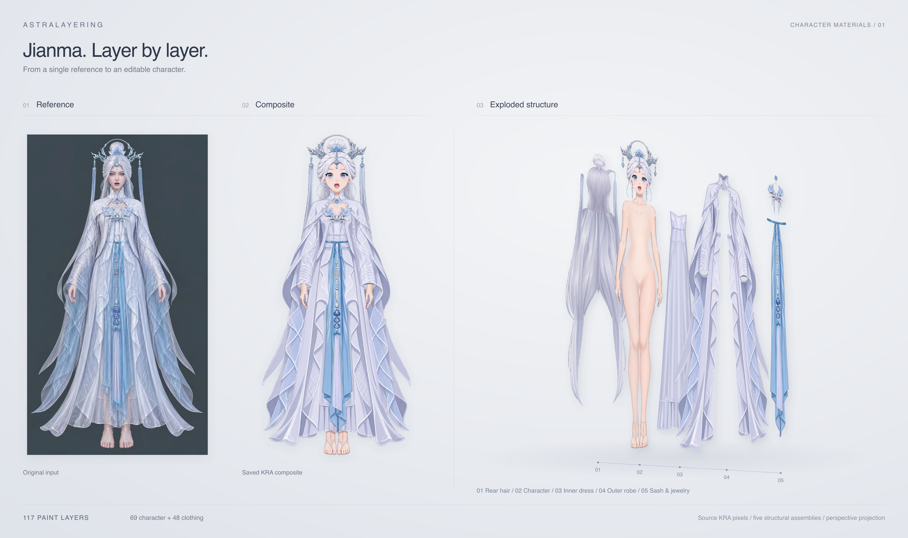

# Jianma：人物、衣服分层与阴影

本案例使用 `ice-fairy-20261102` 的完整成果替换此前 Jianma 归档：标准化参考、人物与衣服分件、人物栅格绘制、穿戴组装和 mask 阴影。画布为 **941 × 1672**；组装工程包含 69 个人物绘画分片和 48 个衣服绘画分片。素材用于后续 Live2D 绑定，不包含动态绑定。

| 阶段 | 成果 |
| --- | --- |
| 参考与人物分件 | [输入图](input/original.png) · [人物色块](part-layering/preview.svg) · [分组](part-layering/groups.json) · [深度](part-layering/occlusion.json) |
| 人物分层与补全 | [KRA](raster-layering/step01/character-depth.kra) · [报告](raster-layering/step01/report.md) · [两轮审核与修复](raster-layering/step01/review-01.md) |
| 人物边缘精修 | [KRA](raster-layering/step02/character-soft-edges.kra) · [PNG](raster-layering/step02/character-soft-edges.png) · [报告](raster-layering/step02/report.md) |
| 换装素体 | [KRA](raster-layering/step03/character-dressup-base.kra) · [报告](raster-layering/step03/report.md) |
| 衣服分件与绘制 | [色块](clothing-part-layering/preview.svg) · [衣服 KRA](clothing-raster-layering/step02/clothing-soft-edges.kra) · [报告](clothing-raster-layering/step02/report.md) |
| 穿戴组装 | [KRA](character-assembly/step01/character-assembled.kra) · [PNG](character-assembly/step01/character-assembled.png) · [报告](character-assembly/step01/report.md) |
| 阴影成品 | [KRA](shadow/step01_mask/character-shadowed.kra) · [透明 PNG](shadow/step01_mask/character-shadowed.png) · [报告](shadow/step01_mask/report.md) |

人物 step01、step02 为清理旧工程后重新制作的版本；step03、组装及阴影随后完成。衣服分层沿用本任务此前完成的结果。用户已确认观察视角左手的一处局部缺陷可以接受；局部画风与参考仍有差异，具体检查记录见各步骤报告。

本目录按工作流导出：`run.json` 标记为只读归档，不包含模型会话或凭据；`manifest.json` 记录文件哈希及导出时发现的历史引用警告。正式 KRA 可继续在 Krita 中编辑，续跑制作须使用原任务目录。
