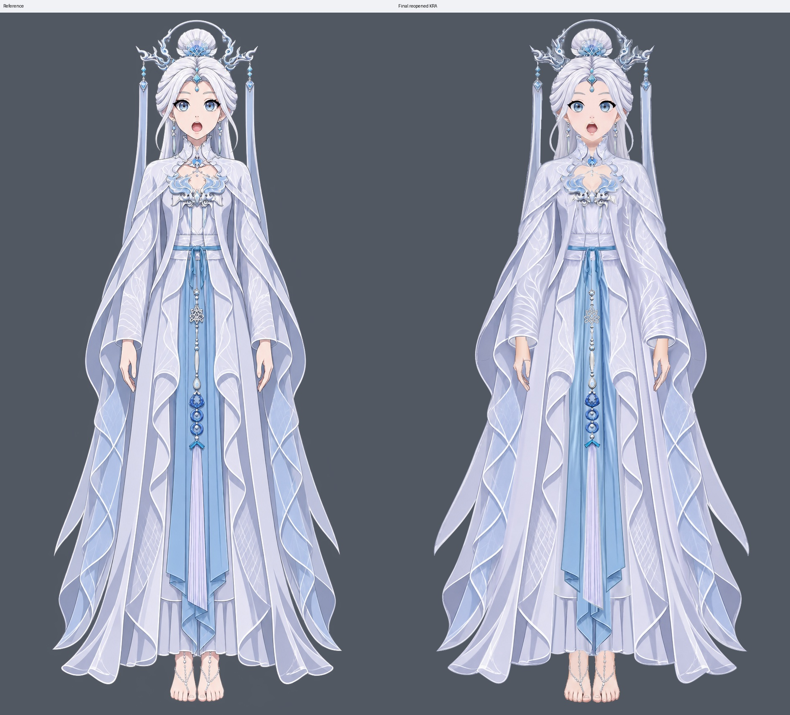
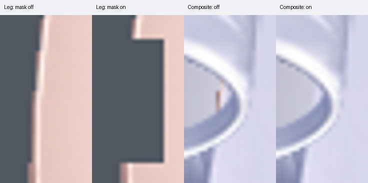
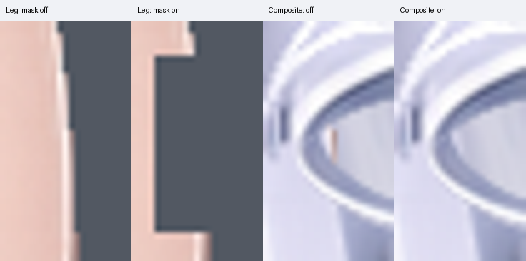
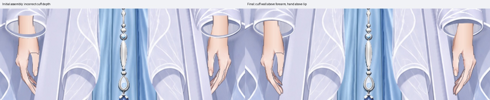
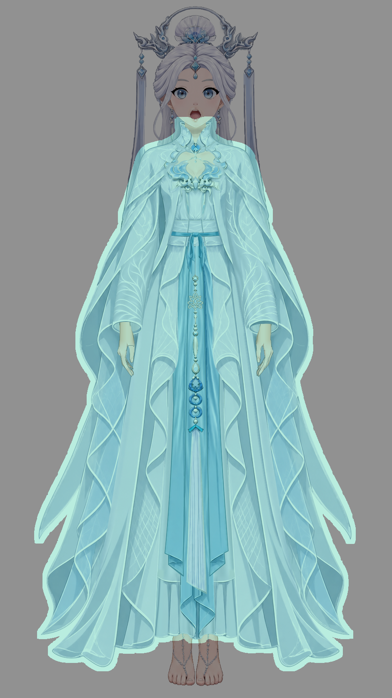

# 人物与衣装组装报告

交付：[分层 KRA](character-assembled.kra) · [透明合成 PNG](character-assembled.png) · [重开后导出的 ORA](character-assembled.ora)。画布保持 **941 × 1672**，参考图未移动或缩放，两份输入 KRA 未覆盖。

## 配准与穿插

先对整套衣装作名义 **0.96 倍等比缩放**，像素取整为 903 × 1605，再整体平移 **(+17, +124) px** 到人物原画布。以领口、腰结、双袖口及内外裙摆共同确认位置；没有将原始同尺寸画布当作已配准。衣装内部各衣片共同变换，随后仅将屏幕左、右整组袖片分别向内平移 5 px。

| 核对位置 | 处理与结果 |
| --- | --- |
| 衣领与脖子、肩披与肩根 | 后领位于脖子之后，前领、肩披位于人体之前；脸、侧发和耳饰保留人物原有前层。颈部及胸口正常露肤保留。此衣装没有独立肩带。 |
| 双袖口、腋下与腕部 | 首次合成中，后侧袖口布壁被前臂遮住，前包边横穿手腕。独显确认既有袖片完整后，将 042/043 后壁置于前臂之上、050/051 前片之下，手部整套原分片置于袖片之上。长垂布后片仍在手臂后方。未新增布片或重画袖孔。 |
| 衣身两侧、胸饰下缘 | 肩披、袖根、袍身和内衣身保持重叠；未见组装导致的侧面漏肤或腋下断口。胸饰下缘极少量混色属于原衣片抗锯齿/透明度，不扩写为新的皮肤开口。 |
| 腰线、腰结与蓝长幅 | 腰结约在 y554–571，腰带覆盖衣身和裙根；蓝长幅及挂饰根保持原有前后分片和连接。未分别拉伸衣片来追参考。 |
| 裙摆与肢体接头 | 内裙落至约 y1533、外袍至 y1600，脚踝与足部按参考正常外露。袖孔内侧两处不应露出的腿缘用下述遮罩处理；手腕、手指、腿足连接沿用人物层。 |

## 局部遮罩与独显确认

新增 **2 个 Krita 原生透明度遮罩**，均名为 `assembly | thigh edge behind opaque sleeve cuff`，默认启用：

- `人物 | 009 | legs/leg_right/leg | complete`：仅收住原画布 `[328,770,15,31]` 内的外缘。
- `人物 | 010 | legs/leg_left/leg | complete`：对应范围 `[596,770,15,31]`。

这两处是腿层从袖孔内侧多余露出，不是手腕或薄纱透肤。已先独显腿层，再开关遮罩并回到完整合成确认；关闭可恢复全部原腿缘。两遮罩在合成中共影响 55 个像素（含极弱混色），未裁掉正常露肤。[影响范围记录](evidence/mask-delta-verification.json)。

原人物 18 个遮罩保留，眼口、耳部、发根及肢体衔接功能不变；衣服原有 `waist opening | hide completed suspension root` 遮罩随整套衣装变换，继续隐藏腰口的补全悬线短根。原遮罩曾临时关闭核对并全部恢复启用。[原腕部遮罩开关对照](evidence/original-mask-toggle.jpg)。没有为袖口另加手臂遮罩，正确层序已解决该问题。

[既有前臂、后壁、前袖片独显](evidence/cuff-source-pieces.jpg) · [参考与最终袖口](evidence/cuffs-final.jpg)

## 部件检测与候选判断

首次合成保存 `workspace/initial.kra` 后，以 Krita 导出的同画布 PNG、ORA 检测；最终另存、关闭重开交付 KRA 后，重新导出 PNG、ORA，按**同样七个父部件路径**复查：

`clothing:collar_shoulder_cape`、`clothing:sleeve_screen_left`、`clothing:sleeve_screen_right`、`clothing:outer_robe_body`、`clothing:inner_long_dress`、`clothing:waist_sash_and_knot`、`clothing:central_blue_drapery`。

检测采用导出衣片的实际覆盖范围及默认 8 px 周边，未手写坐标缩小范围。所有候选按领肩、衣身腰部、双袖、下半衣装和裙足接缝分区，对照相同画布坐标判断；计数与色差不作为验收分数。

| 候选范围与对照 | 判断、修复或保留理由 |
| --- | --- |
| 领肩，含最终 color `[408,279,129,68]`、`[421,330,99,54]` | [领肩局部](evidence/neck-shoulders-final.jpg)：领颈穿插已连贯；肤色、领饰高光和细边笔触来自上游，保留。 |
| 双袖、腋下及手腕 | [中段同坐标图](evidence/review-middle.jpg)：包边穿腕和高位露臂通过层序修复；两处腿缘通过遮罩修复。候选框未单独圈出的小露肤也通过人体显隐核对补查。 |
| 衣身、腰线与中央长幅，含 color `[451,564,67,558]` | [上段](evidence/review-upper.jpg) · [腰部局部](evidence/waist-final.jpg)：连接闭合；衣褶、蓝布明暗及挂饰细节差异保留。 |
| 两侧垂布，含大块 extra `[93,530,200,762]`、`[617,388,227,905]` 及下端 missing/extra | [下段同坐标图](evidence/review-lower.jpg)：原衣片外轮廓较参考更外展，卷折、霜枝和补全区域也不同。中央锚点和袖口已配准，这些边缘没有造成穿戴缺口；保留上游衣片轮廓，不逐框削掉衣料。 |
| 袍摆、内裙与脚踝，含 missing `[327,1523,89,34]`、`[523,1523,92,33]` | [裙足同坐标图](evidence/review-bottom.jpg) · [裙摆局部](evidence/hem-final.jpg)：对应原褶缘及下摆弧度差异，裙足遮挡正常，无新断口；保留。 |

[首次范围预览](evidence/diagnostic-initial/scope-preview.png) · [首次编号诊断图](evidence/diagnostic-initial/marked.png) · [首次候选 JSON](evidence/diagnostic-initial/differences.json)

[最终编号诊断图](evidence/diagnostic-final/marked.png) · [最终热图](evidence/diagnostic-final/heatmap.png) · [最终原尺寸诊断对照](evidence/diagnostic-final/comparison.png) · [最终候选 JSON](evidence/diagnostic-final/differences.json)

## 保留的上游差异与保存核对

保留人物原有发色、细发丝、脸手及足部笔触、描边和明暗；衣服的霜枝疏密、银饰高光、蓝布褶面、袖孔弧度、垂布外展轮廓与参考仍有差异。本次没有为消除颜色候选重画这些外观，也未将参考整块贴入任何部件。

最终保留 **117 个绘画分片、5 个原有控制组、21 个透明度遮罩**；没有拆分、合并或新增绘画层。顶层增加人物/衣服归属名称前缀以便识别穿插；三个蓝布后腰根的小数编号前缀规范为整数，保留其原腰根注释、层序和像素，确保部件检测包含这些深度分片。[名称对应](evidence/name-normalization.json)。人物 69 个绘画分片原始像素及 18 个旧遮罩与输入一致；衣服 48 个绘画分片与统一缩放后的输入一致，后续只作平移与层序调整。[原层保留核对](evidence/input-layer-preservation.json)。

交付 KRA 已关闭重开，逐节点名称、UUID、层序、父级、显隐、不透明度、混合模式、遮罩及原始像素与保存前一致。PNG 与 ORA 均取自这次重开的工程；PNG 为 RGBA，背景透明。再次目视核对整体与上述接缝，未见仍需处理的明显组装错位、额外漏肤或不自然穿插。[重开记录](evidence/reopen-verification.json) · [交付及配准清单](evidence/delivery-manifest.json)。
