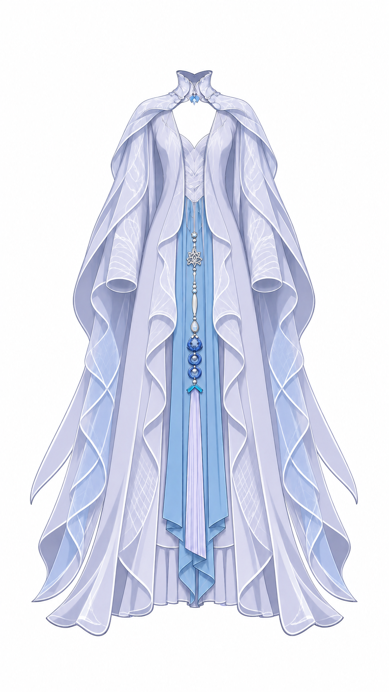

# outer_robe_body 补全辅助参考与检查

使用内置 image_gen 工具生成同正面姿态显露参考，输入为完整纯衣服参考。源稿与初始草稿一致，原有两条路径全部保留；只新增四条闭合路径，置于原路径下。



## 衣料职责与补全

左右分别为开襟外袍躯干、宽包边、连续波浪翻襟及落地裙摆。两片各自完整，中央开襟持续透明，不跨胸腹连接，不含人体、袖体、肩披、内裙、蓝色长垂布或饰件。未发现需要用新增路径修饰的明确源稿归属错误。

1. 左上端约 x365–435、y264–359；右上端约 x508–575、y264–359。顺辅助图肩部袍身方向，从现有 x377/563、y333 的端点延入肩披与胸饰后。只恢复当前正面能被覆盖的上胸侧衣料；开口侧止于两条独立内缘，不连领子、不占胸前镂空。
2. 左前襟腰根约 x399–445、y472–493；右约 x496–542、y472–493。沿源稿 y482 的可见起点向上留约 10 像素圆滑搭接，藏于内裙宽腰部衣料下缘之后。保留上袍襟内缘至下前襟根之间的真实分界，不将原图 x402–443 / x498–539 的腰侧区域填成袍身。横腰带遮住的侧袍衣料在源稿已连续，无须另铺大块隐藏布。

两侧袍身在相应胸腹、腿侧和内裙两侧之前；袍身肩根在肩披、胸饰及袖根覆盖区域之后。腰根的新增薄搭接在内裙宽腰区 y472–484 后，腰带及结在其前，y484 以下的袍襟及翻卷区域在内裙前，并可盖住中央蓝色长垂布的侧缘。该腰口局部插叠须下传至子节点并用于多深度区域规划，无须另建服装背视图。可见卷起内缘与下摆为同侧袍片自遮叠，仍共同随动。

上端随胸肩与同侧袍身，腰根随腰和同侧长前襟；下摆保留同侧独立摆动、弯曲控制。不把袖体随臂或肩披控制并入当前衣片。图中薄纱和袖口仍各归邻组，未填入本片。

## 对照结论

先查看源稿独显与原图 blend/edge，确认主要形体、宽度及两侧归属。生成后查看整图与上胸局部；辅助图支持袍身向肩披下独立上延，但改动了可见腰身内缘，因此不采纳其重新设计的腰线，以原图接缝和原 SVG 为锚。

最终草稿已按生成图 referenceRegion=[112,264,720,1271] 做同姿态整体 edge 对照（无 referenceOffset），检查主体尺度、肩根走向及长摆共有外缘；随后用原图全幅与上胸腰口三倍 blend 检查定位，并完成全幅与局部三倍 SVG 独显。左右仍各自连续，中央开口保留，新增段无跨层串连。生成图局部内缘偏移已作为辅助图局限记录，不据此重画可靠可见边缘。

## 最终生图提示词

```text
Use case: precise-object-edit. Create one structural clothing reference of the SAME ice-fairy outfit, same straight frontal posture, same proportions and full-length composition, on plain white background. Input image is the complete outfit to preserve. This is a de-occlusion study for ONLY the left and right open-front OUTER ROBE BODY: the two long pale lavender robe panels running from the sides of the upper chest to the floor, including their broad edging and curled wavy inner lapels and spreading hems. Keep them as two separate open-front panels, preserve the large central opening and visible blue hanging cloth and inner dress. Preserve existing robe silhouette, widths, folds, material, color and illustration style precisely. Reveal the small hidden upper attachment of each robe panel under the chest ornaments and shoulder cape, and reveal their smooth inner edges at the waist under the belt. To do this, temporarily remove the ornate blue-silver chest clasps and the horizontal waist belt, and lift back only the small overlapping edge of the shoulder cape enough to expose the upper ends of the robe panels. Retain the collar, shoulders, sleeve bodies and sleeve openings, long side cape drapes, blue central hanging cloth and inner skirt in their original arrangement, so the whole garment context remains clear. The robe upper ends should naturally continue to the shoulders under the cape, with a real open neckline between them. Do not invent a cloth bridge across the chest or abdomen, do not merge sleeves or cape into the robe, do not add body/skin/mannequin, do not turn to a back view. Full outfit with generous margins and no labels, no text.
```
