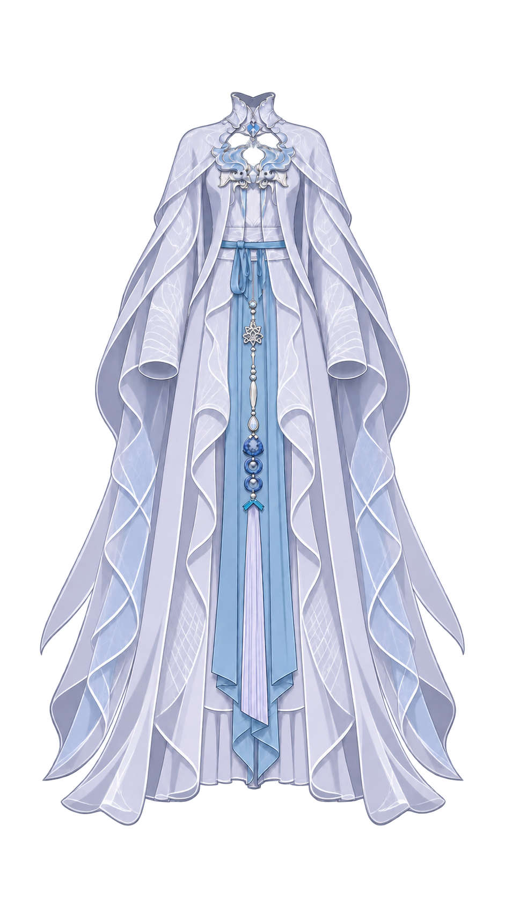

# 结构辅助图记录

使用内置 image_gen.imagegen，输入为完整 clothing.png。

第一版额外新增的大环无原图依据，弃用；仅对照仍保留的原短环局部（450,451,20,74）。第二版把短环拉长，完全弃用。生成图未可靠显露全部带根，不据此扩大隐藏结构。最终仅依据原图可见切向、中央结覆盖范围及既定 note 增加极小圆滑带根搭接。

最终实际使用的参考生成提示词：

Use case: precise-object-edit. Structural reference for garment layering. Input image is the complete costume edit target. Keep the full outfit in the same straight-on front view, same silhouette, scale, placement, style, pale lilac and blue silk materials and all reliable visible details. At waist center, reveal the attachment of the character's RIGHT short folded ribbon loop (viewer LEFT, original coordinates approximately x452–469 y453–523 on a 941x1672 canvas). This is the narrow folded blue cloth strip next to the central knot, not the much longer pointed tail behind it and not the floor length sash. Lift/remove ONLY the small central blue knot cover so the short loop's upper cloth root can be seen continuing a few pixels beneath it, rounded and smoothly tucked inward. Preserve the short loop's existing overall width, hanging length, folded lower return and adjacent short tails, horizontal waist belt and long skirt sash. Show its full narrow folded cloth unit in context of the entire costume. Do not create a large bow, do not spread or enlarge the loop, do not add open holes, body or skin. Full costume framing, no inset, no labels. Transparent background.
