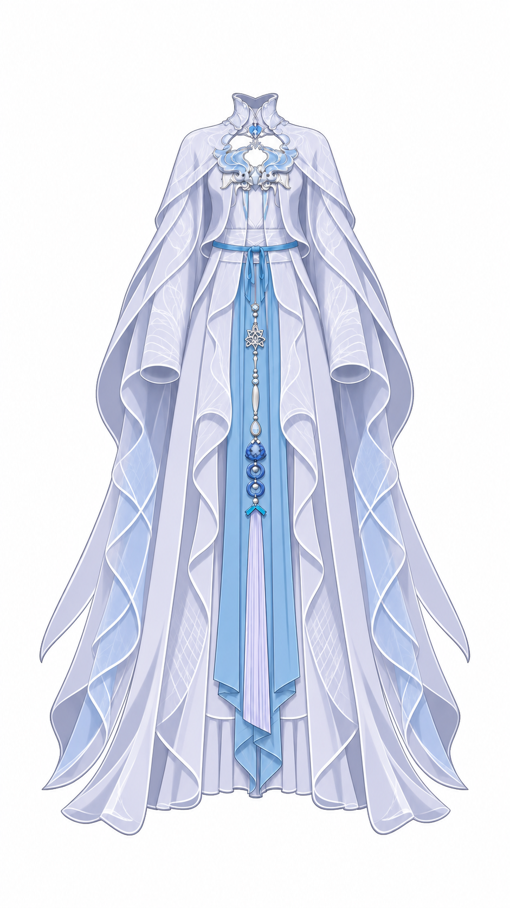

# 腰带结构辅助图

使用内置 image_gen，根据完整衣装参考生成同姿态结构辅助。该图仅用于核对隐藏料走向，不替代原图可见边缘。

本轮无需新增：源稿已含连续横段、中央结后衣料与左右前襟下搭接。已完成生成图 edge 对照、原图 blend 定位、SVG 独显和父范围检查。生成图保留了中央结且弧度略深，未据此修改源稿；具体职责和限制已写入提交 note。

## 完整生成提示词

Use case: precise-object-edit. Asset type: structural clothing reference for Live2D hidden material verification. Edit the supplied complete costume reference, keep the full outfit in the same straight-on frontal pose, same proportions, framing, ice-blue white fantasy outfit, style and materials, on plain white background, no human body. Target is ONLY the narrow blue horizontal waist belt at approximately x412–532 y448–461 on original 941x1672 canvas. Show that same narrow horizontal belt continuously across the waist, revealing its short left and right side continuations beneath the white outer front lapel edges to approximately x388 and x556. The belt is about 10 original pixels thick, gently curves downward at center and upwards toward sides. Locally lift aside only the small white lapel edges hiding the belt and remove the central knot only at belt level, so the full belt strip and rounded side turning portions are visible. Retain the short loops and tails and the long blue skirt cloth below as contextual neighboring parts, unchanged outside the small waist area. The belt is one narrow snug band over the waist bodice, NOT a wide sash, no new straps, no extra holes, no skin. Maintain all other reliable visible costume shapes. Output one full-outfit front view, no insets, labels or diagrams.
