结论：已修复

# repair-01 逐项处理记录

依据 [review-01.md](review-01.md) 处理9类、11个具体返修框；同时修正三视图中发现的矩形腰带色差、隐藏横缝台阶、蓝尾线头及后片游离细边。全部项目经单层、隐藏上层和整图自检通过。

交付：[当前KRA](clothing-depth.kra)、[透明合成PNG](clothing-assembled.png)、[更新后的绘画报告](report.md)。本文件仅写 repair-01.md.tmp，未写正式repair报告。

| 问题 | 涉及实际绘画层 | 处理与自检结果 |
| --- | --- | --- |
| R1 | 10.1/10.2/10.3、11、20/21/22 | 已修复。三片蓝布完整腰根分到011后方；前幅仍保持原20/21/22深度，中央结下淡紫腰面恢复。未继续裁短100悬线。 |
| R2 | 011；085保留 | 已修复。去掉点阵纹、两条饰件长条残痕和碎亮线，连续重画淡紫衣面、纵褶及宽霜纹；085本身不改，合显只保留一套饰件边。 |
| R3 | 042/050、040/060 | 已修复。左袖筒去斜拼与暗楔，霜枝线重画为连续同粗细。垂布内侧补料归040筒后，060仅保留真实前翻面和自身白边。 |
| R4 | 043/051、041/061 | 已修复。右袖筒独立修画，去斜边、竖片与硬折角；筒后续料归041，肩下外侧前翻延续留在061，隐藏上层时不留下游离边。 |
| R5a | 051，邻接061 | 已修复。本筒外侧衣料在约x679–689、y651–690窄量延续，闭合侧缝。浅、深、红底检查不透空；正常椭圆孔保持透明。 |
| R5b | 051、041 | 已修复。051内侧收口改为平顺曲线；041续料根从约(609,677)进入筒后，去掉y702水平亮色顶盖，同材质向下连续延伸。 |
| R6a | 10.2/021 | 已修复。画面右蓝长幅全宽重建连续纵向褶面，去平色硬界和三角接片，合格下段、斜尖与短回折保留。 |
| R6b | 10.3/022 | 已修复。画面左蓝长幅独立补画连续纵褶与横截面明暗，去另一处平色贴片；保留本侧长度、自由边及回折。 |
| R7 | 002/010 | 已修复。恢复可见深紫褶线、横缝和白色下包边；隐藏横缝接到同一约y1321曲线，清除恢复边界误带的蓝尾线头，完整裙面不留窄条贴片台阶。 |
| R8 | 118 | 已修复。恢复顶珠暗部、蓝帽、深蓝外轮廓与下侧自身明暗，去浅色宽晕；穗束、全长和末斜边保留。 |
| R9 | 003/025、101/102/103/104 | 已修复。恢复横带深蓝上下边、短尾窄边与折面、短环根部明暗；结后及后绕段使用本片蓝带横截面连续延续，无矩形拼贴。 |

## 三视图证据

以下每图依次为参考、本片全深度独显、保留下层并隐藏上层、整图。原尺寸PNG来自当前实际KRA，未移动参考去贴合当前。

### R1

三片蓝布完整腰根分到011后方；前幅仍保持原20/21/22深度，中央结下淡紫腰面恢复。未继续裁短100悬线。

### R2

去掉点阵纹、两条饰件长条残痕和碎亮线，连续重画淡紫衣面、纵褶及宽霜纹；085本身不改，合显只保留一套饰件边。

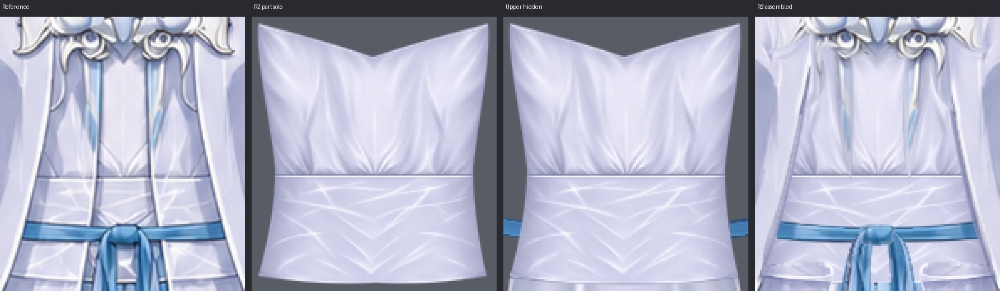

### R3

左袖筒去斜拼与暗楔，霜枝线重画为连续同粗细。垂布内侧补料归040筒后，060仅保留真实前翻面和自身白边。

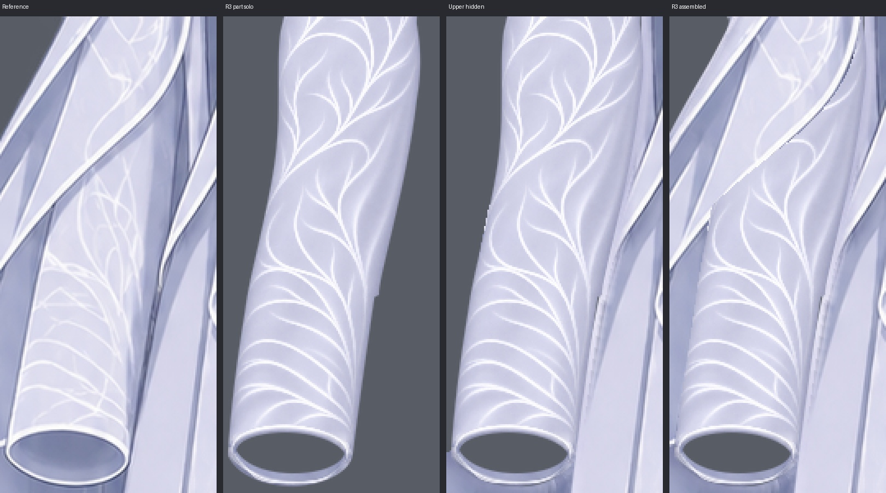

### R4

右袖筒独立修画，去斜边、竖片与硬折角；筒后续料归041，肩下外侧前翻延续留在061，隐藏上层时不留下游离边。

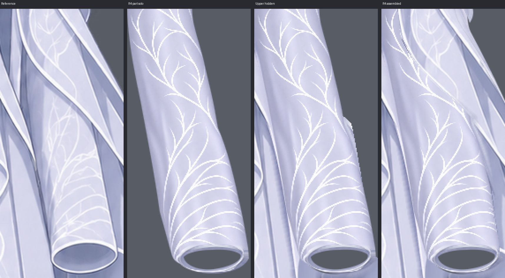

### R5a

本筒外侧衣料在约x679–689、y651–690窄量延续，闭合侧缝。浅、深、红底检查不透空；正常椭圆孔保持透明。

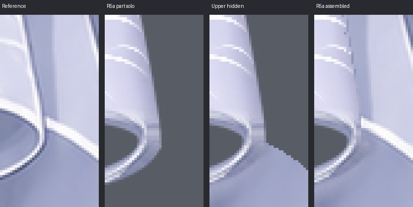

### R5b

051内侧收口改为平顺曲线；041续料根从约(609,677)进入筒后，去掉y702水平亮色顶盖，同材质向下连续延伸。

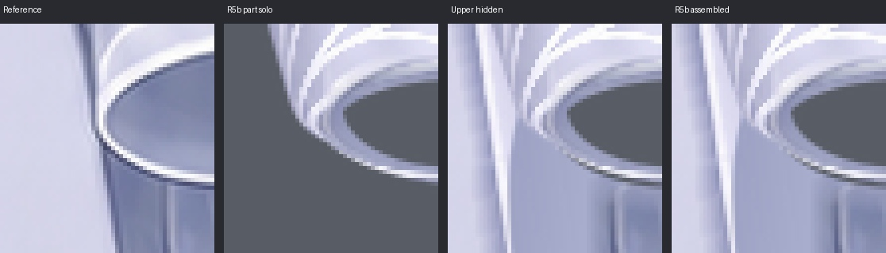

### R6a

画面右蓝长幅全宽重建连续纵向褶面，去平色硬界和三角接片，合格下段、斜尖与短回折保留。

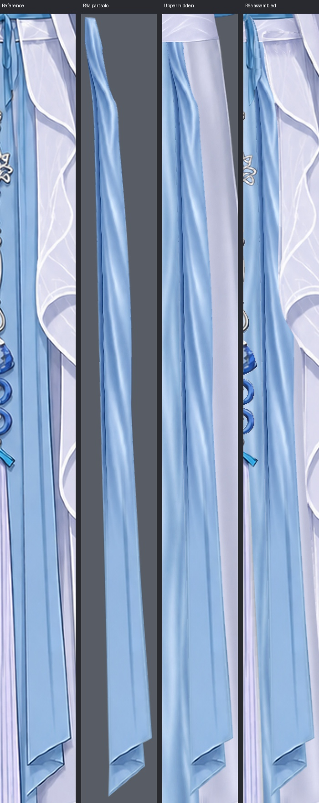

### R6b

画面左蓝长幅独立补画连续纵褶与横截面明暗，去另一处平色贴片；保留本侧长度、自由边及回折。

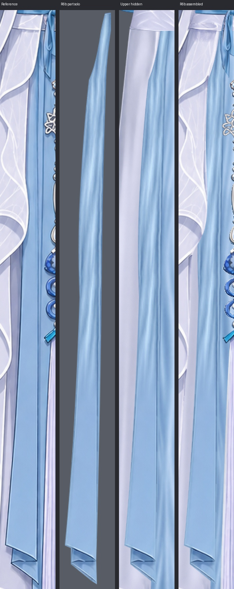

### R7

恢复可见深紫褶线、横缝和白色下包边；隐藏横缝接到同一约y1321曲线，清除恢复边界误带的蓝尾线头，完整裙面不留窄条贴片台阶。

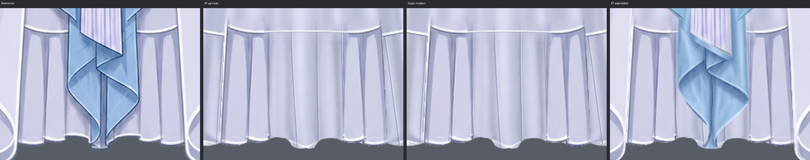

### R8

恢复顶珠暗部、蓝帽、深蓝外轮廓与下侧自身明暗，去浅色宽晕；穗束、全长和末斜边保留。

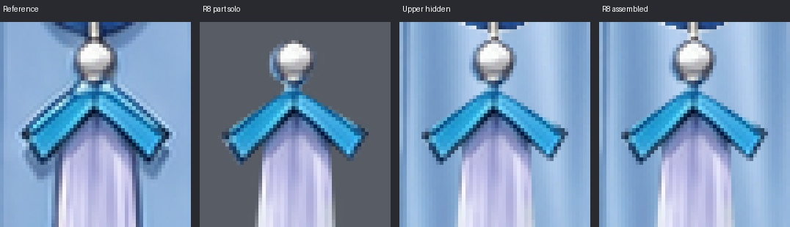

### R9

恢复横带深蓝上下边、短尾窄边与折面、短环根部明暗；结后及后绕段使用本片蓝带横截面连续延续，无矩形拼贴。

袖垂布邻接及后续料另查：

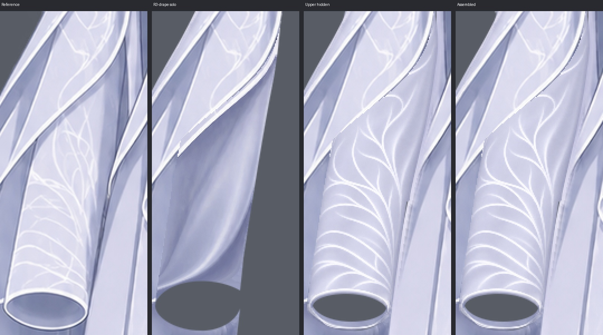

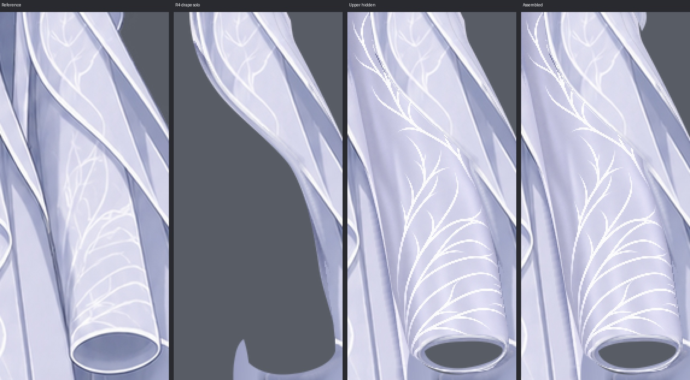

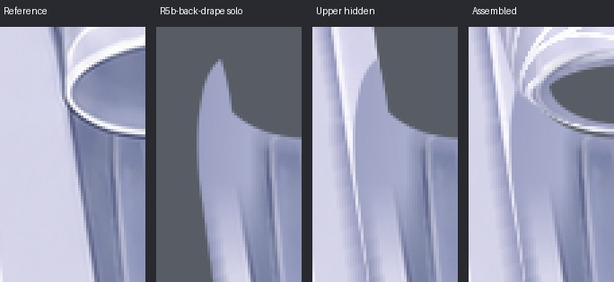

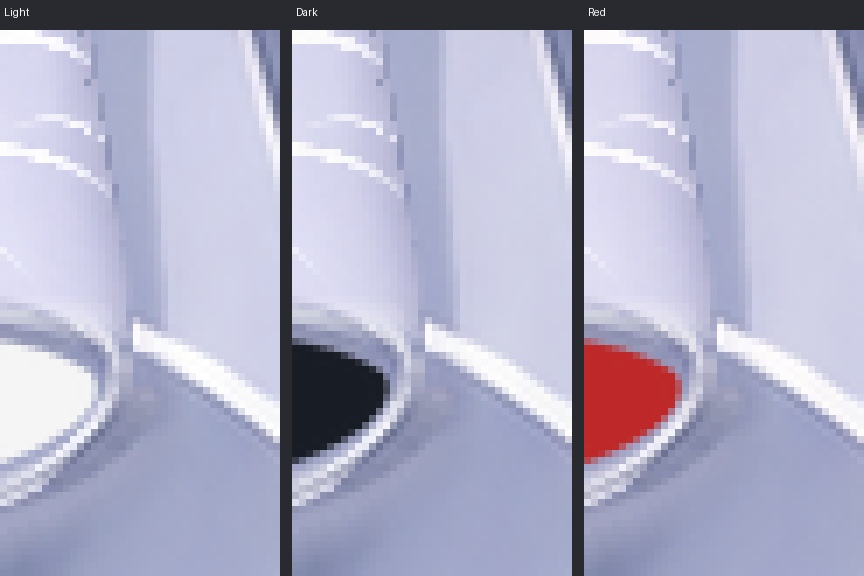

R9的每条短带分别独显、隐藏上层及全显核对：

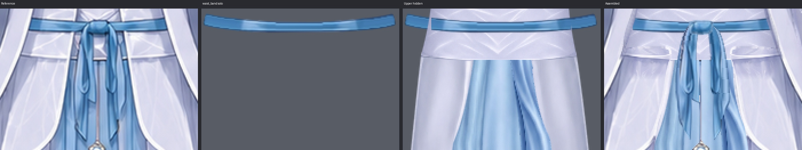

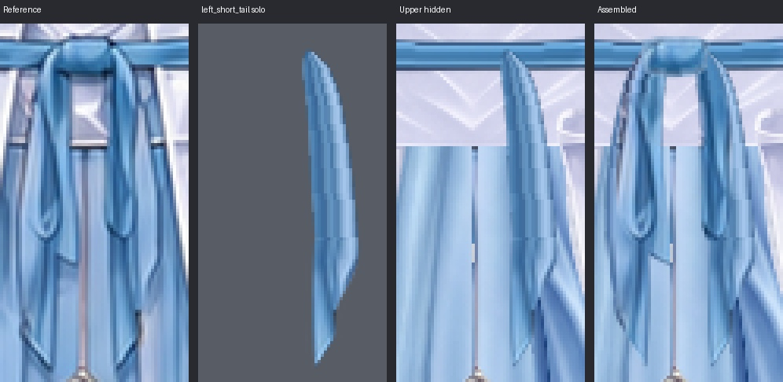

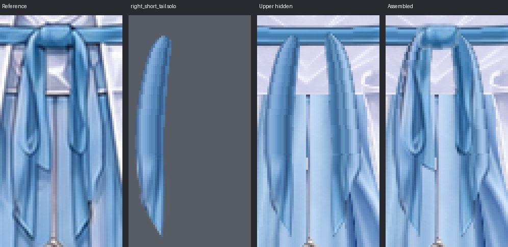

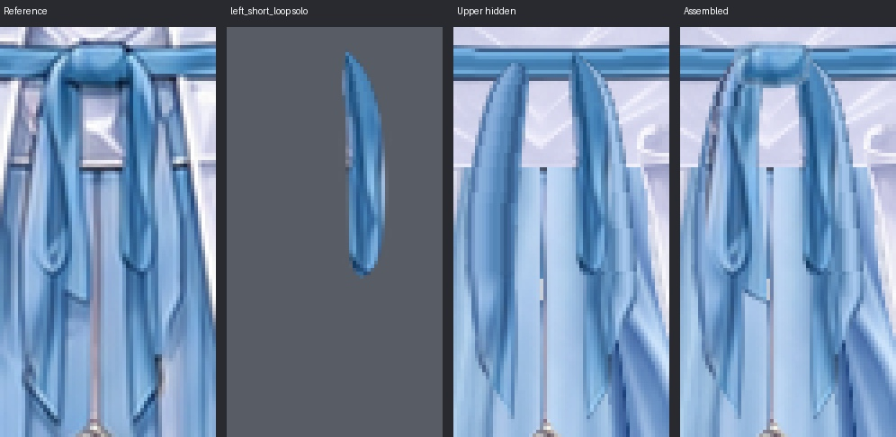

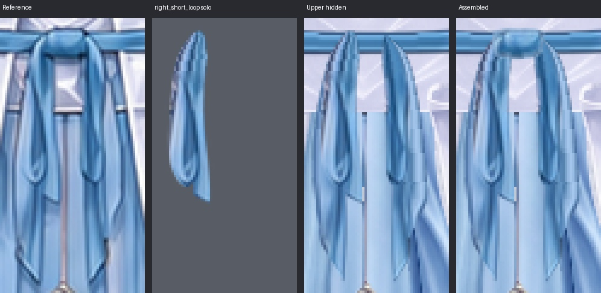

## 层级、归属与原生蒙版

逻辑part仍37个、groups归属与ID不变。三片蓝布分别增加10.1、10.2、10.3完整后根分片，原20/21/22保持前幅和原UUID；当前48个普通绘画层及11个多深度part与上游occlusion.json逐项一致。040/060、041/061仅重新分配同片筒后续料和前翻面，已拆开的前后身份全部保留。右口内外侧必要的SVG修正同步于当前叶轮廓和相应父轮廓，修改依据及48层完整UUID映射见 [绘画报告](report.md)。

100层原生蒙版 `waist opening \| hide completed suspension root` / UUID `{0e97c101-ee19-4c87-8fa6-41749a295fac}` 附在 `100 \| waist_pendant_and_tassel/upper_suspension` / UUID `{f44f66dc-eedc-40f8-9a23-c0877cfa04e6}`。其控制范围、像素和默认启用状态与初绘一致。开/关证明完整根仍在，R1由衣身自然遮挡蓝根解决，未借蒙版继续裁短悬线。

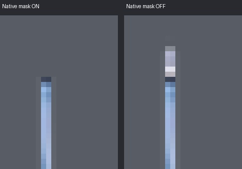

## 完整性与保存重开

37个完整衣片、48个实际分片、48个隐藏上层画面均从实际文档导出并检查；修改的15个逻辑part已逐项检查，24个未返修绘画层保留原像素。胸前、袖口、环孔和纱料透明区域未填入人体或其他衣片内容。没有新增投影、AO或相邻衣物染色层。

[全衣片1](repair-evidence/repair01/parts-01.jpg) · [2](repair-evidence/repair01/parts-02.jpg) · [3](repair-evidence/repair01/parts-03.jpg) · [4](repair-evidence/repair01/parts-04.jpg) · [5](repair-evidence/repair01/parts-05.jpg) · [返修实际分片1](repair-evidence/repair01/changed-slices-01.jpg) · [2](repair-evidence/repair01/changed-slices-02.jpg)。

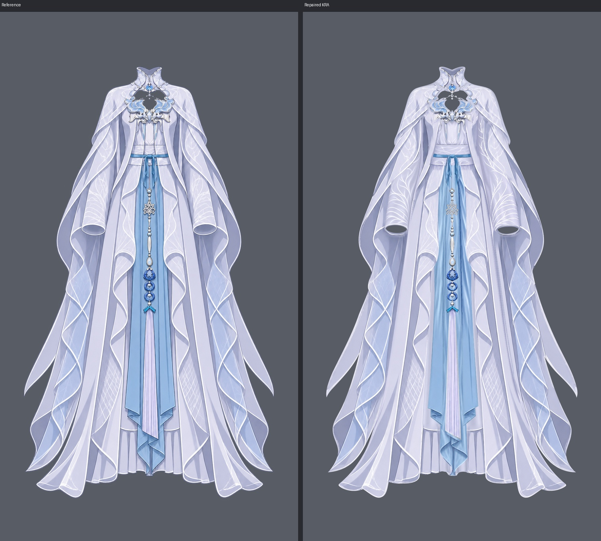

最终KRA已保存、关闭并重新打开。48个绘画层的全画布像素、顺序、名称、UUID、显隐和不透明度一致；唯一原生蒙版的像素、附着关系、UUID和启用状态一致；整图投影像素完全一致。45个原层UUID保留，24个未返修层名称及绘画像素保持原值。

[重开检查：passed=true](repair-evidence/repair01/reopen_check.json) · [结构检查](repair-evidence/repair01/structure_check.json) · [未返修层保护](repair-evidence/repair01/protected_check.json)。保存过程中曾出现桥接QProgressDialog失败标记，但保存函数返回true；最终关闭重开工具明确返回成功，逐层、蒙版及投影字节核对通过，确认不是仅内存修改。

本轮最终提示词、生成原件与当前完整衣片复用来源见 [提示词记录](workspace/repair01/generation-prompts.md) 和绘画报告来源表。验收没有使用PSNR等分数。

未解决问题：无。
