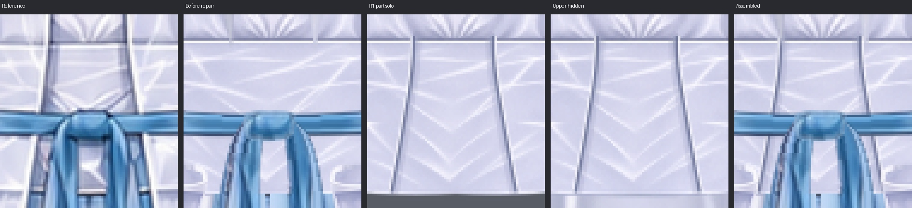
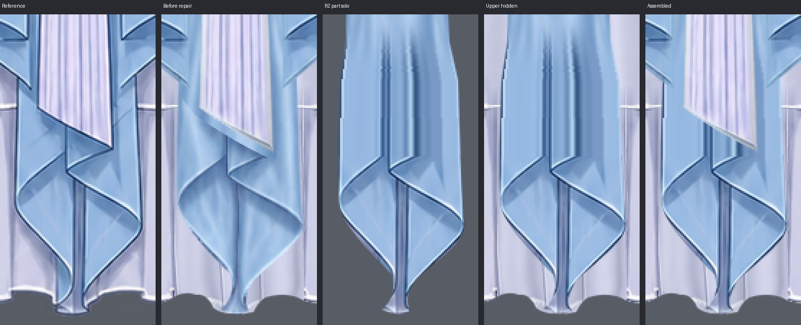
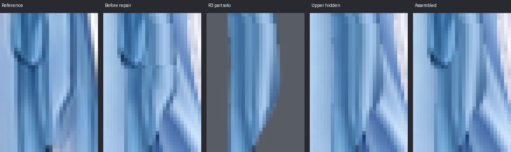
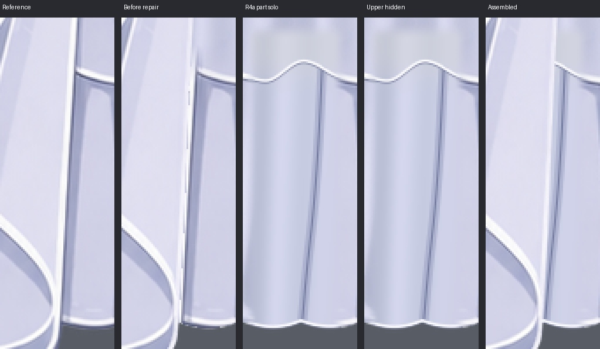
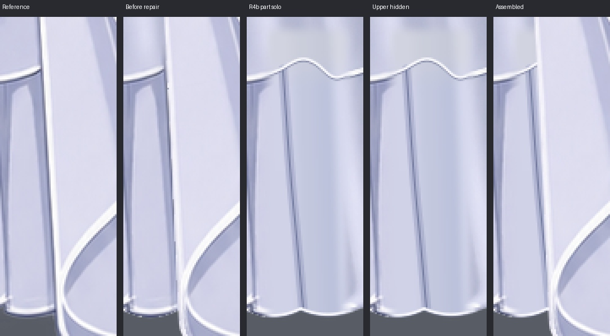
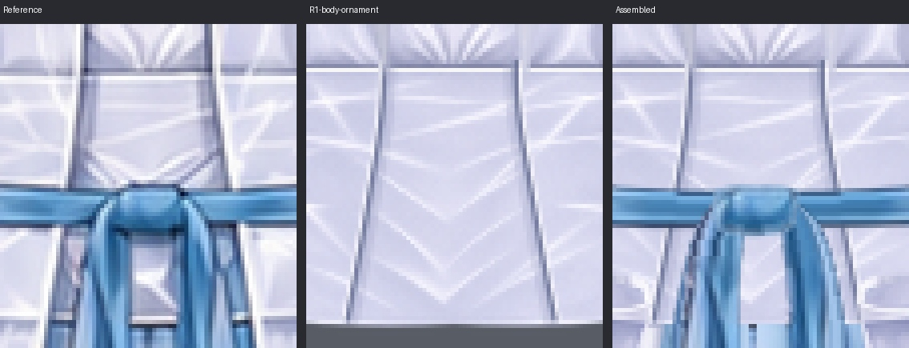
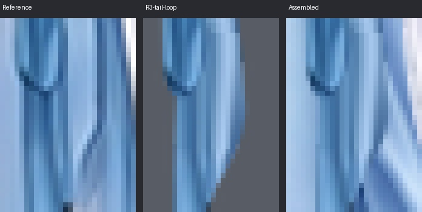
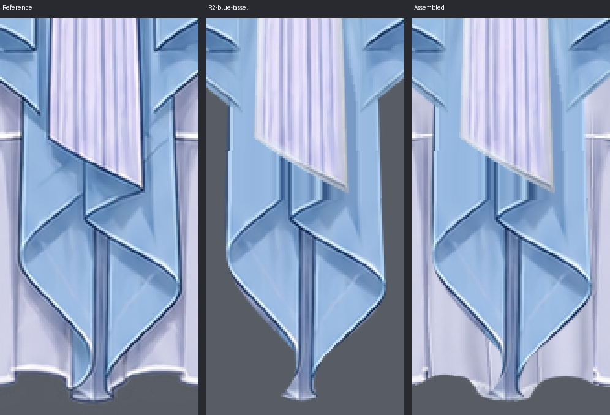
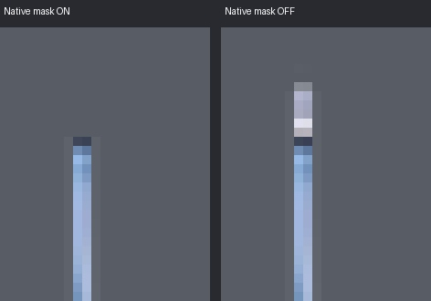
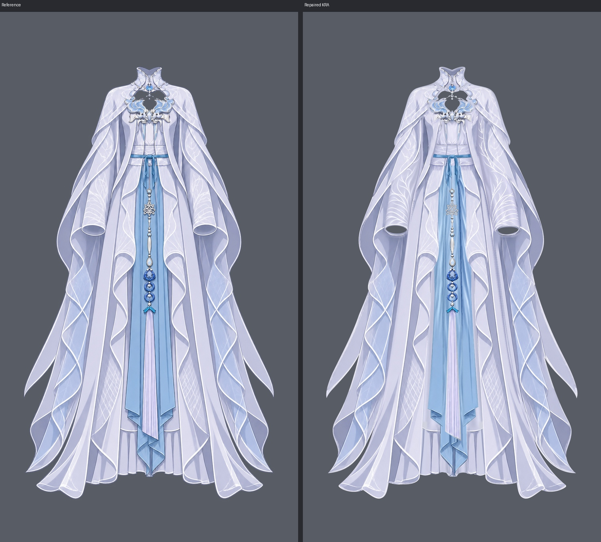

结论：已修复

# repair-02逐项处理记录

依据 [review-02.md](../../clothing-raster-layering/step01/review-02.md) 修复4类、5个具体位置：R1、R2、R3、R4a、R4b。本轮编号独立于review-01。全部位置已完成单层、隐藏上层、整图和必要邻接合显自检。

交付：[当前KRA](../../clothing-raster-layering/step01/clothing-depth.kra)、[透明验收PNG](clothing-assembled.png)、[更新后的绘画报告](../../clothing-raster-layering/step01/report.md)。本文件仅写repair-02.md.tmp，未自行写正式repair报告。

## 逐项结果

### R1：已修复

实际part：`inner_long_dress/bodice_and_waist`；图层 `011 \| inner_long_dress/bodice_and_waist`，UUID `{e49d9e03-ca99-444a-99ac-041e59dfb80b}`，深度 `11`。范围：约x445–499、y419.5–484。

在011恢复两条真实腰面分区线、窄亮边及紧邻衣料明暗，按参考的长向弧线进入腰带和短环后方。只画衣身结构，未延长085，也未贴回点阵、碎线或饰件残痕。

### R2：已修复

实际part：`central_blue_drapery/central_folded_tail`；图层 `020 \| central_blue_drapery/central_folded_tail \| front`，UUID `{b578d36e-4025-47d6-9587-ff6a0a52b4f0}`，深度 `20`。范围：y1260–1467；可见折返重点y1298以下。

恢复本片深蓝长竖折线、斜折边、窄亮边和下端折面。复用参考中无遮挡的本片下段线描（y1356以下），向上按同片横截面纵向延续，并在y1260–1298接入原长布；没有沿流苏斜端制造贴片界。010.1完整腰根和118未改。

### R3：已修复

实际part：`waist_sash_and_knot/left_short_tail`；图层 `101 \| waist_sash_and_knot/left_short_tail`，UUID `{292dee11-7918-45c8-bee9-1b70459251b5}`，深度 `101`。范围：x478–499、实际修画y508–524。

小范围清掉y514横截线，按本短尾的材料坐标将上下纵向高光、暗带和窄边连续接顺。原完整上根、525以下自然斜折、尾长与尖端保留；103独立短环未改。

### R4a：已修复

实际part：`inner_long_dress/long_skirt`；图层 `010 \| inner_long_dress/long_skirt \| front`，UUID `{8d550ac0-4c93-4c99-9c81-c6b710d0b095}`，深度 `10`。范围：左侧x338–395、y1288–1471内的衣料。

清掉整条窄条复制边及原横缝台阶，重画同片连续的扇开纵褶面；沿可见横缝向隐藏区画连续曲线，并接回白色下包边。恢复深紫衣褶，不把外袍白边复制进裙面。内侧已合格深褶、完整裙身及002后绕料保留。

### R4b：已修复

实际part：`inner_long_dress/long_skirt`；图层 `010 \| inner_long_dress/long_skirt \| front`，UUID `{8d550ac0-4c93-4c99-9c81-c6b710d0b095}`，深度 `10`。范围：右侧x551–606、y1288–1471内的衣料。

独立修复右侧完整接片边：统一两侧衣料、连通横缝弧度及下包边，去掉底色色界和直亮复制边；保留内侧深褶并以同片曲线褶线接入新画面。没有导入外袍或蓝尾像素。

## 相邻衣片与完整分片复核

R1另看011+085，确认只有真实腰面结构线、胸饰仍为独立原层；R3另看101+103，确认横截线不是靠短环遮住；R2将010.1+020合显，并与21/22及118合显，确认腰根完整、流苏斜端后无新的材质接边；R4a/R4b分别看010、002+010及隐藏外袍后的长接边到下沿。

两侧裙缝修复时发现最初清边后褶线力度不足，已恢复同片深紫褶线，并让它们接入横缝及白下沿；没有把原外袍的直亮复制边贴回裙层。完整裙面材质在接边两侧连续。未再发现其他需要修复的问题。

## 保护与结构结果

只改4个普通绘画层010、011、020、101。其余44层绘画像素、全部48层名称/UUID/层序/显隐/不透明度、所有衣片alpha和唯一原生透明度蒙版均保持原值。002、010.1、085、103、118等相关合格层均未改。正常开口与薄纱透明度保留，不含人体或相邻部件像素，没有新增投影或AO。

本轮无结构变更：37个逻辑part、48个绘画深度、11个多深度part及其控制职责保留。groups、occlusion和parts/中的53个上游文件字节未变；当前KRA与深度表逐项相符。实际48层UUID及复用来源完整映射见绘画报告。

## 蒙版与保存重开

100层原生子蒙版 `waist opening \| hide completed suspension root` / `{0e97c101-ee19-4c87-8fa6-41749a295fac}` 的所属层、控制范围和默认启用状态未变。停用可见完整悬线短根，启用只隐藏腰口内原短段，检查后恢复启用。

已最终保存、关闭并重新打开clothing-depth.kra：48层及蒙版的全画布像素、名称、UUID、顺序、显隐和不透明度一致，整图投影完全一致。重开工具返回passed=true。保存中出现过瞬时QProgressDialog失败标记，已通过实际重开成功及像素一致核实文件写盘完整，无未恢复故障。

[重开检查](../../clothing-raster-layering/step01/repair-evidence/repair02/reopen_check.json) · [结构检查](../../clothing-raster-layering/step01/repair-evidence/repair02/structure_check.json) · [44层与alpha保护检查](../../clothing-raster-layering/step01/repair-evidence/repair02/protected_check.json)。

37个完整衣片图集：[1](repair-evidence/repair02/parts-01.jpg) · [2](repair-evidence/repair02/parts-02.jpg) · [3](repair-evidence/repair02/parts-03.jpg) · [4](repair-evidence/repair02/parts-04.jpg) · [5](repair-evidence/repair02/parts-05.jpg)。所有原尺寸独显、分片、隐藏上层与邻接PNG分别保存在本轮证据的parts/、slices/、lower/、neighbors/目录。

未解决问题：无。
