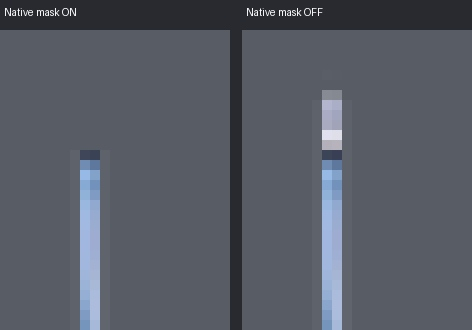
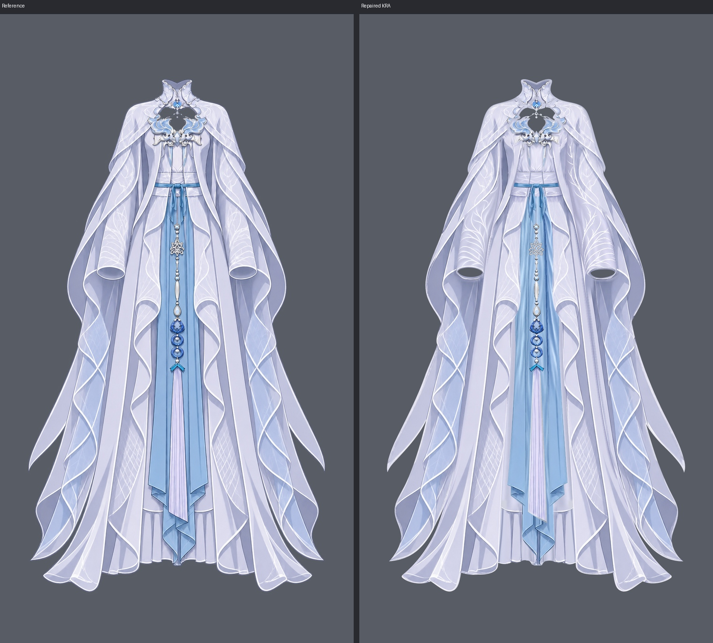

# 衣服分层绘画报告（repair-02后当前版本）

当前工程：[clothing-depth.kra](../../clothing-raster-layering/step01/clothing-depth.kra)；透明验收PNG：[clothing-assembled.png](clothing-assembled.png)。

画布941 × 1672，RGBA/U8，37个逻辑part、48个普通绘画层、11个多深度part、1个原生透明度蒙版。衣片默认全部显示，蒙版默认启用。当前版本已处理review-02的4类、5处问题；具体结果和三视图见 [repair-02暂存记录](../../clothing-raster-layering/step01/repair-02.md.tmp)。

## 本轮局部修画

| 本轮编号 | 实际part / 绘画层 | 范围 | 结果及依据 |
| --- | --- | --- | --- |
| R1 | `inner_long_dress/bodice_and_waist` `011 \| inner_long_dress/bodice_and_waist` | 约x445–499、y419.5–484 | 在011恢复两条真实腰面分区线、窄亮边及紧邻衣料明暗，按参考的长向弧线进入腰带和短环后方。只画衣身结构，未延长085，也未贴回点阵、碎线或饰件残痕。 |
| R2 | `central_blue_drapery/central_folded_tail` `020 \| central_blue_drapery/central_folded_tail \| front` | y1260–1467；可见折返重点y1298以下 | 恢复本片深蓝长竖折线、斜折边、窄亮边和下端折面。复用参考中无遮挡的本片下段线描（y1356以下），向上按同片横截面纵向延续，并在y1260–1298接入原长布；没有沿流苏斜端制造贴片界。010.1完整腰根和118未改。 |
| R3 | `waist_sash_and_knot/left_short_tail` `101 \| waist_sash_and_knot/left_short_tail` | x478–499、实际修画y508–524 | 小范围清掉y514横截线，按本短尾的材料坐标将上下纵向高光、暗带和窄边连续接顺。原完整上根、525以下自然斜折、尾长与尖端保留；103独立短环未改。 |
| R4a | `inner_long_dress/long_skirt` `010 \| inner_long_dress/long_skirt \| front` | 左侧x338–395、y1288–1471内的衣料 | 清掉整条窄条复制边及原横缝台阶，重画同片连续的扇开纵褶面；沿可见横缝向隐藏区画连续曲线，并接回白色下包边。恢复深紫衣褶，不把外袍白边复制进裙面。内侧已合格深褶、完整裙身及002后绕料保留。 |
| R4b | `inner_long_dress/long_skirt` `010 \| inner_long_dress/long_skirt \| front` | 右侧x551–606、y1288–1471内的衣料 | 独立修复右侧完整接片边：统一两侧衣料、连通横缝弧度及下包边，去掉底色色界和直亮复制边；保留内侧深褶并以同片曲线褶线接入新画面。没有导入外袍或蓝尾像素。 |

本轮只改010、011、020、101的绘画RGB。48层的名称、UUID、顺序、显隐、不透明度及全部衣片alpha保持原样；其余44个绘画层全画布像素未变。前后分片、正常开口、纱料透明度及独立附件均保留。新增线条和明暗为参考已有的衣身结构、布褶和包边，没有新增投影、AO或人体内容。

## 结构与上游

本轮没有逻辑节点、SVG轮廓、层级区域或深度数值调整，groups.json、occlusion.json及所有SVG共53个上游文件的字节保持不变。当前48个实际深度逐项符合有效occlusion表，不需要调用结构编辑工具。

继续保留上轮的三片蓝布后腰根10.1/10.2/10.3及前幅20/21/22；袖筒042/050、043/051、袖垂布040/060、041/061及其他已分开的前后深度均未合层。衣片归属和控制职责没有改变。

绘画参考：`../../clothing-part-layering/references/clothing.png`。本轮没有取人体像素，也未调用生图。原有合格绘画复用自本轮输入工程留档 [before.kra](../../clothing-raster-layering/step01/workspace/repair02/before.kra)；上轮详细复用来源与生成记录保留在 [上轮绘画报告快照](../../clothing-raster-layering/step01/workspace/repair02/report-before.md) 和 [上轮提示词记录](../../clothing-raster-layering/step01/workspace/repair01/generation-prompts.md)。

## 原生蒙版

所属part：`waist_pendant_and_tassel/upper_suspension`；绘画层 `100 \| waist_pendant_and_tassel/upper_suspension`，UUID `{f44f66dc-eedc-40f8-9a23-c0877cfa04e6}`。

子蒙版 `waist opening \| hide completed suspension root`，UUID `{0e97c101-ee19-4c87-8fa6-41749a295fac}`，类型transparencymask / A/U8。仍按衣身中央下缘控制悬线短根：x465–478，沿y=485+0.03×abs(x−472)作1像素柔边，仅隐藏约y479.5起的腰口内短根，其他区域为白。已再次开/关检查完整根，最后恢复启用；蒙版像素、附着关系和状态均未改。当前没有整体hiddenInReference=true的终止衣片。

## 视觉验收与保存

每处均查看实际绘画层独显、同一part所有深度合显、隐藏上层及整图；另看011+085、101+103、中央蓝尾+两侧蓝幅+118，以及隐藏两外袍后的完整裙面。两侧裙接边检查到下沿，不仅检查横缝一点。绘画质量以原尺寸和放大看图判断，没有用像素分数代替。

本轮从实际KRA重新导出37个完整衣片、48个深度分片、48个隐藏上层画面、4个蒙版开关图及4个邻接合显。完整衣片图集：[1](repair-evidence/repair02/parts-01.jpg) · [2](repair-evidence/repair02/parts-02.jpg) · [3](repair-evidence/repair02/parts-03.jpg) · [4](repair-evidence/repair02/parts-04.jpg) · [5](repair-evidence/repair02/parts-05.jpg)。

工程按批保存后，最终关闭并重新打开同一路径KRA。48层的绘画像素、名称、UUID、层序、显隐、不透明度及画布色彩配置完全一致；唯一原生蒙版的像素、附着层、UUID和启用状态一致；整图投影也完全一致。保存时桥接曾将瞬时QProgressDialog标为失败而保存函数返回true，现以最终关闭重开成功及完整字节核对确认写盘成功，无遗留工具故障。

[重开核对](../../clothing-raster-layering/step01/repair-evidence/repair02/reopen_check.json) · [结构核对](../../clothing-raster-layering/step01/repair-evidence/repair02/structure_check.json) · [44层保护及alpha核对](../../clothing-raster-layering/step01/repair-evidence/repair02/protected_check.json)。字节检查用于证明保存和保护结果，不替代视觉验收。

用于当前验收的图片在repair-evidence/repair02/，主PNG已刷新；repair01证据保留作历史记录。

## 当前全部图层映射

| 原part ID | 实际图层名 / UUID | 最终深度 | 区域与控制职责 | 本轮来源 |
| --- | --- | ---: | --- | --- |
| `collar_shoulder_cape/standing_collar` | `001 \| collar_shoulder_cape/standing_collar \| back` `{448df4c9-96c7-40e9-b298-05c0674638f7}` | 1 | 上方后领弧及颈侧后缘，在颈后。实际分界从约(433,181)沿内领转折经(460,203)、(471,237)、(480,211)至(509,182)，保留后领的连续V形内壁；不以水平线截领。默认开启。 | 本轮输入KRA中相同UUID原层完整复用；绘画像素未改。 |
| `inner_long_dress/long_skirt` | `002 \| inner_long_dress/long_skirt \| back` `{0e35da44-fa87-4557-a9cd-3459aa7b6cdf}` | 2 | 完整裙体两侧约8像素宽的绕后窄料，自腰根(402/538,478)沿两侧连续转面曲线下至裙口(约297/645,1465)；位于前裙面与双腿之后。后区不包含中央前褶缘。 | 本轮输入KRA中相同UUID原层完整复用；绘画像素未改。 |
| `waist_sash_and_knot/waist_band` | `003 \| waist_sash_and_knot/waist_band \| back` `{ee430c3b-6a85-46ed-8e71-e15d8da3b6ab}` | 3 | 腰带左右后绕续段，约x388–410与533–556；与前段分界在腰侧进入袍下的连续弯折处，左约x410–412、右约x532–535、y449–462。在衣身和袍之后，默认开启但自然隐藏。 | 本轮输入KRA中相同UUID原层完整复用；绘画像素未改。 |
| `inner_long_dress/long_skirt` | `010 \| inner_long_dress/long_skirt \| front` `{8d550ac0-4c93-4c99-9c81-c6b710d0b095}` | 10 | 两侧转面线之间的完整前裙面，含腰下中央、两侧前面、连续下部横缝及全部中央前褶裙缘；在腰臀、双腿前，在蓝布腰根10.1–10.3、衣身11、蓝布前幅20–22与袍30/31后。 | 沿用原完整前裙和内侧可见深褶；两侧用本片纵褶材料重画整条接边、横缝曲线与白下沿。002原层不动。 |
| `central_blue_drapery/central_folded_tail` | `010.1 \| central_blue_drapery/central_folded_tail \| back waist root` `{78bc1e28-59ea-44e1-90ea-768e3988c410}` | 10.1 | 完整中央尾位于衣身实际腰下缘以内的上根，约y458–484；下界逐列沿011轮廓不透明腰缘，中央约y485。在前裙10前、衣身11后，与20前幅共边连续。 | 本轮输入KRA中相同UUID原层完整复用；绘画像素未改。 |
| `central_blue_drapery/left_long_panel` | `010.2 \| central_blue_drapery/left_long_panel \| back waist root` `{a7b62523-83bd-4fc8-9770-82a707ca9001}` | 10.2 | 画面右蓝长幅的完整上根，约y458至011实际下缘约y485以内；在前裙10前、中央后根10.1前、衣身11后，与21腰下前幅共边。 | 本轮输入KRA中相同UUID原层完整复用；绘画像素未改。 |
| `central_blue_drapery/right_long_panel` | `010.3 \| central_blue_drapery/right_long_panel \| back waist root` `{65fa757b-6b4a-4397-8c78-87f270678625}` | 10.3 | 画面左蓝长幅的完整上根，约y458至011实际下缘约y485以内；在前裙10及后根10.1/10.2前、衣身11后，与22前幅共边。 | 本轮输入KRA中相同UUID原层完整复用；绘画像素未改。 |
| `inner_long_dress/bodice_and_waist` | `011 \| inner_long_dress/bodice_and_waist` `{e49d9e03-ca99-444a-99ac-041e59dfb80b}` | 11 | 完整衣身与宽腰在胸腹、前裙10和三片蓝布腰根10.1–10.3前；三片腰下蓝布20–22从实际下缘约y485下方接出。上缘藏胸饰85、两侧藏袍30/31，正横带25在前。repair-01清除饰件长条残影、点阵白纹及碎线，改为连续淡紫衣面、纵褶、腰缝与稀疏宽霜纹。本片实际中央下缘仍控制100悬线短根的原生蒙版，不以裁短悬线代替腰面遮挡。 | 沿用本轮输入KRA的干净衣面；Krita局部绘制真实衣身分区线、窄亮边和衣褶明暗。 |
| `central_blue_drapery/central_folded_tail` | `020 \| central_blue_drapery/central_folded_tail \| front` `{b578d36e-4025-47d6-9587-ff6a0a52b4f0}` | 20 | 从011实际腰下缘约y485以下至1466的中央布尾，包括流苏后完整衣料和末端自卷。在裙10前、两侧前幅21/22及悬饰后；与10.1上根为同一完整纹理。 | 沿用原中央尾及完整后根；只复用本片无遮挡下段参考线描，隐藏连接按同片材料长向续画，不取118像素。 |
| `central_blue_drapery/left_long_panel` | `021 \| central_blue_drapery/left_long_panel \| front` `{5570fda1-2f31-4d28-9c36-495eed12e654}` | 21 | 011腰下缘约y485以下的画面右长幅，含完整袍下侧缘、斜尖和短回折；在中央尾20和裙10前、袍30及悬饰后。与10.2使用同一完整布面纹理。 | 本轮输入KRA中相同UUID原层完整复用；绘画像素未改。 |
| `central_blue_drapery/right_long_panel` | `022 \| central_blue_drapery/right_long_panel \| front` `{9d0ff3e9-740b-44e5-a8b5-f2635a5dd3c2}` | 22 | 011腰下缘约y485以下的画面左长幅，含袍下侧缘、斜尖和短回折；在中央尾20与裙10前，袍31和悬饰后。与10.3上根共用完整纹理。 | 本轮输入KRA中相同UUID原层完整复用；绘画像素未改。 |
| `waist_sash_and_knot/waist_band` | `025 \| waist_sash_and_knot/waist_band \| front` `{bbc07874-0300-4944-b323-a9c65cec3ef1}` | 25 | 约x412–532、y448–461的连续正面横带及结后带面，侧端依弯曲分界接3区；贴衣身前、袍片侧缘和中央结后，默认显示。 | 本轮输入KRA中相同UUID原层完整复用；绘画像素未改。 |
| `outer_robe_body/left_robe_panel` | `030 \| outer_robe_body/left_robe_panel` `{937356d7-288f-4412-bcc7-e253d2ceb64b}` | 30 | 画面右完整袍片在内裙、central_blue_drapery/left_long_panel 及 waist_sash_and_knot/waist_band 侧端前；被控制本片上端由 collar_shoulder_cape/left_shoulder_cape、chest_ornament 遮，外侧由 sleeve_screen_right/left_sleeve_tube、sleeve_screen_right/left_hanging_drape 遮。默认开启，内缘y550–890压蓝幅侧缘，内卷及下摆仅同片自折无夹层，保持单深度，开襟透明。 | 本轮输入KRA中相同UUID原层完整复用；绘画像素未改。 |
| `outer_robe_body/right_robe_panel` | `031 \| outer_robe_body/right_robe_panel` `{60bd2482-c7dc-4522-b270-022893b02486}` | 31 | 画面左完整袍片在内裙、central_blue_drapery/right_long_panel 及 waist_sash_and_knot/waist_band 侧端前；上端由 collar_shoulder_cape/right_shoulder_cape、chest_ornament 遮，外侧由 sleeve_screen_left/right_sleeve_tube、sleeve_screen_left/right_hanging_drape 遮。默认开启，内缘y550–890压蓝幅侧缘，卷襟下摆自折无他物插层，单深度，开襟透明。 | 本轮输入KRA中相同UUID原层完整复用；绘画像素未改。 |
| `sleeve_screen_left/right_hanging_drape` | `040 \| sleeve_screen_left/right_hanging_drape \| back` `{4bef1885-89fe-4c15-9abd-e68b37229d2d}` | 40 | 画面左口后宽面、下方长幅与外尖长尾；另含约y390–688位于原可见前翻主轮廓之外、藏袖筒后的完整内侧续料。在袍31前、筒42/50后。可见前翻主边的全部抗锯齿像素归60，不在后片留一条前边残弧。 | 本轮输入KRA中相同UUID原层完整复用；绘画像素未改。 |
| `sleeve_screen_right/left_hanging_drape` | `041 \| sleeve_screen_right/left_hanging_drape \| back` `{77fcc592-d710-4d99-9b0c-1e2965f0bda5}` | 41 | 画面右口后宽面、下方长幅与长尾，另含约y390–688主轮廓内侧的筒后补全料。在袍30前、筒43/51后。口内侧续料上根改从约(609,677)圆顺进入51后，再延至下方长幅，不以y702水平亮边截断。 | 本轮输入KRA中相同UUID原层完整复用；绘画像素未改。 |
| `sleeve_screen_left/right_sleeve_tube` | `042 \| sleeve_screen_left/right_sleeve_tube \| back` `{8f0002cf-03e5-4258-b427-9141b7d26219}` | 42 | 画面左袖口远侧上弧及实际内后壁，在腕后、40后垂布前。范围约x256–335、y665–688，下界循椭圆上口内缘由(256,687)经(277,674)、(292,674)、(325,680)至(334,688)，两端绕口转入50区；真正开口透明。 | 本轮输入KRA中相同UUID原层完整复用；绘画像素未改。 |
| `sleeve_screen_right/left_sleeve_tube` | `043 \| sleeve_screen_right/left_sleeve_tube \| back` `{15c1b420-3b4a-4eb0-927f-091161cf9407}` | 43 | 画面右口远侧上弧及内后壁，约x608–687、y665–689，在腕后、41后垂面前。下界循本侧椭圆上口内缘由(608,689)经(632,679)、(646,679)、(672,679)至(686,689)，两端绕口转入51；空口透明。 | 本轮输入KRA中相同UUID原层完整复用；绘画像素未改。 |
| `sleeve_screen_left/right_sleeve_tube` | `050 \| sleeve_screen_left/right_sleeve_tube \| front` `{824ddbe3-c712-4e56-80e7-56b5b73315d5}` | 50 | 完整袖根、前筒面、近侧下唇与白包边，扣除42远侧内壁。在臂腕前、筒后续料40前、真实前翻白边60后、肩披71后；沿椭圆口两端接42。 | 本轮输入KRA中相同UUID原层完整复用；绘画像素未改。 |
| `sleeve_screen_right/left_sleeve_tube` | `051 \| sleeve_screen_right/left_sleeve_tube \| front` `{a4a789c5-b72e-4e3d-b710-bab8bc4c5e5e}` | 51 | 完整袖根、前筒、近侧白边与下唇，扣除43区。在41续料前、61真实白边后、70肩披后。外侧约x679–689、y651–690延续本筒衣料窄量搭接，内侧约(602,686)至(611,695)改为圆顺收口，无水平矩形端。 | 本轮输入KRA中相同UUID原层完整复用；绘画像素未改。 |
| `sleeve_screen_left/right_hanging_drape` | `060 \| sleeve_screen_left/right_hanging_drape \| front` `{9f8f53de-82b3-41a6-9560-a5a574d09aa8}` | 60 | 肩披71下压筒的前翻主面及自身白包边；与40分界沿原主面(374,328)、(369,432)、(326,497)、(280,536)、(264,634)、(257,685)，再随口外折返经(222,719)至约(177,734)。原主面以外的筒后补全料分回40。 | 本轮输入KRA中相同UUID原层完整复用；绘画像素未改。 |
| `sleeve_screen_right/left_hanging_drape` | `061 \| sleeve_screen_right/left_hanging_drape \| front` `{05b89668-8569-4537-a453-1254e2aa70c9}` | 61 | 肩披70下的真实前翻主面与白包边，在筒43/51前。分界沿原主面约(570,405)、(595,470)、(650,526)、(677,620)、(685,687)，再随既有口外折返接41；主面以外的筒后续料转归41，边缘抗锯齿完整归前片。 | 本轮输入KRA中相同UUID原层完整复用；绘画像素未改。 |
| `collar_shoulder_cape/left_shoulder_cape` | `070 \| collar_shoulder_cape/left_shoulder_cape` `{e4e0616b-0fad-4a35-a593-c2225aba4402}` | 70 | 画面右短披盖袖根、垂布前翻缘及 outer_robe_body/left_robe_panel 胸肩端；被控制本片内端由 collar_shoulder_cape/standing_collar 的72区遮，内卷下缘由 chest_ornament 遮。默认开启，搭接自然隐藏，胸洞透明，单深度。 | 本轮输入KRA中相同UUID原层完整复用；绘画像素未改。 |
| `collar_shoulder_cape/right_shoulder_cape` | `071 \| collar_shoulder_cape/right_shoulder_cape` `{aed42338-b858-4645-ace8-6c6b6d552528}` | 71 | 画面左短披盖 sleeve_screen_left/right_sleeve_tube、sleeve_screen_left/right_hanging_drape 根和 outer_robe_body/right_robe_panel 胸肩端；内端由 collar_shoulder_cape/standing_collar 的72区遮，内卷下缘由 chest_ornament 遮。默认开启、隐藏搭接保留，胸洞透明，单深度。 | 本轮输入KRA中相同UUID原层完整复用；绘画像素未改。 |
| `collar_shoulder_cape/standing_collar` | `072 \| collar_shoulder_cape/standing_collar \| front` `{04d9238d-4429-4a5e-a569-8cf7e640b4c9}` | 72 | 后领分界以外的左右前瓣、翻边与喉前闭合衣料，在颈前、肩披内端前、喉扣后；沿两侧弯曲内领边接1区。胸前真正镂空透明，默认开启。 | 本轮输入KRA中相同UUID原层完整复用；绘画像素未改。 |
| `collar_jewel_fastener/left_beaded_chain` | `080 \| collar_jewel_fastener/left_beaded_chain` `{60533a4b-028a-4dd7-bcdd-4102ee092f68}` | 80 | 画面右整链在胸前，内接头由 collar_jewel_fastener/central_pendant/connecting_ring 侧缘遮，外接头由 chest_ornament 上内缘遮，分界取进入各实体边缘处。被控制本片默认显示链珠，两短端自然隐藏且完整保留，双端均同向遮挡无需分片。 | 本轮输入KRA中相同UUID原层完整复用；绘画像素未改。 |
| `collar_jewel_fastener/right_beaded_chain` | `081 \| collar_jewel_fastener/right_beaded_chain` `{a25b734f-d758-457b-800a-f49d2a1aab33}` | 81 | 画面左整链在胸前，内接头由 collar_jewel_fastener/central_pendant/connecting_ring 侧缘遮，外接头由 chest_ornament 上内缘遮。被控制本片默认显示中段两珠，两端保留隐藏搭接，单深度满足，周围胸洞透明。 | 本轮输入KRA中相同UUID原层完整复用；绘画像素未改。 |
| `collar_jewel_fastener/central_pendant/hanging_bead` | `082 \| collar_jewel_fastener/central_pendant/hanging_bead` `{e6610023-213a-4447-bb89-ba0ce5af38b7}` | 82 | 完整短杆和珠在胸口空区前；被控制本片上接头由 collar_jewel_fastener/central_pendant/connecting_ring 环底局部遮，露出环底后杆珠连续显示。默认开启、保留完整接头，周围透明，单层满足。 | 本轮输入KRA中相同UUID原层完整复用；绘画像素未改。 |
| `collar_jewel_fastener/central_pendant/connecting_ring` | `083 \| collar_jewel_fastener/central_pendant/connecting_ring` `{c640902f-61aa-4766-905f-e0c0dacc7673}` | 83 | 完整小环压 collar_jewel_fastener/left_beaded_chain、collar_jewel_fastener/right_beaded_chain 内接头及 collar_jewel_fastener/central_pendant/hanging_bead 顶杆；被控制本片上尖由 collar_jewel_fastener/fixed_jewel 遮。默认显示环身、孔透明，单向接头遮挡不需拆半环。 | 本轮输入KRA中相同UUID原层完整复用；绘画像素未改。 |
| `collar_jewel_fastener/fixed_jewel` | `084 \| collar_jewel_fastener/fixed_jewel` `{a4dd0458-4ccd-4e78-b6bd-5e4e06d16833}` | 84 | 完整喉扣和固定托在 collar_shoulder_cape/standing_collar 前领前，盖 collar_jewel_fastener/central_pendant/connecting_ring 上接头。默认整件显示，接点局部自然遮挡，固定纹样随扣，无需背扣或额外深度。 | 本轮输入KRA中相同UUID原层完整复用；绘画像素未改。 |
| `chest_ornament` | `085 \| chest_ornament` `{7ff3e970-4f42-460e-8328-dc7d041a9189}` | 85 | 终止叶虽kind=group，作为实际完整胸饰排绘画深度，盖 inner_long_dress/bodice_and_waist 上缘、outer_robe_body/left_robe_panel、outer_robe_body/right_robe_panel 胸端、collar_shoulder_cape/left_shoulder_cape、collar_shoulder_cape/right_shoulder_cape 内卷下缘及 collar_jewel_fastener/left_beaded_chain、collar_jewel_fastener/right_beaded_chain 外端。默认全饰开启，胸洞透空，长端及固定卷叶同层。 | 本轮输入KRA中相同UUID原层完整复用；绘画像素未改。 |
| `waist_pendant_and_tassel/upper_suspension` | `100 \| waist_pendant_and_tassel/upper_suspension` `{f44f66dc-eedc-40f8-9a23-c0877cfa04e6}` | 100 | 完整悬线、宝石珠节在中央蓝布前，底座由雪花110遮。100层保留原生透明度蒙版waist opening \| hide completed suspension root；以011实际中央下缘约y485控制，仅在x465–478范围沿y=485+0.03*abs(x-472)作1像素柔边，隐藏约x468–473、y479.5至腰口内短根，其余为白。默认启用，关闭可见完整根。repair-01只调整蓝布根前后关系，未继续裁短悬线或改变本层绘画与蒙版。 | 本轮输入KRA中相同UUID原层完整复用；绘画像素未改。 |
| `waist_sash_and_knot/left_short_tail` | `101 \| waist_sash_and_knot/left_short_tail` `{292dee11-7918-45c8-bee9-1b70459251b5}` | 101 | 画面右自由短端在衣身和蓝布前，在 waist_sash_and_knot/left_short_loop 后；根部由 waist_sash_and_knot/center_knot 遮。默认完整开启；repair-01恢复自身原图折面、窄边与尖端，隐藏上中段以同片蓝带横截面连续延续。 | 沿用原完整短尾；仅在508–524内将本带上下对应纵向色带和窄边连续续画。 |
| `waist_sash_and_knot/right_short_tail` | `102 \| waist_sash_and_knot/right_short_tail` `{0597ced5-ffe5-4afa-8845-bb5fc07018fb}` | 102 | 画面左自由短端在衣身和蓝布前，在 waist_sash_and_knot/right_short_loop 后；根部由 waist_sash_and_knot/center_knot 遮。完整单层开启；repair-01恢复自身原图深蓝边线、折面及尖端，隐藏上段以同材料续画。 | 本轮输入KRA中相同UUID原层完整复用；绘画像素未改。 |
| `waist_sash_and_knot/left_short_loop` | `103 \| waist_sash_and_knot/left_short_loop` `{5c35cebf-839b-4adc-a114-ec59b7a0a273}` | 103 | 画面右完整折回环压 waist_sash_and_knot/left_short_tail，根部由 waist_sash_and_knot/center_knot 侧下缘遮。默认完整开启，修复浅色根块并恢复原有折面与连续深蓝边线；自折无他物插层，单深度。 | 本轮输入KRA中相同UUID原层完整复用；绘画像素未改。 |
| `waist_sash_and_knot/right_short_loop` | `104 \| waist_sash_and_knot/right_short_loop` `{c587ec68-0faf-4d6b-a5b1-bc8edb2be27b}` | 104 | 画面左完整折回环压 waist_sash_and_knot/right_short_tail，根部由 waist_sash_and_knot/center_knot 遮。默认完整显示；repair-01将新绘根和原折面逐段接顺，保留环底回折、完整上根和独立单深度。 | 本轮输入KRA中相同UUID原层完整复用；绘画像素未改。 |
| `waist_sash_and_knot/center_knot` | `105 \| waist_sash_and_knot/center_knot` `{5d6a62d6-62c7-48d0-b743-55a54f63ad48}` | 105 | 中央结盖 waist_sash_and_knot/waist_band 前段及 waist_sash_and_knot/left_short_loop、waist_sash_and_knot/right_short_loop、waist_sash_and_knot/left_short_tail、waist_sash_and_knot/right_short_tail 上根；亦盖三片 central_blue_drapery 的上根。默认显示结，遮挡限于结侧下缘实际交叠，独立短带和蓝幅保留身份。 | 本轮输入KRA中相同UUID原层完整复用；绘画像素未改。 |
| `waist_pendant_and_tassel/middle_articulated_chain/upper_connector_segment` | `108 \| waist_pendant_and_tassel/middle_articulated_chain/upper_connector_segment` `{3e4bd53e-224e-42d6-b8c0-80a8b129d0cf}` | 108 | 完整杆珠在蓝布前，上端y644.4起短接头由 waist_pendant_and_tassel/snowflake_medallion 下尖遮，下端y697–698窄颈由 waist_pendant_and_tassel/middle_articulated_chain/elongated_link 上圆座遮。默认显示杆珠，接头局部隐藏且完整保留，单层满足。 | 本轮输入KRA中相同UUID原层完整复用；绘画像素未改。 |
| `waist_pendant_and_tassel/middle_articulated_chain/elongated_link` | `109 \| waist_pendant_and_tassel/middle_articulated_chain/elongated_link` `{2d461cef-2627-4437-8154-850aeb4fb67b}` | 109 | 完整长椭圆及上圆座压 waist_pendant_and_tassel/middle_articulated_chain/upper_connector_segment 下接头；本片下窄颈由 waist_pendant_and_tassel/middle_articulated_chain/teardrop_link 的较宽珠座遮。默认开启，接头局部自然隐藏，固定嵌饰同层。 | 本轮输入KRA中相同UUID原层完整复用；绘画像素未改。 |
| `waist_pendant_and_tassel/snowflake_medallion` | `110 \| waist_pendant_and_tassel/snowflake_medallion` `{198460c7-721d-46e7-9bcf-b917d4c47e05}` | 110 | 完整雪花压 waist_pendant_and_tassel/upper_suspension 底座和 waist_pendant_and_tassel/middle_articulated_chain/upper_connector_segment 顶接头。默认显示雪花、镂空透蓝布，接头遮挡限定短搭接，不填孔、不碎拆花瓣。 | 本轮输入KRA中相同UUID原层完整复用；绘画像素未改。 |
| `waist_pendant_and_tassel/middle_articulated_chain/teardrop_link` | `111 \| waist_pendant_and_tassel/middle_articulated_chain/teardrop_link` `{e03c594b-44fb-4b4f-8e44-0386680362bd}` | 111 | 完整水滴、上珠和下接头在蓝布前，压 waist_pendant_and_tassel/middle_articulated_chain/elongated_link 下窄颈；本片y809.8–814尾接头由 waist_pendant_and_tassel/lower_pendant_and_rings/main_pendant 顶镶座遮。默认开启珠及水滴、尾端局部隐藏，完整单层。 | 本轮输入KRA中相同UUID原层完整复用；绘画像素未改。 |
| `waist_pendant_and_tassel/lower_pendant_and_rings/main_pendant` | `112 \| waist_pendant_and_tassel/lower_pendant_and_rings/main_pendant` `{c76f19bb-8a2c-49db-8e48-440281984bbc}` | 112 | 完整大坠顶座盖 waist_pendant_and_tassel/middle_articulated_chain/teardrop_link 尾接头；本片下窄颈y850–854由 waist_pendant_and_tassel/lower_pendant_and_rings/upper_ring_assembly/ring_frame 上弧遮。默认显示坠体、完整接头保留，单深度。 | 本轮输入KRA中相同UUID原层完整复用；绘画像素未改。 |
| `waist_pendant_and_tassel/lower_pendant_and_rings/lower_ring_assembly/inner_pendant` | `113 \| waist_pendant_and_tassel/lower_pendant_and_rings/lower_ring_assembly/inner_pendant \| back` `{bb991b05-be97-4f43-a0e7-346a2dee2ed7}` | 113 | 仅中央x470–474、约y890–891.4向上进入下环内缘后的短窄挂接；下界顺连接颈微弧转入115，不把珠顶两肩后置。在下环114后，默认开启但由环缘自然遮挡。 | 本轮输入KRA中相同UUID原层完整复用；绘画像素未改。 |
| `waist_pendant_and_tassel/lower_pendant_and_rings/lower_ring_assembly/ring_frame` | `114 \| waist_pendant_and_tassel/lower_pendant_and_rings/lower_ring_assembly/ring_frame` `{6dc8cec9-3f4f-4f62-bc20-05d66a1a69de}` | 114 | 完整下环含顶连接节及下短杆；顶节y880–889由上环117下弧遮，底杆端y917–918由118流苏顶珠遮。环上内缘盖下悬珠113接头，115主体在环前。默认完整显示，孔透空，环珠独立显隐，不拆半环。 | 本轮输入KRA中相同UUID原层完整复用；绘画像素未改。 |
| `waist_pendant_and_tassel/lower_pendant_and_rings/lower_ring_assembly/inner_pendant` | `115 \| waist_pendant_and_tassel/lower_pendant_and_rings/lower_ring_assembly/inner_pendant \| front` `{44b87ac9-8c41-458d-892b-ffcb4bef2bca}` | 115 | 完整下环悬珠主体，包括约x467–476、y891–894圆拱两肩和至y903.1珠体；仅中央窄颈接113，在下环114前，周边孔隙透明。 | 本轮输入KRA中相同UUID原层完整复用；绘画像素未改。 |
| `waist_pendant_and_tassel/lower_pendant_and_rings/upper_ring_assembly/inner_pendant` | `116 \| waist_pendant_and_tassel/lower_pendant_and_rings/upper_ring_assembly/inner_pendant` `{d24884f2-e02b-4c08-8d18-097a084644ee}` | 116 | 完整上环悬珠和短挂接在蓝布前，接头约x470–473、y858.4–861由上环117上内缘遮，珠体在孔内可见，余环弧无重叠。默认独立开启，可单独隐藏珠；不将珠剪贴环体、不删接头，完整单层。 | 本轮输入KRA中相同UUID原层完整复用；绘画像素未改。 |
| `waist_pendant_and_tassel/lower_pendant_and_rings/upper_ring_assembly/ring_frame` | `117 \| waist_pendant_and_tassel/lower_pendant_and_rings/upper_ring_assembly/ring_frame` `{9f773cfa-ef82-4ef9-a0dc-11542d706268}` | 117 | 完整上环盖112大坠下窄颈、114下环顶节及116上悬珠顶挂接。默认完整显示、孔透空，珠显隐不控制环，遮挡只限实际短接点约y861，单层不拆半环。 | 本轮输入KRA中相同UUID原层完整复用；绘画像素未改。 |
| `waist_pendant_and_tassel/long_tassel` | `118 \| waist_pendant_and_tassel/long_tassel` `{48ad6dd8-4994-4b64-80b3-964ce235dfbd}` | 118 | 完整顶珠、蓝色折角帽和浅紫穗束在三片蓝布前，顶珠盖114下环杆端。repair-01恢复帽体蓝色、深蓝外缘与下侧明暗、顶珠暗部，去掉宽浅晕；穗束全长和末端斜边保留，不截后蓝布。默认完整开启；帽盖同片束根属自遮，无他物插层，单深度。全表无整体hiddenInReference节点；除100短根原生蒙版外接头按实际自然遮挡。 | 本轮输入KRA中相同UUID原层完整复用；绘画像素未改。 |

四个实际修画层的当前原生画布PNG：[010 | inner_long_dress/long_skirt | front](repair02/assets/010.png) · [011 | inner_long_dress/bodice_and_waist](repair02/assets/011.png) · [020 | central_blue_drapery/central_folded_tail | front](repair02/assets/020.png) · [101 | waist_sash_and_knot/left_short_tail](repair02/assets/101.png)。

未解决问题：无。只交付衣服绘画与分层记录，未另写身体插层或装配说明。
