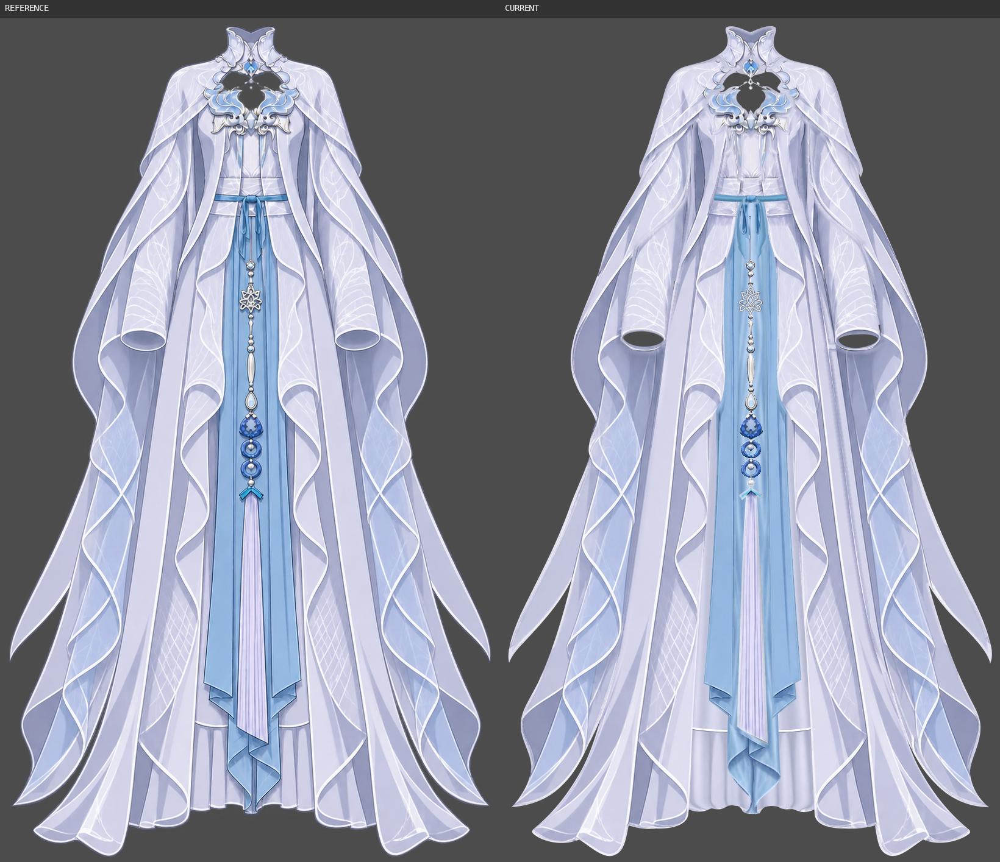
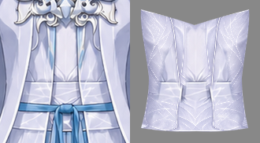
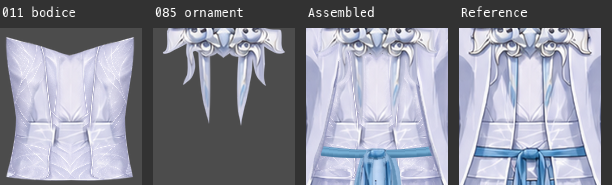
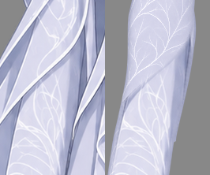
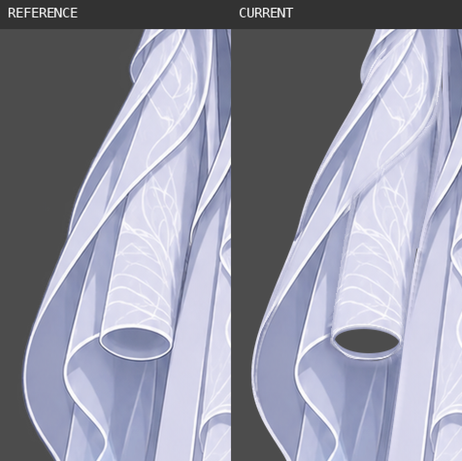
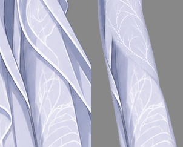
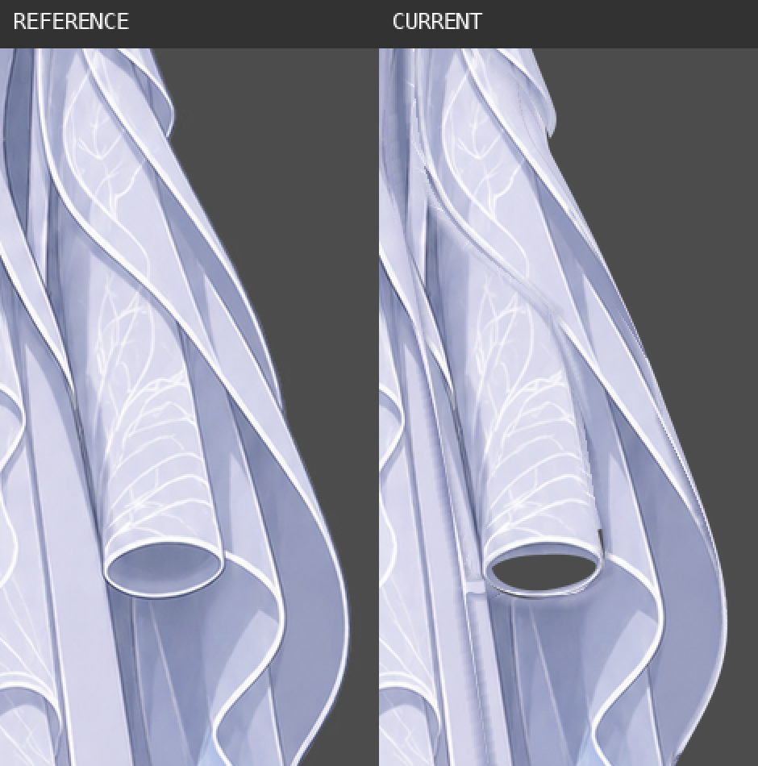
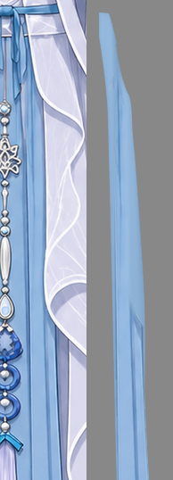
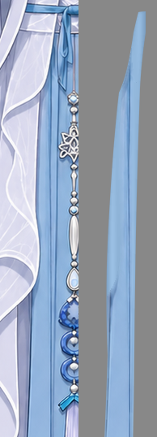

结论：需要修复

已完成本轮独立视觉检查。共确认 9 类问题、11 个具体返修框：R1–R4、R5a/R5b、R6a/R6b、R7–R9。主要问题为腰口遮挡错误、两侧袖筒补绘拼接、右袖口裂隙及方块接头、蓝长幅平涂拼接，以及部分原图可见衣料和附件的线条/材质丢失。以下均依据实际 KRA 导出的画面判断；不以像素分数、细小像素差或补全褶皱的个人偏好判定。

## 检查输入、范围与证据说明

- 工程：`../../clothing-raster-layering/step01/clothing-depth.kra`。
- 绘画参考：`../../clothing-part-layering/references/clothing.png`，与本步正式 `../../clothing-raster-layering/step01/report.md` 指定参考一致。
- 结构依据：`../../clothing-part-layering/parts/`、`../../clothing-part-layering/groups.json`、`../../clothing-part-layering/occlusion.json`；已读取当前结构及上述本步正式报告。本步目录未发现已发布的正式 review／repair 报告；未将草稿或原绘制者的自检记录当作通过证据。
- Krita 5.3.4.1 实际打开工程，画布 941 × 1672，37 个逻辑 part、45 个普通绘画层、1 个附在 100 层的原生透明度蒙版。逐个切换显隐并从文档投影导出：45 个单绘画层、37 个逻辑 part 合显、45 个逐深度隐藏上层的合成画面，以及蒙版开/关的整图与悬线独显。检查整图、原尺寸主要衣料及放大的接缝、袖口、腰口和串饰接点。
- 8 个多深度 part 均分别查看分片并合显：立领、内裙、腰带、左右袖筒、左右袖垂布、下环悬珠。没有将同一 part 的多层误判为重复；前后控制分片应继续保留。
- 蒙版 `waist opening | hide completed suspension root` 在实际工程中停用、启用均已看过；停用可见悬线完整短根，启用只裁去顶端短段。检查后恢复全部衣片显示及蒙版启用。R1 是蓝布与衣身的遮挡问题，不能靠继续裁短悬线处理。
- 本轮只检查衣服分层，不检查人体装配。胸前镂空、领口、两正常椭圆袖口、串饰环孔均作为正常开口保留。未发现需要另列的纱料透明度问题；不要求将袖口改为实心深色椭圆。合理的隐藏褶皱设计按合格处理。
- 全部显隐切换仅发生在内存中，未调用工程保存。工程、groups、occlusion 和 parts 共 54 个输入文件的检查前后 SHA-256 一致，见 [只读核对](../../clothing-raster-layering/step01/review-evidence/review01/readonly-check.json)。哈希只用于证明未改输入，不用于评价画面。

框选由 `annotate_review_regions` 生成，坐标均为原画布 `[x,y,width,height]`。所有局部对照均为**左参考、右当前**，未移动或缩放参考来拟合当前。R2、R3、R4、R6a、R6b 的“当前”为对应绘画层独显；参考侧保留原有遮挡物，用于说明可见材料和真实衣片边界，不把参考未显示的隐藏褶皱当作唯一答案。报告引用的证据已全部保存于本步 `review-evidence/review01/`。

[整图框选](review-evidence/review01/marks/assembled/marked.png) · [整图框坐标与图层](../../clothing-raster-layering/step01/review-evidence/review01/marks/assembled/regions.json) · [实际工程节点清单](../../clothing-raster-layering/step01/review-evidence/review01/nodes.json)

## 确定需要修复的问题

### R1：蓝长布根遮住参考中可见的腰面

- **相关图层**：`020 | central_blue_drapery/central_folded_tail`、`021 | central_blue_drapery/left_long_panel`、`022 | central_blue_drapery/right_long_panel`，与 `011 | inner_long_dress/bodice_and_waist` 的局部前后关系。
- **位置**：框 `[445,460,53,33]`，中央结下方、两短环之间，约 y462–485。
- **当前表现及参考依据**：参考中此处能看到淡紫腰部衣料、斜向白纹及下缘白线；当前被提早露出的蓝色长布根填满。额外在 Krita 隐藏 020/021/022 后，淡紫腰面实际存在并重新露出，确认是局部遮挡关系错误。
- **影响**：参考中可见的一段腰面消失，蓝布接出位置上移，悬线顶根也失去参考中的腰缘背景。
- **修复方向**：沿 011 实际腰口下缘调整三片蓝布根的局部前后遮挡，使腰面在此段显示，蓝布从腰口下方接出。可将完整根部的遮挡区分到衣身后的深度，或用对应的局部显隐控制；补根仍须完整保留。其余长幅维持在内裙前的关系，分片之间材质连续。
- **需要保留**：中央结、两短环和自由端各自的身份；三片长布的完整根、长度、下端折返；100 层完整悬线及其合理的短根蒙版。

### R2：衣身新增点阵纹与长条残痕，叠回后产生碎线重影

- **相关图层**：`011 | inner_long_dress/bodice_and_waist`；邻接 `085 | chest_ornament`，085 自身不要求重画。
- **位置**：框 `[400,330,141,158]`；尤其 x409–447、x497–535 的两侧衣面，以及胸饰长端旁的纵向区域。
- **当前表现及参考依据**：独显衣身时可见密集的点状白纹、破碎纵线及两条长条亮暗痕。胸饰叠回后，其长端旁仍出现额外凌乱亮边和残影感。参考的露出衣身是较平滑的淡紫布面、连贯纵褶与腰部霜纹，没有这一层密集点阵白纹和碎线。
- **影响**：补画区和贴原图区的笔触密度、线条完整性不一致；原尺寸上胸至腰的衣面显得脏碎，饰件与底布分界不清。
- **修复方向**：按独显 085 的实际范围辨认并清掉 011 上与饰件对应的残线，保留衣身自己的褶线；将点阵式新增纹理改成与参考一致的连续布纹及明暗。重画后分别看 011 独显和 011+085 合显，确认底布干净且饰件外只有一套清晰边。
- **需要保留**：衣身完整轮廓、真实胸前开口、腰缝和腰面本身的纹样；085 的独立绘画层与长端，不将饰件像素补贴回衣身。

[独显框选及坐标](../../clothing-raster-layering/step01/review-evidence/review01/marks/bodice/regions.json) · [独显标记图](review-evidence/review01/marks/bodice/marked.png)

### R3：画面左袖筒有横跨筒面的斜向拼接

- **相关图层**：主修 `050 | sleeve_screen_left/right_sleeve_tube | front`；复核与 `060 | sleeve_screen_left/right_hanging_drape | front` 的搭接。
- **位置**：框 `[275,427,101,190]`，袖筒中上段至原图可见袖面交界。
- **当前表现及参考依据**：050 独显仍有一条斜穿筒面的深灰边，边上方是细点状新枝纹，下方变成较粗的原枝纹，底色也在边界两侧突变。这条分界对应参考中垂布压住袖筒的遮挡边；袖筒自己的补全不应保留一条形似上层布缘的边。合显时该段白包边附近出现灰糊重边。
- **影响**：袖筒独显不能读成连续、同材质的一个筒面，露出补全区后会显出斜拼和上层轮廓残影；默认组装的局部边线也不干净。
- **修复方向**：在 050 上清掉斜向残边，补成连续的袖料横截面、纵褶与枝纹，匹配原可见区的纹样粗细及底色；060 继续承担它自己真实的白包边。沿二者搭接边检查一次完整斜线，消除重复边和模糊擦接。
- **需要保留**：050 与 042 的前后分片、袖筒原尺寸及袖口包边；椭圆袖口透明；060 及其后分片 040 仍属独立袖垂布。

[独显框选及坐标](../../clothing-raster-layering/step01/review-evidence/review01/marks/sleeve-left/regions.json) · [独显标记图](review-evidence/review01/marks/sleeve-left/marked.png)

### R4：画面右袖筒同样有斜接边、纹样突变与深色硬折角

- **相关图层**：主修 `051 | sleeve_screen_right/left_sleeve_tube | front`；复核与 `061 | sleeve_screen_right/left_hanging_drape | front` 的搭接。
- **位置**：框 `[557,413,119,211]`；斜接线及其内侧起点附近。
- **当前表现及参考依据**：051 独显中，细密新枝纹沿斜线切换为粗亮的原枝纹，斜线内端又接一块深色竖片和硬折角。参考相应斜边属于上层垂布，不是袖筒自身的一道拼缝；合显后此处仍可分辨出两套边和灰色接片。
- **影响**：袖筒补全区露出时会显出另一衣片的边形及材质断层，独显与组装均不够连续干净。
- **修复方向**：独立重画 051 的这段袖面，去掉沿遮挡边保留下来的斜向轮廓和硬折角，把布褶、底色与枝纹接到原可见袖料；与 061 的实际白边窄量搭接，再核对全段线宽与轮廓。
- **需要保留**：本侧自身袖筒形状、043/051 深度职责、透明口孔及白包边；061 不并入袖筒，不强制镜像另一侧袖口。

[独显框选及坐标](../../clothing-raster-layering/step01/review-evidence/review01/marks/sleeve-right/regions.json) · [独显标记图](review-evidence/review01/marks/sleeve-right/marked.png)

### R5a：右袖口外侧存在透明裂隙

- **相关图层**：`051 | sleeve_screen_right/left_sleeve_tube | front` 与 `061 | sleeve_screen_right/left_hanging_drape | front`。
- **位置**：框 `[679,651,10,35]`，画面右袖口外侧、正常椭圆口上方。
- **当前表现及参考依据**：袖筒与外侧布料之间有细长透明缝。灰底上显示为暗条，换红色验收底后能直接看到红底穿出；参考此处为连续衣料接边。
- **影响**：默认组装就有断口，会随背景颜色显现，不属于正常袖口开口。
- **修复方向**：以 051 或 061 所属的同片衣料延续窄量搭接，闭合这条侧缝，并保持该段明暗、边线连续。完成后在浅色和深色验收底各看一次。
- **需要保留**：真正的椭圆袖口、远侧内壁和近侧包边；不向口孔内填色，也不合并两逻辑 part。

### R5b：右袖口内侧的补料有矩形台阶接头

- **相关图层**：主修 `051 | sleeve_screen_right/left_sleeve_tube | front`，复核其与 `041 | sleeve_screen_right/left_hanging_drape | back` 的交接。
- **位置**：框 `[591,691,22,19]`，同侧袖口内侧下缘。
- **当前表现及参考依据**：沿袖筒内侧下行的补料在此处用一条浅色水平矩形边结束，和后垂面拼成可见方块。分层独显可以定位到 051 的纵条末端；参考在袖口旁为平顺、连续的内缘，没有该横向凸台。
- **影响**：原尺寸袖口接点出现硬边和接片感，破坏内侧长线的连续性。
- **修复方向**：按实际筒口和后垂面的连续走向重画纵条末端，调整小范围搭接并统一底色，使纵线顺接至自然遮挡处；清掉水平截断的亮色方块边。
- **需要保留**：筒口完整白边、内侧衣料必要隐藏延续、后垂布的独立层及其在袖口之后的深度。

[同坐标041/043/051/061独显定位](review-evidence/review01/cuff-layer-attribution.png)

### R6a、R6b：两条蓝色长幅各有大块平涂硬接原纹理

这两处在不同衣片上各自存在，分别框选、分别返修。

| 编号 | 实际图层 | 原画布框 | 明确表现 |
| --- | --- | --- | --- |
| R6a | `021`，`central_blue_drapery/left_long_panel`，画面右 | `[478,456,73,514]` | 根部、外侧大片均匀浅蓝与内侧有纵褶、暗边的材料按曲线硬接，约 y850–920 可见三角状接入。 |
| R6b | `022`，`central_blue_drapery/right_long_panel`，画面左 | `[392,456,73,514]` | 对侧也有平涂块，沿原纹理边形成硬曲线和尖角，整片材质不连续。 |

- **参考依据**：参考中可见的同片蓝布具有连续纵向明暗和清晰边线；独显时，新补色却与保留区形成一块可辨认的贴片。问题是这条可见接边及材质断层，不要求参考未显示的隐藏褶皱逐根一致。
- **影响**：上层袍片隐藏或衣片变形露出补全区时，会看到平色块和三角拼接；完整单片不能读成连续蓝布。
- **修复方向**：分别沿两片自身长向延续纵褶，重建平涂区到现有暗边、布面高光之间连续的横截面明暗；消除补全轮廓形成的硬色界。与 R1 同时处理根部遮挡，但独显时仍需保留完整根及连续材质。
- **需要保留**：各侧原有长度、宽度、自由边、斜尖及短回折；021、022 和 020 三片继续独立；不带入中央流苏、珠链或另一条长幅的轮廓。

[R6a 框选](review-evidence/review01/marks/blue-right/marked.png) · [R6a 坐标](../../clothing-raster-layering/step01/review-evidence/review01/marks/blue-right/regions.json) · [R6b 框选](review-evidence/review01/marks/blue-left/marked.png) · [R6b 坐标](../../clothing-raster-layering/step01/review-evidence/review01/marks/blue-left/regions.json)

[完整内裙、中央尾和两蓝幅原尺寸独显并排](review-evidence/review01/native-skirt-blue.png)

### R7：可见内裙褶边的线条结构和白包边丢失

- **相关图层**：主要为 `010 | inner_long_dress/long_skirt | front`；修改时连同 `002 | inner_long_dress/long_skirt | back` 合显复核连续性。
- **位置**：框 `[367,1308,211,162]`；蓝布两侧露出的下裙褶边和下沿。
- **当前表现及参考依据**：参考可见部分有清楚的深紫纵向褶边、转折和连续白色下沿包边；当前这部分大面积被软化为圆波状明暗，深褶线和白包边大部不见，边缘显得发虚。不是只在完全隐藏的裙面增加合理褶皱。
- **影响**：参考中可辨认的褶裥结构与线描画风改变，下裙与保留的外袍、蓝幅边线风格脱节。
- **修复方向**：优先恢复原图可见褶边的深浅折线、横缝与白色下沿包边，隐藏裙面仍可采用现有合理的连续纵褶；在可见/补全交界处顺接，不把原图裁成两个可见窄条贴上后留下接边。复核前后分片合显的下缘连续性。
- **需要保留**：完整裙身和必要两侧绕后料、现有前后深度身份、总体裙长；中央蓝尾、左右袍片仍属各自衣片，不纳入裙层。

### R8：流苏帽和顶珠发白，深蓝轮廓变成浅色宽晕

- **相关图层**：`118 | waist_pendant_and_tassel/long_tassel`。
- **位置**：框 `[450,915,44,40]`，流苏顶珠及折角帽。
- **当前表现及参考依据**：参考帽体为蓝色，外缘和下侧有清楚的深蓝轮廓/阴影，顶珠有暗部；当前帽体和顶珠明显发白，帽外缘围着较宽的浅色晕边，接帽的边线也变软。与上方保留的蓝环及参考金属/珠饰笔触不一致。
- **影响**：原图可见附件的颜色、轮廓和体积感改变，接入长穗处有贴片与擦白感。
- **修复方向**：在 118 自身恢复帽体蓝色、深蓝外轮廓和下侧阴影，清掉浅色宽晕；恢复顶珠的正常暗部，让短连接和帽下穗束自然相接。
- **需要保留**：顶珠、帽和穗束的同片归属；完整流苏长度、浅紫穗丝、末端斜边；帽后蓝布和上方圆环保持独立。

### R9：腰带与短带的可见包边、折面被简化成无边渐变

- **相关图层**：腰带 `003/025 | waist_sash_and_knot/waist_band`；`101 | waist_sash_and_knot/left_short_tail`、`102 | waist_sash_and_knot/right_short_tail`；短环 `103 | waist_sash_and_knot/left_short_loop`、`104 | waist_sash_and_knot/right_short_loop` 的根部接入区。
- **位置**：框 `[409,446,124,112]`；横带正面、两自由短尾及短环上根。
- **当前表现及参考依据**：参考横带上下缘有清晰深蓝边线，短尾可见折面、窄边和尖端走向；当前横带、短尾主要成为浅蓝的圆滑渐变，深色轮廓及折面线大量丢失。短环保留了较深的原折面，但上根换成浅色块，二者衔接不自然。
- **影响**：这些本来可见的蓝带在原尺寸下与中央结、原有短环折面及其他蓝布的描边风格不一致，片与片之间出现材料和线宽突变。此项独立于 R1 的腰面遮挡错误。
- **修复方向**：按各片本身恢复可见包边、折痕和根部明暗，完整隐藏段继续以同种蓝丝带延续；将新绘根与原折面逐段顺接。腰带 003+025 合显检查两侧深度分界，101/102 独显检查被短环遮住的完整布面，最后全显检查各片相邻边。
- **需要保留**：横带完整前后绕段、中央结独立层、左右环与左右自由短端四片独立身份及各自长度；环底回折与尾端尖角，不将它们合成一层平涂。

## 全部衣片实际检查清单

下表每行均已做“本 part 全深度合显独显 → 各实际深度分片分别独显 → 保留下层并隐藏上层看补全 → 整图参考对照”。“未见确定必修”仅表示本轮没有可明确举证的问题，不限制修复相邻接缝时必要的小范围调整。实际全名、UUID、顺序、边界与可见性见 [节点清单](../../clothing-raster-layering/step01/review-evidence/review01/nodes.json)，逻辑归并见 [part 清单](../../clothing-raster-layering/step01/review-evidence/review01/parts.json)。

| 编号 | 逻辑 part | 实际绘画层 | 检查结果 |
| --- | --- | --- | --- |
| P01 | `collar_shoulder_cape/standing_collar` | 001 / 072 | 未见确定必修 |
| P02 | `inner_long_dress/long_skirt` | 002 / 010 | R7 |
| P03 | `waist_sash_and_knot/waist_band` | 003 / 025 | R9 |
| P04 | `inner_long_dress/bodice_and_waist` | 011 | R1、R2 |
| P05 | `central_blue_drapery/central_folded_tail` | 020 | R1 |
| P06 | `central_blue_drapery/left_long_panel` | 021 | R1、R6a |
| P07 | `central_blue_drapery/right_long_panel` | 022 | R1、R6b |
| P08 | `outer_robe_body/left_robe_panel` | 030 | 未见确定必修 |
| P09 | `outer_robe_body/right_robe_panel` | 031 | 未见确定必修 |
| P10 | `sleeve_screen_left/right_hanging_drape` | 040 / 060 | R3 邻接复核 |
| P11 | `sleeve_screen_right/left_hanging_drape` | 041 / 061 | R4、R5a/R5b 邻接复核 |
| P12 | `sleeve_screen_left/right_sleeve_tube` | 042 / 050 | R3 |
| P13 | `sleeve_screen_right/left_sleeve_tube` | 043 / 051 | R4、R5a/R5b |
| P14 | `collar_shoulder_cape/left_shoulder_cape` | 070 | 未见确定必修 |
| P15 | `collar_shoulder_cape/right_shoulder_cape` | 071 | 未见确定必修 |
| P16 | `collar_jewel_fastener/left_beaded_chain` | 080 | 未见确定必修 |
| P17 | `collar_jewel_fastener/right_beaded_chain` | 081 | 未见确定必修 |
| P18 | `collar_jewel_fastener/central_pendant/hanging_bead` | 082 | 未见确定必修 |
| P19 | `collar_jewel_fastener/central_pendant/connecting_ring` | 083 | 未见确定必修 |
| P20 | `collar_jewel_fastener/fixed_jewel` | 084 | 未见确定必修 |
| P21 | `chest_ornament` | 085 | 本层未见确定必修；保留并用于 R2 清理边界 |
| P22 | `waist_pendant_and_tassel/upper_suspension` | 100 | 蒙版开/关已查；本层未见单独必修 |
| P23 | `waist_sash_and_knot/left_short_tail` | 101 | R9 |
| P24 | `waist_sash_and_knot/right_short_tail` | 102 | R9 |
| P25 | `waist_sash_and_knot/left_short_loop` | 103 | R9 根部 |
| P26 | `waist_sash_and_knot/right_short_loop` | 104 | R9 根部 |
| P27 | `waist_sash_and_knot/center_knot` | 105 | 未见确定必修 |
| P28 | `waist_pendant_and_tassel/middle_articulated_chain/upper_connector_segment` | 108 | 未见确定必修 |
| P29 | `waist_pendant_and_tassel/middle_articulated_chain/elongated_link` | 109 | 未见确定必修 |
| P30 | `waist_pendant_and_tassel/snowflake_medallion` | 110 | 未见确定必修 |
| P31 | `waist_pendant_and_tassel/middle_articulated_chain/teardrop_link` | 111 | 未见确定必修 |
| P32 | `waist_pendant_and_tassel/lower_pendant_and_rings/main_pendant` | 112 | 未见确定必修 |
| P33 | `waist_pendant_and_tassel/lower_pendant_and_rings/lower_ring_assembly/inner_pendant` | 113 / 115 | 未见确定必修 |
| P34 | `waist_pendant_and_tassel/lower_pendant_and_rings/lower_ring_assembly/ring_frame` | 114 | 未见确定必修 |
| P35 | `waist_pendant_and_tassel/lower_pendant_and_rings/upper_ring_assembly/inner_pendant` | 116 | 未见确定必修 |
| P36 | `waist_pendant_and_tassel/lower_pendant_and_rings/upper_ring_assembly/ring_frame` | 117 | 未见确定必修 |
| P37 | `waist_pendant_and_tassel/long_tassel` | 118 | R8 |

检查图集（均来自本轮实际打开的 KRA，灰底仅用于观察）：

- 37 个逻辑衣片完整独显：[P01–08](review-evidence/review01/parts-01.png)、[P09–16](review-evidence/review01/parts-02.png)、[P17–24](review-evidence/review01/parts-03.png)、[P25–32](review-evidence/review01/parts-04.png)、[P33–37](review-evidence/review01/parts-05.png)。
- 45 个实际绘画分片独显：[1](review-evidence/review01/slices-01.png)、[2](review-evidence/review01/slices-02.png)、[3](review-evidence/review01/slices-03.png)、[4](review-evidence/review01/slices-04.png)、[5](review-evidence/review01/slices-05.png)、[6](review-evidence/review01/slices-06.png)。
- 隐藏各深度上层、保留下层的补全检查：[1](review-evidence/review01/lower-01.png)、[2](review-evidence/review01/lower-02.png)、[3](review-evidence/review01/lower-03.png)、[4](review-evidence/review01/lower-04.png)、[5](review-evidence/review01/lower-05.png)、[6](review-evidence/review01/lower-06.png)、[7](review-evidence/review01/lower-07.png)、[8](review-evidence/review01/lower-08.png)。
- [领肩与胸腰对照](review-evidence/review01/top.png)、[串饰接点对照](review-evidence/review01/middle.png)、[棋盘底整图对照](review-evidence/review01/checker-compare.png)、[蒙版开关检查](review-evidence/review01/mask-toggle.png)。

本轮没有修改工程或上游分层文件。返修后应逐编号复核，同时重看被修改衣片独显、隐藏上层后的补全、相邻衣片合显及蒙版开/关；不能仅凭全显时遮住问题就判定已修好。
