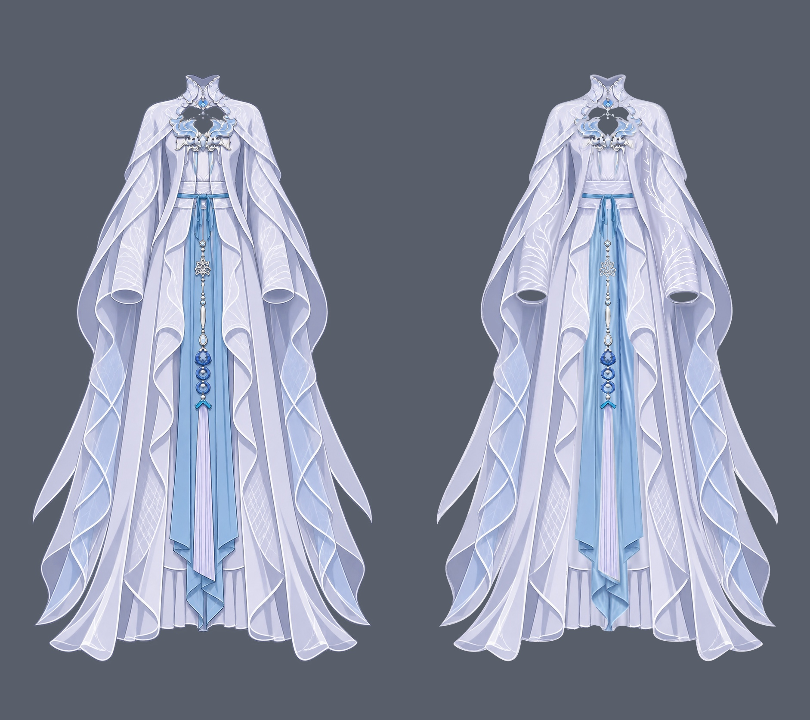

结论：需要修复

本轮独立检查已完成。确认 **4 类问题、5 个具体返修位置：R1、R2、R3、R4a、R4b**。主要为参考可见衣身线条遗漏、中央蓝尾折边画风和明暗丢失、短尾局部横向拼接，以及内裙两侧窄条接片。以下编号为本轮编号，与 review-01 的编号分别使用。

## 输入、范围与检查方式

- 实际工程：`../../clothing-raster-layering/step01/clothing-depth.kra`。
- 实际绘画参考：`../../clothing-part-layering/references/clothing.png`。已依正式 `report.md` 确认，不用原穿衣人物代替纯衣服参考。
- 结构输入：`../../clothing-part-layering/parts/`、同目录 `groups.json`、`occlusion.json`。已查看全部 37 个终止衣片的 SVG 色块及分组、深度职责。
- 已读取本步正式 `report.md`、`review-01.md`、`repair-01.md` 了解已知问题；没有将暂存记录或修复者的通过结论替代本轮看图。
- 在 Krita 5.3.4.1 重新打开上述 KRA，实际画布 **941 × 1672**，**37 个逻辑 part、48 个普通绘画层、1 个透明度蒙版**。从实际文档切换显隐并重新导出：37 个逻辑衣片完整独显、48 个深度分片独显、48 个保留下层并隐藏上层的画面，另有蒙版启用/停用各自的整图和悬线独显。
- 每个衣片都完成独显、隐藏上层、整图参考对照；长衣料另看原尺寸，腰面、袖口、下摆、串饰接点及分片接头放大复核。11 个多深度 part 均分别看分片，也看同一 part 合显。多层共同归属没有判作重复。
- 48 个绘画层的 ID 与深度逐项符合当前 occlusion 表，见 [结构核对](review-evidence/review02/structure-check.json)。前后衣片保持独立；未见人体绘画、额外背景层或逻辑衣片混并。
- 原生蒙版 `waist opening | hide completed suspension root` 属于 `100 | waist_pendant_and_tassel/upper_suspension`。已在实际工程停用、启用各看一遍：停用可见完整短根，启用隐藏腰口内短段；最后恢复默认启用。见 [蒙版开关局部](review-evidence/review02/mask-toggle.png) 及 [四个原尺寸导出](review-evidence/review02/mask/)。
- 本步只检查衣服分层。胸口镂空、领口、两正常椭圆袖口及环孔按正常开口保留；未发现需要另列的纱料透明度问题。合理隐藏褶皱、枝纹设计变化及细小像素差按合格处理。

本轮全部显隐操作仅在内存中进行，没有保存工程。工程、参考、groups、occlusion 及 parts 共 55 个输入文件检查前后 SHA-256 一致，见 [只读核对](review-evidence/review02/readonly-check.json)。哈希仅证明未改输入，不用于判断绘画质量。

[实际节点清单](review-evidence/review02/nodes.json) · [逻辑衣片清单](review-evidence/review02/parts.json) · [整图编号框选](review-evidence/review02/marks/assembled/marked.png)

## 确定需要修复的问题

框选均由 `annotate_review_regions` 生成；坐标为原画布 `[x,y,width,height]`。局部对照均为**左参考、右当前**，参考未移动或缩放来拟合当前。R3 的当前为 101 独显，R4a/R4b 的当前为内裙 002+010 合显独显；参考侧保留原有遮挡物。对隐藏区域的要求是衣料自身连续，不要求复制参考未显示的褶皱。

### R1：腰面原有两条竖向结构线被一并清掉

- **相关图层**：主修 `011 | inner_long_dress/bodice_and_waist`；用 `085 | chest_ornament` 辨清独立饰件范围，085 不需延长。
- **位置**：`[441,414,61,74]`。约 x450、x490，胸饰尖端以下至横带上方的腰面，以及带下露出的短段。
- **当前表现**：当前腰面成为横向贯通的白色网纹，原有两条深色竖线消失。011 独显中没有这两条线；叠回 085 后也没有恢复。
- **参考依据**：参考在约 y421–449 明确显示两条带深色边的竖向结构线，横带下方可见部分继续接到腰面下缘附近。它们在 085 当前长尖端以下仍跨过腰面，可在同坐标对照中直接辨认。
- **影响**：原图可见的腰面分区与线条结构缺失，胸至腰的长向结构被改为整块横向网纹。这不是隐藏补全褶皱的自由变化。
- **修复方向**：在 011 恢复参考确实可见的竖线、窄亮边及其旁边衣料明暗，按原位置和线宽接顺；线条在腰带、短环等实际遮挡处自然进入后方。恢复后分别看 011、011+085、整图，确认合法衣身线条存在且饰件外没有额外残影。
- **需要保留**：本轮已清干净的衣身底布、完整轮廓、白色腰缝与正常开口；085 的独立层及现有尖端。上一轮清除的点阵、碎线和饰件残痕不应原样贴回。

[参考／085独显／011独显／组装放大](review-evidence/review02/chest-waist-detail.png) · [腰面较大范围对照](review-evidence/review02/waist-compare.png) · [框坐标与图层](review-evidence/review02/marks/assembled/regions.json)

### R2：中央蓝尾可见折返段丢失清楚的深蓝折边与窄亮边

- **相关图层**：主修 `020 | central_blue_drapery/central_folded_tail | front`。同 part 的 `010.1 | … | back waist root` 继续保留；118 流苏保持独立。
- **位置**：`[428,1298,99,175]`，流苏末端后方露出的中央蓝尾折返，至约 y1467 的下端。
- **当前表现**：该段变成偏浅的宽软渐变及放射褶，原长竖折线、窄亮边和转折处的深蓝描线明显弱化或消失。下端收口也读成柔软扇状渐变，与周围保留的清晰描边脱节。
- **参考依据**：参考中可见长向深蓝折边、窄亮包边，以及转折处明确的斜线和折面明暗；原尺寸局部即可辨认，见下方同坐标对照。
- **影响**：原图可见蓝布的折面结构和线描画风改变，中央尾与两侧蓝幅、内裙的线条风格不一致。
- **修复方向**：恢复这段本片自身的深蓝轮廓、长竖折线、窄亮边和参考可见折面；把隐藏长布的合理纵褶接入恢复后的折面，避免在流苏末端或原图覆盖边界留下新的硬接。分别复核 020、10.1+020、与 118 及两侧蓝幅合显。
- **需要保留**：完整腰根和长尾、既有前后分片、总体长度及下端折返身份；118 的浅紫穗束、斜端和独立层。修改范围集中于蓝尾自己的可见折返段。

[参考／中央尾独显／组装放大](review-evidence/review02/central-fold-focus.png) · [三片完整蓝布原尺寸独显](review-evidence/review02/blue-native.png) · [下摆大范围对照](review-evidence/review02/hem-compare.png)

### R3：画面右短尾独显仍有横向拼接截线

- **相关图层**：主修 `101 | waist_sash_and_knot/left_short_tail`；邻接 `103 | waist_sash_and_knot/left_short_loop` 仅作遮挡复核。
- **位置**：`[477,507,22,18]`，101 中段约 y514，接近 103 的下端。
- **当前表现**：101 独显可见一条横穿纵向明暗的细暗截线，截线两侧高光有小台阶；保留下层、隐藏 103 后同样存在。它横切同片纵向色带，与下方自然斜折的方向不相接，呈现补全段接回原可见段的拼接。
- **参考依据**：参考此处部分由独立短环 103 遮住，短尾露出部分沿长向延续；因此不限定隐藏褶皱的具体设计。当前 101 本层的横截线及明暗台阶可由独显和隐藏上层两种画面直接确认。
- **影响**：默认合显时上层遮去部分问题，但短尾独显或上层移动后会露出截线，不满足同一完整短尾无拼接的要求。
- **修复方向**：在 101 本层小范围清掉横截线，将上、下方对应的纵向高光、暗带和窄边逐条接顺。保留下方原有自然斜折；修后检查 101 独显、隐藏 103、101+103 和全显。
- **需要保留**：完整上根、原有尾长和尖端、可见折面、103 的独立短环身份及回折。此处无需重画全部腰带或合并短环与短尾。

[原尺寸局部放大：参考／101／103／隐藏上层／组装](review-evidence/review02/tail101-focus.png) · [101编号框选](review-evidence/review02/marks/tail101/marked.png) · [框坐标与图层](review-evidence/review02/marks/tail101/regions.json)

### R4a、R4b：内裙两侧恢复的窄条与补全料仍有台阶及长竖接片边

- **相关图层**：主修 `010 | inner_long_dress/long_skirt | front`；修后连同 `002 | inner_long_dress/long_skirt | back` 合显复核。两处均在前裙面内部，不是正常前后深度分界。

| 编号 | 原画布框 | 位置及当前表现 |
| --- | --- | --- |
| R4a | `[359,1296,32,174]` | 画面左侧，约 x376。下部横缝从补全料接入恢复的可见窄条时，约 y1310–1322 有明显台阶；亮暗双边由接头沿窄条外缘贯穿至裙口。 |
| R4b | `[553,1296,35,174]` | 画面右侧，约 x568。同样存在横缝落差，外侧直亮边、底色色差和下包边硬接延续至裙口。 |

- **参考依据**：参考可见窄条的深褶、横缝及白色下包边已大体恢复，这是应保留的内容；被外袍挡住的裙料需要自然延续。当前内裙独显在复制窄条的外界形成突变，横缝无法作为同一条连续缝线读通。其证据来自完整裙面及 010 独显，不要求隐藏裙面与参考逐褶一致。
- **影响**：独显原尺寸即能读出两条竖向贴片，上层外袍隐藏后暴露横缝断阶、长亮边与材料切换。全显时遮住大部不能解决单片连续性问题。
- **修复方向**：分别以两侧参考可见横缝的弧度向隐藏区延续，消除接点的突然落差；清掉窄条复制边，重接两边底色、纵褶及白色下包边。修复范围应包含整条接片边到下沿，不能只抹平横缝一个点。之后检查 010、002+010、隐藏外袍和整图。
- **需要保留**：已恢复的可见深紫褶线、横缝与白包边；完整裙身、总体裙长、两侧后绕料和前后独立层。中央蓝尾及外袍继续归各自衣片。

[两处当前接头放大](review-evidence/review02/skirt-junctions.png) · [完整裙面原尺寸](review-evidence/review02/skirt-native.png) · [参考／内裙独显／组装](review-evidence/review02/skirt-native-focus.png) · [内裙编号框选](review-evidence/review02/marks/skirt/marked.png) · [框坐标与图层](review-evidence/review02/marks/skirt/regions.json)

## 上轮返修的独立复核

本轮没有把已解决的问题原样再次列入：蓝布腰根现位于衣身之后，中央淡紫腰面已露出；袖筒原斜向拼接边已去除，袖垂布前后职责得到修正；右袖口外侧裂隙和内侧矩形接头已闭合、接顺；两侧蓝长幅不再有原大片平色曲线硬接；流苏帽蓝色及自身深色边恢复；腰带和短带的包边、折面已恢复。

仍需局部完善的内容由本轮 R1、R3、R4a/R4b 具体限定；R2 为中央蓝尾可见折返段。袖筒枝纹的具体排列、合理隐藏褶皱及小像素差未另列为问题。

## 全部衣片检查清单

下表各行均完成：逻辑衣片所有深度合显独显、各深度分别独显、逐深度隐藏上层看补全、整图参考及相邻衔接复核。“未见确定必修”表示本轮未找到可明确举证的问题。编号 P 与本轮证据清单一致。

| 编号 | 逻辑 part | 实际绘画层 | 本轮结果 |
| --- | --- | --- | --- |
| P01 | `collar_shoulder_cape/standing_collar` | 001 / 072 | 未见确定必修 |
| P02 | `inner_long_dress/long_skirt` | 002 / 010 | R4a、R4b |
| P03 | `waist_sash_and_knot/waist_band` | 003 / 025 | 未见确定必修 |
| P04 | `central_blue_drapery/central_folded_tail` | 010.1 / 020 | R2 |
| P05 | `central_blue_drapery/left_long_panel` | 010.2 / 021 | 未见确定必修 |
| P06 | `central_blue_drapery/right_long_panel` | 010.3 / 022 | 未见确定必修 |
| P07 | `inner_long_dress/bodice_and_waist` | 011 | R1 |
| P08 | `outer_robe_body/left_robe_panel` | 030 | 未见确定必修 |
| P09 | `outer_robe_body/right_robe_panel` | 031 | 未见确定必修 |
| P10 | `sleeve_screen_left/right_hanging_drape` | 040 / 060 | 未见确定必修 |
| P11 | `sleeve_screen_right/left_hanging_drape` | 041 / 061 | 未见确定必修 |
| P12 | `sleeve_screen_left/right_sleeve_tube` | 042 / 050 | 未见确定必修 |
| P13 | `sleeve_screen_right/left_sleeve_tube` | 043 / 051 | 未见确定必修 |
| P14 | `collar_shoulder_cape/left_shoulder_cape` | 070 | 未见确定必修 |
| P15 | `collar_shoulder_cape/right_shoulder_cape` | 071 | 未见确定必修 |
| P16 | `collar_jewel_fastener/left_beaded_chain` | 080 | 未见确定必修 |
| P17 | `collar_jewel_fastener/right_beaded_chain` | 081 | 未见确定必修 |
| P18 | `collar_jewel_fastener/central_pendant/hanging_bead` | 082 | 未见确定必修 |
| P19 | `collar_jewel_fastener/central_pendant/connecting_ring` | 083 | 未见确定必修 |
| P20 | `collar_jewel_fastener/fixed_jewel` | 084 | 未见确定必修 |
| P21 | `chest_ornament` | 085 | 本层未见确定必修；R1保留并用于辨清边界 |
| P22 | `waist_pendant_and_tassel/upper_suspension` | 100 | 蒙版开/关已查，未见确定必修 |
| P23 | `waist_sash_and_knot/left_short_tail` | 101 | R3 |
| P24 | `waist_sash_and_knot/right_short_tail` | 102 | 未见确定必修 |
| P25 | `waist_sash_and_knot/left_short_loop` | 103 | 本层未见确定必修；R3邻接复核 |
| P26 | `waist_sash_and_knot/right_short_loop` | 104 | 未见确定必修 |
| P27 | `waist_sash_and_knot/center_knot` | 105 | 未见确定必修 |
| P28 | `waist_pendant_and_tassel/middle_articulated_chain/upper_connector_segment` | 108 | 未见确定必修 |
| P29 | `waist_pendant_and_tassel/middle_articulated_chain/elongated_link` | 109 | 未见确定必修 |
| P30 | `waist_pendant_and_tassel/snowflake_medallion` | 110 | 未见确定必修 |
| P31 | `waist_pendant_and_tassel/middle_articulated_chain/teardrop_link` | 111 | 未见确定必修 |
| P32 | `waist_pendant_and_tassel/lower_pendant_and_rings/main_pendant` | 112 | 未见确定必修 |
| P33 | `waist_pendant_and_tassel/lower_pendant_and_rings/lower_ring_assembly/inner_pendant` | 113 / 115 | 未见确定必修 |
| P34 | `waist_pendant_and_tassel/lower_pendant_and_rings/lower_ring_assembly/ring_frame` | 114 | 未见确定必修 |
| P35 | `waist_pendant_and_tassel/lower_pendant_and_rings/upper_ring_assembly/inner_pendant` | 116 | 未见确定必修 |
| P36 | `waist_pendant_and_tassel/lower_pendant_and_rings/upper_ring_assembly/ring_frame` | 117 | 未见确定必修 |
| P37 | `waist_pendant_and_tassel/long_tassel` | 118 | 未见确定必修 |

## 检查证据索引

所有引用证据均保存在本步正式目录 `review-evidence/review02/`，均为本轮重新从实际 KRA 导出的图或基于这些导出的观察图。灰底仅为观察透明区域。

- 37 个逻辑衣片独显：[P01–08](review-evidence/review02/parts-01.jpg)、[P09–16](review-evidence/review02/parts-02.jpg)、[P17–24](review-evidence/review02/parts-03.jpg)、[P25–32](review-evidence/review02/parts-04.jpg)、[P33–37](review-evidence/review02/parts-05.jpg)。对应原尺寸透明 PNG 在 [parts/](review-evidence/review02/parts/)。
- 48 个实际绘画分片独显：[1](review-evidence/review02/slices-01.jpg)、[2](review-evidence/review02/slices-02.jpg)、[3](review-evidence/review02/slices-03.jpg)、[4](review-evidence/review02/slices-04.jpg)、[5](review-evidence/review02/slices-05.jpg)、[6](review-evidence/review02/slices-06.jpg)。对应原尺寸透明 PNG 在 [slices/](review-evidence/review02/slices/)。
- 48 个逐深度隐藏上层画面：[1](review-evidence/review02/lower-01.jpg)、[2](review-evidence/review02/lower-02.jpg)、[3](review-evidence/review02/lower-03.jpg)、[4](review-evidence/review02/lower-04.jpg)、[5](review-evidence/review02/lower-05.jpg)、[6](review-evidence/review02/lower-06.jpg)、[7](review-evidence/review02/lower-07.jpg)、[8](review-evidence/review02/lower-08.jpg)。图集按当前目标分片取局部，未改变显隐；完整画布 PNG 在 [lower/](review-evidence/review02/lower/)。
- 实际上游 SVG 色块：[1](review-evidence/review02/structure-01.jpg)、[2](review-evidence/review02/structure-02.jpg)、[3](review-evidence/review02/structure-03.jpg)、[4](review-evidence/review02/structure-04.jpg)、[5](review-evidence/review02/structure-05.jpg)。色块只用于归属、形体及范围判断，不当作绘画纹理标准。
- [前后分片合显接头](review-evidence/review02/depth-junctions.png)、[腰带分片检查](review-evidence/review02/band-depth-focus.png)（自上而下为参考、完整腰带、003、025、隐藏上层、组装）、[长袍和袖垂布原尺寸](review-evidence/review02/robes-drapes-native.png)。
- [领肩胸腰对照](review-evidence/review02/top-compare.png)、[左袖对照](review-evidence/review02/left-sleeve-compare.png)、[右袖对照](review-evidence/review02/right-sleeve-compare.png)、[串饰接点对照](review-evidence/review02/chain-compare.png)、[蒙版开关](review-evidence/review02/mask-toggle.png)。

检查结束已恢复所有衣片显示及原生蒙版启用，未保存或修改 KRA、分组、深度或任何分层输入。本轮只写本暂存报告及检查证据；未改正式 review／repair、运行状态或调度记录。
