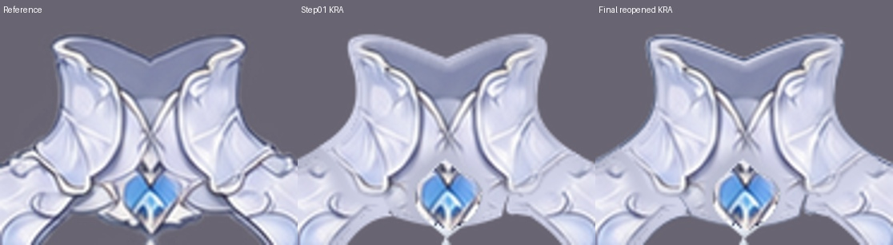
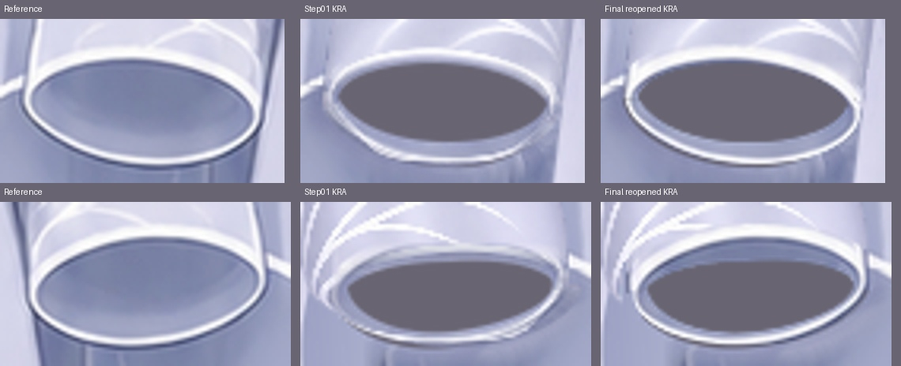
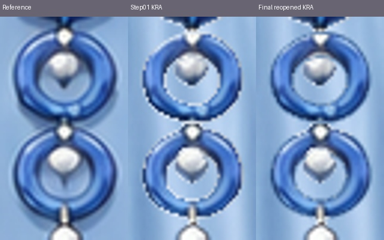
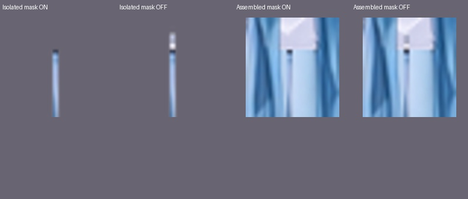
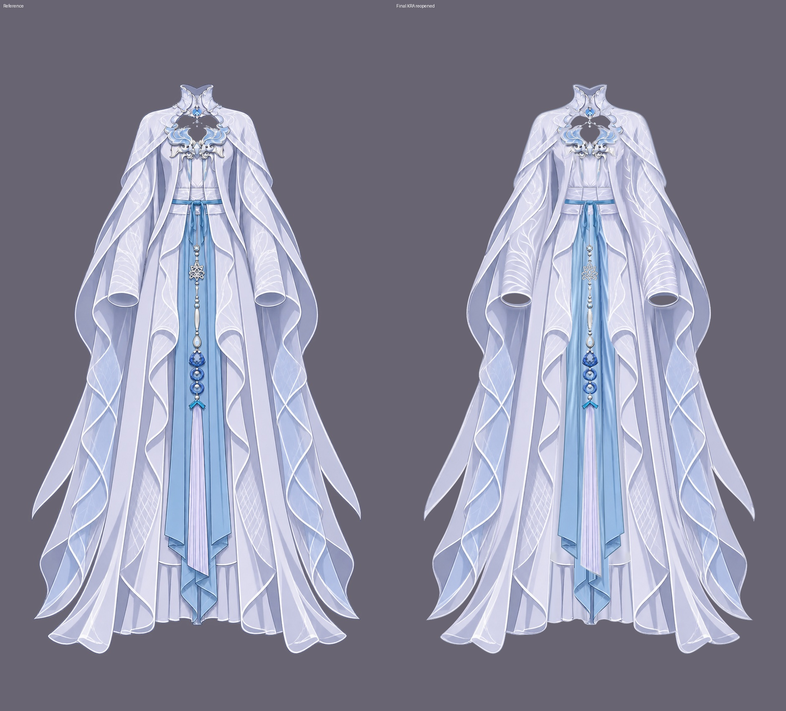

# 衣服边缘精修与最终衣片报告

交付：[clothing-soft-edges.kra](clothing-soft-edges.kra)。从第一步工程另存并持续修改，未覆盖第一步。画布保持 **941 × 1672、RGBA/U8**；37 个逻辑衣片、48 个普通绘画分片、1 个原生透明度蒙版。当前为完成逐层检查和保存重开核对后的版本。

## 检查覆盖

先读取第一步 report.md，按 groups.json 的37个终止衣片及 occlusion.json 的48个实际深度核对。检查48个分片完整底图、37个同part多深度合显，以及逐层隐藏其上方图层的48个画面；沿外轮廓、包边、开口和隐藏接缝查看。原穿衣角色仅用于确认袖口、领口和饰件穿插，没有取人体像素。

完整逐项清单及无损PNG：[逐层覆盖记录](evidence/layer-review.md)。

- 完整衣片图集：[1](evidence/parts-01.jpg) · [2](evidence/parts-02.jpg) · [3](evidence/parts-03.jpg) · [4](evidence/parts-04.jpg) · [5](evidence/parts-05.jpg) · [6](evidence/parts-06.jpg) · [7](evidence/parts-07.jpg)。
- 48个绘画分片图集：[1](evidence/layers-01.jpg) · [2](evidence/layers-02.jpg) · [3](evidence/layers-03.jpg) · [4](evidence/layers-04.jpg) · [5](evidence/layers-05.jpg) · [6](evidence/layers-06.jpg) · [7](evidence/layers-07.jpg) · [8](evidence/layers-08.jpg)。
- 隐藏上层图集：[1](evidence/hidden-upper-01.jpg) · [2](evidence/hidden-upper-02.jpg) · [3](evidence/hidden-upper-03.jpg) · [4](evidence/hidden-upper-04.jpg) · [5](evidence/hidden-upper-05.jpg) · [6](evidence/hidden-upper-06.jpg) · [7](evidence/hidden-upper-07.jpg) · [8](evidence/hidden-upper-08.jpg)。

## 实际修改及原因

| 衣片 / 深度 | 修改 | 原因与验收结果 |
| --- | --- | --- |
| 立领001、072；肩披070、071 | 沿本片外弧、领侧、内缘及隐藏根接续窄暗线，补隐藏下缘 | 原边线偏淡或未接完；合显后与既有白包边相接，不在前后切口加重描边，胸洞和颈口保持。 |
| 袖筒042/050、043/051 | 重建左右袖口自身的窄包边与平顺弧线，清除原孔内残留细线和重复灰白边；保留远侧内壁与中间开口 | 早期试修仍有重复细边，最终改用参考中**本袖自身的窄包边材料**、按两侧不同倾斜弧度局部修复。未带入垂布、手腕或人体；前后深度继续独立。 |
| 右袖筒051 | 沿58段指定霜枝的窄笔刷路径作轻度局部收边 | 处理局部齿状笔触，保留原枝纹和袖料；没有全层模糊、全局羽化或整层改色。试用的窄克隆修补产生纹样串入，已撤回，未进入交付。 |
| 蓝长幅010.2/021、010.3/022 | 细暗边从隐藏腰根沿两侧接至斜端、短回折 | 原侧线较参考偏淡，移动衣片后也需有连续边线。前后分片使用同一轮廓接续，不画横截描边，不改完整衣料。 |
| 长袖垂布040、041 | 沿长外缘、分叉、自折尾弧接顺窄白边和细暗轮廓 | 原轮廓偏软、浓淡不齐；前翻060/061及真实开口保留，不合层、不擦筒后完整续料。 |
| 长袍030、031；内裙002、010 | 补下摆连续窄轮廓；内裙沿完整褶缘接通偏弱白边 | 不改变卷折、横缝、裙褶或原有补绘接片；隐藏后也能沿下摆整圈接续。 |
| 胸饰085 | 沿两侧内弧接续窄金白边与细暗衬线 | 原内边偏淡，修后与已有饰件线条相接；完整卷叶、长端、中央开口及独立归属保留。 |
| 下/上蓝环114、117；珠体115、116 | 按本片曲线重整内外沿抗锯齿，去白色齿状残边，保留内部材质；复核并接完整114下杆 | 环框与珠体继续独立；下珠113短挂接与115圆拱两肩职责不变。环孔透明，杆端和隐藏短根仍完整，未合并珠与环。 |

实际改动23个绘画层，其余25个绘画层全画布像素与输入一致。40个绘画层alpha逐字节保持；仅042、043、050、051、114、115、116、117在上述局部边缘重整alpha。未改变纱料的大面积透明度、衣料归属或正常开口。新增暗线均是本片固有边线，没有新增阴影、AO或投影。

## 候选框补查

先作逐层独显检查，再以像素候选补查整图遗漏。初查101框，中途104框，最终保存重开画面101框；每框均在参考/当前局部对照、对应整图分区及实际衣片中看图确认。默认阈值保持，**计数不作为验收分数**。

最终逐框范围、看图结果和13张对应对照图：[101框补查记录](evidence/candidate-review.md)；原始候选：[JSON](evidence/differences-final.json)。

- 袖口missing主要是正常透明孔，未用参考中投影式灰面封住。包边重复、残线与弧线粗糙已实际修复。
- 领肩、胸饰、蓝幅、长垂布及裙袍边缘候选用于发现偏淡、未接完的细线，已按各片自身轮廓修画。
- 蓝环与珠的齿状白边已清理；所有环孔、短根及下杆又作独显与合显复核。
- 其余框对应既有补绘纹样、衣料褶面、内侧续料、轻微轮廓偏差和笔触色差，具体保留判断逐项记在补查表。

## 保留的差异

以原尺寸整体观看及局部放大作判断，保留以下视觉可接受差异：袖料霜枝的疏密和走向、衣身及蓝布补全区的衣褶与高光、长垂布/袍摆自折的细小弧度偏差，以及高倍放大可见的少量细笔触颗粒。银饰和宝石的细小高光形状也有差异。没有按差异热图逐像素换色，也未为追求计数裁掉内侧衣料或隐藏补全。

多深度分片的人工切口不当作整片外轮廓重复描边；已拆出的围领、袖口、垂布、腰带、蓝布根和下悬珠保持第一步共同归属及独立深度。

## 蒙版、保护与重开核对

100层的 `waist opening | hide completed suspension root` 原生透明度蒙版像素、UUID、附着层和默认启用状态均不变。关蒙版可见完整悬线根，启用后仅隐藏原腰口短根，检查后恢复启用。

按批保存当前工程，最终关闭后重新打开同一路径KRA。49个节点的名称、UUID、层序、父子关系、显隐、不透明度、混合模式、继承alpha、锁定状态及像素哈希全部一致，画布、色彩配置和整图投影一致。与输入比较，上述结构字段全部保持。

[重开核对](evidence/reopen-check.json) · [输入保护核对](evidence/protected-check.json) · [上游结构逐项核对](evidence/structure-check.json) · [最终清单与KRA哈希](evidence/final-manifest.json)。保存桥接偶有QProgressDialog被自动取消的提示，但保存函数返回true；最终以成功关闭重开及逐节点、投影完全一致确认写盘成功，无遗留工具故障。

## 未解决的问题

未发现仍需修复的验收问题。上文列出的纹样、褶面、微小轮廓与笔触差异作为视觉可接受差异保留。本步没有推进后续组装或阴影步骤。
