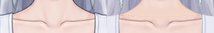
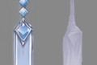

结论：需要修复

本次已完成全部 65 个逻辑 part、69 个普通绘画分片、13 个透明度蒙版的独立检查。确认 13 项需要修复的问题，位置细分为 R1–R13 的字母子框。主要影响是可见原画笔触缺失、颈根及掌指接缝、长发混入饰件残影、踝链断接和足趾脏边。

## 检查依据与方式

- 当前工程：`../../raster-layering/step01/character-depth.kra`。
- 实际原参考依据 `report.md` 确认为 `../../part-layering/references/base-subject.png`。画布均为 941 × 1672，保持同一坐标。报告比较图全部左参考、右当前。原参考外围的抠图杂边已排除出判断。
- 已读取 `part-layering/groups.json`、`occlusion.json`、各 part SVG 和本步正式 `report.md`。检查开始时本步尚无正式 review / repair Markdown；工作区暂存文件未当作完成依据。
- 在 Krita 5.3.4.1 实际打开当前 KRA，从当前图层原生导出独显、蒙版启用独显、隐藏上层合成、蒙版停用且隐藏上层合成。所有部件均看过以上状态；再同坐标对照整图，放大查看发根、冠架与额饰搭接、睫毛分片、颌颈、颈肩、衣片、肘腕、掌指、腿口及踝足。
- 独显完整纹理时临时停用透明度蒙版与继承透明度；蒙版启用独显仍关闭剪贴继承，便于辨认本件开口效果。默认合成核对真实剪贴和遮挡。最后恢复全部原始显隐及继承状态，没有保存 KRA。
- 四个多深度 part 的 8 个分片均分别看过并合看：冠架 61.5/67、额饰 62/65、左上睑 42/66、右上睑 48/66.5。当前搭接连续，没有因多片同件而判为重复，也没有要求合层。
- 以下是看图确认的确定问题。完整隐藏底形、合理根部补全及细微色调差异允许保留；没有以相似度数值作判断。

[当前默认合成](review-01-evidence/current/default.png) · [全部蒙版停用](review-01-evidence/current/all-masks-disabled.png) · [实际图层树与 UUID](review-01-evidence/current/tree.json) · [深度分片及合看](review-01-evidence/inspection/depth-slices.png)

## 问题定位

[默认合成编号总图](review-01-evidence/composite/marked.png) · [长发独显 R8 总图](review-01-evidence/hair-isolated/marked.png) · [踝链前后合看 R12 总图](review-01-evidence/anklet-pairs/marked.png)。每个目录内均保留 `regions.json`、同坐标当前局部、参考局部和并列对照；下面链接直接定位对照图。框坐标格式为原画布 `[x,y,width,height]`，字母表示同一问题的不同位置。

### R1 — 颈根与胸前底形有横向接缝

- 图层：`030.0 | neck | complete`、`031.0 | body/torso | complete`，以及 `neck_and_shoulder_attachment_blend`。
- 位置：R1 `[405,340,128,23]`，锁骨上方、两肩带之间。
- 当前与参考：默认蒙版开启仍可见一条横向浅色带，其上有灰紫色小点，颈部扩张到胸前时出现截断感。参考这里是连续肤色与自然下行的颈胸明暗，没有这条带状边。
- 影响：原尺寸就能辨出颈部与 torso 的拼接。
- 修复：在颈根与 torso 的真实重叠内接顺两层底色和笔触，再调整本处蒙版过渡；清掉带上的杂点。保留锁骨、颈部原阴影、肩带边线和完整颈根，不用大范围模糊代替接色。

### R2 — 三件连体衣的可见塑形、边线与接续笔触缺失

- 图层：`031.0 | body/torso | complete`、`032.0 | body/breast | complete`、`013.0 | pelvis | complete`；胸片的 `torso_attachment_blend` 也需随绘画复核。
- 位置：R2a `[362,392,214,153]`（胸与胸下侧边），R2b `[343,533,253,286]`（腰腹到腿口）。
- 当前与参考：三件独显都以近乎均匀的淡紫白填色为主，组装后原胸部亮面、侧下方暗部、腰腹渐层、裆尖暗部大幅消失。胸侧轮廓成为薄色块转折；腰部缝线有生硬折点。腿口原有深边与窄亮边只剩浅白细线。参考中这些笔触共同塑造紧身衣与身体的体积。
- 影响：胸部体积、腰胯材质和衣口厚度发生明显变化，胸片到躯干、躯干到骨盆的缝线也缺少原有自然接续。这超过细微色调差异。
- 修复：各件内恢复参考可见区的柔和布面亮暗、深浅边线和弧形缝线；在两处重叠内逐条接顺线宽、走向及色面。独显补全处沿相同笔触延续。保留完整 torso 底、独立胸片/骨盆、当前轮廓范围及肩颈控制，不挖遮挡孔或将衣片合并。

[R2a 胸部对照](review-01-evidence/composite/R2a-comparison.png) · [R2b 腰胯对照](review-01-evidence/composite/R2b-comparison.png) · [较大局部](review-01-evidence/inspection/compare-torso.png)

### R3 — 双手掌指拼接明显，指甲和手指画法失真

- 图层：右手 `014.0–018.0` 的 `little_finger/ring_finger/middle_finger/index_finger/thumb`、`021.0` palm、`020.0` forearm；左手 `024.0–028.0` 的 `index_finger/middle_finger/little_finger/ring_finger/thumb`、`029.0` palm、`022.0` forearm。完整层名见末尾逐件表及图层树。
- 位置：R3a `[279,773,49,133]`（画面左手），R3b `[611,776,49,131]`（画面右手）。
- 当前与参考：右掌覆盖拇指根时留下硬横向色阶；左掌下缘与长指根也有截断边。腕掌轮廓有台阶。指体为平涂，重叠处原深色线与阴影不足；两个拇指甲从原圆润甲面变为小方框。参考的掌指肤色、轮廓和指甲连续自然。
- 影响：手指像贴在掌下的色片，原指形、叠指层次与手部画风丢失。
- 修复：先按原参考恢复各指可见轮廓、指甲及叠指暗部，再在各自层内接顺掌指和腕掌的肤色、轮廓与线宽。保留原姿势、各指长度、指根补全、掌部已恢复的有效细褶线，以及全部独立归属。

[R3a 对照](review-01-evidence/composite/R3a-comparison.png) · [R3b 对照](review-01-evidence/composite/R3b-comparison.png) · [右手放大](review-01-evidence/inspection/compare-right-hand.png) · [左手放大](review-01-evidence/inspection/compare-left-hand.png)

### R4 — 两眼瞳形、虹膜和眼睑笔触与原画明显不同

- 图层：左右 `iris`、`highlight`、`sclera` 及上下眼睑、褶线；尤其 `039.0/045.0` 虹膜、`040.0/046.0` 高光。上眼睑 42/66、48/66.5 的同件分片需要一起复核。
- 位置：R4a `[409,202,47,40]`（画面左眼），R4b `[482,202,50,40]`（画面右眼）。
- 当前与参考：原近圆形暗瞳改成了明显细长的竖椭圆；虹膜的深外圈、内部反光和纹理被简单上下蓝色渐变替换，高光分布改变。上睑/下睑和褶线变成规则色线，原有眼线笔锋、睫毛及柔和眼周层次不足。
- 影响：角色眼神和面部画风明显改变；并非隐藏虹膜上段的合理补全差异。
- 修复：依据本侧原可见笔触恢复瞳形、虹膜层次、高光及睑线；隐藏虹膜仍补成完整形体。保持眼白不挖虹膜孔、高光独立、原生剪贴与开口蒙版、上睑两深度归属及当前正确的片间搭接。

[R4a 对照](review-01-evidence/composite/R4a-comparison.png) · [R4b 对照](review-01-evidence/composite/R4b-comparison.png)

### R5 — 嘴部纵深与唇缘细节缺失，唇片接色偏硬

- 图层：`050.0` mouth_interior、`052.0` tongue、`053.0` upper_teeth、`054.0` lower_lip、`055.0` upper_lip。
- 位置：R5 `[446,252,46,45]`。
- 当前与参考：当前像暗红平面开口叠粉色色块，缺少参考中口腔上壁与舌缘的层次；双唇原细亮边、下唇高光和柔和皮肤过渡消失，嘴角唇片边缘显出硬接色。
- 影响：口腔显平，唇片与脸底有贴片感，张口表情的原有画法未保留。
- 修复：分别在口底、舌、双唇中恢复原可见明暗与高光，并接顺嘴角及唇外肤色。保持口腔完整底形、完整牙舌、默认下牙隐藏、上牙露出量和共享开口蒙版。

### R6 — 双耳饰可见形体及连续金属笔触改变

- 图层：`033.0 | head_accessories/earrings/earring_right | complete`、`034.0 | head_accessories/earrings/earring_left | complete`。
- 位置：R6a `[402,251,20,96]`，R6b `[516,251,20,96]`。
- 当前与参考：两侧原竖向菱形宝石、短节与柳叶形长坠，被改成倾斜碎片和窄条；长坠原深边、宽亮暗面及收尖笔触缺失，金属轮廓断碎。左右原画各自的朝向也未保持。
- 影响：原图可见饰件的形体、材质和画风发生明显变化。
- 修复：按各侧参考恢复宝石、短节和长坠的轮廓、宽度、朝向与连续笔触；连接端在本件内接顺。保留完整安装根、原长坠长度及左右各自归属。

[R6a 对照](review-01-evidence/composite/R6a-comparison.png) · [R6b 对照](review-01-evidence/composite/R6b-comparison.png)

### R7 — 两束长发的原可见分束与边线大面积丢失

- 图层：`001.0 | hair/back_hair/long_hair_right | complete`、`002.0 | hair/back_hair/long_hair_left | complete`。
- 位置：R7a `[224,188,177,1246]`，R7b `[539,188,176,1246]`；重点是肩臂外侧、外弯分叉及小腿旁长梢的原可见区。
- 当前与参考：原有清晰纵向分束、成面的高光、细暗边及尖梢笔锋，变成大面积柔糊条纹；尤其上长直段和下长梢缺乏原画的层次，与当前前侧发面也不协调。独显确认这些变化来自长发自身绘画。
- 影响：长发材质和画风明显改变，原可见内容没有完整保留。
- 修复：沿各侧原发流恢复清晰分束、深浅折面和细边线，再将补全区接入同样的笔触。保留当前完整隐藏发面、合理补根、连续外弯、分叉及长梢长度；根部轮廓按已有 part 结构保持，不需因本项重分层。

[R7a 对照](review-01-evidence/composite/R7a-comparison.png) · [R7b 对照](review-01-evidence/composite/R7b-comparison.png) · [可见中段放大](review-01-evidence/inspection/compare-hair-mid.png)

### R8 — 左长发混入冠吊饰宝石残影

- 图层：`002.0 | hair/back_hair/long_hair_left | complete`。正确饰件属于 `006.0 | head_accessories/crown_pendants/crown_pendant_left | complete`。
- 位置：R8 `[585,149,28,49]`，画面右侧狭长上发段。
- 当前与参考：隐藏全部其他部件、停用蒙版后，002 中仍清楚可见菱形宝石切面、V 形暗线及上方细串的紫色残影。同坐标原图此形体是冠吊饰，006 已承担它。该残影不是发纹。
- 影响：违反单层归属；发束独显、摆动或饰件移开时会露出第二个饰件鬼影。
- 修复：仅在 002 中清除宝石与串接的残线/折面，补为连续纵向发流并接顺周边亮暗。保留 002 的完整发根、发束轮廓及全部长段；保留 006 自己的宝石绘画，不以默认遮挡掩盖残影。

### R9 — 双臂、双腿原有轮廓线和关节塑形缺失

- 图层：`019.0/023.0` upper_arm、`020.0/022.0` forearm、`009.0/010.0` leg；肩端衔接还涉及 `031.0` torso。
- 位置：R9a `[282,351,120,448]`、R9b `[536,351,121,448]`（两臂）；R9c `[332,715,275,395]`（大腿与内侧接触）；R9d `[377,1090,185,408]`（膝下与小腿）。
- 当前与参考：四肢原细深轮廓与边缘亮暗被大幅削弱，浅色像素台阶直接充当外边界；肘、膝原有细亮暗变糊。双腿内侧原连续清晰的分界线消失，局部融为一片后又露出锯齿细缝。原图是有细描边的清晰绘画。
- 影响：四肢可见结构和画风与参考不一致；腿间接触关系读不清。本项要求恢复缺失的绘画内容，不能只做边缘抗锯齿。
- 修复：在各自部件内恢复参考可见轮廓的颜色、粗细、细高光和肘膝笔触；两腿内侧保持各自完整边线与原接触关系，肘腕位置接顺。保留完整根部、现有全长、比例、自然肤色渐层及 part 归属。

[R9a 对照](review-01-evidence/composite/R9a-comparison.png) · [R9b 对照](review-01-evidence/composite/R9b-comparison.png) · [R9c 对照](review-01-evidence/composite/R9c-comparison.png) · [R9d 对照](review-01-evidence/composite/R9d-comparison.png)

### R10 — 双足趾缝和甲缘破碎，足底有杂点与横向脏边

- 图层：`009.0 | legs/leg_right/leg | complete`、`010.0 | legs/leg_left/leg | complete`。
- 位置：R10a `[400,1586,70,60]`，R10b `[468,1586,71,60]`。
- 当前与参考：趾缝由原连续细线变成断续杂色；趾甲弧线、趾腹和足底边线缺损。画面左拇趾底可见黑青孤点，画面右趾底还有粗糙横向浅边和杂点。独显中同样存在。
- 影响：足趾形体与原有干净笔触不符，原尺寸下足底显脏。
- 修复：清除这些杂色点与不属于自然趾缝的横边，按各侧参考重接趾缝、甲缘、趾腹及连续足底轮廓，保持原明暗。保留完整足部、全部脚趾与趾间走向，足背贴附链仍归 leg。

[R10a 对照](review-01-evidence/composite/R10a-comparison.png) · [R10b 对照](review-01-evidence/composite/R10b-comparison.png) · [双足放大](review-01-evidence/inspection/compare-feet.png)

### R11 — 绕踝前链与足背中央链断接

- 图层：`011.0/012.0` anklet_front，与对应 `009.0/010.0` leg 中的足背链。
- 位置：R11a `[411,1494,55,53]`，R11b `[473,1494,53,53]`，尤其中央连接点。
- 当前与参考：画面左侧中央链头明显悬在珠环下方；另一侧也有间断/连接不足。参考的中央银链直接接住绕踝链。当前前珠链的紧密金属连接形态也被稀疏圆珠替换。
- 影响：原图相连的饰物断开，组装显出悬空链头。
- 修复：在前链和 leg 各自所属内容内补齐连接长度与细链节，恢复原参考接点和连贯金属笔触；在默认姿态原尺寸核对无空隙。保留前后绕踝分工、足背链归属及当前完整足部。

[R11a 对照](review-01-evidence/composite/R11a-comparison.png) · [R11b 对照](review-01-evidence/composite/R11b-comparison.png)

### R12 — 前后踝链合看缺少连续珠间连接和顺畅转接

- 图层：右侧 `007.0` anklet_back 与 `011.0` anklet_front；左侧 `008.0` anklet_back 与 `012.0` anklet_front。检查时停用后段默认隐藏蒙版并隐藏双腿。
- 位置：R12a `[413,1493,51,24]`，R12b `[475,1493,51,24]`。
- 当前与参考：前后段独显及合看，多处只有离散圆珠，珠间缺少清晰连续银丝；两侧转接处珠粒挤叠或不连成顺畅环形。原可见前链为紧密珠粒及银色连接，groups 中后段明确是同一绕踝链的连续后半段。
- 影响：隐藏结构在独显与转动显露时成为散珠，前后部件无法读成完整环绕饰物。
- 修复：按原前链的材质尺度补各件自身珠间细银连接，接顺前后端点；避免为接缝叠出双珠。保留完整后段、当前环绕位置、前后各自归属，以及后段默认隐藏的原生蒙版。

[R12a 原参考/前后合看](review-01-evidence/anklet-pairs/R12a-comparison.png) · [R12b 原参考/前后合看](review-01-evidence/anklet-pairs/R12b-comparison.png) · [前后合看放大](review-01-evidence/inspection/anklet-pairs.png)

### R13 — 双耳原可见耳廓与内耳明暗被简化

- 图层：`035.0 | face/ears/ear_right | complete`、`036.0 | face/ears/ear_left | complete`，及各自 `face_and_side_hair_default_occlusion`。
- 位置：R13a `[394,232,29,34]`，R13b `[515,232,29,34]`；补全耳廓也需沿修复后的画法接续。
- 当前与参考：原可见耳廓的转折、耳甲阴影与边线变成平涂肤色加 U 形线。蒙版停用独显时也显示为这种简化耳形，启用后原露出耳部的结构仍未恢复。
- 影响：头部原有解剖结构和画风丢失；补全区与可见区也缺少一致的耳部塑形。
- 修复：按本侧原可见耳部恢复耳廓折面、内耳暗部和细边线，并自然延续到隐藏耳廓。保留完整普通人耳范围、耳垂、独立归属与当前默认遮挡蒙版，不将发缘或耳饰补入耳层。

[R13a 对照](review-01-evidence/composite/R13a-comparison.png) · [R13b 对照](review-01-evidence/composite/R13b-comparison.png)

## 逐件检查记录

下表每行均已实际看过：完整独显（蒙版停用）、蒙版启用独显、隐藏上层合成（蒙版停用/启用），并在默认合成中与同坐标原参考核对。`未另列` 表示该件未发现除本报告所列问题之外的确定修复项；不代表全工程通过。各层完整名称、UUID、父组和包围盒保存在图层树。

| 逻辑 part | 实际深度 | 完整独显 / 蒙版启用 | 隐藏上层：蒙版停用 / 启用 | 关联问题 |
|---|---|---|---|---|
| `hair/back_hair/long_hair_right` | 001.0 | [停用](review-01-evidence/current/isolated/01-hair__back_hair__long_hair_right.png) / [启用](review-01-evidence/current/masked/01-hair__back_hair__long_hair_right.png) | [停用](review-01-evidence/current/reveal-off/01-hair__back_hair__long_hair_right.png) / [启用](review-01-evidence/current/reveal/01-hair__back_hair__long_hair_right.png) | R7 |
| `hair/back_hair/long_hair_left` | 002.0 | [停用](review-01-evidence/current/isolated/02-hair__back_hair__long_hair_left.png) / [启用](review-01-evidence/current/masked/02-hair__back_hair__long_hair_left.png) | [停用](review-01-evidence/current/reveal-off/02-hair__back_hair__long_hair_left.png) / [启用](review-01-evidence/current/reveal/02-hair__back_hair__long_hair_left.png) | R7, R8 |
| `hair/back_hair/cap` | 003.0 | [停用](review-01-evidence/current/isolated/03-hair__back_hair__cap.png) / [启用](review-01-evidence/current/masked/03-hair__back_hair__cap.png) | [停用](review-01-evidence/current/reveal-off/03-hair__back_hair__cap.png) / [启用](review-01-evidence/current/reveal/03-hair__back_hair__cap.png) | 未另列 |
| `hair/bun` | 004.0 | [停用](review-01-evidence/current/isolated/04-hair__bun.png) / [启用](review-01-evidence/current/masked/04-hair__bun.png) | [停用](review-01-evidence/current/reveal-off/04-hair__bun.png) / [启用](review-01-evidence/current/reveal/04-hair__bun.png) | 未另列 |
| `head_accessories/crown_pendants/crown_pendant_right` | 005.0 | [停用](review-01-evidence/current/isolated/05-head_accessories__crown_pendants__crown_pendant_right.png) / [启用](review-01-evidence/current/masked/05-head_accessories__crown_pendants__crown_pendant_right.png) | [停用](review-01-evidence/current/reveal-off/05-head_accessories__crown_pendants__crown_pendant_right.png) / [启用](review-01-evidence/current/reveal/05-head_accessories__crown_pendants__crown_pendant_right.png) | 未另列 |
| `head_accessories/crown_pendants/crown_pendant_left` | 006.0 | [停用](review-01-evidence/current/isolated/06-head_accessories__crown_pendants__crown_pendant_left.png) / [启用](review-01-evidence/current/masked/06-head_accessories__crown_pendants__crown_pendant_left.png) | [停用](review-01-evidence/current/reveal-off/06-head_accessories__crown_pendants__crown_pendant_left.png) / [启用](review-01-evidence/current/reveal/06-head_accessories__crown_pendants__crown_pendant_left.png) | 未另列 |
| `legs/leg_right/anklet_back` | 007.0 | [停用](review-01-evidence/current/isolated/07-legs__leg_right__anklet_back.png) / [启用](review-01-evidence/current/masked/07-legs__leg_right__anklet_back.png) | [停用](review-01-evidence/current/reveal-off/07-legs__leg_right__anklet_back.png) / [启用](review-01-evidence/current/reveal/07-legs__leg_right__anklet_back.png) | R12 |
| `legs/leg_left/anklet_back` | 008.0 | [停用](review-01-evidence/current/isolated/08-legs__leg_left__anklet_back.png) / [启用](review-01-evidence/current/masked/08-legs__leg_left__anklet_back.png) | [停用](review-01-evidence/current/reveal-off/08-legs__leg_left__anklet_back.png) / [启用](review-01-evidence/current/reveal/08-legs__leg_left__anklet_back.png) | R12 |
| `legs/leg_right/leg` | 009.0 | [停用](review-01-evidence/current/isolated/09-legs__leg_right__leg.png) / [启用](review-01-evidence/current/masked/09-legs__leg_right__leg.png) | [停用](review-01-evidence/current/reveal-off/09-legs__leg_right__leg.png) / [启用](review-01-evidence/current/reveal/09-legs__leg_right__leg.png) | R9, R10, R11 |
| `legs/leg_left/leg` | 010.0 | [停用](review-01-evidence/current/isolated/10-legs__leg_left__leg.png) / [启用](review-01-evidence/current/masked/10-legs__leg_left__leg.png) | [停用](review-01-evidence/current/reveal-off/10-legs__leg_left__leg.png) / [启用](review-01-evidence/current/reveal/10-legs__leg_left__leg.png) | R9, R10, R11 |
| `legs/leg_right/anklet_front` | 011.0 | [停用](review-01-evidence/current/isolated/11-legs__leg_right__anklet_front.png) / [启用](review-01-evidence/current/masked/11-legs__leg_right__anklet_front.png) | [停用](review-01-evidence/current/reveal-off/11-legs__leg_right__anklet_front.png) / [启用](review-01-evidence/current/reveal/11-legs__leg_right__anklet_front.png) | R11, R12 |
| `legs/leg_left/anklet_front` | 012.0 | [停用](review-01-evidence/current/isolated/12-legs__leg_left__anklet_front.png) / [启用](review-01-evidence/current/masked/12-legs__leg_left__anklet_front.png) | [停用](review-01-evidence/current/reveal-off/12-legs__leg_left__anklet_front.png) / [启用](review-01-evidence/current/reveal/12-legs__leg_left__anklet_front.png) | R11, R12 |
| `pelvis` | 013.0 | [停用](review-01-evidence/current/isolated/13-pelvis.png) / [启用](review-01-evidence/current/masked/13-pelvis.png) | [停用](review-01-evidence/current/reveal-off/13-pelvis.png) / [启用](review-01-evidence/current/reveal/13-pelvis.png) | R2 |
| `arms/arm_right/hand/little_finger` | 014.0 | [停用](review-01-evidence/current/isolated/14-arms__arm_right__hand__little_finger.png) / [启用](review-01-evidence/current/masked/14-arms__arm_right__hand__little_finger.png) | [停用](review-01-evidence/current/reveal-off/14-arms__arm_right__hand__little_finger.png) / [启用](review-01-evidence/current/reveal/14-arms__arm_right__hand__little_finger.png) | R3 |
| `arms/arm_right/hand/ring_finger` | 015.0 | [停用](review-01-evidence/current/isolated/15-arms__arm_right__hand__ring_finger.png) / [启用](review-01-evidence/current/masked/15-arms__arm_right__hand__ring_finger.png) | [停用](review-01-evidence/current/reveal-off/15-arms__arm_right__hand__ring_finger.png) / [启用](review-01-evidence/current/reveal/15-arms__arm_right__hand__ring_finger.png) | R3 |
| `arms/arm_right/hand/middle_finger` | 016.0 | [停用](review-01-evidence/current/isolated/16-arms__arm_right__hand__middle_finger.png) / [启用](review-01-evidence/current/masked/16-arms__arm_right__hand__middle_finger.png) | [停用](review-01-evidence/current/reveal-off/16-arms__arm_right__hand__middle_finger.png) / [启用](review-01-evidence/current/reveal/16-arms__arm_right__hand__middle_finger.png) | R3 |
| `arms/arm_right/hand/index_finger` | 017.0 | [停用](review-01-evidence/current/isolated/17-arms__arm_right__hand__index_finger.png) / [启用](review-01-evidence/current/masked/17-arms__arm_right__hand__index_finger.png) | [停用](review-01-evidence/current/reveal-off/17-arms__arm_right__hand__index_finger.png) / [启用](review-01-evidence/current/reveal/17-arms__arm_right__hand__index_finger.png) | R3 |
| `arms/arm_right/hand/thumb` | 018.0 | [停用](review-01-evidence/current/isolated/18-arms__arm_right__hand__thumb.png) / [启用](review-01-evidence/current/masked/18-arms__arm_right__hand__thumb.png) | [停用](review-01-evidence/current/reveal-off/18-arms__arm_right__hand__thumb.png) / [启用](review-01-evidence/current/reveal/18-arms__arm_right__hand__thumb.png) | R3 |
| `arms/arm_right/upper_arm` | 019.0 | [停用](review-01-evidence/current/isolated/19-arms__arm_right__upper_arm.png) / [启用](review-01-evidence/current/masked/19-arms__arm_right__upper_arm.png) | [停用](review-01-evidence/current/reveal-off/19-arms__arm_right__upper_arm.png) / [启用](review-01-evidence/current/reveal/19-arms__arm_right__upper_arm.png) | R9 |
| `arms/arm_right/forearm` | 020.0 | [停用](review-01-evidence/current/isolated/20-arms__arm_right__forearm.png) / [启用](review-01-evidence/current/masked/20-arms__arm_right__forearm.png) | [停用](review-01-evidence/current/reveal-off/20-arms__arm_right__forearm.png) / [启用](review-01-evidence/current/reveal/20-arms__arm_right__forearm.png) | R9 |
| `arms/arm_right/hand/palm` | 021.0 | [停用](review-01-evidence/current/isolated/21-arms__arm_right__hand__palm.png) / [启用](review-01-evidence/current/masked/21-arms__arm_right__hand__palm.png) | [停用](review-01-evidence/current/reveal-off/21-arms__arm_right__hand__palm.png) / [启用](review-01-evidence/current/reveal/21-arms__arm_right__hand__palm.png) | R3 |
| `arms/arm_left/forearm` | 022.0 | [停用](review-01-evidence/current/isolated/22-arms__arm_left__forearm.png) / [启用](review-01-evidence/current/masked/22-arms__arm_left__forearm.png) | [停用](review-01-evidence/current/reveal-off/22-arms__arm_left__forearm.png) / [启用](review-01-evidence/current/reveal/22-arms__arm_left__forearm.png) | R9 |
| `arms/arm_left/upper_arm` | 023.0 | [停用](review-01-evidence/current/isolated/23-arms__arm_left__upper_arm.png) / [启用](review-01-evidence/current/masked/23-arms__arm_left__upper_arm.png) | [停用](review-01-evidence/current/reveal-off/23-arms__arm_left__upper_arm.png) / [启用](review-01-evidence/current/reveal/23-arms__arm_left__upper_arm.png) | R9 |
| `arms/arm_left/hand/index_finger` | 024.0 | [停用](review-01-evidence/current/isolated/24-arms__arm_left__hand__index_finger.png) / [启用](review-01-evidence/current/masked/24-arms__arm_left__hand__index_finger.png) | [停用](review-01-evidence/current/reveal-off/24-arms__arm_left__hand__index_finger.png) / [启用](review-01-evidence/current/reveal/24-arms__arm_left__hand__index_finger.png) | R3 |
| `arms/arm_left/hand/middle_finger` | 025.0 | [停用](review-01-evidence/current/isolated/25-arms__arm_left__hand__middle_finger.png) / [启用](review-01-evidence/current/masked/25-arms__arm_left__hand__middle_finger.png) | [停用](review-01-evidence/current/reveal-off/25-arms__arm_left__hand__middle_finger.png) / [启用](review-01-evidence/current/reveal/25-arms__arm_left__hand__middle_finger.png) | R3 |
| `arms/arm_left/hand/little_finger` | 026.0 | [停用](review-01-evidence/current/isolated/26-arms__arm_left__hand__little_finger.png) / [启用](review-01-evidence/current/masked/26-arms__arm_left__hand__little_finger.png) | [停用](review-01-evidence/current/reveal-off/26-arms__arm_left__hand__little_finger.png) / [启用](review-01-evidence/current/reveal/26-arms__arm_left__hand__little_finger.png) | R3 |
| `arms/arm_left/hand/ring_finger` | 027.0 | [停用](review-01-evidence/current/isolated/27-arms__arm_left__hand__ring_finger.png) / [启用](review-01-evidence/current/masked/27-arms__arm_left__hand__ring_finger.png) | [停用](review-01-evidence/current/reveal-off/27-arms__arm_left__hand__ring_finger.png) / [启用](review-01-evidence/current/reveal/27-arms__arm_left__hand__ring_finger.png) | R3 |
| `arms/arm_left/hand/thumb` | 028.0 | [停用](review-01-evidence/current/isolated/28-arms__arm_left__hand__thumb.png) / [启用](review-01-evidence/current/masked/28-arms__arm_left__hand__thumb.png) | [停用](review-01-evidence/current/reveal-off/28-arms__arm_left__hand__thumb.png) / [启用](review-01-evidence/current/reveal/28-arms__arm_left__hand__thumb.png) | R3 |
| `arms/arm_left/hand/palm` | 029.0 | [停用](review-01-evidence/current/isolated/29-arms__arm_left__hand__palm.png) / [启用](review-01-evidence/current/masked/29-arms__arm_left__hand__palm.png) | [停用](review-01-evidence/current/reveal-off/29-arms__arm_left__hand__palm.png) / [启用](review-01-evidence/current/reveal/29-arms__arm_left__hand__palm.png) | R3 |
| `neck` | 030.0 | [停用](review-01-evidence/current/isolated/30-neck.png) / [启用](review-01-evidence/current/masked/30-neck.png) | [停用](review-01-evidence/current/reveal-off/30-neck.png) / [启用](review-01-evidence/current/reveal/30-neck.png) | R1 |
| `body/torso` | 031.0 | [停用](review-01-evidence/current/isolated/31-body__torso.png) / [启用](review-01-evidence/current/masked/31-body__torso.png) | [停用](review-01-evidence/current/reveal-off/31-body__torso.png) / [启用](review-01-evidence/current/reveal/31-body__torso.png) | R2, R1, R9 |
| `body/breast` | 032.0 | [停用](review-01-evidence/current/isolated/32-body__breast.png) / [启用](review-01-evidence/current/masked/32-body__breast.png) | [停用](review-01-evidence/current/reveal-off/32-body__breast.png) / [启用](review-01-evidence/current/reveal/32-body__breast.png) | R2 |
| `head_accessories/earrings/earring_right` | 033.0 | [停用](review-01-evidence/current/isolated/33-head_accessories__earrings__earring_right.png) / [启用](review-01-evidence/current/masked/33-head_accessories__earrings__earring_right.png) | [停用](review-01-evidence/current/reveal-off/33-head_accessories__earrings__earring_right.png) / [启用](review-01-evidence/current/reveal/33-head_accessories__earrings__earring_right.png) | R6 |
| `head_accessories/earrings/earring_left` | 034.0 | [停用](review-01-evidence/current/isolated/34-head_accessories__earrings__earring_left.png) / [启用](review-01-evidence/current/masked/34-head_accessories__earrings__earring_left.png) | [停用](review-01-evidence/current/reveal-off/34-head_accessories__earrings__earring_left.png) / [启用](review-01-evidence/current/reveal/34-head_accessories__earrings__earring_left.png) | R6 |
| `face/ears/ear_right` | 035.0 | [停用](review-01-evidence/current/isolated/35-face__ears__ear_right.png) / [启用](review-01-evidence/current/masked/35-face__ears__ear_right.png) | [停用](review-01-evidence/current/reveal-off/35-face__ears__ear_right.png) / [启用](review-01-evidence/current/reveal/35-face__ears__ear_right.png) | R13 |
| `face/ears/ear_left` | 036.0 | [停用](review-01-evidence/current/isolated/36-face__ears__ear_left.png) / [启用](review-01-evidence/current/masked/36-face__ears__ear_left.png) | [停用](review-01-evidence/current/reveal-off/36-face__ears__ear_left.png) / [启用](review-01-evidence/current/reveal/36-face__ears__ear_left.png) | R13 |
| `face/face_base` | 037.0 | [停用](review-01-evidence/current/isolated/37-face__face_base.png) / [启用](review-01-evidence/current/masked/37-face__face_base.png) | [停用](review-01-evidence/current/reveal-off/37-face__face_base.png) / [启用](review-01-evidence/current/reveal/37-face__face_base.png) | 未另列 |
| `face/eyes/eye_left/sclera` | 038.0 | [停用](review-01-evidence/current/isolated/38-face__eyes__eye_left__sclera.png) / [启用](review-01-evidence/current/masked/38-face__eyes__eye_left__sclera.png) | [停用](review-01-evidence/current/reveal-off/38-face__eyes__eye_left__sclera.png) / [启用](review-01-evidence/current/reveal/38-face__eyes__eye_left__sclera.png) | R4 |
| `face/eyes/eye_left/iris` | 039.0 | [停用](review-01-evidence/current/isolated/39-face__eyes__eye_left__iris.png) / [启用](review-01-evidence/current/masked/39-face__eyes__eye_left__iris.png) | [停用](review-01-evidence/current/reveal-off/39-face__eyes__eye_left__iris.png) / [启用](review-01-evidence/current/reveal/39-face__eyes__eye_left__iris.png) | R4 |
| `face/eyes/eye_left/highlight` | 040.0 | [停用](review-01-evidence/current/isolated/40-face__eyes__eye_left__highlight.png) / [启用](review-01-evidence/current/masked/40-face__eyes__eye_left__highlight.png) | [停用](review-01-evidence/current/reveal-off/40-face__eyes__eye_left__highlight.png) / [启用](review-01-evidence/current/reveal/40-face__eyes__eye_left__highlight.png) | R4 |
| `face/eyes/eye_left/lower_eyelid` | 041.0 | [停用](review-01-evidence/current/isolated/41-face__eyes__eye_left__lower_eyelid.png) / [启用](review-01-evidence/current/masked/41-face__eyes__eye_left__lower_eyelid.png) | [停用](review-01-evidence/current/reveal-off/41-face__eyes__eye_left__lower_eyelid.png) / [启用](review-01-evidence/current/reveal/41-face__eyes__eye_left__lower_eyelid.png) | R4 |
| `face/eyes/eye_left/upper_eyelid` | 042.0, 066.0 | [停用](review-01-evidence/current/isolated/42-face__eyes__eye_left__upper_eyelid.png) / [启用](review-01-evidence/current/masked/42-face__eyes__eye_left__upper_eyelid.png) | [停用](review-01-evidence/current/reveal-off/42-face__eyes__eye_left__upper_eyelid.png) / [启用](review-01-evidence/current/reveal/42-face__eyes__eye_left__upper_eyelid.png) | R4 |
| `face/eyes/eye_left/eyelid_crease` | 043.0 | [停用](review-01-evidence/current/isolated/43-face__eyes__eye_left__eyelid_crease.png) / [启用](review-01-evidence/current/masked/43-face__eyes__eye_left__eyelid_crease.png) | [停用](review-01-evidence/current/reveal-off/43-face__eyes__eye_left__eyelid_crease.png) / [启用](review-01-evidence/current/reveal/43-face__eyes__eye_left__eyelid_crease.png) | R4 |
| `face/eyes/eye_right/sclera` | 044.0 | [停用](review-01-evidence/current/isolated/44-face__eyes__eye_right__sclera.png) / [启用](review-01-evidence/current/masked/44-face__eyes__eye_right__sclera.png) | [停用](review-01-evidence/current/reveal-off/44-face__eyes__eye_right__sclera.png) / [启用](review-01-evidence/current/reveal/44-face__eyes__eye_right__sclera.png) | R4 |
| `face/eyes/eye_right/iris` | 045.0 | [停用](review-01-evidence/current/isolated/45-face__eyes__eye_right__iris.png) / [启用](review-01-evidence/current/masked/45-face__eyes__eye_right__iris.png) | [停用](review-01-evidence/current/reveal-off/45-face__eyes__eye_right__iris.png) / [启用](review-01-evidence/current/reveal/45-face__eyes__eye_right__iris.png) | R4 |
| `face/eyes/eye_right/highlight` | 046.0 | [停用](review-01-evidence/current/isolated/46-face__eyes__eye_right__highlight.png) / [启用](review-01-evidence/current/masked/46-face__eyes__eye_right__highlight.png) | [停用](review-01-evidence/current/reveal-off/46-face__eyes__eye_right__highlight.png) / [启用](review-01-evidence/current/reveal/46-face__eyes__eye_right__highlight.png) | R4 |
| `face/eyes/eye_right/lower_eyelid` | 047.0 | [停用](review-01-evidence/current/isolated/47-face__eyes__eye_right__lower_eyelid.png) / [启用](review-01-evidence/current/masked/47-face__eyes__eye_right__lower_eyelid.png) | [停用](review-01-evidence/current/reveal-off/47-face__eyes__eye_right__lower_eyelid.png) / [启用](review-01-evidence/current/reveal/47-face__eyes__eye_right__lower_eyelid.png) | R4 |
| `face/eyes/eye_right/upper_eyelid` | 048.0, 066.5 | [停用](review-01-evidence/current/isolated/48-face__eyes__eye_right__upper_eyelid.png) / [启用](review-01-evidence/current/masked/48-face__eyes__eye_right__upper_eyelid.png) | [停用](review-01-evidence/current/reveal-off/48-face__eyes__eye_right__upper_eyelid.png) / [启用](review-01-evidence/current/reveal/48-face__eyes__eye_right__upper_eyelid.png) | R4 |
| `face/eyes/eye_right/eyelid_crease` | 049.0 | [停用](review-01-evidence/current/isolated/49-face__eyes__eye_right__eyelid_crease.png) / [启用](review-01-evidence/current/masked/49-face__eyes__eye_right__eyelid_crease.png) | [停用](review-01-evidence/current/reveal-off/49-face__eyes__eye_right__eyelid_crease.png) / [启用](review-01-evidence/current/reveal/49-face__eyes__eye_right__eyelid_crease.png) | R4 |
| `face/mouth/mouth_interior` | 050.0 | [停用](review-01-evidence/current/isolated/50-face__mouth__mouth_interior.png) / [启用](review-01-evidence/current/masked/50-face__mouth__mouth_interior.png) | [停用](review-01-evidence/current/reveal-off/50-face__mouth__mouth_interior.png) / [启用](review-01-evidence/current/reveal/50-face__mouth__mouth_interior.png) | R5 |
| `face/mouth/lower_teeth` | 051.0 | [停用](review-01-evidence/current/isolated/51-face__mouth__lower_teeth.png) / [启用](review-01-evidence/current/masked/51-face__mouth__lower_teeth.png) | [停用](review-01-evidence/current/reveal-off/51-face__mouth__lower_teeth.png) / [启用](review-01-evidence/current/reveal/51-face__mouth__lower_teeth.png) | 未另列 |
| `face/mouth/tongue` | 052.0 | [停用](review-01-evidence/current/isolated/52-face__mouth__tongue.png) / [启用](review-01-evidence/current/masked/52-face__mouth__tongue.png) | [停用](review-01-evidence/current/reveal-off/52-face__mouth__tongue.png) / [启用](review-01-evidence/current/reveal/52-face__mouth__tongue.png) | R5 |
| `face/mouth/upper_teeth` | 053.0 | [停用](review-01-evidence/current/isolated/53-face__mouth__upper_teeth.png) / [启用](review-01-evidence/current/masked/53-face__mouth__upper_teeth.png) | [停用](review-01-evidence/current/reveal-off/53-face__mouth__upper_teeth.png) / [启用](review-01-evidence/current/reveal/53-face__mouth__upper_teeth.png) | R5 |
| `face/mouth/lower_lip` | 054.0 | [停用](review-01-evidence/current/isolated/54-face__mouth__lower_lip.png) / [启用](review-01-evidence/current/masked/54-face__mouth__lower_lip.png) | [停用](review-01-evidence/current/reveal-off/54-face__mouth__lower_lip.png) / [启用](review-01-evidence/current/reveal/54-face__mouth__lower_lip.png) | R5 |
| `face/mouth/upper_lip` | 055.0 | [停用](review-01-evidence/current/isolated/55-face__mouth__upper_lip.png) / [启用](review-01-evidence/current/masked/55-face__mouth__upper_lip.png) | [停用](review-01-evidence/current/reveal-off/55-face__mouth__upper_lip.png) / [启用](review-01-evidence/current/reveal/55-face__mouth__upper_lip.png) | R5 |
| `face/eyebrows/eyebrow_right` | 056.0 | [停用](review-01-evidence/current/isolated/56-face__eyebrows__eyebrow_right.png) / [启用](review-01-evidence/current/masked/56-face__eyebrows__eyebrow_right.png) | [停用](review-01-evidence/current/reveal-off/56-face__eyebrows__eyebrow_right.png) / [启用](review-01-evidence/current/reveal/56-face__eyebrows__eyebrow_right.png) | 未另列 |
| `face/eyebrows/eyebrow_left` | 057.0 | [停用](review-01-evidence/current/isolated/57-face__eyebrows__eyebrow_left.png) / [启用](review-01-evidence/current/masked/57-face__eyebrows__eyebrow_left.png) | [停用](review-01-evidence/current/reveal-off/57-face__eyebrows__eyebrow_left.png) / [启用](review-01-evidence/current/reveal/57-face__eyebrows__eyebrow_left.png) | 未另列 |
| `face/nose` | 058.0 | [停用](review-01-evidence/current/isolated/58-face__nose.png) / [启用](review-01-evidence/current/masked/58-face__nose.png) | [停用](review-01-evidence/current/reveal-off/58-face__nose.png) / [启用](review-01-evidence/current/reveal/58-face__nose.png) | 未另列 |
| `hair/sidelock/sidelock_right` | 059.0 | [停用](review-01-evidence/current/isolated/59-hair__sidelock__sidelock_right.png) / [启用](review-01-evidence/current/masked/59-hair__sidelock__sidelock_right.png) | [停用](review-01-evidence/current/reveal-off/59-hair__sidelock__sidelock_right.png) / [启用](review-01-evidence/current/reveal/59-hair__sidelock__sidelock_right.png) | 未另列 |
| `hair/sidelock/sidelock_left` | 060.0 | [停用](review-01-evidence/current/isolated/60-hair__sidelock__sidelock_left.png) / [启用](review-01-evidence/current/masked/60-hair__sidelock__sidelock_left.png) | [停用](review-01-evidence/current/reveal-off/60-hair__sidelock__sidelock_left.png) / [启用](review-01-evidence/current/reveal/60-hair__sidelock__sidelock_left.png) | 未另列 |
| `head_accessories/bun_ornament` | 061.0 | [停用](review-01-evidence/current/isolated/61-head_accessories__bun_ornament.png) / [启用](review-01-evidence/current/masked/61-head_accessories__bun_ornament.png) | [停用](review-01-evidence/current/reveal-off/61-head_accessories__bun_ornament.png) / [启用](review-01-evidence/current/reveal/61-head_accessories__bun_ornament.png) | 未另列 |
| `head_accessories/crown_frame` | 061.5, 067.0 | [停用](review-01-evidence/current/isolated/62-head_accessories__crown_frame.png) / [启用](review-01-evidence/current/masked/62-head_accessories__crown_frame.png) | [停用](review-01-evidence/current/reveal-off/62-head_accessories__crown_frame.png) / [启用](review-01-evidence/current/reveal/62-head_accessories__crown_frame.png) | 未另列 |
| `head_accessories/forehead_pendant` | 062.0, 065.0 | [停用](review-01-evidence/current/isolated/63-head_accessories__forehead_pendant.png) / [启用](review-01-evidence/current/masked/63-head_accessories__forehead_pendant.png) | [停用](review-01-evidence/current/reveal-off/63-head_accessories__forehead_pendant.png) / [启用](review-01-evidence/current/reveal/63-head_accessories__forehead_pendant.png) | 未另列 |
| `hair/side_hair/side_hair_right` | 063.0 | [停用](review-01-evidence/current/isolated/64-hair__side_hair__side_hair_right.png) / [启用](review-01-evidence/current/masked/64-hair__side_hair__side_hair_right.png) | [停用](review-01-evidence/current/reveal-off/64-hair__side_hair__side_hair_right.png) / [启用](review-01-evidence/current/reveal/64-hair__side_hair__side_hair_right.png) | 未另列 |
| `hair/side_hair/side_hair_left` | 064.0 | [停用](review-01-evidence/current/isolated/65-hair__side_hair__side_hair_left.png) / [启用](review-01-evidence/current/masked/65-hair__side_hair__side_hair_left.png) | [停用](review-01-evidence/current/reveal-off/65-hair__side_hair__side_hair_left.png) / [启用](review-01-evidence/current/reveal/65-hair__side_hair__side_hair_left.png) | 未另列 |

## 蒙版与多深度复核

13 个原生透明度蒙版全部启用/停用各看过；默认隐藏的后踝链和下牙在停用蒙版后有完整纹理。眼口开口与原生剪贴在默认合成中有效。肩根与胸片蒙版停用后出现的根部覆盖边属于其完整绘画范围；本次确定需修的是默认启用状态仍存在的 R1，以及 R2 的绘画内容问题。

| 蒙版（同名分项计数） | 控制对象 | 本次实看 |
|---|---|---|
| `upper_and_lower_eyelid_opening` ×2 | 左右眼 opening_contents | 两眼分别启停；各眼白、虹膜、高光完整独显，默认合成核对 |
| `upper_and_lower_lip_opening` | 嘴 opening_contents | 启停；口底、牙舌分别看，默认开口核对 |
| `default_closed_or_back_occlusion` ×3 | 下牙、左右 anklet_back | 启停；完整下牙与后链独显，前后链合看 |
| `upper_lip_root_occlusion` | 上牙 | 启停；完整牙根与默认露牙量核对 |
| `face_and_side_hair_default_occlusion` ×2 | 左右耳 | 两耳分别启停；完整耳及默认露出核对（R13） |
| `side_hair_root_occlusion` ×2 | 左右 sidelock | 两件分别启停；完整根梢及默认侧发覆盖核对 |
| `torso_attachment_blend` | breast | 启停，独显与默认衣片合看（R2） |
| `neck_and_shoulder_attachment_blend` | torso | 启停，肩根及颈根独显与默认合看（R1） |

多深度分片的逐片证据：

- `face/eyes/eye_left/upper_eyelid`：[42.0](review-01-evidence/current/slices/42-face__eyes__eye_left__upper_eyelid--42.0.png) · [66.0](review-01-evidence/current/slices/42-face__eyes__eye_left__upper_eyelid--66.0.png) · [同件合看](review-01-evidence/current/isolated/42-face__eyes__eye_left__upper_eyelid.png)。
- `face/eyes/eye_right/upper_eyelid`：[48.0](review-01-evidence/current/slices/48-face__eyes__eye_right__upper_eyelid--48.0.png) · [66.5](review-01-evidence/current/slices/48-face__eyes__eye_right__upper_eyelid--66.5.png) · [同件合看](review-01-evidence/current/isolated/48-face__eyes__eye_right__upper_eyelid.png)。
- `head_accessories/crown_frame`：[61.5](review-01-evidence/current/slices/62-head_accessories__crown_frame--61.5.png) · [67.0](review-01-evidence/current/slices/62-head_accessories__crown_frame--67.0.png) · [同件合看](review-01-evidence/current/isolated/62-head_accessories__crown_frame.png)。
- `head_accessories/forehead_pendant`：[62.0](review-01-evidence/current/slices/63-head_accessories__forehead_pendant--62.0.png) · [65.0](review-01-evidence/current/slices/63-head_accessories__forehead_pendant--65.0.png) · [同件合看](review-01-evidence/current/isolated/63-head_accessories__forehead_pendant.png)。

## 修复后复核要求与只读记录

先处理 R8 的跨件残影及 R1、R3、R10–R12 的明确接缝、脏边和断接，再恢复 R2、R4–R7、R9、R13 的原可见形体与画法。每项修后同时看完整独显、默认合成与相邻接续；涉及蒙版时启停各核对，涉及上眼睑时逐片与整件都看。

本次保留了当前完整隐藏底形、多深度归属、控制组、默认隐藏结构和合理补全，没有提出结构重分层。报告中的恢复方向均应在相关部件自身完成，并保留原来有效的根梢和绘画。

工程、groups、occlusion 及全部 parts 文件的检查前后 SHA-256 一致，详见 [只读核验](review-01-evidence/read-only-verification.json)。本次只生成审核证据和此暂存报告，未修改工程、分层输入或调度文件。上述 13 项尚待绘制者修复，本次审核不通过。
