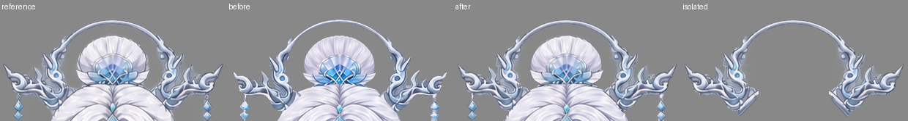
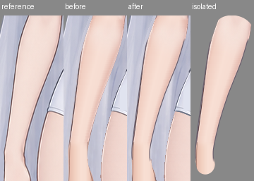

# 第二步人物边缘精修与逐件验收

交付：[KRA](character-soft-edges.kra) · [原尺寸透明 PNG](character-soft-edges.png) · [左参考／右最终整图](evidence/reference-final.png)。画布保持 **941×1672**，RGBA/U8；没有增加阴影、AO、投影或发光。第一步及上游文件未改写。本步没有调用生图。

## 实际输入与结构

- 输入 KRA：`../../raster-layering/step01/character-depth.kra`。
- 先读的报告：`../../raster-layering/step01/report.md`，沿用 repair-02 后的有效版本。
- 实际原图：`../../part-layering/references/base-subject.png`。始终使用原画布坐标，没有平移、缩放参考。
- 形状及归属：`../../part-layering/parts/`。
- 分组及深度：`../../part-layering/groups.json`、`../../part-layering/occlusion.json`。
- 首次另存工作工程：`../../raster-layering/step02/workspace/character-soft-edges.kra`。各批实际修改均保存；正式工程是本目录的 `character-soft-edges.kra`。

65 个逻辑 part、69 个普通绘画分片、5 个眼口控制组及18个原生透明度蒙版沿用。61 个单深度件各保留一个完整绘画层；冠架、额饰、左右上睑四个多深度件仍分别含两个分片。同件 UUID、名称、层序、父级、继承透明度及默认显隐均保持。`neck`、`pelvis` 在上游 groups 中是无子项的可绘制 group ID，本步按输入 KRA 和 occlusion 中的原身份保留，没有改成新逻辑件。[结构核对](evidence/structure-verification.json)。

## 实际保留的修改

1. **冠架、吊坠及髻饰。** 恢复冠面左右尖端、弧梁及角部原有银蓝笔触，补回先前 alpha 缺少的细尖；两侧冠吊饰恢复宝石、连接段和银边，降低生成纹理中的碎硬线。髻顶局部恢复原扇褶，髻饰和额饰可见面恢复本件金属细节。取样按本件局部选区原生 copy/paste，在原坐标接入；冠架61.5、额饰62的隐藏安装根均未修改。冠面和额饰前片与后根的搭接仍属于同一逻辑 part。
2. **双上臂、前臂、掌部和十指，共16件。** 在本件原有肤色上续画细轮廓，对可见侧缘进行原生抗锯齿曲线修顺，局部包络变化约为亚像素至1px。用于补足极窄新增边的颜色只延续本件自己的邻近纹理，没有混入衣片、背景发面或相邻手指。指甲、掌褶及第一步修好的拇指根继续保留。肩、肘、腕和掌指的人工连接截面不新增横向暗线；连接根保留原始 alpha 与肤色，并通过原有蒙版自然拼接。
3. **胸部、躯干和骨盆衣片。** 在实际外侧续接柔和灰蓝细边，并沿肩外缘局部补接柔和细线以消除亮边；胸片下方和 torso/pelvis 内部连接处不加重复轮廓。衣片自身明暗和原侧缝继续保留，骨盆腿口局部恢复原双边笔触。最后修顺衣片可见侧缘的单像素台阶，隐藏连接底图及18个蒙版不变。
4. **双长发、双宽侧发及双细鬓发。** 长发和宽侧发的实际可见边缘局部恢复本件参考笔触，取样避开上层遮挡区。最终放大检查又修顺部分银发外缘的单像素台阶；只沿所属件轮廓调整 alpha 与极窄边色，保留内部发流、独立发梢、分叉和隐藏根。细鬓发保留第一步已经连续的灰边、亮芯和完整根梢，本步只修顺可见弯段的边界，不另贴背景发面。

最终共有 **31 个普通绘画层** 的像素发生修改；其余绘画层及全部原生蒙版的原始像素校验值未变。没有新增逻辑件或深度分片。

## 局部对照与撤回试修

下列四列均为同坐标、原尺寸：**参考／第一步组装／最终组装／最终本件独显**。报告概览仅用于导航，独显原文件保留完整画布和原始像素。

- 冠架：[对照](evidence/crown.png)；髻饰：[对照](evidence/bun-ornament.png)；额饰：[对照](evidence/forehead.png)。
- 右前臂：[对照](evidence/arm-right.png)；左前臂：[对照](evidence/arm-left.png)；双掌：[右](evidence/palm-right.png)／[左](evidence/palm-left.png)。
- 衣片：[torso](evidence/torso.png)／[breast](evidence/breast.png)／[pelvis](evidence/pelvis.png)。
- 长发：[右](evidence/hair-right.png)／[左](evidence/hair-left.png)；宽侧发：[右](evidence/side-right.png)／[左](evidence/side-left.png)。

试修中检查到的矩形接色、皮肤边条带、根部横向闭合描边均已撤回，没有作为最终绘画保留。双腿参考边条试贴也已撤回，原始腿层像素不变。两束长发隐藏根曾试用本件材质平移衔接，独显检查发现其发流不如输入自然，已撤回该平移试修；最终隐藏根仍沿用输入的本件笔触。最终保留的是明确属于本件的局部取样、侧线和边缘修顺。

## 逐件检查覆盖

每件均查看了完整独显（停用显隐蒙版、无底件时停用继承透明度）、默认组装以及隐藏其上层的局部关系；覆盖整圈轮廓、补全根端、尖梢和邻件接缝。原尺寸检查结构和线宽，放大检查细线、异色点及单像素边界。人工连接截面以连续自身材质为准，不人为加一圈会在组装时显出的横线。

独显总览：[1](evidence/parts-01.jpg) · [2](evidence/parts-02.jpg) · [3](evidence/parts-03.jpg) · [4](evidence/parts-04.jpg) · [5](evidence/parts-05.jpg) · [6](evidence/parts-06.jpg) · [7](evidence/parts-07.jpg) · [8](evidence/parts-08.jpg) · [9](evidence/parts-09.jpg)。

隐藏上层总览：[1](evidence/reveal-01.jpg) · [2](evidence/reveal-02.jpg) · [3](evidence/reveal-03.jpg) · [4](evidence/reveal-04.jpg) · [5](evidence/reveal-05.jpg) · [6](evidence/reveal-06.jpg) · [7](evidence/reveal-07.jpg) · [8](evidence/reveal-08.jpg) · [9](evidence/reveal-09.jpg)。后踝链、下牙在默认控制下仍隐藏，完整绘画在独显中可见。[全部蒙版停用检查](evidence/all-masks-off.png)。

| 逻辑 part | 深度 | 覆盖及最终处理 | 原尺寸视图 |
|---|---|---|---|
| `hair/back_hair/long_hair_right` | 1 | 根、纵向发流、分叉、细梢、外缘；局部参考边色与曲线修顺 | [独显](evidence/parts/hair__back_hair__long_hair_right--isolated.png)／[隐藏上层](evidence/parts/hair__back_hair__long_hair_right--reveal.png) |
| `hair/back_hair/long_hair_left` | 2 | 根、纵向发流、分叉、细梢、外缘；局部参考边色与曲线修顺 | [独显](evidence/parts/hair__back_hair__long_hair_left--isolated.png)／[隐藏上层](evidence/parts/hair__back_hair__long_hair_left--reveal.png) |
| `hair/back_hair/cap` | 3 | 完整后枕、两侧及下摆；保留已合格纹理 | [独显](evidence/parts/hair__back_hair__cap--isolated.png)／[隐藏上层](evidence/parts/hair__back_hair__cap--reveal.png) |
| `hair/bun` | 4 | 扇形外轮廓及底根；髻顶局部笔触恢复 | [独显](evidence/parts/hair__bun--isolated.png)／[隐藏上层](evidence/parts/hair__bun--reveal.png) |
| `head_accessories/crown_pendants/crown_pendant_right` | 5 | 安装端、宝石、银边、下尖；可见段本件笔触恢复 | [独显](evidence/parts/head_accessories__crown_pendants__crown_pendant_right--isolated.png)／[隐藏上层](evidence/parts/head_accessories__crown_pendants__crown_pendant_right--reveal.png) |
| `head_accessories/crown_pendants/crown_pendant_left` | 6 | 安装端、宝石、银边、下尖；可见段本件笔触恢复 | [独显](evidence/parts/head_accessories__crown_pendants__crown_pendant_left--isolated.png)／[隐藏上层](evidence/parts/head_accessories__crown_pendants__crown_pendant_left--reveal.png) |
| `legs/leg_right/anklet_back` | 7 | 珠粒、细链及透明孔；保持前后链独立与默认控制 | [独显](evidence/parts/legs__leg_right__anklet_back--isolated.png)／[隐藏上层](evidence/parts/legs__leg_right__anklet_back--reveal.png) |
| `legs/leg_left/anklet_back` | 8 | 珠粒、细链及透明孔；保持前后链独立与默认控制 | [独显](evidence/parts/legs__leg_left__anklet_back--isolated.png)／[隐藏上层](evidence/parts/legs__leg_left__anklet_back--reveal.png) |
| `legs/leg_right/leg` | 9 | 大腿补根、膝踝、足侧、趾缝、足背链；保留原层像素 | [独显](evidence/parts/legs__leg_right__leg--isolated.png)／[隐藏上层](evidence/parts/legs__leg_right__leg--reveal.png) |
| `legs/leg_left/leg` | 10 | 大腿补根、膝踝、足侧、趾缝、足背链；保留原层像素 | [独显](evidence/parts/legs__leg_left__leg--isolated.png)／[隐藏上层](evidence/parts/legs__leg_left__leg--reveal.png) |
| `legs/leg_right/anklet_front` | 11 | 珠粒、细链及透明孔；保持前后链独立与默认控制 | [独显](evidence/parts/legs__leg_right__anklet_front--isolated.png)／[隐藏上层](evidence/parts/legs__leg_right__anklet_front--reveal.png) |
| `legs/leg_left/anklet_front` | 12 | 珠粒、细链及透明孔；保持前后链独立与默认控制 | [独显](evidence/parts/legs__leg_left__anklet_front--isolated.png)／[隐藏上层](evidence/parts/legs__leg_left__anklet_front--reveal.png) |
| `pelvis` | 13 | 隐藏上根、侧缝、双腿口及下尖；外缘与腿口细边修画 | [独显](evidence/parts/pelvis--isolated.png)／[隐藏上层](evidence/parts/pelvis--reveal.png) |
| `arms/arm_right/hand/little_finger` | 14 | 整件根梢、甲缘/掌褶、叠指与腕掌连接；本件侧缘修顺 | [独显](evidence/parts/arms__arm_right__hand__little_finger--isolated.png)／[隐藏上层](evidence/parts/arms__arm_right__hand__little_finger--reveal.png) |
| `arms/arm_right/hand/ring_finger` | 15 | 整件根梢、甲缘/掌褶、叠指与腕掌连接；本件侧缘修顺 | [独显](evidence/parts/arms__arm_right__hand__ring_finger--isolated.png)／[隐藏上层](evidence/parts/arms__arm_right__hand__ring_finger--reveal.png) |
| `arms/arm_right/hand/middle_finger` | 16 | 整件根梢、甲缘/掌褶、叠指与腕掌连接；本件侧缘修顺 | [独显](evidence/parts/arms__arm_right__hand__middle_finger--isolated.png)／[隐藏上层](evidence/parts/arms__arm_right__hand__middle_finger--reveal.png) |
| `arms/arm_right/hand/index_finger` | 17 | 整件根梢、甲缘/掌褶、叠指与腕掌连接；本件侧缘修顺 | [独显](evidence/parts/arms__arm_right__hand__index_finger--isolated.png)／[隐藏上层](evidence/parts/arms__arm_right__hand__index_finger--reveal.png) |
| `arms/arm_right/hand/thumb` | 18 | 整件根梢、甲缘/掌褶、叠指与腕掌连接；本件侧缘修顺 | [独显](evidence/parts/arms__arm_right__hand__thumb--isolated.png)／[隐藏上层](evidence/parts/arms__arm_right__hand__thumb--reveal.png) |
| `arms/arm_right/upper_arm` | 19 | 整臂、完整补根、肩/肘/腕重叠；侧线续接且保留连接截面材质 | [独显](evidence/parts/arms__arm_right__upper_arm--isolated.png)／[隐藏上层](evidence/parts/arms__arm_right__upper_arm--reveal.png) |
| `arms/arm_right/forearm` | 20 | 整臂、完整补根、肩/肘/腕重叠；侧线续接且保留连接截面材质 | [独显](evidence/parts/arms__arm_right__forearm--isolated.png)／[隐藏上层](evidence/parts/arms__arm_right__forearm--reveal.png) |
| `arms/arm_right/hand/palm` | 21 | 整件根梢、甲缘/掌褶、叠指与腕掌连接；本件侧缘修顺 | [独显](evidence/parts/arms__arm_right__hand__palm--isolated.png)／[隐藏上层](evidence/parts/arms__arm_right__hand__palm--reveal.png) |
| `arms/arm_left/forearm` | 22 | 整臂、完整补根、肩/肘/腕重叠；侧线续接且保留连接截面材质 | [独显](evidence/parts/arms__arm_left__forearm--isolated.png)／[隐藏上层](evidence/parts/arms__arm_left__forearm--reveal.png) |
| `arms/arm_left/upper_arm` | 23 | 整臂、完整补根、肩/肘/腕重叠；侧线续接且保留连接截面材质 | [独显](evidence/parts/arms__arm_left__upper_arm--isolated.png)／[隐藏上层](evidence/parts/arms__arm_left__upper_arm--reveal.png) |
| `arms/arm_left/hand/index_finger` | 24 | 整件根梢、甲缘/掌褶、叠指与腕掌连接；本件侧缘修顺 | [独显](evidence/parts/arms__arm_left__hand__index_finger--isolated.png)／[隐藏上层](evidence/parts/arms__arm_left__hand__index_finger--reveal.png) |
| `arms/arm_left/hand/middle_finger` | 25 | 整件根梢、甲缘/掌褶、叠指与腕掌连接；本件侧缘修顺 | [独显](evidence/parts/arms__arm_left__hand__middle_finger--isolated.png)／[隐藏上层](evidence/parts/arms__arm_left__hand__middle_finger--reveal.png) |
| `arms/arm_left/hand/little_finger` | 26 | 整件根梢、甲缘/掌褶、叠指与腕掌连接；本件侧缘修顺 | [独显](evidence/parts/arms__arm_left__hand__little_finger--isolated.png)／[隐藏上层](evidence/parts/arms__arm_left__hand__little_finger--reveal.png) |
| `arms/arm_left/hand/ring_finger` | 27 | 整件根梢、甲缘/掌褶、叠指与腕掌连接；本件侧缘修顺 | [独显](evidence/parts/arms__arm_left__hand__ring_finger--isolated.png)／[隐藏上层](evidence/parts/arms__arm_left__hand__ring_finger--reveal.png) |
| `arms/arm_left/hand/thumb` | 28 | 整件根梢、甲缘/掌褶、叠指与腕掌连接；本件侧缘修顺 | [独显](evidence/parts/arms__arm_left__hand__thumb--isolated.png)／[隐藏上层](evidence/parts/arms__arm_left__hand__thumb--reveal.png) |
| `arms/arm_left/hand/palm` | 29 | 整件根梢、甲缘/掌褶、叠指与腕掌连接；本件侧缘修顺 | [独显](evidence/parts/arms__arm_left__hand__palm--isolated.png)／[隐藏上层](evidence/parts/arms__arm_left__hand__palm--reveal.png) |
| `neck` | 30 | 完整颈根、两侧与底尖；保留原层像素 | [独显](evidence/parts/neck--isolated.png)／[隐藏上层](evidence/parts/neck--reveal.png) |
| `body/torso` | 31 | 整片衣面、隐藏结构、领口/侧线及邻件衔接；可见外缘细线修画 | [独显](evidence/parts/body__torso--isolated.png)／[隐藏上层](evidence/parts/body__torso--reveal.png) |
| `body/breast` | 32 | 整片衣面、隐藏结构、领口/侧线及邻件衔接；可见外缘细线修画 | [独显](evidence/parts/body__breast--isolated.png)／[隐藏上层](evidence/parts/body__breast--reveal.png) |
| `head_accessories/earrings/earring_right` | 33 | 安装端、细节、长坠及尖梢；保留原层像素 | [独显](evidence/parts/head_accessories__earrings__earring_right--isolated.png)／[隐藏上层](evidence/parts/head_accessories__earrings__earring_right--reveal.png) |
| `head_accessories/earrings/earring_left` | 34 | 安装端、细节、长坠及尖梢；保留原层像素 | [独显](evidence/parts/head_accessories__earrings__earring_left--isolated.png)／[隐藏上层](evidence/parts/head_accessories__earrings__earring_left--reveal.png) |
| `face/ears/ear_right` | 35 | 完整耳廓、耳内面、耳垂和默认露出；保留原层及蒙版 | [独显](evidence/parts/face__ears__ear_right--isolated.png)／[隐藏上层](evidence/parts/face__ears__ear_right--reveal.png) |
| `face/ears/ear_left` | 36 | 完整耳廓、耳内面、耳垂和默认露出；保留原层及蒙版 | [独显](evidence/parts/face__ears__ear_left--isolated.png)／[隐藏上层](evidence/parts/face__ears__ear_left--reveal.png) |
| `face/face_base` | 37 | 额头、两颊、下颌、无五官连续底；保留原层像素 | [独显](evidence/parts/face__face_base--isolated.png)／[隐藏上层](evidence/parts/face__face_base--reveal.png) |
| `face/eyes/eye_left/sclera` | 38 | 完整本件、上下睑/眼角关系、共享开口及剪贴；原层及分片均保留 | [独显](evidence/parts/face__eyes__eye_left__sclera--isolated.png)／[隐藏上层](evidence/parts/face__eyes__eye_left__sclera--reveal.png) |
| `face/eyes/eye_left/iris` | 39 | 完整本件、上下睑/眼角关系、共享开口及剪贴；原层及分片均保留 | [独显](evidence/parts/face__eyes__eye_left__iris--isolated.png)／[隐藏上层](evidence/parts/face__eyes__eye_left__iris--reveal.png) |
| `face/eyes/eye_left/highlight` | 40 | 完整本件、上下睑/眼角关系、共享开口及剪贴；原层及分片均保留 | [独显](evidence/parts/face__eyes__eye_left__highlight--isolated.png)／[隐藏上层](evidence/parts/face__eyes__eye_left__highlight--reveal.png) |
| `face/eyes/eye_left/lower_eyelid` | 41 | 完整本件、上下睑/眼角关系、共享开口及剪贴；原层及分片均保留 | [独显](evidence/parts/face__eyes__eye_left__lower_eyelid--isolated.png)／[隐藏上层](evidence/parts/face__eyes__eye_left__lower_eyelid--reveal.png) |
| `face/eyes/eye_left/upper_eyelid` | 42/66 | 完整本件、上下睑/眼角关系、共享开口及剪贴；原层及分片均保留 | [独显](evidence/parts/face__eyes__eye_left__upper_eyelid--isolated.png)／[隐藏上层](evidence/parts/face__eyes__eye_left__upper_eyelid--reveal.png) |
| `face/eyes/eye_left/eyelid_crease` | 43 | 完整本件、上下睑/眼角关系、共享开口及剪贴；原层及分片均保留 | [独显](evidence/parts/face__eyes__eye_left__eyelid_crease--isolated.png)／[隐藏上层](evidence/parts/face__eyes__eye_left__eyelid_crease--reveal.png) |
| `face/eyes/eye_right/sclera` | 44 | 完整本件、上下睑/眼角关系、共享开口及剪贴；原层及分片均保留 | [独显](evidence/parts/face__eyes__eye_right__sclera--isolated.png)／[隐藏上层](evidence/parts/face__eyes__eye_right__sclera--reveal.png) |
| `face/eyes/eye_right/iris` | 45 | 完整本件、上下睑/眼角关系、共享开口及剪贴；原层及分片均保留 | [独显](evidence/parts/face__eyes__eye_right__iris--isolated.png)／[隐藏上层](evidence/parts/face__eyes__eye_right__iris--reveal.png) |
| `face/eyes/eye_right/highlight` | 46 | 完整本件、上下睑/眼角关系、共享开口及剪贴；原层及分片均保留 | [独显](evidence/parts/face__eyes__eye_right__highlight--isolated.png)／[隐藏上层](evidence/parts/face__eyes__eye_right__highlight--reveal.png) |
| `face/eyes/eye_right/lower_eyelid` | 47 | 完整本件、上下睑/眼角关系、共享开口及剪贴；原层及分片均保留 | [独显](evidence/parts/face__eyes__eye_right__lower_eyelid--isolated.png)／[隐藏上层](evidence/parts/face__eyes__eye_right__lower_eyelid--reveal.png) |
| `face/eyes/eye_right/upper_eyelid` | 48/66.5 | 完整本件、上下睑/眼角关系、共享开口及剪贴；原层及分片均保留 | [独显](evidence/parts/face__eyes__eye_right__upper_eyelid--isolated.png)／[隐藏上层](evidence/parts/face__eyes__eye_right__upper_eyelid--reveal.png) |
| `face/eyes/eye_right/eyelid_crease` | 49 | 完整本件、上下睑/眼角关系、共享开口及剪贴；原层及分片均保留 | [独显](evidence/parts/face__eyes__eye_right__eyelid_crease--isolated.png)／[隐藏上层](evidence/parts/face__eyes__eye_right__eyelid_crease--reveal.png) |
| `face/mouth/mouth_interior` | 50 | 完整本件、补根、嘴角、双唇开口及口内层序；原层及控制保留 | [独显](evidence/parts/face__mouth__mouth_interior--isolated.png)／[隐藏上层](evidence/parts/face__mouth__mouth_interior--reveal.png) |
| `face/mouth/lower_teeth` | 51 | 完整本件、补根、嘴角、双唇开口及口内层序；原层及控制保留 | [独显](evidence/parts/face__mouth__lower_teeth--isolated.png)／[隐藏上层](evidence/parts/face__mouth__lower_teeth--reveal.png) |
| `face/mouth/tongue` | 52 | 完整本件、补根、嘴角、双唇开口及口内层序；原层及控制保留 | [独显](evidence/parts/face__mouth__tongue--isolated.png)／[隐藏上层](evidence/parts/face__mouth__tongue--reveal.png) |
| `face/mouth/upper_teeth` | 53 | 完整本件、补根、嘴角、双唇开口及口内层序；原层及控制保留 | [独显](evidence/parts/face__mouth__upper_teeth--isolated.png)／[隐藏上层](evidence/parts/face__mouth__upper_teeth--reveal.png) |
| `face/mouth/lower_lip` | 54 | 完整本件、补根、嘴角、双唇开口及口内层序；原层及控制保留 | [独显](evidence/parts/face__mouth__lower_lip--isolated.png)／[隐藏上层](evidence/parts/face__mouth__lower_lip--reveal.png) |
| `face/mouth/upper_lip` | 55 | 完整本件、补根、嘴角、双唇开口及口内层序；原层及控制保留 | [独显](evidence/parts/face__mouth__upper_lip--isolated.png)／[隐藏上层](evidence/parts/face__mouth__upper_lip--reveal.png) |
| `face/eyebrows/eyebrow_right` | 56 | 眉身、隐藏眉尾及细亮芯；保留原层像素 | [独显](evidence/parts/face__eyebrows__eyebrow_right--isolated.png)／[隐藏上层](evidence/parts/face__eyebrows__eyebrow_right--reveal.png) |
| `face/eyebrows/eyebrow_left` | 57 | 眉身、隐藏眉尾及细亮芯；保留原层像素 | [独显](evidence/parts/face__eyebrows__eyebrow_left--isolated.png)／[隐藏上层](evidence/parts/face__eyebrows__eyebrow_left--reveal.png) |
| `face/nose` | 58 | 本鼻点与柔和明暗、脸底衔接；保留原层像素 | [独显](evidence/parts/face__nose--isolated.png)／[隐藏上层](evidence/parts/face__nose--reveal.png) |
| `hair/sidelock/sidelock_right` | 59 | 完整根梢、灰边/银芯、可见弯段；局部曲线边界修顺 | [独显](evidence/parts/hair__sidelock__sidelock_right--isolated.png)／[隐藏上层](evidence/parts/hair__sidelock__sidelock_right--reveal.png) |
| `hair/sidelock/sidelock_left` | 60 | 完整根梢、灰边/银芯、可见弯段；局部曲线边界修顺 | [独显](evidence/parts/hair__sidelock__sidelock_left--isolated.png)／[隐藏上层](evidence/parts/hair__sidelock__sidelock_left--reveal.png) |
| `head_accessories/bun_ornament` | 61 | 完整轮廓、安装根与宝石翼片；可见本件笔触恢复 | [独显](evidence/parts/head_accessories__bun_ornament--isolated.png)／[隐藏上层](evidence/parts/head_accessories__bun_ornament--reveal.png) |
| `head_accessories/crown_frame` | 61.5/67 | 两深度片共同独显、前冠尖端、弧梁与安装舌片搭接；只修改前片 | [独显](evidence/parts/head_accessories__crown_frame--isolated.png)／[隐藏上层](evidence/parts/head_accessories__crown_frame--reveal.png) |
| `head_accessories/forehead_pendant` | 62/65 | 两深度片、短连接、菱形和水滴；只修改前片可见细节 | [独显](evidence/parts/head_accessories__forehead_pendant--isolated.png)／[隐藏上层](evidence/parts/head_accessories__forehead_pendant--reveal.png) |
| `hair/side_hair/side_hair_right` | 63 | 完整发面、中央分缝、波纹外侧、尖梢；局部边缘笔触及曲线修顺 | [独显](evidence/parts/hair__side_hair__side_hair_right--isolated.png)／[隐藏上层](evidence/parts/hair__side_hair__side_hair_right--reveal.png) |
| `hair/side_hair/side_hair_left` | 64 | 完整发面、中央分缝、波纹外侧、尖梢；局部边缘笔触及曲线修顺 | [独显](evidence/parts/hair__side_hair__side_hair_left--isolated.png)／[隐藏上层](evidence/parts/hair__side_hair__side_hair_left--reveal.png) |

四个多深度逻辑件除整件独显外，另有八个原尺寸分片图，文件名为对应 `part--slice-深度.png`，保存在 `evidence/parts/`。冠架61.5/67、额饰62/65、左上睑42/66、右上睑48/66.5均维持输入组织。

## 候选框补查

整图使用同一画布，color=80、coarseColor=32、alpha=96、minRegionPixels=64。初查61框均查看了参考/当前局部；复查37框后追加冠角与髻饰细节，随后在32框放大检查中补修了银发及衣片单像素台阶。最后一次工具统计如下，候选数量和像素数只作定位，不作为质量评分。

| 时点 | missing像素 | extra像素 | color像素 | 候选框 |
|---|---:|---:|---:|---:|
| 输入初查 | 8001 | 571 | 17250 | 61 |
| 最终重开PNG | 3210 | 1269 | 14137 | 31 |

初查候选框的过程补查图（右侧为当时工程）：[1](evidence/initial-candidates-01.jpg) · [2](evidence/initial-candidates-02.jpg) · [3](evidence/initial-candidates-03.jpg) · [4](evidence/initial-candidates-04.jpg) · [5](evidence/initial-candidates-05.jpg) · [6](evidence/initial-candidates-06.jpg)。最终逐框图：[1](evidence/final-candidates-01.jpg) · [2](evidence/final-candidates-02.jpg) · [3](evidence/final-candidates-03.jpg)。[最终框坐标及像素数](evidence/final-differences.json)／[标记整图](evidence/final-marked.png)。最终逐框图每格左参考、右最终；初查过程图右侧为当时的工作工程。所有候选均逐框看图，修过的位置再核对本件独显。

| 最终框 | 种类与坐标 `[x,y,w,h]` | 看图确认及处置 |
|---|---|---|
| 1 | color `[401, 161, 146, 150]` | 五官与脸底色温、笔触差异；眼口完整且共享控制保留，见保留差异对照 |
| 2 | color `[300, 492, 83, 402]` | 本侧臂掌/手指侧线及皮肤明暗；原生侧缘已修顺，保留细微肤色差异与完整连接根 |
| 3 | color `[570, 586, 55, 183]` | 本侧臂掌/手指侧线及皮肤明暗；原生侧缘已修顺，保留细微肤色差异与完整连接根 |
| 4 | color `[537, 427, 37, 217]` | 衣片外缘、原布面明暗；已续接细边并修顺轮廓，保留自身柔和材质 |
| 5 | color `[596, 398, 43, 271]` | 本侧臂掌/手指侧线及皮肤明暗；原生侧缘已修顺，保留细微肤色差异与完整连接根 |
| 6 | color `[590, 712, 35, 113]` | 本侧臂掌/手指侧线及皮肤明暗；原生侧缘已修顺，保留细微肤色差异与完整连接根 |
| 7 | color `[307, 466, 30, 145]` | 本侧臂掌/手指侧线及皮肤明暗；原生侧缘已修顺，保留细微肤色差异与完整连接根 |
| 8 | missing `[346, 171, 7, 191]` | 长发细边/发梢的半透明过渡；局部曲线已修顺，余下为原尺寸抗锯齿覆盖及亮芯差异，未见断开的发段 |
| 9 | color `[466, 873, 7, 181]` | 双腿接触/腿口及边色；核对连续形体，保留第一步腿层和完整内腿余量，未以裁腿来压低差异 |
| 10 | color `[645, 727, 12, 116]` | 本侧臂掌/手指侧线及皮肤明暗；原生侧缘已修顺，保留细微肤色差异与完整连接根 |
| 11 | color `[329, 711, 20, 103]` | 双腿接触/腿口及边色；核对连续形体，保留第一步腿层和完整内腿余量，未以裁腿来压低差异 |
| 12 | color `[281, 756, 11, 88]` | 本侧臂掌/手指侧线及皮肤明暗；原生侧缘已修顺，保留细微肤色差异与完整连接根 |
| 13 | extra `[467, 926, 4, 100]` | 双腿接触/腿口及边色；核对连续形体，保留第一步腿层和完整内腿余量，未以裁腿来压低差异 |
| 14 | color `[496, 317, 42, 32]` | 颈后发面及耳坠周围的补绘纹理；独显归属干净，保留已有连贯发流和耳坠 |
| 15 | color `[623, 828, 14, 55]` | 本侧臂掌/手指侧线及皮肤明暗；原生侧缘已修顺，保留细微肤色差异与完整连接根 |
| 16 | missing `[551, 231, 18, 81]` | 细鬓发弯段；完整本件根梢及亮芯保留，局部边界修顺；笔触排列差异见对照 |
| 17 | color `[425, 306, 10, 36]` | 颈后发面及耳坠周围的补绘纹理；独显归属干净，保留已有连贯发流和耳坠 |
| 18 | missing `[457, 812, 24, 60]` | 双腿接触/腿口及边色；核对连续形体，保留第一步腿层和完整内腿余量，未以裁腿来压低差异 |
| 19 | missing `[372, 267, 18, 62]` | 细鬓发弯段；完整本件根梢及亮芯保留，局部边界修顺；笔触排列差异见对照 |
| 20 | color `[492, 728, 57, 66]` | 衣片外缘、原布面明暗；已续接细边并修顺轮廓，保留自身柔和材质 |
| 21 | missing `[548, 266, 7, 65]` | 细鬓发弯段；完整本件根梢及亮芯保留，局部边界修顺；笔触排列差异见对照 |
| 22 | color `[622, 855, 30, 49]` | 本侧臂掌/手指侧线及皮肤明暗；原生侧缘已修顺，保留细微肤色差异与完整连接根 |
| 23 | color `[403, 320, 19, 28]` | 颈后发面及耳坠周围的补绘纹理；独显归属干净，保留已有连贯发流和耳坠 |
| 24 | missing `[243, 881, 22, 69]` | 长发细边/发梢的半透明过渡；局部曲线已修顺，余下为原尺寸抗锯齿覆盖及亮芯差异，未见断开的发段 |
| 25 | color `[570, 654, 18, 45]` | 衣片外缘、原布面明暗；已续接细边并修顺轮廓，保留自身柔和材质 |
| 26 | color `[389, 563, 10, 41]` | 衣片外缘、原布面明暗；已续接细边并修顺轮廓，保留自身柔和材质 |
| 27 | color `[435, 212, 16, 14]` | 右虹膜暗瞳/虹膜笔触差异；保留第一步已修复的连续暗瞳及独立高光，层内没有睑线 |
| 28 | color `[334, 359, 28, 53]` | 本侧臂掌/手指侧线及皮肤明暗；原生侧缘已修顺，保留细微肤色差异与完整连接根 |
| 29 | color `[461, 130, 18, 18]` | 中央额饰上端宝石的切面笔触不同；短连接连续，归属与前后片保持 |
| 30 | missing `[370, 256, 15, 34]` | 细鬓发弯段；完整本件根梢及亮芯保留，局部边界修顺；笔触排列差异见对照 |
| 31 | missing `[653, 936, 27, 42]` | 长发细边/发梢的半透明过渡；局部曲线已修顺，余下为原尺寸抗锯齿覆盖及亮芯差异，未见断开的发段 |

## 保留差异及局部说明

- [脸部对照](evidence/retained-face.png)：完整脸底、眼白/虹膜的补绘比原图更均匀，颊部、口周色温及虹膜内部亮暗笔触有细微差异；鼻口位置、眼角连接和上下睑开口仍使用同一画布控制。没有把整张参考脸贴入脸底，也没有将高光合入虹膜。
- [细鬓发对照](evidence/retained-sidelocks.png)：保留原先完成的隐藏根与连续银芯，弯段内部细灰笔触排列不逐像素复刻；本轮修顺边界后仍为一束完整连贯的本件头发。
- [内腿对照](evidence/retained-inner-legs.png)：保留第一步已经确认的完整双腿及自然前后接触关系，局部接触窄边和肤色与原图有细微差异。腿层原始像素校验值未变，没有为减少候选框削去绑定余量。
- 隐藏根、耳朵、眼口内容和后踝链是原图不可见部分的合理补绘。独显以结构、材质和轮廓连续性检查，未把遮挡物的参考像素当成本件应当具备的内容。

## 保存、重开与透明导出

每批修画保存，正式工程保存后关闭，再重新打开核对；最终临时显隐检查全部恢复后，又完成一次保存—关闭—重开。92 个实际节点的层序、名称、UUID、实际父级、显隐、继承透明度、混合模式、不透明度与原始像素 SHA-256 前后一致，整图投影像素也一致。Krita 会为虚拟 ROOT 生成新的会话 UUID，核对时仅将该虚拟标识归一化为 ROOT，实际部件和控制组 UUID 没有变化。

18个原生蒙版与输入的原始像素相同，眼内共享开口、虹膜/高光剪贴、口内共享开口、后踝链和下牙的默认隐藏均保留。最终 PNG 从最后重开工程导出，保持941×1672、透明背景，没有缩放或加底色。[重开核对记录](evidence/reopen-verification.json)。

## 未解决的问题

本轮自检未发现需要留待后续修复的断件、错层、外来部件残片或连接硬线。上述保留的补绘、细微色调与笔触差异有局部对照，最终画面不是逐像素复制原图。交付为静态绑定素材，未在本步制作绑定、变形或动画。
