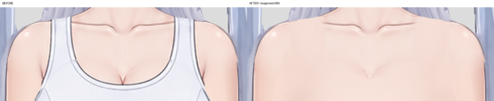
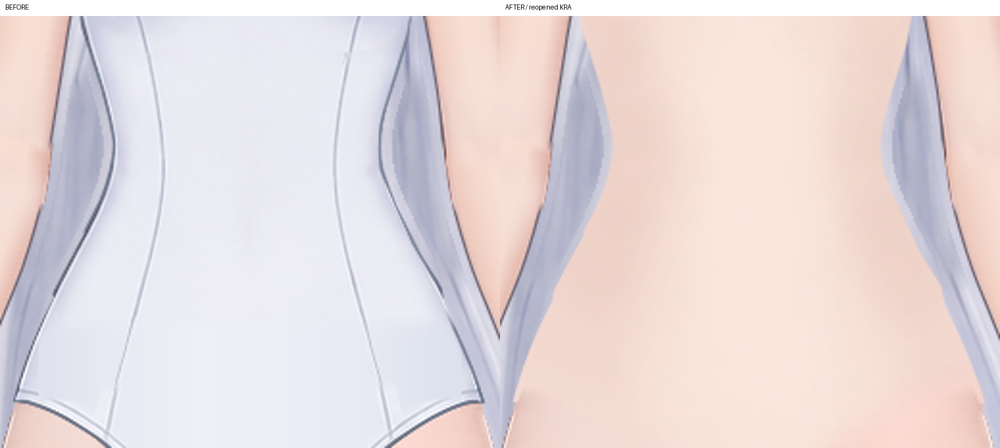
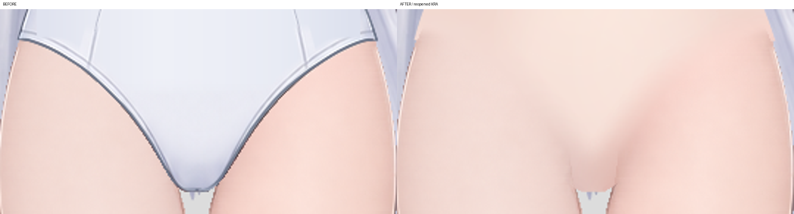

# Live2D 换装低细节底稿

交付：[KRA](character-dressup-base.kra) · [941×1672 透明 PNG](character-dressup-base.png)。最终工程已保存、关闭、重新打开；以下最终对照全部取自重开后的实际 KRA。未调用生图工具或服务。

## 输入与范围

先读取 step01、step02 的有效 report.md，沿用第二步 `character-soft-edges.kra`。上游 `groups.json`、`occlusion.json`、parts 与 `base-subject.png` 用于确认归属、包络和原有皮肤依据。前序文件未修改。首次工作工程保存在本步 `workspace/character-dressup-base.kra`，各批修改保存于同一工程，最终另存本目录交付文件。

实际保留修改的绘画层共五层：

| 部件／深度 | 去衣与过渡范围 | 保留内容 | 实际检查 |
|---|---|---|---|
| `body/torso`／31 | 原肩带、领口、胸腹衣面、侧缝与灰蓝衣边；约 x337–600、y348–728 内的原衣料及邻近接色 | 原肩峰高光、肩外缘、领口内部大部分肤色及锁骨；原颈肩、腰腹蒙版 | [200% 完整独显对照](evidence/body__torso-isolated-comparison.png) |
| `body/breast`／32 | 原胸片、领口双边和分割缝；x365–572、y395–528 | 中央上缘原有皮肤明暗，原胸层位置、轮廓及上根蒙版 | [300% 完整独显对照](evidence/body__breast-isolated-comparison.png) |
| `pelvis`／13 | 原完整衣面、腰侧缝、双腿口滚边和下尖；x346–592、y566–814 | 原位置、上根、外侧包络；使用原腿部皮肤作接色依据 | [300% 完整独显对照](evidence/pelvis-isolated-comparison.png) |
| `arms/arm_right/upper_arm`／19 | 仅近躯干的肩臂交界，约 x354–395、y388–505 内的窄幅软笔过渡 | 其余上臂描线、体积、肩肘根与原始 alpha | [400% 局部对照](evidence/arms__arm_right__upper_arm-isolated-comparison.png) |
| `arms/arm_left/upper_arm`／23 | 对侧肩臂交界，约 x539–585、y388–505 内的窄幅软笔过渡 | 同上；原前臂接合蒙版保持 | [400% 局部对照](evidence/arms__arm_left__upper_arm-isolated-comparison.png) |

没有新增乳头、生殖器或衣下人体细节。颈、双腿、前臂、腕掌、十指、脸、头发、饰品及其原有绘画最终均保留输入像素；双腿试修已全部撤回。

## 修画过程与发现的问题

1. 使用 Krita 原生 Basic-2 Opacity 画笔覆盖衣料，再用 Airbrush Soft 分别续画暖色侧面、浅色中央及柔和胸腹层次，辅以低不透明度 Bristles-3 Large Smooth 轻扫。路径、颜色、笔刷尺寸和每段过渡由观察输入皮肤后逐段确定，通过 Krita 桥接执行笔触；没有以公式色场、阈值填肤色、图像生成或整体模糊替代绘画。所有颜色落在原有绘画层内。
2. 第一批出现选区行步长解析错误，造成斜向试笔；从只读输入恢复对应三层后重做，错误试笔没有保留。绘制 API 不沿用 alpha 锁的行为也已处理：普通补色后恢复本件原始 alpha，避免笔触扩出包络。
3. 第一轮看图发现旧领口白线、肩带形状的接色边和胸层下缘色差。扩大到紧邻旧领口的少量皮肤过渡，清除残线，胸层与躯干采用连续的同坐标体积笔触，再以小范围软笔接入肩部原肤色。试画的腰侧细线偏离外缘，已撤回。
4. 骨盆与原腿色温并不左右对称，分别取原画左右腿的色温续画。最初的窄幅腿根接色在独显中形成浅笔带，故恢复双腿输入原画。最终只在骨盆层沿原腿口接触处用软橡皮画笔收柔像素透明度，约一个25px笔刷的边缘范围，仅在下方原腿完全不透明处起效；没有改动或增加蒙版，没有在非重叠处挖孔。这是本轮明确的边缘透明度调整，骨盆独显下缘因此呈柔边，见独显图。
5. 每批修改均保存后查看实际工程导出。最终再次关闭、重开，并重新导出全部验收图。

## 同坐标合成验收

每张左侧是输入 KRA、右侧是最终重开 KRA，裁剪位置和倍率完全一致；灰底仅用于对照展示，交付 PNG 保持透明。以下范围与三件独显共同覆盖全部去衣区及交界。

| 范围 `[x,y,w,h]` | 倍率／对照 | 实际观察 |
|---|---|---|
| 颈肩、双肩带与旧领口 `[330,338,280,107]` | [300%](evidence/shoulders-comparison.png) | 肩带、领口双线和白边已消除，原肩高光与锁骨保留，新增肤色渐接原皮肤，没有旧 U 形衣边 |
| 胸层与肩臂、胸躯干 `[350,395,240,145]` | [300%](evidence/chest-comparison.png) | 灰蓝布面及斜缝已去除，胸层下缘不再形成单独的暗色片边；两侧接色柔和 |
| 腰腹、躯干骨盆接合 `[340,510,260,225]` | [300%](evidence/waist-comparison.png) | 原纵缝及侧边灰线去除，浅暖中央与两侧柔和变化连贯，没有试画的内部腰线 |
| 双腿口及下端 `[335,690,270,140]` | [400%](evidence/hips-comparison.png) | 双滚边和衣料色带清除，骨盆与原腿通过软笔边缘接续；原腿明暗、内腿线保留 |

相邻四件的独显汇总见 [400% 对照](evidence/adjacent-isolated-comparisons.jpg)。双腿的最终独显与输入一致：[右腿](evidence/legs__leg_right__leg-isolated-comparison.png)、[左腿](evidence/legs__leg_left__leg-isolated-comparison.png)。七件检查用的完整原尺寸独显位于 `evidence/parts/`，文件名 `*-before.png` 与 `*-after.png` 成对。

最终还查看了[原尺寸整图](character-dressup-base.png)：主体保持原姿态、原分层关系与透明背景。腿间 y815–820 的少量灰蓝像素经逐层读取确认属于 `hair/back_hair/long_hair_right`，不是衣料残留，因此没有删改头发。

## 保存与结构核对

65 个逻辑部件、69 个绘画分片、5 个眼口控制组、18 个原生蒙版保持原身份。图层名称、UUID、父级、层序、显隐、继承透明度、不透明度、混合模式及 alpha 锁状态与输入一致；冠架、额饰及双上睑的多深度分片保持不变。全部18个蒙版原始像素不变；除上述五个绘画层外，其余绘画层像素不变。

最终完成保存—关闭—重开、临时独显恢复—再保存—关闭—重开。重开前后实际节点属性、原始像素及合成投影一致。PNG 从最后重开的交付 KRA 导出，941×1672，RGBA，透明背景。[核对记录](evidence/reopen-verification.json)。这些一致性核对用于确认交付文件，艺术检查使用上述实际图像。

## 保留差异与限制

新补区域采用低细节暖肤色层次，细节密度低于原脸部、手部和腿部，不复刻原衣料的褶皱或明暗。原外侧包络和髋侧很小的轮廓转角沿用输入；骨盆内部腿部重叠边有上述像素透明度软化，独显完整记录，未伪称所有 alpha 不变。最终自检未再发现临时衣料、肩带、滚边、衣缝或灰蓝残线；本步没有制作绑定及变形测试。
