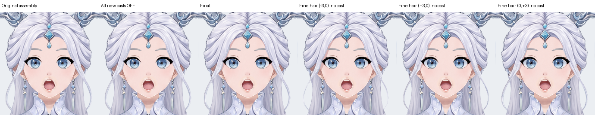
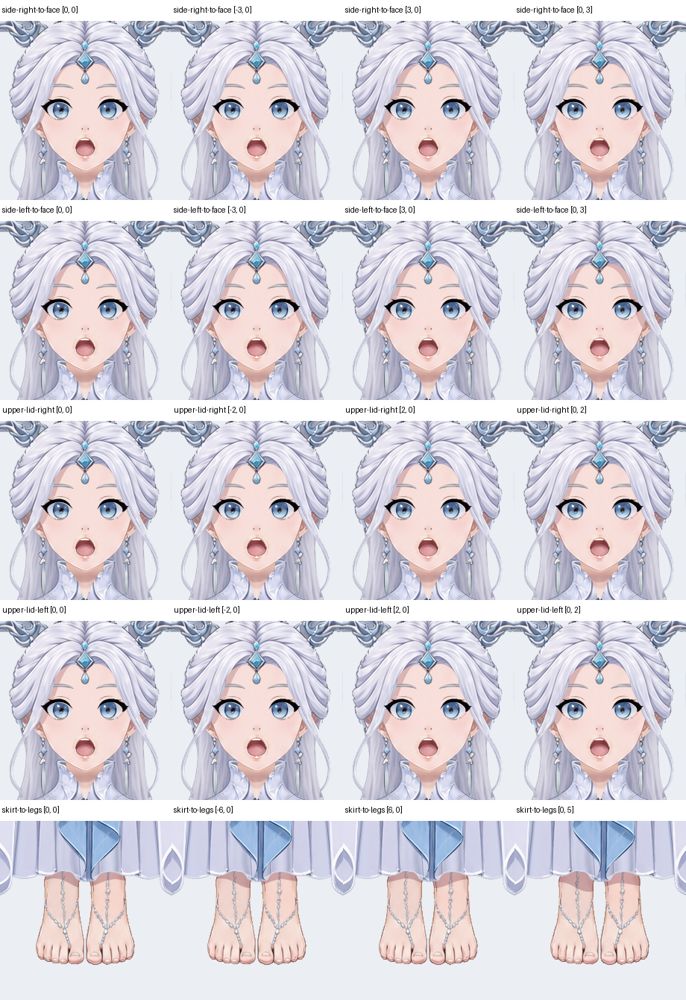

# 投影蒙版交付

以原组装 KRA 新建工程，Krita 原生绘制，未调用生图。输出 941 × 1672、RGBA U8、透明背景。新增五个独立影层；未制作 deformer 或光向关键形。

## 脸周判断

- 两侧额前分开的宽发面分别属于 side_hair_right、side_hair_left，没有另一个独立刘海 part。参照 simplified 的顶部偏正面柔光，仅在贴近额角、太阳穴的内缘留窄投影；根部和被头发遮住的面积保留。未把外侧叠纹逐条投到脸内，也未用深度序号推算距离。
- 两侧 sidelock 的耳前根段大多隐藏于宽侧发下，露出的细束向脸外伸出；细长外弧及卷尾在脸外，不存在本光向下投到脸内的证据。因此不新增细线，不为左右对称补影。细发本体的水平 ±3 px、下移 3 px 对照见下图，接收脸保持原位。
- 后枕、后发幕、发髻位于脸后或远离接收脸，未增加落脸投影。发饰遮挡与发内明暗保留，不把材质暗纹当作新增投影。

## 绘制与颜色

宽侧发影用正常模式、不透明暖灰粉 RGB(218,179,179)，依据 simplified 的暖肤色接触影调弱配合本组装的柔和脸底；同色交叠不叠黑。两眼各有独立上睑／睫毛投影，使用 RGB(221,227,237) 正片叠底，只补眼内上缘接触窄片；保留原眼白灰蓝渐变、虹膜深浅、眼线和高光。完整影形向上延至隐藏区，使用带原开口蒙版的眼内组作裁切底，不随虹膜视线移动。

裙影使用 RGB(214,193,201) 正片叠底，以前裙褶缘为依据跨双腿联合裁切；上段完整覆盖隐藏腿段，底边延续裙口的起伏。现有腿部肤色、线稿和脚链保持原样。脸底已经净化，无需本轮去旧影或补底；关闭全部新影后与原组装 PNG 逐像素一致。

## 结构与余量

每个来源独立影层，隔离组内使用原生透明度继承。脸底下无其他实色层；双腿接收子组保留两件原腿。眼开口原组、虹膜／高光子组和原蒙版完整保留。宽发测试复位、水平 ±3 px、向下 3 px；上睑复位、水平 ±2 px、向下 2 px；裙影复位、水平 ±6 px、向下 5 px。逐图观察：隐藏形状与裁切外余量充足，偏移时没有脱离接收面新增 alpha；眼部窄影未压住主要高光，裙口仍保留可读的肤色过渡。这些是相对素材偏移检查，不是物理动画验收。

输入索引对若干图层只识别到父 part，因此 JSON 的 casterPartId／receiverPartIds 使用该真实父组归属；motionSourcePartId／receiverSurfacePartIds 明确实际叶级来源与接收面，原 caster／receiver UUID 精确定位原件。follow 仅说明来源，不表示父组或 deformer 已绑定。颜色另记在 colorRGBA。

## 检查结果

最终 inspect_shadow_mask：passed=true，problems=[]，warnings=[]。已查看 overview、五张 relation review、完整影层与接收面、去影对照、全部 20 个偏移原尺寸局部及细发位移。最后一次仅补充颜色及候选偏移元数据，其全部 57 张原生 PNG 与已查看轮次逐像素相同。

制作中发现 Krita remove 会拆开子节点，已从只读源恢复并保存／重挂原节点树。保存后核对全部 143 个原节点 UUID、21 个原蒙版的 UUID、原父归属、启用状态与位置均保留。首轮检查的名称归属问题已通过上述真实父组与叶级来源双重记录消除。最终导出 PNG 与保存 KRA 的原生合成逐像素一致。

完整影层、接收面及全身偏移：[宽发右](inspection/relation-000-review.png)、[宽发左](inspection/relation-001-review.png)、[右上睑](inspection/relation-002-review.png)、[左上睑](inspection/relation-003-review.png)、[裙口](inspection/relation-004-review.png)。检查记录：[inspection.json](inspection.json)。
