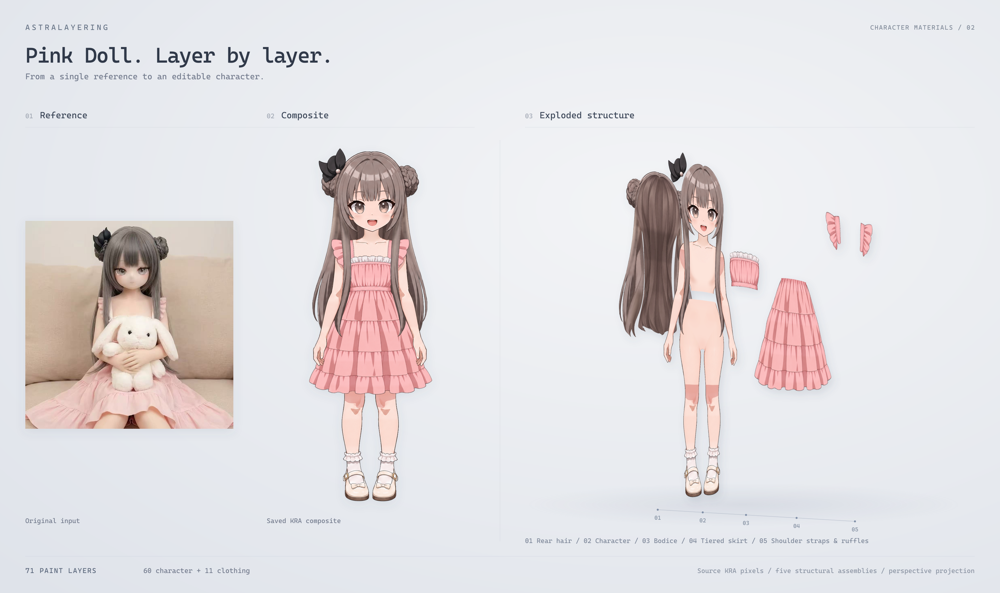

# Pink Doll：标准化、分层、穿戴组装与阴影

本例沿用 Pink Doll 原图，启用姿态标准化，完成于 2026-11-19。人物有 76 个分组节点，其中 58 个叶子。衣服有 13 个分组节点，其中 11 个叶子。组装 KRA 保留 60 个人物绘画层和 11 个衣服绘画层，阴影工程记录 21 条投影关系，交付检查通过。

| 阶段 | 成果 |
| --- | --- |
| 输入与标准化 | [原图](input/original.png) · [标准化图](part-layering/references/standard.png) · [简化穿衣参考](part-layering/references/simplified-subject.png) · [人物参考](part-layering/references/base-subject.png) |
| 人物分件 | [SVG](part-layering/preview.svg) · [分组树](part-layering/groups.json) · [深度表](part-layering/occlusion.json) |
| 人物分层补全 | [KRA](raster-layering/step01/character-depth.kra) · [合成预览](raster-layering/step01/composite.png) · [报告](raster-layering/step01/report.md) |
| 人物边缘修画 | [KRA](raster-layering/step02/character-soft-edges.kra) · [PNG](raster-layering/step02/character-soft-edges.png) · [报告](raster-layering/step02/report.md) |
| 换装素体 | [KRA](raster-layering/step03/character-dressup-base.kra) · [PNG](raster-layering/step03/character-dressup-base.png) · [报告](raster-layering/step03/report.md) |
| 衣服分件 | [衣服参考](clothing-part-layering/references/clothing.png) · [SVG](clothing-part-layering/preview.svg) · [分组树](clothing-part-layering/groups.json) · [深度表](clothing-part-layering/occlusion.json) |
| 衣服分层补全 | [KRA](clothing-raster-layering/step01/clothing-depth.kra) · [合成预览](clothing-raster-layering/step01/composite.png) · [报告](clothing-raster-layering/step01/report.md) |
| 衣服边缘修画 | [KRA](clothing-raster-layering/step02/clothing-soft-edges.kra) · [合成预览](clothing-raster-layering/step02/composite.png) · [报告](clothing-raster-layering/step02/report.md) |
| 穿戴组装 | [KRA](character-assembly/step01/character-assembled.kra) · [PNG](character-assembly/step01/character-assembled.png) · [报告](character-assembly/step01/report.md) |
| 阴影蒙版 | [最终 KRA](shadow/step01_mask/character-shadowed.kra) · [最终 PNG](shadow/step01_mask/character-shadowed.png) · [面部检查](shadow/step01_mask/face-review.png) · [投影定义](shadow/step01_mask/shadows.json) · [验收](shadow/step01_mask/inspection.json) · [报告](shadow/step01_mask/report.md) |

[归档记录](ARCHIVE.md) · [文件清单](manifest.json)
