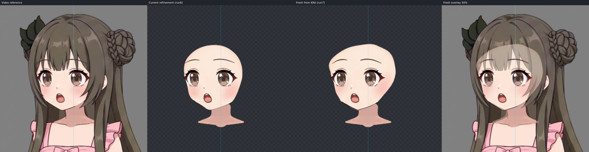
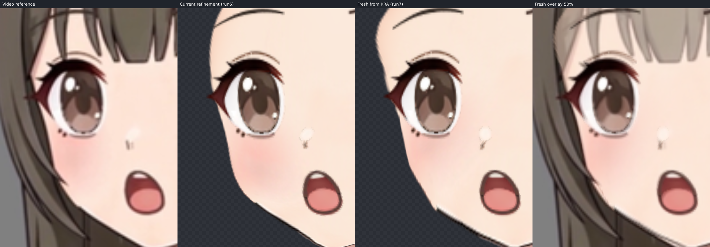

本次从原始 KRA 全新运行 left 制作管线，未传入旧描线、网格、导出层、五官参数或旧会话。沿用原视频和 left 目标帧，没有重新生成视频。管线自己导出 24 层、描线并补全脸型、拟合 Warp 和调整五官。导入初始状态为 0 个 Warp、所有部件处于静止关键形，详见 [pipeline-run.json](pipeline-run.json)。

外层仅用工作台同一渲染器只读检查；没有修改角色参数。以下对照保持原裁框、坐标和比例，未重新对齐，四栏依次为视频参考、上次精修 run6、原 KRA 新跑 run7、新跑与参考 50% 叠加。

新跑保留了远侧脸缘的陡直段，五官层次及鼻嘴位置较接近参考。与上次精修仍有差异：遮挡下的额头和近侧脸底更宽；鼻高光、下颌线厚度和局部笔触不同。只读对照是独立检查证据，不是管线 agent 的产物。脖子保持固定，顶部接触留后续 step07；未制作后续轴。本轮等待用户验收，不能据此宣布流程稳定。
