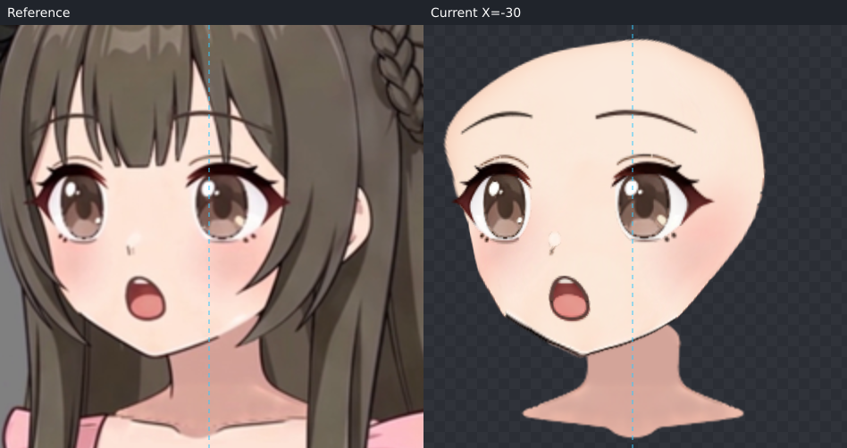
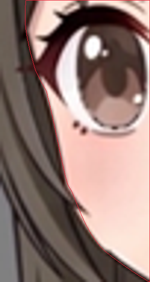
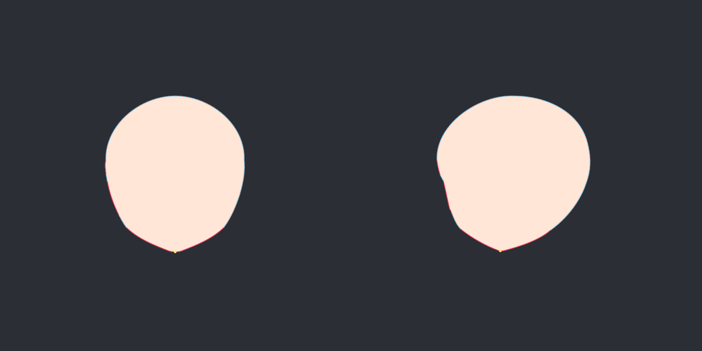
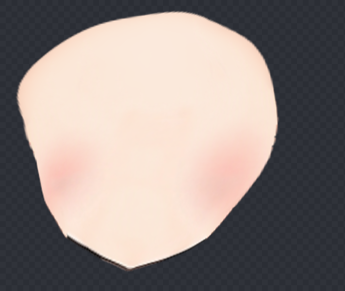
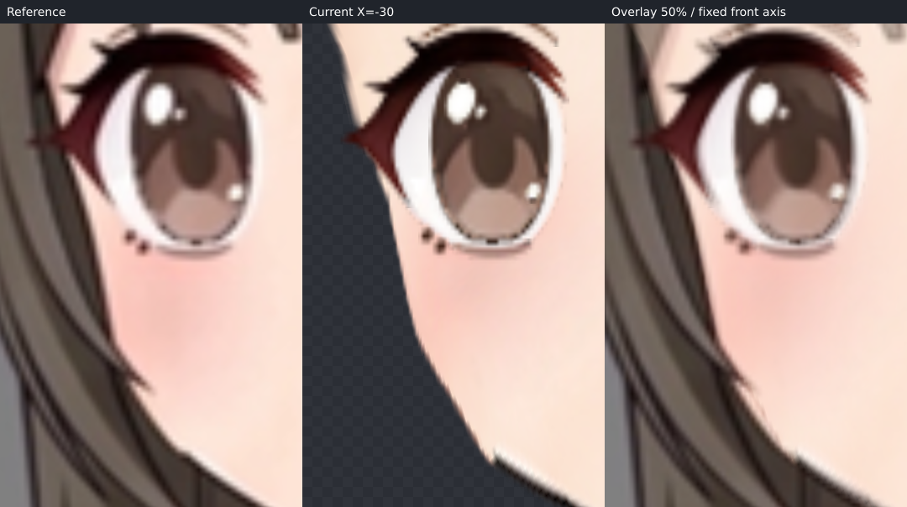
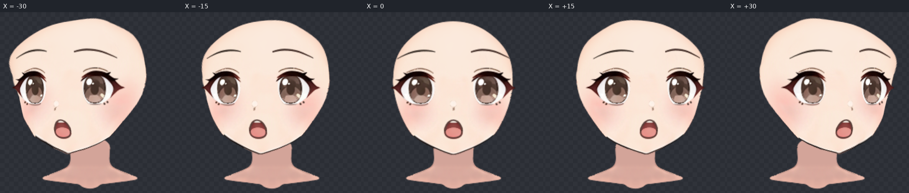
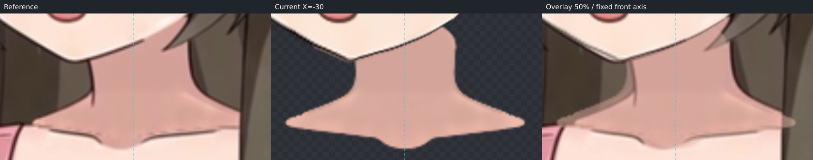

本轮是待用户确认的 ParamAngleX = −30 候选，+30 由程序镜像。只完成当前 X；未制作 Y、四角或 step07。所有对照使用固定 box `[431,35,394,394]`，没有按转动后的眼睛、下巴重新对齐。

原始 `character-assembled.kra` 保留不变。通过 Krita 导出原画可见投影，共 24 张：脸部 23 层和身体中的独立脖子。原工程的这些部件是平铺绘画层，没有遗漏脸组蒙版；图层名、原 UUID、透明裁切位置记在 [layer-export.json](layer-export.json)。交付前再次用原 KRA 投影逐像素核对 24 张 PNG，全部相同，见 [source-layer-check.json](source-layer-check.json)。没有导入别的模型网格，也没有用视频像素替换贴图。源 KRA/PNG 哈希由管线的 `finishHead` 写入 [source.json](source.json)，PNG 哈希与上游 crop.json 相同。

脸底保留原画腮红，使用 `face-completion → face-silhouette → face/face_base`。内层 6×8 控制颊颌转折，外层 12×12 支持完整脸体量和局部残差；它们不带动五官。每眼七层共同归一个眼 Warp，虹膜与高光保留关联后做局部修正；嘴的唇、齿、舌、口腔五层共同归 `mouth-perspective`。眉和鼻独立。这样可以分别匹配视频中的眼宽、眼尾、鼻嘴落点，不强迫它们随脸底走相同位移。`neck` 位于脸下，parent 为空，所有关键形与静止形完全相同。原 KRA 没有独立耳层或独立腮红层，因此没有伪造耳朵或拆换腮红。

补全采用 Hiyori 的圆润鹅蛋脸与教程完整脸底的连续颊颌结构：本角色颊部饱满、下颌渐收、下巴小尖，适合此类结构。实际看过圆脸视频与关键帧板、教程侧向脸底、六模型板及 Hiyori 单模型板；短圆脸和长窄脸没有被平均进来。先验只指导遮挡处；可见远眼外侧近竖向脸缘、眼窝至颊部的转向和小尖颏仍取本角色 left 帧。

描边的完整 source 取原 face_base alpha 外缘，保留原画体量，不取头发之间的皮肤窗口。`source-face-reference.png` 是原 PNG 按 textureBounds 放回画布后，用既定 box 裁出。两份闭合 SVG 与 [face-trace.json](face-trace.json) 使用同一组 12 个路径段。可见远侧太阳穴、远眼外侧至颊部、颊部小转折、两侧可见颌线和下巴标为 visible；发挡额顶、近侧太阳穴/颊部、远侧局部发挡颊线与睫毛遮挡标为 occluded。局部露出的脸缘单独保留为 visible，没有把整个远侧一律弱化，也没有把发束凹口压进脸肉。真实 preview_svg 的全图 blend 和重叠局部 blend/edge 已核对。

真实 `fit_nine_axis inspect` 的 completionMismatch 为空。下面是工具输出的完整 source/target 素脸预测，不能代替实际形变结果。

实际调用 `fit_nine_axis fit` 求脸底，最终成功拟合节点为 `face-completion`，smoothness 0.005；[fit-report.json](fit-report.json) 保留工具逐段结果。低平滑度尝试触发网格折叠而未保存，最终保留通过检查的版本。可见段对描线的平均/最大误差如下，单位为原画布像素；这些数值仅说明贴描线的程度，可见目标另外通过实际渲染叠加复查。

| 可见段 | 平均 | 最大 |
| --- | ---: | ---: |
| 远侧太阳穴 | 0.082 | 0.209 |
| 远眼外侧至颊部 | 0.188 | 0.566 |
| 远颊转折 | 0.264 | 0.566 |
| 远侧颌线 | 0.223 | 0.885 |
| 下巴 | 0.266 | 0.444 |
| 近侧颌线 | 0.093 | 0.328 |

遮挡补全没有完全贴合预测：最终工具自动把 occluded 权重进一步减弱，以不移动已贴住的可见段。隐藏远颊平均约 2.0 像素，近颊约 5.0，近太阳穴约 5.6，额顶两段约 6.0–7.4；额顶局部最大约 11.3 像素。这些是实际网格与完整预测的偏差，不是视频中已可见脸缘的误差。已单独查看下面的真实脸底，整体连续并保留近侧颊部体量，但额顶/近太阳穴的隐藏走势仍是候选推断。

五官先一轮批量液化，再高倍率核对微调：远眼整体压窄到约 0.77，近眼约 0.95，分别按视频移位；眉、鼻和整嘴独立移动，鼻嘴没有钉在正面。虹膜/高光成对调整；近眼尾最终补约 2.5 像素外展，保留内眼角和眼睑峰值。嘴上缘与侧鼻做局部倾向修正。两眼上下睑、虹膜、高光与口腔层未出现明显错层。

仍可见的原画差异：鼻的白色高光比视频更清晰，灰色鼻影仍保留原笔触；实际下颌线比视频软化后的线更厚、更有颗粒，远侧颌角附近保留原 PNG 的微小白色缺口。嘴的舌面/边缘和眼部细节仍有轻微笔触差别。未通过重绘、改透明度或换贴图来消除这些差异。可见位置与转折已复查，但不把拟合小误差称为视频像素完全一致。

−30、−15、0、+15、+30 已实际查看。0 度与原画五官和可见脸缘重合；左右端点与中间姿态无明显突然收缩、融化或分离，保留线性参数轨迹，无需额外中间关键形。组合网格在 −30、−22.5、−15、−7.5、0、+7.5、+15、+22.5、+30 均通过程序几何检查，见 [validation.json](validation.json)；几何通过不表示用户已验收。

step07 接触需求：原固定脖子 textureBounds 为 `[565,293,126,70]`。下巴由约 `(628,318)` 移到左转 `(599,317)`，右转镜像约 `(657,317)`；脖子保持原位置，端点改变了顶缘被下颌覆盖的范围。重点检查左转 canvas `x≈598–665,y≈292–319` 的下巴至画面右侧颌线接触，以及镜像的 `x≈591–658`；视频左转脖子画面左侧上缘与当前固定脖子略有不同，近侧顶部覆盖/接触缝需在 step07 统一收尾。当前没有明显贯穿空洞，但未用扭动、拉长或倾斜脖子来补齐，也没有改错脸型填缝。

完整作者源为 [face-left.json](face-left.json)，程序已生成 [deformers.json](deformers.json) 和来源记录。必需检查图均已保存；[check-images.json](check-images.json) 记录真实工具输出、裁框、尺度与图像哈希，拼图仅并排、加标题，没有重新对齐。此版本待用户确认，不称流程稳定。
