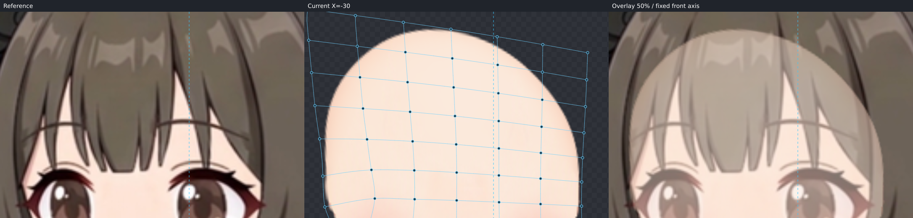
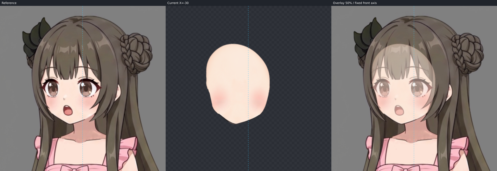
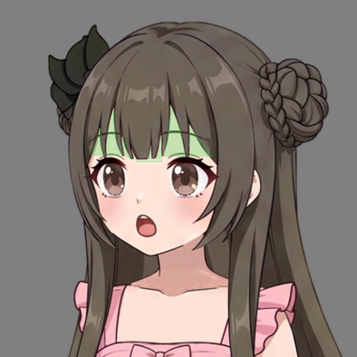

# ParamAngleX -30 候选交付

本轮只制作 X。指定 left.png 是可见脸缘、五官与笔锋的唯一目标；+30 由真实管线镜像。候选尚待用户确认，未宣称流程稳定。固定坐标为原画布 1254×1254、box=[431,35,394,394]、axis=627.5，没有重新居中或按五官对齐。

## 原画来源与静止校准

从原 KRA 新导出 23 个脸部部件和独立脖子，使用 Krita 的 projectionPixelData 保留可见投影及子蒙版，按原画布透明裁切。原 KRA 没有实际脸组容器，脸相关平面图层按原 KRA 从上到下顺序导入；UUID、图层名、裁框和 PNG SHA 见 export-record.json。所有 24 张贴图最终哈希与本次导出一致，原 KRA 未保存改写。没有使用视频像素或他人贴图。

本轮没有既有作者、source 或 trace，故从静止网格开始。0 度初始及最终叠加都核对了脸底、眼部所有层、唇齿舌和脖子，位置保留原画。源脸底的线、色与腮红烘焙在同层；无独立耳层、无独立腮红层，未伪造耳朵。源脸底 textureBounds=[548,142,159,177]，按原坐标放回固定 view 得到 source-face-reference.png；source-face.svg 来自完整脸底 alpha，而不是头发间的窗口。

原 KRA SHA256：56b11c5fd7a3db20e512de642bb1a5922d2f312b2c96557d0c8d3da022587ad4
原合成 PNG SHA256：52359407596567a2874c9714b1e4ea336f1268916e3de784737deeb8de8f173c

## 完整描边、窗口与补全

先绘完整 source，并整图 blend、重叠分区 edge 核对原 alpha。再对带头发的 left 帧起稿整张 target，保留远侧眼窝转向、陡直颊段、颌角和小尖颏；未知上沿先临时闭合。可见脸实体外缘与头发遮挡边界分开判断，远侧眼外段/眼窝转向/陡颊没有整段降为 occluded，近侧脸也没有沿发束凹口削成波浪。两份完整 SVG 与 trace 使用同一组 18 段，另有 chin-tip 对应点；inspect 的 completionMismatch=[]。

在整脸起稿的观察阶段直接描视频的额头窗口 mask，并反复放大左右重叠区，从额顶到太阳穴确认尖角、暗肤色与分离细缝。已核准的窗口包括 view 坐标约 (109.7,139.6)、(125.9,117.8)、(134.5,150)、(145.3,165.6)、(166.5,161.7)、(177.2,148.9)、(187.6,114.8)、(209,137.3)，以及刘海下缘的窄皮肤连接。复查时补入此前漏见的中央细缝，纠正右细缝上尖端，依据均为原帧；核准后没有为覆盖验收缩小 mask。mask 没有描整脸、眼窝/颊部/下颌实体外缘。

已实际查看圆脸九轴关键帧板及原视频 7.7 秒帧、教程完整 left 脸底与 03:38/03:47/04:03 三张关键帧、六模型参考板及 Hiyori 单模型板。本角色原画是饱满颊、小尖颏的圆润鹅蛋脸，选择 Hiyori 的连续额角—颊颌结构作为隐藏部分的参考；短圆脸视频只帮助辨认短下脸体积，不平均不同模型，不借模型角度校准本角色。

补全把额顶抬至 view 约 (172,91)，连续连接双额角、太阳穴与上颊，包含原帧最高已知尖角并在真实刘海后保留搭接。没有按整头发外轮廓扩脸，也没有统一扩张所有脸缘。不存在 continuity-reference，所以没有声称验证 X=-30 的 Y 正负/斜角连续性；当前工程 Y/XY 尚未制作。

## Warp 与实际自动拟合

脸底使用 face_form 6×8 大形 Warp，其下 face_refine 6×12 细化 Warp，只有 face_base 挂入这两级。此分组让额顶补全和陡直脸缘可独立于眼鼻口调整。调用 fit_nine_axis 两次真实拟合；第一次大形之后追加细化并再次 fit。fit-report.json 是最后一次 face_refine 的真实报告，原大形报告保留于 workspace/primary-fit-report.json。

最后 fit 的 occludedWeightScale=0.010000000000000002。可见分段平均误差约 0.055–0.214 原画布像素，最大约 0.456；chin-tip 约 0.074。隐藏远侧额角的对应点最大误差仍为 12.631，没有把低可见误差或弱约束通过视作隐藏区域验收。已另行同坐标看实际 alpha 与完整 SVG：外轮廓连续，额顶、双额角没有断续、缺顶或明显凹坑；实际/预测栅格外缘双向最近距离平均约 0.47px、最大约 2.24px。这一辅助栅格量度只解释隐藏对应点残差，不替代图像检查。实际完整脸与预测对照见 actual-completion-edge-check.png。

完整预测自身包含 mask 全部 2268 个像素；实际脸底也通过独立硬覆盖。最终 fit 后没有手填大量脸底网格点来代替自动求解，也没有全脸膨胀、移下巴或扭脖子补顶。

## 五官批量液化与微调

一次 operations 批次建立左右完整眼 Warp、嘴组 Warp，并移动独立眉毛和鼻：远侧眼整体横向约 0.78，近侧约 0.97，所有眼睑/眼白/虹膜/高光一起透视；不是只移动瞳孔。口腔、上齿、舌、上下唇同组保持连接。放大复查后两眼作亚像素位移、鼻单独修落点，嘴按原帧上端偏左/下端偏右作轻剪切，再轻微拓宽嘴顶。五官没有挂到脸底，以免额部补全改变它们。

最后实际重渲染整脸、远侧眼窝到颊缘、两眼、鼻嘴、额顶与固定脖子。原画鼻高光边缘比视频扩散高光更清晰，鼻线方向/粗细仍有小差异；保留原笔触。源腮红是脸底的烘焙渐变，随脸底转面，不能在不拆改绘画的情况下独立还原视频中的色泽。嘴底圆弧与眼部抗锯齿仍有约 1–2px 级视觉差异，见 nose-mouth-check.png/far-side-check.png；此候选不称像素级一致。

## 最终实际覆盖与端点

最终作者最后一次编辑后，用同一核准 mask、完整 crop=bounds、only=[face/face_base] 重渲染。调用的是管线真实 createNineAxisViewTool / 工作台渲染器，正式报告按 run.ts 的实际报告构造生成，随后调用 finishHead 生成 deformers.json/source.json。没有手绘覆盖图或手写零缺口。另一次 functions.view_nine_axis 独立复查得到相同 mask/alpha/作者构建哈希。

- satisfied=true；requiredPixels=2268；uncoveredPixels=0；uncoveredAreaCanvasPixels=0；uncoveredBounds=null。
- mask alpha 门槛 128，实际脸底 alpha 门槛 250，scale=1，crop/bounds=[431,35,394,394]。
- 最终作者 SHA256：70d79b7fd6507aa3e4e158d7663c4f237880c75e46227960ceee2d47c4650758
- 核准 mask SHA256：1e160a10b68ff7a814e6599241c62a73da40ad442260adeaebbd6a334f35a874
- 指定 left 帧 SHA256：d6832b155687216cc5b161b4dd9ed3c3eee6c1d1fa344822501337c29cd2e155
- 工具 builtDocumentSha256：47ae22bc27bec98252c54197b7020b724464b0c99a8be22376cf4c08072e80e8
- 工具 alphaSha256：ea3b33663b2c1f115818a20dd7d0588f4d6a9558c6e154406f1774b625d64b98
- face-trace.json SHA256：dc495d3b1e9c4d8c2ea861670560994bbf8ab02d0f8de9cf38f6c3558f148b31
- source-face.svg SHA256：5b9cb0df4c224c238236c7a06139014bbc714d1a8afd6e8820bae35ddd2ec620
- target-face.svg SHA256：3dd8bb6b348cf8d96429b5b371acee836fdef7b002c2e151763dcdfcade6f524

正式真实报告/图：face-coverage-report.json、face-coverage-check.png、face-alpha-check.png。独立复查报告/图：independent-coverage-report.json、independent-coverage-check.png、independent-alpha-check.png。完整调用元数据和图像绝对路径在 workspace/final-render-results.json，实际生成脚本在 workspace/final_validate.mts。mask 覆盖为零只验收核准窗口，窗口本身已依据原帧逐区核对。

最终编辑后按 7.5° 步长查看 -30 至 +30 共 9 帧，见 intermediate-check.png；实际额顶/额角连续放大见 forehead-x-transition-check.png。眼睛、嘴和脸底未见明显突然收缩、融化或分离。X 使用当前线性轨迹，没凭先验增设中间关键形。程序几何校验通过并生成镜像右侧；neck 的 -30/0/+30 控制点完全一致、无父级。

发缘检查以指定 left 静态发束为遮挡证据，原 KRA 的静态头发投影另存 workspace/static-hair。工程没有导入头发动画，hair-coverage-check.png 是实际脸底与原帧发缘的同坐标静态叠加；只确认当前可见窗口和隐藏体量，不宣称未来头发动也不会露底。

## step07 接触留项与检查图

脖子全程原形，不拉长、不倾斜、不移动。下巴转向到原画布约 (597.5,317.3) 后，远侧下巴与颈根在约 [597,314]–[608,327] 一带的搭接/阴影需 step07 收尾；近侧约 [655,294]–[674,309] 的颈顶部与下颌线交接也需结合后续 Y/XY 检查。当前没有在 X 步补脖子或改错脸型消缝。

