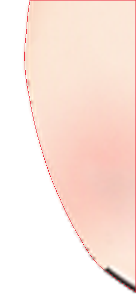
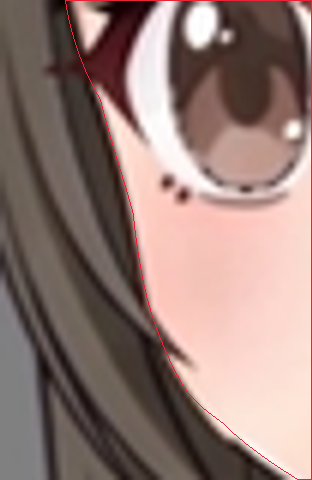
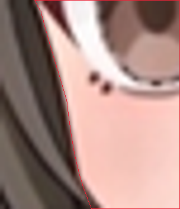
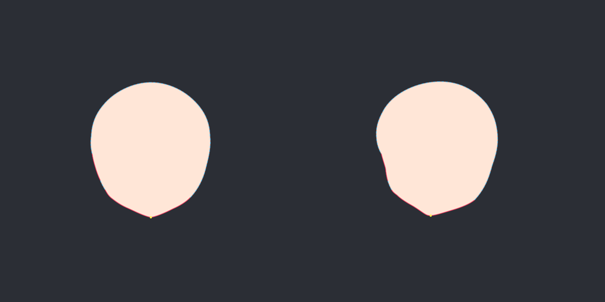
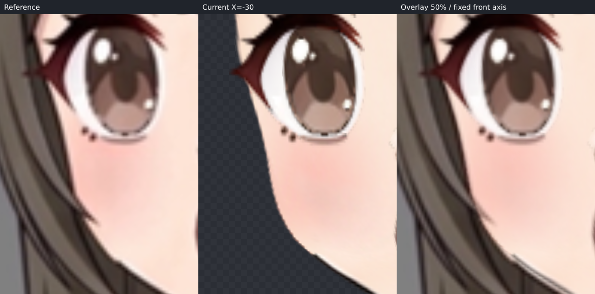
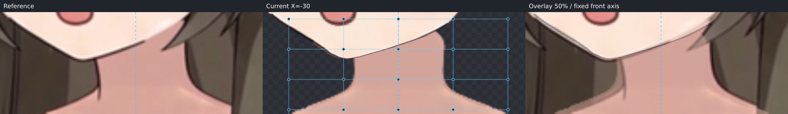

# ParamAngleX −30 局部续修候选

本轮按 review-feedback 延续用户已赞许的真实 seed，候选尚待用户确认。只制作 X，+30 由程序镜像；24 张原贴图、全部部件、两个完整眼 Warp、嘴 Warp 和固定脖子保留。实际修改仅为 face_contour 的 −30 关键形。

## 来源、坐标与分组

源为本轮原始 character-assembled.kra / PNG，哈希分别为 `56b11c5fd7a3db20e512de642bb1a5922d2f312b2c96557d0c8d3da022587ad4`、`52359407596567a2874c9714b1e4ea336f1268916e3de784737deeb8de8f173c`，与 seed 的源核对记录一致。全部24张 PNG 的文件哈希及解码 RGBA 哈希仍与原 KRA 投影核验一致，UUID、上下顺序、裁切范围未变。沿用23个脸层与身体中的独立 neck，没有重新导入静止网格。layer-export-manifest.json、source-layer-verification.json 保留历史导出记录，其 run4 路径表示 seed 的出处；本轮真实路径和核对见 verification.json。

画布1254×1254，固定特写 `[431,35,394,394]`，镜像轴 x=628。所有预览保持原始位置和比例，没有按眼睛或下巴重新配准。青色虚线表示正面中轴。

| 节点 | 部件与分组理由 |
| --- | --- |
| face_contour，8×8 | 仅 face_base；原肤色、轮廓、内绘腮红同层，独立拟合脸缘 |
| eye_left / eye_right，各4×4 | 各带上睑、睑褶、下睫毛、下睑、高光、虹膜、眼白七层；整眼透视，显式镜像配对 |
| mouth_pose，2×2 | 五层口唇、舌、齿、口腔共同调整，保持覆盖 |
| 眉、鼻 | 独立部件网格，保留已有液化落点 |
| neck | 最底层，无父 Warp，全部关键形等于静止形 |

Warp 平级；eye_left 是角色左眼、画面右侧近眼，eye_right 是画面左侧远眼。源 KRA 没有独立耳层，不伪造；腮红已经绘在脸底内。

## 本轮真实脸缘与补全

原 face_base 按 textureBounds `[548,142,159,177]` 放回画布，再裁固定 box 得到 source-face-reference.png。source-face.svg 完整轮廓取原部件，远侧真实 alpha 外缘已局部重描，纠正旧描线约1–1.5 px 的局部偏差。

target-face.svg 对指定 left.png 同坐标检查。已结合本角色原视频相邻帧辨认：远侧眼尾外下方实际显露的实体边缘是 visible，眼上方及发梢覆盖区是 occluded；发束切入皮肤窗口的凹口不捏入脸肉。对应路径分为以下小段，单位为特写 view 像素。

| 段 | target 范围 | 证据 |
| --- | --- | --- |
| far-orbit-hidden | `[96.5,181]` → `[102.6,200.5]` | occluded，眼上方覆盖区 |
| far-orbit-visible | `[102.6,200.5]` → `[108.1,219.5]` | visible，眼尾外侧显露脸缘 |
| far-cheek-steep | `[108.1,219.5]` → `[111.1,236]` | visible，较近竖向的颊部陡段 |
| far-cheek-hair-tip | `[111.1,236]` → `[116,247.5]` | occluded，发梢覆盖下的连续实体 |
| far-cheek-lower | `[116,247.5]` → `[123,254.5]` | visible，发梢以下重新显露的颊缘 |

远侧颌段、两半下巴、近侧颌段仍为 visible；额顶、太阳穴及近侧被发束覆盖的眼窝至上颊补全为 occluded。保留已确认的近侧完整 target 路径与下巴形状，不为了陡段修改其它已确认区域。下巴由 source view `[196.5,283.5]` 到 target `[167,281.3]`，即画布 `[598,316.3]`。

已查看圆脸视频关键帧板和实际7.2秒帧、教程 left 完整脸底及三个关键帧、不同模型总板及 Hiyori 单模型。选 Hiyori 的圆润鹅蛋脸作为遮挡结构先验：本角色饱满颊部、渐收下颌和小尖颏较接近这一类型。只指导被挡区的连续体量，不复制比例、角度、五官或脖子，也不改变已贴视频的可见段。

两份 SVG 均为394×394、透明背景、闭合纯色色块、stroke=none。已实际用 preview_svg 整图 blend 和重叠局部 blend/edge 核对远侧眼窝、陡段、颊颌与相邻区，并复查近侧和下巴。face-trace.json 的15个小段与 completion 完整闭合轮廓使用同一组路径，不以发缘闭合皮肤窗口。

## inspect、自动拟合与实际脸底

已实际调用 fit_nine_axis inspect，查看描线三联图和完整无遮挡 source/target 素脸双图，completionMismatch=[]。face-completion-check.png 是本轮工具原始完整双板，不沿用旧补充拼图。

随后实际调用 fit_nine_axis fit，id=face_contour，81控制点，smoothness=0.002。visible 权重1，occluded 基础权重0.03；工具为避免补全牵动可见证据，自动采用 occludedWeightScale=0.01（实际补全权重约0.0003）。fit-report.json 保存完整逐段结果，下表单位为原画布像素，仅表示网格对描线的残差。

| 段 | 证据 | 拟合后平均 / 最大 px |
| --- | --- | --- |
| far-crown | occluded | 0.244 / 0.628 |
| far-temple | occluded | 1.242 / 2.302 |
| far-orbit-hidden | occluded | 1.543 / 2.302 |
| far-orbit-visible | visible | 0.100 / 0.285 |
| far-cheek-steep | visible | 0.106 / 0.285 |
| far-cheek-hair-tip | occluded | 0.376 / 0.549 |
| far-cheek-lower | visible | 0.110 / 0.270 |
| far-jaw | visible | 0.100 / 0.270 |
| far-chin | visible | 0.072 / 0.212 |
| near-chin | visible | 0.066 / 0.142 |
| near-jaw | visible | 0.034 / 0.142 |
| near-cheek | occluded | 0.344 / 0.623 |
| near-orbit | occluded | 0.093 / 0.382 |
| near-temple | occluded | 0.157 / 0.291 |
| near-crown | occluded | 0.152 / 0.291 |
| chin-tip | visible | 0.015 / 0.015 |

far-orbit-visible 平均残差由4.598降至0.100 px；far-cheek-steep 由2.991降至0.106 px。隐藏 far-temple/orbit 与预测最大约2.302 px；近侧隐藏颊部最大0.623 px。这是弱补全与原平滑网格的差异，不以移动可见脸缘强行消除。

已单独渲染实际变形 face_base，并与完整预测核对，完整近侧眼窝至颊部体量连续。再显示五官和固定脖子，同坐标叠到指定视频帧，检查远侧眼窝、颊缘、颌角和下巴的位置、转向和笔锋。原贴图细小笔锋与 alpha 边缘保留；不以预测图代替实际形变图。

## 五官复核与剩余差异

本轮保留 seed 已完成的一轮批量液化与微调，没有无新证据地重调五官。已有近眼整体左移约36.48 px、宽度约0.992；远眼左移约26.99 px、宽度约0.764，并有侧向剪切和眼尾调整。嘴五层共同左移约35.92 px，横向约0.844、纵向约0.978；鼻和眉独立调整，鼻层另有下半部局部校正。两眼内外角、睑峰、虹膜及高光、鼻尖、嘴角和口腔覆盖本轮已放大逐项复核，全部部件和三个五官 Warp 与 seed 完全一致。

仍能看到的局部差异如下，候选不宣称逐像素一致：

- 鼻尖画布 x约582–584、y约255–260：原深色分叉笔触和高光边缘不同于视频更软的竖向笔触。
- 嘴画布 x约581–605、y约271–298：原口角、下唇边线保留稍有棱角的笔锋，视频边缘更圆软；口腔各层衔接。
- 两眼细睑线、睫毛尖、虹膜下缘：原画软边与视频重采样有小差异，整体落点和远近眼宽度保持。
- 远侧眼窝下至颊颌：原脸底轮廓仍有细小笔锋和线宽差异；主体陡段、转向已贴当前描线，不能用低拟合残差代替视频核对。

left-fit-check.png 是完整 reference/current/50% overlay 三联图；left-check.png 仅原位裁出其前两板。对照未重居中、缩放或配准。

## 过渡、固定脖子与 step07

已实际查看−30、−15、0、+15、+30完整脸、五官与固定脖子。沿用线性 X，没有增加中间关键形。眼睛、口腔与脸底过渡连续，没有突然收缩或层间分离；0全部网格与初始规则网格完全一致，且已同坐标对原合成PNG核对。镜像侧由真实程序生成。

neck 无父级，作者源与镜像工程全部 X 关键形保持原形，没有移动、拉长、倾斜。本轮下巴仍覆盖原脖子顶部；视频脖子本身有侧移，与固定原脖外缘的差别留接触收尾评审。交给 step07 的原画布位置：下巴约 `[598,316.3]`；远侧顶部 x=600–608、y=313–330；近侧颌颈交界 x=650–665、y=292–311。后续复核顶部延长、覆盖与颌线收尾及对应镜像接触，本步未实施。

## 交付核对

face-left.json 为 edit_nine_axis / fit_nine_axis 保存的真实 version2 作者源；deformers.json、source.json 已用本仓库 finishHead 真实编译器更新，验证层级和网格并生成右侧。verification.json 和 view-evidence.json 记录本轮哈希、24张贴图继承原投影的核对、唯一实际修改节点、同源 SVG/trace、工具原图及派生拼板来源。Y、四角和 step07 未推进。此轮交付仍为待用户确认候选。
