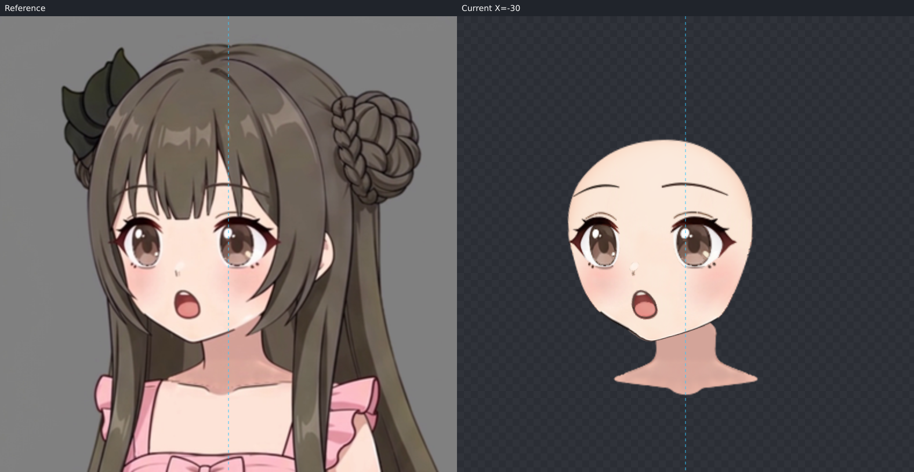
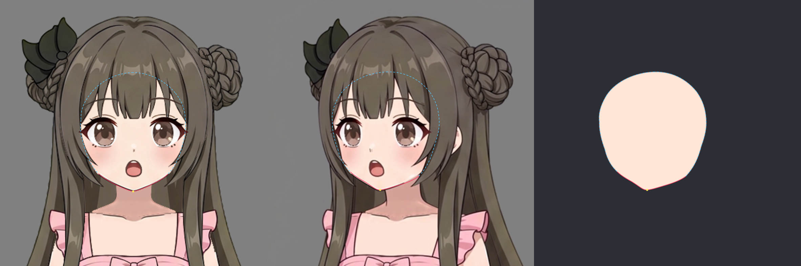
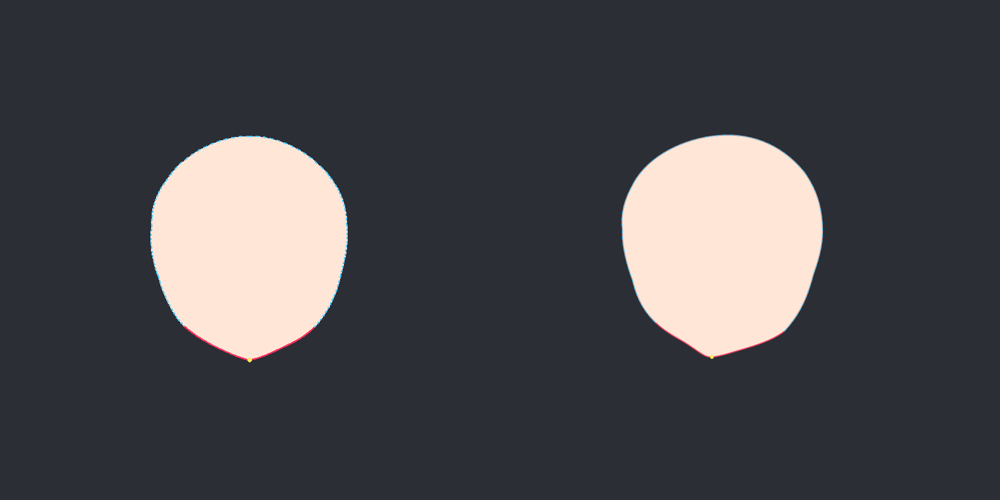
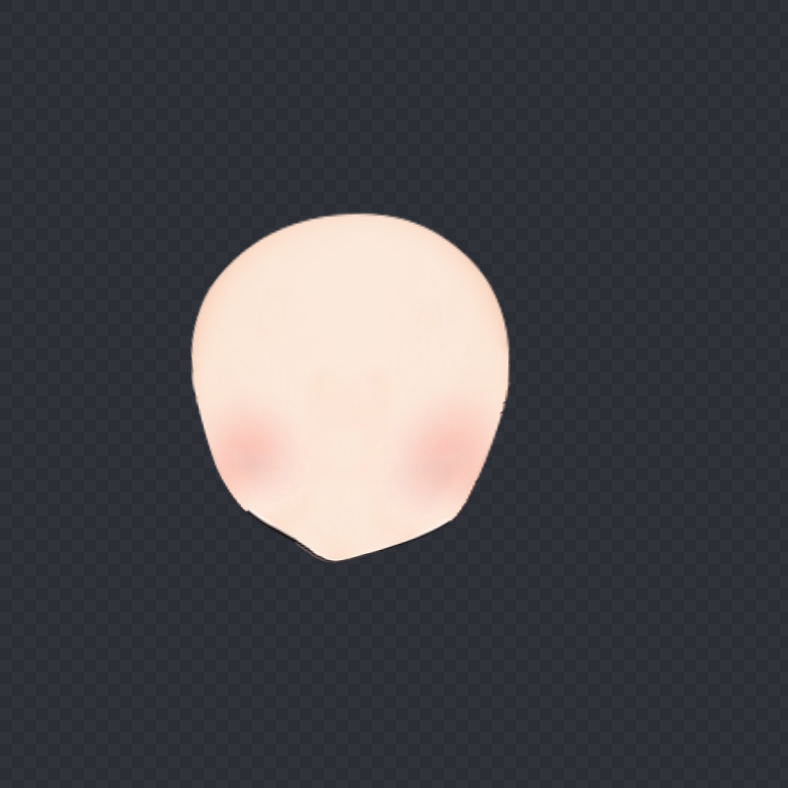
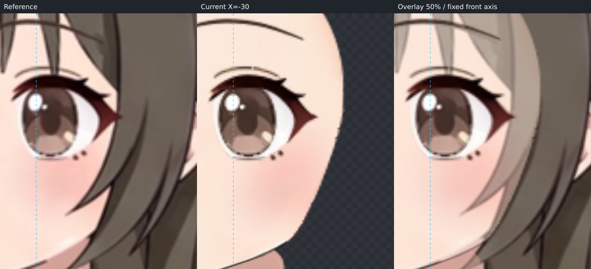
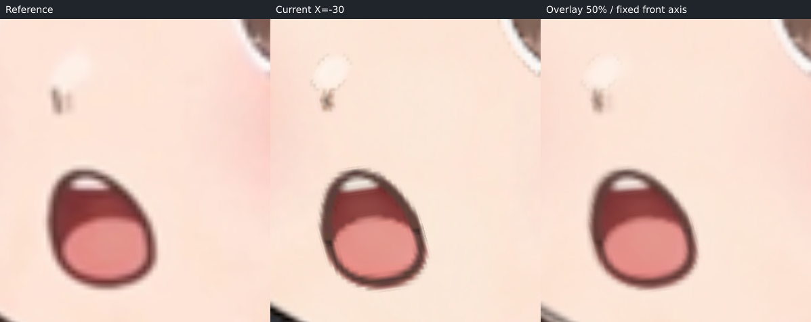
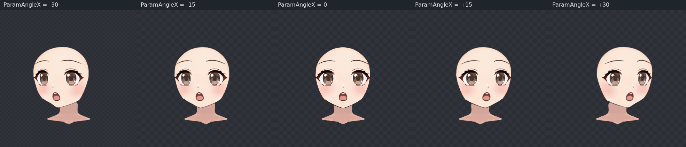

# ParamAngleX −30 候选

本轮为待用户确认的候选。仅制作 X；+30 由程序镜像生成，Y、四角和 step07 未制作。本次导出、拟合与五官调整均保留原 KRA 绘画。

## 来源、坐标和分组

画布为 1254×1254，固定特写范围为 `[431,35,394,394]`，镜像轴为原画布 x=628。所有参考叠加均使用这套坐标，没有按眼睛、下巴重新对齐。图中青色虚线是固定正面中轴。

从原始 `character-assembled.kra` 以 Krita 的图层投影导出 23 个脸层和身体中的独立 neck，按原画布边界裁切透明 PNG。投影保留原层效果；未替换、重绘或液化贴图像素。`layer-export-manifest.json` 保存原 UUID、名称、上下顺序与裁切位置；`source-layer-verification.json` 实际核对全部 24 张 PNG 的解码 RGBA 与原 KRA 投影一致，UUID 和顺序一致，Krita 原文档 modified=false。

| 节点 | 实际包含部件 | 分组理由 |
| --- | --- | --- |
| face_contour，8×8 | face_base 的肤色、轮廓和内绘腮红 | 脸底线色在同一原层，独立自动拟合完整轮廓；较密网格容纳颊颌转折 |
| eye_left、eye_right，各 4×4 | 各自的上眼睑、睑褶、下睫毛、下眼睑、高光、虹膜、眼白，共七层 | 整眼改变远近宽度和眼尾，保持虹膜、高光与睑线关系；显式 mirror_pair |
| mouth_pose，2×2 | 上唇、下唇、舌、上齿、口腔五层 | 共同压缩和侧向倾斜，避免口腔层分離 |
| 眉、鼻 | 各自原部件的局部网格 | 独立修正落点、眉梢和鼻尖，不被脸底轮廓拟合牵动 |
| neck | 原身体脖子层 | 最底层、无父 Warp，全部关键形保持原形 |

这些 Warp 平级，没有预设整头或所有五官共同变形。`eye_left` 是角色左眼、画面右侧近眼；`eye_right` 是画面左侧远眼。原 KRA 没有独立耳层，不伪造耳朵；腮红已绘在 face_base 内，没有新增腮红贴图。

## 真实脸缘与遮挡补全

已打开圆脸视频关键帧板、实际圆脸视频 7.2 秒帧、教程完整 left 脸底、不同脸型模型参考板和 Hiyori 单模型参考，并抽看本角色 left 视频。选用 Hiyori 的圆润鹅蛋脸结构辅助遮挡补全：本角色原完整脸具有饱满颊部、逐渐收束的下颌和小尖颏，较接近这一类型。没有平均长脸和短圆脸，也没有复制 Hiyori 的尺寸、角度、五官或脖子。

当前 left 中，两侧太阳穴、眼窝外缘和多数上颊被发束挡住。尤其画面右眼外侧沿发束弯曲的皮肤窗口属于遮挡边界，未作为脸外缘，也未把发束凹口捏进脸底。下方清晰露出的远侧颌段、两半下巴和近侧颌段标为 visible；其余八段完整脸外轮廓标为 occluded。补全从原 KRA 的整张脸底向额头、太阳穴、眼窝和完整近侧颊部连续延伸。

`face-trace.json` 的 12 个对应小段与闭合 source/target 使用同一组曲线，方向和语义端点一致。原下巴 view `[196.5,283.5]` 移到 `[167,281.3]`，即画布 `[598,316.3]`；上半脸和五官的位移各不相同，不是整脸统一横移。

`fit_nine_axis inspect` 在拟合前已实际调用并查看完整脸预测；最终再次 inspect，completionMismatch 仍为 `[]`。`face-completion-check.png` 保留工具返回的原始素脸双板。工具拼板时 source 面板被放在居中位置，随后由 target 面板遮盖了半张源脸；因此另存 `face-completion-full-check.png` 供完整检查。该补充图左板按相同 source 路径、相同尺度绘制，右板保留工具原 target 面板；它是预测检查图，不是贴图，也不冒充工具原输出。原画完整脸底另经实际部件渲染核对。

## 自动拟合与实际脸底

已实际调用 `fit_nine_axis fit` 制作 face_contour，不以手填网格代替脸底拟合。最终使用 81 个控制点、smoothness=0.002，visible 权重 1，occluded 权重 0.03，occludedWeightScale=1。`fit-report.json` 是工具返回的逐段报告。下表单位为原画布像素，度量的是网格对描线的残差。

| 段 | 证据 | 拟合后平均／最大 |
| --- | --- | --- |
| far-crown | occluded | 0.103 / 0.524 |
| far-temple | occluded | 0.146 / 0.524 |
| far-orbit | occluded | 0.086 / 0.272 |
| far-cheek | occluded | 0.106 / 0.236 |
| far-jaw | visible | 0.049 / 0.100 |
| far-chin | visible | 0.095 / 0.263 |
| near-chin | visible | 0.052 / 0.156 |
| near-jaw | visible | 0.045 / 0.156 |
| near-cheek | occluded | 0.162 / 0.415 |
| near-orbit | occluded | 0.070 / 0.285 |
| near-temple | occluded | 0.051 / 0.153 |
| near-crown | occluded | 0.041 / 0.260 |

下巴标点误差为 0.029 px。已单独查看真实网格渲染的 face_base，并与完整预测核对；近侧眼窝至颊部保持连续体量，原画轮廓的细笔锋保留。五官后续编辑未改动脸底 Warp，可见颌线与下巴没有随五官调整偏离描线。

## 五官与可见残差

先用一个 operations 批次完成有把握的眉眼、鼻、嘴整体调整，再根据同坐标叠加微调。近眼整体向左约 36.48 px，宽度约原来的 0.992；远眼向左约 26.99 px，宽度约 0.764，并修正侧向剪切。远眼的眼白、睑峰和外眼尾随整眼变化，不是只移动瞳孔。近、远眉分别独立调整外半与眉梢。

嘴的五层共同向左约 35.92 px，横向约 0.844、纵向约 0.978，并加入侧向剪切和倾斜。鼻独立向左约 43 px、适度压缩；最后对鼻层下半部作约 1–2.2 px 的局部左移与少量纵向调整，校正放大图中深色鼻尖偏右的位置。原鼻高光和笔触仍保留。

两眼内外角、上睑峰、虹膜与高光、鼻尖、嘴角及口腔覆盖已逐项看过。下列残差仍可在放大图中看到，候选不宣称逐像素一致：

- 鼻尖画布约 x=582–584、y=255–260：落点已校正，原深色笔触的分叉与高光清晰边缘仍不同于视频的竖直软笔触。
- 嘴画布约 x=581–605、y=271–298：原口角和下唇外线保留稍有棱角的笔锋，视频边缘更圆、更软；口腔层没有分離。
- 两眼上睑、睫毛尖与虹膜下缘：整体位置和远近宽度相合，原画细线、软边与视频重采样仍有局部差别。
- 远侧露出的颊颌过渡与下巴：实际线条仍含原画的小笔锋起伏；拟合贴住描线不等于视频每个像素完全一致。

`left-fit-check.png` 保留完整 reference／current／50% overlay 三联图。`left-check.png` 是其前两板原位裁出，所有板采用固定视框和比例。

## 过渡与 step07 接触记录

已查看 −30、−15、0、+15、+30 的完整脸、五官和固定脖子。使用线性 X 插值，眼睛和嘴层保持衔接，脸底没有突然收缩、融化或分離；0 的局部网格与初始规则网格一致，原画叠加核对无错位。本轮没有补中间关键形或改用 ellipse。

脖子的父级为空，所有 X 关键形与静止网格完全相同；没有平移、拉长或倾斜。目前脸底仍覆盖脖子顶部，没有以扭动脖子填缝。视频脖子本身有偏移，因此其外缘与固定原脖存在差别，留待后续接触收尾评审。

交给 step07 的位置均为原画布坐标：下巴约 `[598,316.3]`；远侧顶部接触约 x=600–608、y=313–330；近侧颌颈交界约 x=650–665、y=292–311。应复核固定脖子顶部延长、覆盖和颌线收尾，并检查程序镜像侧的对应接触。本步未实施这些操作。

## 文件核对

`face-left.json` 是 edit/fit 工具保存的 version 2 作者源；`deformers.json` 与 `source.json` 已由本仓库真实 `finishHead` 编译器生成，包含镜像 X 和源 KRA/PNG 哈希。贴图共 24 张，作者源共四个 Warp、24 个原部件。`verification.json` 与 `view-evidence.json` 记录坐标、静止形、固定 neck、工具输出来源与产物哈希。用户确认前，本候选不作为流程稳定性结论。
