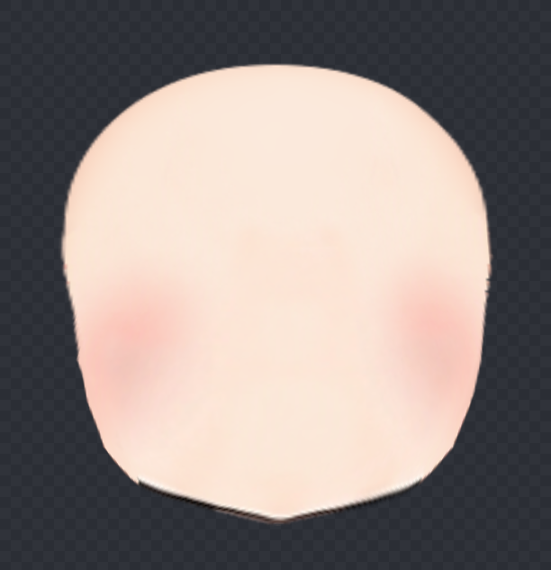
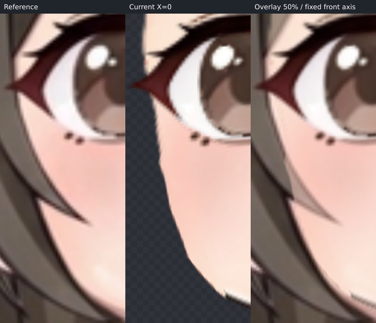
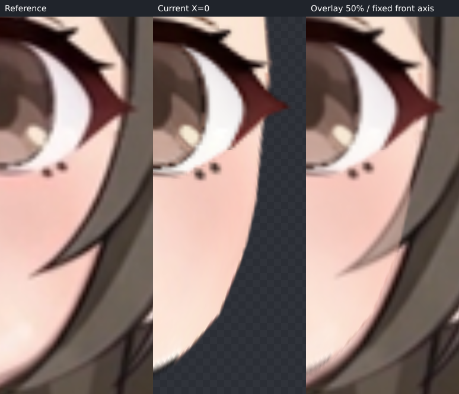
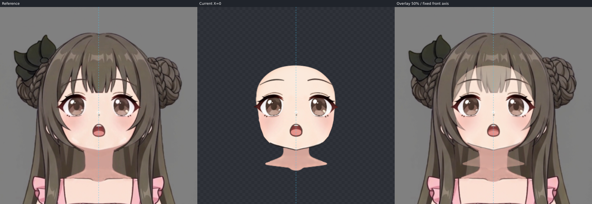
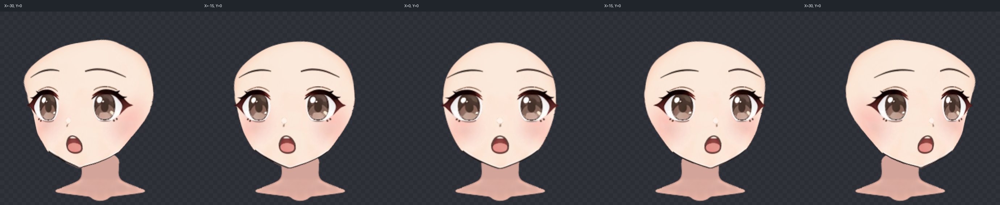

# X=0 / ParamAngleY=+25 制作记录

本步已保存可复查的 up 候选及完整 version 2 工程。只制作 +25，未制作 down、四角或颈部收尾。技术核验通过，视觉验收仍待用户确认，尚不称本方向流程稳定。

## 目标、方向与坐标

目标为同任务 `step03_video-y/up.png`，原片为 `step03_video-y/up.mp4`。实际使用已有 ffmpeg 取并打开原片 0、30、60、90、120 帧：运动为正立的竖直俯仰透视，未见水平转身、滚转倒立或推近放大；五帧只帮助辨认结构，拟合仍以指定 PNG 为准。

原画布 1254×1254，中轴 x=628。原始裁框为 x=431、y=35、size=394；特写 (u,v) 直接对应 (431+u,35+v)。所有目标比较保持此尺度和位置，未按变形五官、下巴重新对齐、旋转或缩放参考。

## 源脸型与遮挡补全

实际打开上游完整 face_base PNG，沿 textureBounds=[548,142,159,177] 放回画布后裁出 `source-face-reference.png`；此图只用于原 alpha 外缘检查，未更换贴图。原脸是饱满颊、圆润鹅蛋体量与小尖颏，不是发束围出的皮肤窗口。

已实际查看圆脸 Y 关键帧、教程抬头脸底及上下并列/眉眼网格、六种模型图。选择 Hiyori 的圆润鹅蛋脸，仅帮助补全隐藏额顶、太阳穴与上颊的连续体量；其饱满颊和小尖颏接近原脸。短宽圆脸、长窄脸等没有与它平均，也未复制模型角度、表情、视线、装饰或脖子运动。圆脸片段含 X 和表情变化，只观察体量连贯性。

目标可见下颊、颌底与下巴比源脸更平、更圆收，按当前视频描。下巴目标特写约 (196.813,286.088)，原画布约 (627.813,321.088)。不能因为“抬头”一词另规定下巴向上移动或一律磨圆。

两侧发梢下方确实露出的皮肤侧缘分别标为 visible：左下颊从 (126.8,244) 到 (142,270)，右下颊从 (251.8,269.7) 到 (268,244)。额顶、太阳穴、发束后的上中颊标 occluded；发梢凹口不压入脸肉。内部鼻线、腮色、颈部阴影均不作为外轮廓。

两份 SVG 是 394×394、透明背景、闭合纯色且 stroke=none 的同一组路径段。实际进行了整图 blend、重叠分区 blend/edge 及独显素脸检查，随后从相同段生成 trace。右源下颊分段用 De Casteljau 拆分，未改变原轮廓。最后 inspect 的 completionMismatch=[]。

## 分组与实际形变

继承上游全部局部网格、绘制顺序和来源：face-completion（12×12）→face-silhouette（6×8）→face/face_base（4×4）。本步新增根级 up-volume-correction（12×12）只包住脸底层级，用于已拟合颊颌与隐藏上颊之间的修顺；其范围 [505,135,740,377]，不含五官或脖子。新层的静止与 X 形保持原画布位置。

先自动拟合可见脸缘，再检查真实贴图渲染。较小平滑约束曾触发网格折叠，失败试验均未保存。保留有效平滑拟合后，按实际完整素脸与同一目标 SVG 局部修顺隐藏侧缘：收回上部多出的体量、补足中颊内收，保住可见颌底与下巴。实际脸底与纯色预测是两份独立检查，交付的是原纹理的真实 Warp 渲染。

两只整眼分别沿用独立的 4×4 Warp，每眼七层共同调整；口腔五层沿用独立 2×2 mouth-perspective。鼻、眉独立修改，不预设随脸底变形。neck 从始至终 parent 为空，静止、X、Y 关键形完全相同。

## 五官微调

一次有把握的 operations 批次完成眼、眉、鼻、嘴，再进行小幅微调。以下均为原画布像素，按本角色目标决定：

- 图像左整眼向外约 1.95、向下约 1.81；图像右整眼向外约 2.27、向下约 2.27。宽约增加 4%，高度基本保留，外眼尾有轻微向下坡度。眼白、眼睑、睫毛、虹膜和高光共同变化，保留原画左右差异。
- 鼻围绕原中心缩至 90%，向右约 0.50、向上约 6.15，核对眼鼻与鼻嘴关系。
- 整口腔总宽约增加 3.7%，高度约增加 0.8%，整体向上约 2.93，保留张嘴表情、牙、舌和上下唇的配合。
- 两眉宽约缩 2%、高约缩 1%，分别向上约 1.1/1.0，小幅向内调整。

原鼻贴图的白高光仍比视频明显；原下眼线、睫毛点与唇缘笔锋有细小差异，保留并列检查，没有透明度消除。原 KRA 无独立耳朵，跳过耳部；也没有独立腮色层，腮色随真实脸底一起处理。

## 最终逐段残差

单位为原画布像素。`fit-report.json` 的 before/after 保留最后一次自动拟合结果；下面及 finalMeasured 是之后手工修顺的当前工程，用同一 SVG 弧长采样、原生组合 Warp 重新实测，author 哈希对应当前 face-up.json。

“对应均值/最大”包含沿轮廓的语义对应位置差异；“轮廓最大距离”是补充的到完整预测 target 外缘的最近距离。后者只评估完整素脸轮廓接近程度，不能证明遮挡结构在视频中真实可见，也不能替代对应残差。

| 段 | 证据 | 对应均值 | 对应最大 | 轮廓最大距离 |
| --- | --- | ---: | ---: | ---: |
| left-forehead-temple | occluded | 0.830 | 1.373 | 0.830 |
| left-temple | occluded | 1.674 | 2.474 | 0.668 |
| left-upper-cheek | occluded | 3.002 | 3.544 | 0.668 |
| left-mid-cheek | occluded | 4.295 | 6.073 | 0.931 |
| left-cheek-turn | occluded | 0.212 | 0.398 | 0.230 |
| left-lower-cheek | visible | 0.172 | 0.472 | 0.290 |
| left-jaw | visible | 0.139 | 0.472 | 0.185 |
| chin | visible | 0.078 | 0.182 | 0.201 |
| right-jaw | visible | 0.140 | 0.589 | 0.201 |
| right-lower-cheek | visible | 0.155 | 0.589 | 0.173 |
| right-mid-cheek | occluded | 4.774 | 6.708 | 0.785 |
| right-upper-cheek | occluded | 4.736 | 6.524 | 1.165 |
| right-forehead-temple | occluded | 1.241 | 2.810 | 0.840 |
| chin-center | visible | 0.050 | 0.050 | 0.107 |

可见颊颌均值约 0.08–0.17，最大约 0.59。隐藏中上颊的弧长对应仍有约 3–4.8 均值、最高 6.71 的残差；完整预测轮廓的最近距离最高约 1.17。实际完整脸底保留连续体量，但隐藏区域属于补全判断，不视为视频验证过的精确解。

## 固定脖子与 step07 交接

当前下巴覆盖固定脖子顶部，无通过拉长或倾斜脖子填接缝。原脸底纹理有深色下颌接触线及微小白色缺口，端点仍可见。接触重点约原画布 x=602–654、y=314–322；颌两侧的线与白色笔锋也需一起审查。额顶/发遮挡处的最终覆盖、脖子顶部补足、接触消线与阴影归 step07。

目标视频的脖子下部投影较长，固定素材的肩颈形状与其不重合；本步明确保留原形原位置，不为追这部分差异改错目标脸型。没有增加贴图、蒙版或改不透明度。

## 过渡、来源与交付核验

实际查看 Y=0、12.5、25 及 X=-30、-15、0、15、30，未见五官突然收缩、分离或融化，脖子固定。额外原生检查 Y=6.25、18.75 的组合细分网格；所有检查姿态均无翻折，最小有向三角面积为 0.168415 原画布平方像素。

原生 buildContinuation/writeBuilt 已按最新作者源重新生成 deformers.json 与 layers。24 张继承贴图逐一 SHA256 与上游相同，受保护 X 姿态最大控制点数值差 0.00006104 像素（新增恒等父级后的浮点舍入量），来源验证通过。没有负 Y 或四角关键形。完整校验见 validation-report.json。

当前作者 SHA256：`9a2a6489922deb4e9e254440e433b67da6e7f74c1941ba40d1330ceb80bfc6f7`。

