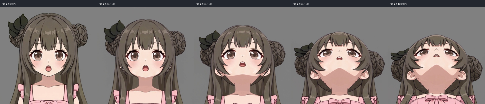
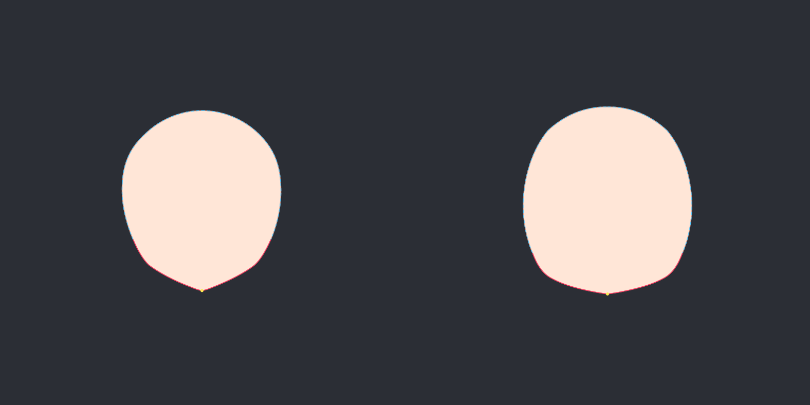
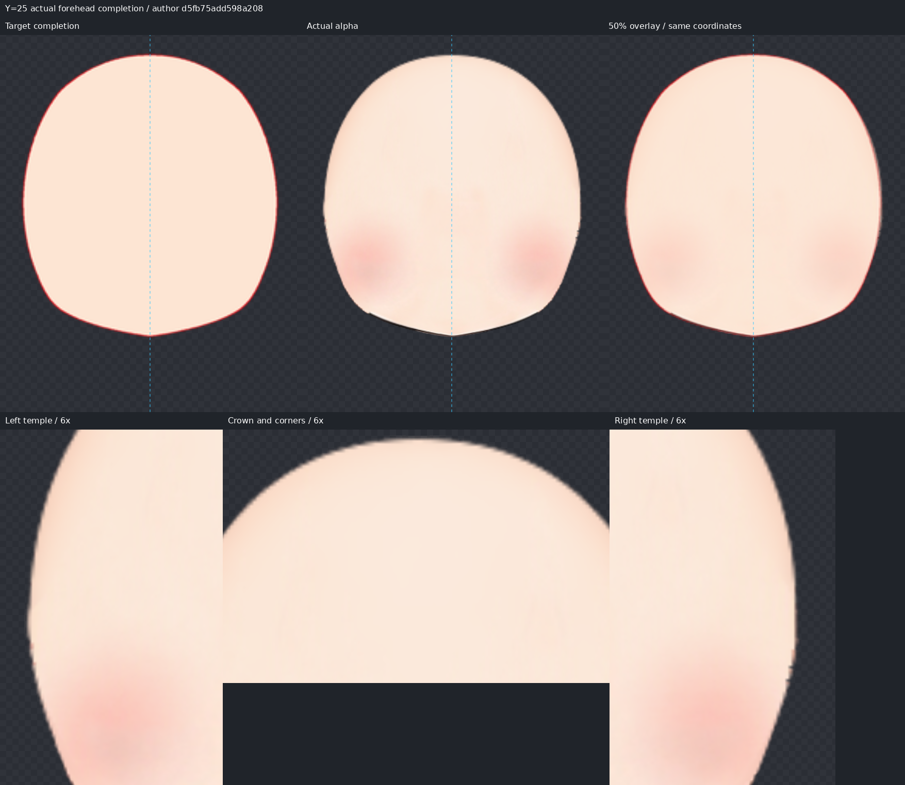
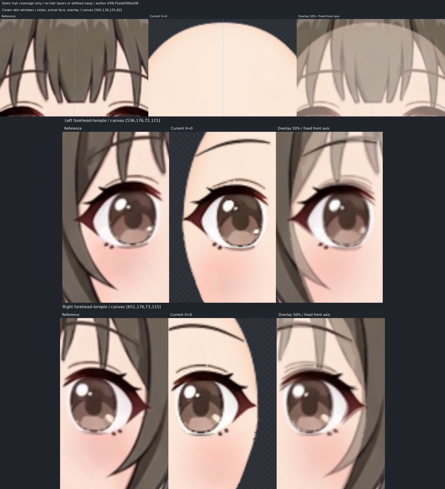
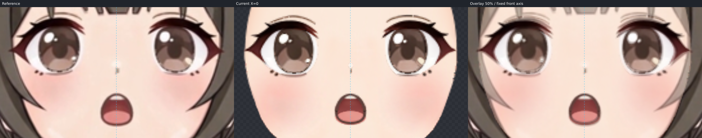
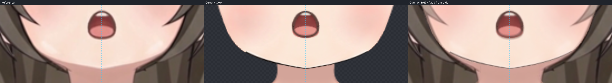
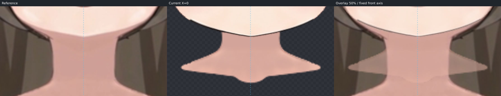
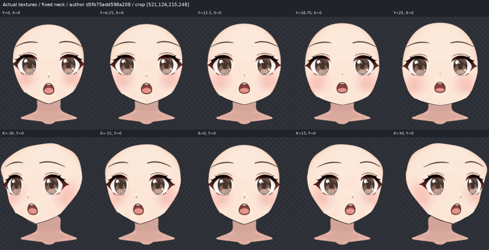
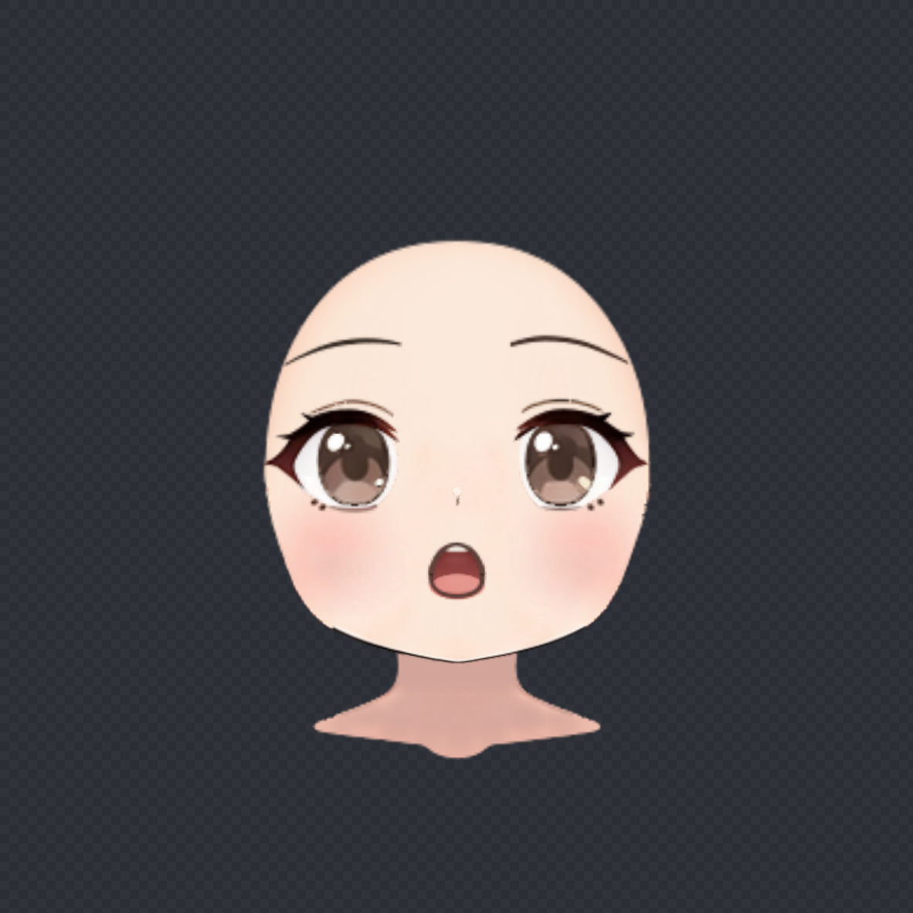

# X=0 / ParamAngleY=+25 抬头制作记录

本步完成 up 作者工程与真实贴图检查，尚待用户视觉验收，未称本方向流程稳定。未制作 down、四角或颈部收尾。

## 来源、坐标与视频方向

- 上游：`/data/home/lockliu/workspaces/AstraLayering-nineaxis-deformer-hierarchy-20261103/.web/nine-axis-forehead-pipeline-20261104/run1/pink-doll/nine-axis/step02_angle-x/deformers.json`，SHA256 `e29782f927aa4d4e82ddf277aa721a1366b93063373dc5c922fa358db82a3d24`。
- 唯一目标：`/data/home/lockliu/workspaces/AstraLayering-nineaxis-deformer-hierarchy-20261103/.web/nine-axis-forehead-pipeline-20261104/run1/pink-doll/nine-axis/step03_video-y/up.png`，SHA256 `18515228cc9789d4ab99e7970fb8c1b8d92ee223db52f045bb01b310d0c287ce`。
- 原视频：`/data/home/lockliu/workspaces/AstraLayering-nineaxis-deformer-hierarchy-20261103/.web/nine-axis-forehead-pipeline-20261104/run1/pink-doll/nine-axis/step03_video-y/up.mp4`；正面：`/data/home/lockliu/workspaces/AstraLayering-nineaxis-deformer-hierarchy-20261103/.web/nine-axis-forehead-pipeline-20261104/run1/pink-doll/nine-axis/step01_video/upper-body.png`。
- 裁框：`/data/home/lockliu/workspaces/AstraLayering-nineaxis-deformer-hierarchy-20261103/.web/nine-axis-forehead-pipeline-20261104/run1/pink-doll/nine-axis/step01_video/crop.json`。原画布 1254×1254，中轴 x=628；固定 box=[431,35,394,394]。所有叠加均使用此坐标和尺度，没有按五官或下巴重新对齐。

复用 `/data/home/lockliu/.local/bin/ffmpeg` 从原视频的 121 帧中取 0、30、60、90、120 帧，实际查看五帧板。运动为正立的竖直抬头透视，无水平转身、滚转倒立或推近放大；指定 up.png 为目标（所选第 33 帧），相邻帧只辅助辨认归属。视频后段的脖子运动没有带入工程。

## 脸型辨认与遮挡补全依据

已读取并实际打开先验页的六模型板、Hiyori 放大图、圆脸视频关键帧，以及教程 04:16 脸底、07:27 上下并列、07:42 眉眼关系图。

本角色原画完整 alpha 是饱满圆润鹅蛋脸，颊部有体量、下颌渐收至小尖颏。选择 Hiyori 的额顶—额角—太阳穴—上颊连续结构作为隐藏部分参考；没有采用 Koharu/Haruto 的短扁圆颏，没有平均不同脸型。圆脸视频片段含 X 转向和表情，仅看体量连续性；教程只解释隐藏结构，不借用示例角度、网格位移、眉眼距离或脖子运动。

源轮廓来自 `face/face_base` 的原画完整 alpha，包含额顶与下颌，不是刘海间的皮肤窗口，也不是已做 X 转角。按原 textureBounds 放回原画布，再按固定 box 裁出 source-face-reference.png，未修改贴图。视频的鬓发凹口、下睫毛、内鼻线和颈部阴影没有被描成实体脸缘。

source-face.svg、target-face.svg 和 face-trace.json 由同一组 12 个语义对应的 cubic 路径段生成，均为 394×394。六段可见颊颌/下巴优先；六段额顶、额角、太阳穴为 occluded，原始权重 0.03。另用一处可见下巴 landmark 稳定对应。整图及重叠局部 blend/edge 已实际查看，最后 inspect 的 completionMismatch=[]。

第一次隐藏额顶预测偏低，放大刘海高处皮肤三角窗口后，将隐藏 crown/forehead 修为顶部 view(197,104)，两侧额角约(139,127)/(255,127)。已对齐的可见下颌路径和五官没有随此补全修改。最终预测不沿刘海下缘闭合，也不扩大到发髻、头饰或整片头发外轮廓。

## Warp 分组与最终拟合

沿用真实 version 2 层级、绘制顺序、局部网格和 X 关键形。face-silhouette 6×8 负责脸底大形，parent=face-completion；后者保留原 X 补全，Y 形保持原位。密度已有足够控制范围，未给全部五官复制同一形变。

左右 eye Warp 各 4×4 共同带动眼白、虹膜、高光、眼睑和睫毛，避免只移瞳孔。mouth-perspective 2×2 带动口腔各层，舌头再独立修正。眉与鼻保持独立，依据视频落点调整，未预设所有五官都跟脸底投影。

最终 fit 作用于 face-silhouette，smoothness=0.01、63 控制点，occludedWeightScale=0.1，因此隐藏段有效权重为 0.003。以下是自动 fit 的语义对应点误差，单位为原画布像素，不是描边与视频的视觉偏差，也不代替 alpha 覆盖检查。

| 分段/点 | 证据 | 平均残差 | 最大残差 |
| --- | --- | ---: | ---: |
| crown-right | 遮挡补全 | 0.3832 | 1.8299 |
| right-forehead | 遮挡补全 | 0.6438 | 2.1910 |
| right-temple | 遮挡补全 | 0.8802 | 2.1910 |
| right-cheek | 可见 | 0.0544 | 0.1087 |
| right-jaw | 可见 | 0.1077 | 0.2522 |
| chin-right | 可见 | 0.0651 | 0.2522 |
| chin-left | 可见 | 0.0608 | 0.2420 |
| left-jaw | 可见 | 0.1112 | 0.2420 |
| left-cheek | 可见 | 0.0641 | 0.1648 |
| left-temple | 遮挡补全 | 0.9132 | 2.0717 |
| left-forehead | 遮挡补全 | 0.6100 | 2.0717 |
| crown-left | 遮挡补全 | 0.3919 | 1.9018 |
| chin | 可见 | 0.0096 | 0.0096 |

最后自动拟合作者 SHA256：`8195d7d7b7cd5b86592a76e0e8e00d753c7c1a21f054ce933e448a9572eac206`。
随后只更新作者 notes，没有改几何、五官或贴图；最终作者与 deformers.json SHA256 均为：

`d5fb75add598a208c3fde42858e1296627b8abf4b48348e612fe4e3432067c65`

face-trace.json SHA256：`a8ab64ac47918544143b6098cc428641576938fc91996c657e8cfcd8597f14c7`。fit-report.json 保留最终 fit 数值并补入此来源关系；check-provenance.json 标记最终检查图所对应作者。所有正式验收图为最终隐藏额顶修正后的图。

## 真实额頂、额角和发缘验收

独显真实 face_base 看整张脸，再用原画布 crop [565,136,125,82]、[536,176,72,115]、[651,176,73,115] 以 6 倍放大核对额顶和双侧额角/太阳穴；另以同坐标 target completion PNG 对照实际 alpha。额顶中心至两侧额角再到上颊保持连续体量，没有新缺顶、深凹坑、裂口或需要皮肤覆盖处露背景。

实际隐藏轮廓与预测仍有最多约 2.2 像素的拟合差异；两侧源 alpha 的细小阶梯笔缘在放大时仍可见，未换贴图或用透明度抹去。额顶没有因低隐藏权重而压薄。最终实际额顶在刘海两处高皮肤窗口的尖部后留有数像素静态搭接；较亮的窗口内部证据点 view(160,122)/(233,121) 与同横坐标实际上缘约112.3之间有约9.7/8.7像素纵向余量，这只是内部取样佐证，不把它当整个发缘的最小余量。

静态发缘对照显示太阳穴到上颊处有脸底搭接，可见颊颌没有被补全拉走。Y=12.5 的上脸局部也实际放大查看，额顶/额角持续连贯。工程没有头发层，也没有定义发摆范围；本次只核对原画及 up 视频静态遮挡与脸底自身完整性，不能保证未来头发动态时不露底，未自定发摆或制作头发动画。

## 五官、固定脖子与剩余偏差

按 up 同坐标核对眉眼、眼鼻、鼻嘴、嘴颏关系和眼睑弧度。第一批将两整眼微向外、向下调整，眼尾做局部下移，保留虹膜与高光配合；眉独立微调。嘴组略上移并调整宽高，保留开口表情；二轮以下缘为锚压低舌头上缘，增加视频可见的深色口腔比例。鼻通过局部网格收窄白高光并匹配鼻线起止，没有改透明度。调整依据为本角色视频，不强制采用“抬头眉眼拉开/嘴变高”等教程距离规则。

仍可见的差异：原贴图白鼻高光比视频明显；部分眼线、下睫毛和口缘的像素笔锋约有一像素局部差异；脸底自带的深色下颌线比视频明显，颊部纹理/腮红也保留原素材。可见下颌主体与下巴落点已贴住目标，不能把 fit 的小残差理解成所有笔触逐像素一致。

neck 从开始参与完整渲染，parent=null，bbox=[565,293,691,363]，所有 X/Y 关键形与静止形完全相同。下巴覆盖固定脖子顶部；视频脖子更长/更宽处未通过拉伸补齐。step07 处理接触区域：原画布下巴中心约(628,321)、左右颈顶交接约(602,317)/(654,317)附近的下颌接触线、颈顶覆盖补足和阴影收尾。额顶、额角及太阳穴的脸底完整性在本步完成，未留给 step07。

原 KRA 无独立耳朵层，本步跳过耳朵制作。

## 过渡、保留校验与产物

实际查看 X=0 下的 Y=0、6.25、12.5、18.75、25；回查 Y=0 下的 X=-30、-15、0、15、30。脸型和五官过渡没有突然收缩、融化或分离，固定脖子不动。X 的既有非对称额部造型保持上游结果，本步没有修改其它方向。

使用管线 finishAngleY 编译真实作者文件并导出 deformers.json/layers，checkContinuation 验证来源和已制作姿态。另按每个上游部件、细分网格检查五个 X 姿态，最大画布位移差为 0。24 张导出贴图与上游 SHA256 一致，中轴、来源、绘制顺序不变，neck 全关键形等于静止形。详见 validation-report.json。这些技术检查不代替用户视觉验收。

正式产物保存在 `/data/home/lockliu/workspaces/AstraLayering-nineaxis-deformer-hierarchy-20261103/.web/nine-axis-forehead-pipeline-20261104/run1/pink-doll/nine-axis/step04_angle-up`：face-up.json、deformers.json、原图 layers/、两份闭合 SVG、原画 alpha 检查底图、共享 face-trace.json、最终 fit-report.json、所有指定检查图及本记录。完整端点见 up-check.png，同坐标视频三联见 up-fit-check.png。

