# X=0 / ParamAngleY=-25 制作记录

已保存独立 down 候选、完整 version 2 作者源和运行工程。本步只制作 -25，保留既有 X/up；未制作四角或颈部收尾。技术核验通过，视觉验收待用户确认，尚不称本方向流程稳定。

## 输入、方向与坐标

上游工程：`nine-axis/step04_angle-up/deformers.json`。

指定拟合目标：`nine-axis/step03_video-y/down.png`。

原视频：`nine-axis/step03_video-y/down.mp4`。

正面和裁框分别为任务根下的绝对输入：
`nine-axis/step01_video/upper-body.png`，
`nine-axis/step01_video/crop.json`。

描线前已用已有 ffmpeg 取开头、四分之一、中间、四分之三、末尾并实际查看；归档时补为精确帧号 0、30、60、90、120 再查看。五帧保存原生 960×960，没有独立缩放、旋转或重新居中。运动为正立竖直俯仰透视，未见水平转身、滚转倒立或推近变焦。后段额顶显露增大、脸投影收短属于俯视变化；相邻帧只辅助辨认，仍以指定 down.png 为拟合目标。

原画布 1254×1254，中轴 x=628，固定裁框 [431,35,394,394]；特写 (u,v) 对应 (431+u,35+v)。所有参考叠图均用这一范围，不按当前眼睛或下巴消除误差。

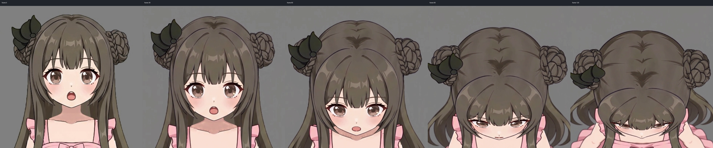

## 源脸型、可见证据与补全

实际打开上游完整 face_base 原 PNG。按 textureBounds=[548,142,159,177] 放回原画布，再按固定裁框裁出 source-face-reference.png。source 描的是原画完整 alpha 外缘，未取发束间露肤窗口，未修改或替换贴图。

原脸为饱满颊、圆润鹅蛋体量与小尖颏。已读指定 down 先验，实际查看六模型脸型板、Hiyori 单模型、圆脸视频关键帧、教程低头完整脸底/网格、上下并列和眼部网格。选择 Hiyori 的圆润鹅蛋结构，仅帮助补出隐藏额顶、太阳穴与上颊的连续体量：其颊部饱满、小尖颏圆收与原脸接近。没有平均长窄脸和短宽圆脸。圆脸片段含 X 和表情，只观察体量；教程与模型的参数、表情、嘴开、视线和脖子运动未移植。

目标可靠显露的左颌、下巴、右颌标 visible。左可见起点约特写 (144.6,297.3)，右端约 (250.6,297.0)，下巴约 (197,323)，即原画布约 (628,358)。两侧发梢遮住的颊段与额顶/太阳穴标 occluded；发梢凹口、发影、睫毛、内部鼻线和下颌阴影均未直接刻进脸底外缘。下巴的实际位置、圆收弧度与脸宽由视频决定。

补全额顶约特写 (197,145)，与两侧太阳穴及上颊连成完整体量，没有沿刘海下缘闭合成露肤小片。source/target 独立描制，两份 SVG 均为 394×394、透明背景、闭合纯色、stroke=none。先整图 blend，再用重叠局部 crop 的 blend/edge 查看填色外缘，核对颊颌、下巴和发束旁的归属，随后独显完整素脸并回看叠加。

face-trace.json 从同一组已核对 SVG 路径段生成，额顶、太阳穴、上下颊、左右颌、下巴分段且方向对应。inspect 的 completionMismatch=[]；完整双图与三联描线均已实际查看。预测结构和真正原纹理 Warp 渲染分别留图。

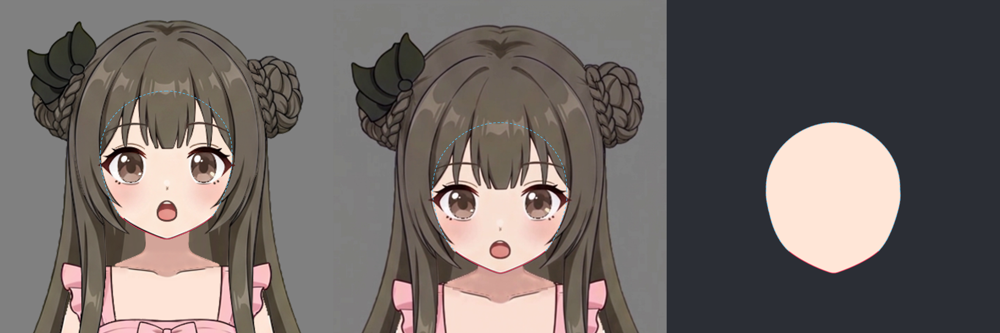
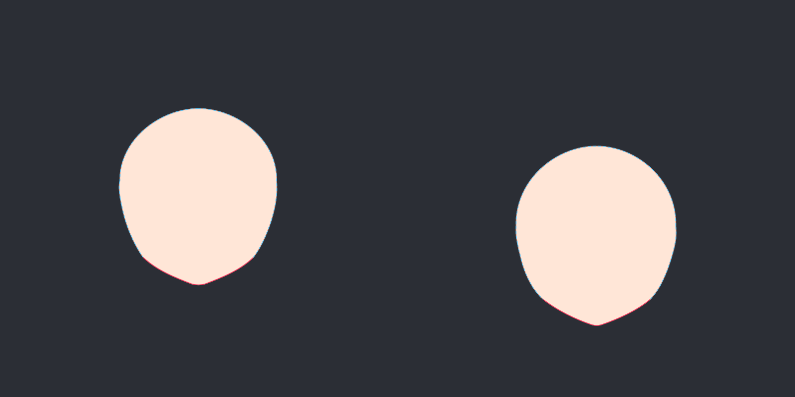

## 分组、拟合与真实脸底

沿用上游层级：up-volume-correction（根级12×12）→face-completion（12×12）→face-silhouette（6×8）→face/face_base（4×4）。本步未新增父级或复制相同形变到所有贴图。继承的 up-volume-correction 在 down 为静止形；只自动拟合 face-completion 的 -25，保留上游局部网格、来源和绘制顺序。

两次自动拟合均成功保存，平滑约束分别为 0.02 与最终 0.002。最终有169个控制点。visible 初始权重1，occluded初始权重0.03；工具为保护可见线自动给出 occludedWeightScale=0.010，即本轮隐藏约束有效降为0.0003。补全不能牵走当前视频的可见下颌。

两只整眼继续用各自独立4×4 Warp，每眼七层共同变化；口腔五层共同用2×2 mouth-perspective。眉与鼻独立，不预设随脸底 Warp。neck 一直为根级、parent为空，所有静止/X/Y关键形相同。完整渲染和参考自开始包含固定脖子。

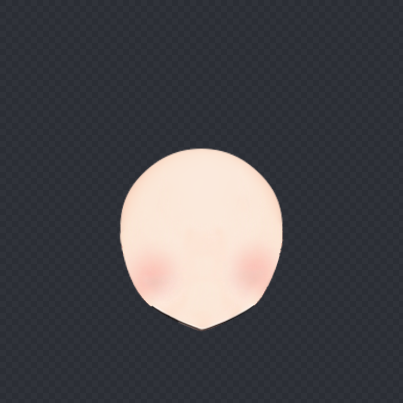
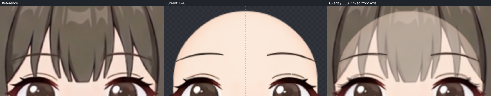

## 五官调整

先一次 operations 批次完成有把握的眼、眉、鼻、嘴落点和形状，再放大微调。以下变化取本角色视频；没有用教程距离规则替代目标，也没有只移瞳孔：

- 图像左整眼（eye_right）宽约增加3.1%、高约缩3.5%，向外约2.39、向下约43.94原画布像素；右整眼（eye_left）宽约增加3.6%、高约缩4.9%，向外约1.99、向下约44.02。两眼随后分别加约+0.0503/-0.0514横向剪切，眼睑、眼白、虹膜、高光和睫毛共同配合，保留左右原画差异。
- 两眉宽增加约8%、高缩至85%，向下约45.6/46.2并稍向外，按视频眉眼间距检查。
- 鼻先按目标落点向下约47.71，再以鼻线下缘约 [627.8,306] 为锚缩小白高光体量，核对眼鼻、鼻嘴关系。
- 口腔宽增加约1.3%、高缩至85.2%，整体向下约45.13，保留张嘴表情及原唇缘笔触。舌以底缘为锚将高度增加约9%，牙缩至宽80%/高75%并下移0.3，核对开口内各层的配合。

实际同坐标检查鼻高光仍比视频显眼，下眼线、睫毛点、唇缘和极细白笔锋仍有原纹理差异；未用透明度掩盖。原 KRA 无独立耳朵，说明后跳过耳部；无独立腮色层，原腮色随脸底一起考虑。

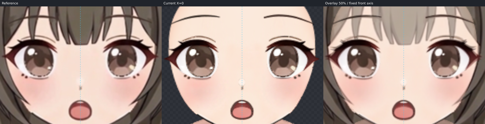

## 当前逐段残差

单位为原画布像素。fit-report.json 保留最后一次自动拟合的 before/after，finalMeasured 用同一SVG弧长采样和原生组合 Warp，对最终作者源重新实测。五官微调后未再手动改变脸底轮廓。

表中对应误差含语义弧长位置差；轮廓距离为补充的到完整预测外缘最近距离，不证明隐藏区域在视频可见，也不代替描线对视频的实际检查。

| 段 | 证据 | 对应均值 | 对应最大 | 轮廓最大距离 |
| --- | --- | ---: | ---: | ---: |
| left-forehead | occluded | 0.143 | 0.412 | 0.293 |
| left-temple | occluded | 0.349 | 0.433 | 0.293 |
| left-upper-cheek | occluded | 0.246 | 0.473 | 0.133 |
| left-mid-cheek | occluded | 0.423 | 0.855 | 0.402 |
| left-cheek-turn | occluded | 1.678 | 2.538 | 0.359 |
| left-lower-cheek | occluded | 1.311 | 2.538 | 0.357 |
| left-jaw | visible | 0.040 | 0.138 | 0.142 |
| chin | visible | 0.065 | 0.138 | 0.154 |
| right-jaw | visible | 0.019 | 0.118 | 0.154 |
| right-lower-cheek | occluded | 0.469 | 1.202 | 0.283 |
| right-mid-cheek | occluded | 0.867 | 2.045 | 0.275 |
| right-upper-cheek | occluded | 0.826 | 2.045 | 0.366 |
| right-forehead | occluded | 0.339 | 1.651 | 0.484 |

可见左颌、下巴、右颌平均对应误差约0.019–0.065，最大约0.138。隐藏左颊转折/下颊仍有约1.31–1.68平均、最高2.538的弧长对应误差；完整预测外缘最近距离全段最高约0.484。隐藏结构属于补全判断，实际渲染仍保留连续额顶、上颊和圆收下颌体量。数值小不能替代同坐标视觉验收。

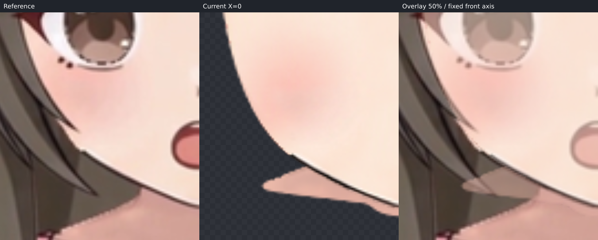
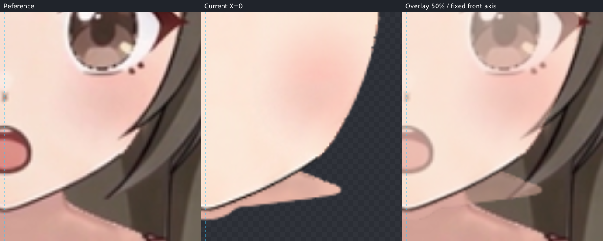
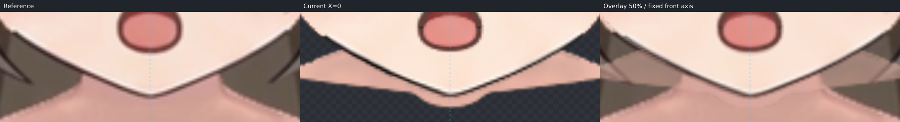

## 固定脖子与 step07 交接

down 下巴约 [628,358]，覆盖固定脖子大部分，肩颈两侧仍露细条；当前素材的肩颈与视频投影不重合。本步保留脖子原形原位置，未通过倾斜、拉长或跟头部 Warp 来追参考。

原脸底深色下颌线、极细白边/缺口仍在。中央下巴接触重点约 x=600–655、y=345–359，固定脖子下缘约y=363；两侧细条约 x=566–603、653–690、y=343–356。step07 需一起审查下颌压颈线、脖子顶部补足与接触阴影、两侧边缘的笔锋，以及隐藏额顶/发遮挡处的最终覆盖。没有为填接缝改变目标脸型，没有添加或替换贴图、蒙版或不透明度。

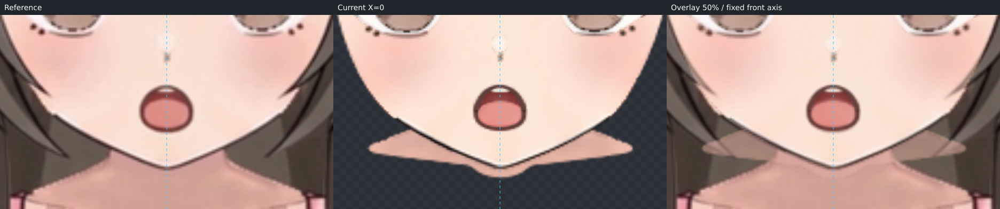

## 过渡和工程核验

实际查看 X=0 的 Y=0、-12.5、-25；回看 X=-30、-15、0、15、30（Y=0），以及 up 的Y=12.5、25。未见五官突然收缩、融化或分离，脖子固定。

原生 buildContinuation/writeBuilt 从当前作者源生成 deformers.json 和 layers。所有继承节点按每格4次细分检查保护姿态；X加查±7.5、±22.5，up加查6.25、18.75。最大组合网格画布坐标差为 0.00000000 像素。24张贴图逐一SHA256与上游完全相同，画布、中轴与来源记录保留。所有17个轴姿态的组合细分网格无翻折，最小有向三角面积 0.157745 原画布平方像素。未新增四角关键形。

最终作者SHA256：`12742502e51dddd6388c323f70e9aee85928e68617ac7cca1df1e4d343abe3c1`。

详细工程校验见 validation-report.json，检查图哈希与坐标记录见 checks.json。视觉验收仍待用户确认；本步止于独立 down。

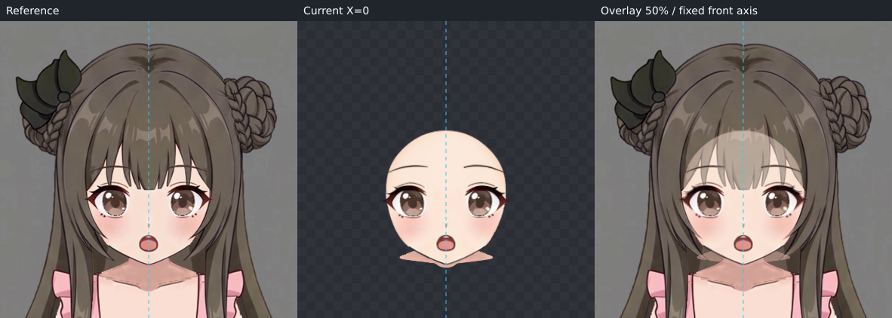
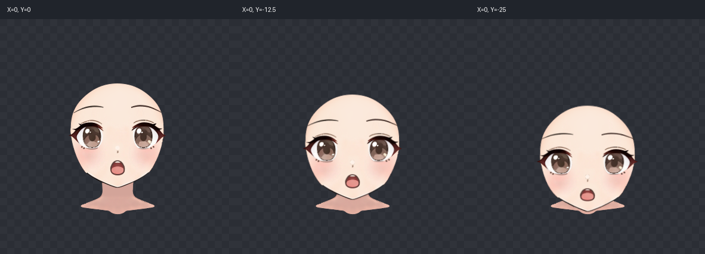
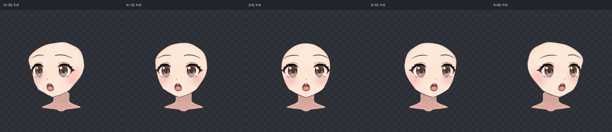
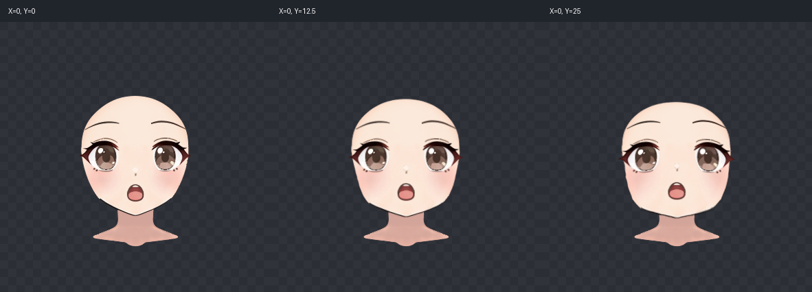
