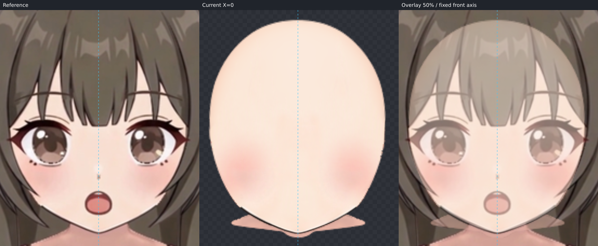
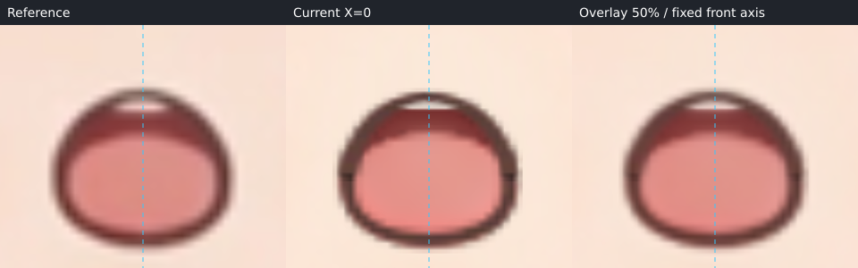
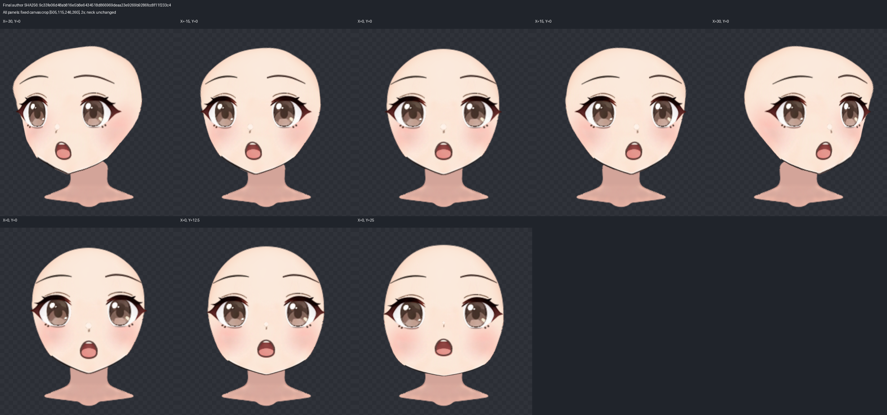

# 低头 X=0 / ParamAngleY=-25 制作记录

本次只制作 down。已保存完整 version 2 作者工程、原生运行工程与检查图，尚待用户视觉验收；技术检查通过不表示本方向流程已获认可或稳定。未制作四角或颈部收尾。

最终 `face-down.json` 与 `deformers.json` 的 SHA256 均为：

`9c33fe06d48ab816e5b8e6434518d866969deaa23e9269b9286fcc8f11f233c4`

## 视频、原脸型与补全依据

从原 down.mp4 用已有 `/data/home/lockliu/.local/bin/ffmpeg` 提取并实际查看第 0、30、60、90、120 帧（24 fps，0 / 1.25 / 2.50 / 3.75 / 5.00 秒）。画面保持正立，变化为竖直俯仰透视；未见水平转身、滚转、倒立或明显推近放大。相邻帧用于辨认皮肤、发束与下颌归属；后段口部表情变化不移植。本步拟合始终以指定 down.png 为目标。

已阅读并实际查看补全先验页中的六模型脸型板、圆脸 Y 视频关键帧、教程低头完整脸底及抬头/正面/低头五官对照。原完整 face_base 是饱满圆颊、圆润收束的小颏，接近圆润鹅蛋脸；选择 **Hiyori** 的额顶—额角—太阳穴连续性作为遮挡区域参考。没有混合长窄脸，也没有采用教程例子的尖颏、参数位移、嘴开或脖子运动。

先验文件：
[脸型补全先验](/data/home/lockliu/workspaces/AstraLayering-nineaxis-deformer-hierarchy-20261103/.agents/skills/live2d-maker/knowledge/nine-axis/step05_angle-down/references/completion/脸型补全先验.md)；
[Hiyori 图板](/data/home/lockliu/workspaces/AstraLayering-nineaxis-deformer-hierarchy-20261103/.agents/skills/live2d-maker/knowledge/nine-axis/step05_angle-down/references/completion/models/hiyori/reference.jpg)。

头宽、可见颊颌、下巴位置和弧度仍取本角色目标帧。低头后的露肤窗口没有用作完整脸底的闭合边界，发梢凹口和下颌内部阴影均未压入脸肉。

## 坐标、描边与分组

全过程沿用原画布 1254×1254、中轴 X=628，以及固定裁框 `[431,35,394,394]`。参考未重新居中、缩放或按五官对齐。

`source-face-reference.png` 将上游原 face_base PNG 按 textureBounds `[548,142,159,177]` 放回原画布，再裁取既定 box；没有改动贴图。source 描原完整 alpha 外缘，不描 up 轮廓或头发间的皮肤窗口。两份 SVG 均为 394×394、纯色闭合填充、无描边、透明背景；由同一个分段定义生成 SVG 与 trace。

先整图 blend，再用重叠局部 crop、4–8 倍 blend/edge 核对填色真实外缘。上眼外侧可见脸缘、两侧下颌与下巴标为 visible；发束遮住的额顶、太阳穴和颊部连接标为 occluded。额顶、太阳穴、上颊、颌线与两半下巴分别建立语义对应段，不用整条轮廓的弧长猜转折。最终 inspect 的 `completionMismatch=[]`，完整预测保留额部和双侧额角体量。

继承上游 5 个 Warp 与 24 个贴图部件，未套用新解剖树：

- `face-completion` 为现有 12×12 父 Warp，承接隐藏上脸的完整体量；`face-silhouette` 为现有 6×8 子 Warp，控制可见颊颌，二者只作用于脸底。
- 两眼分别用现有 4×4 Warp 同步眼白、虹膜、高光、眼睑与睫毛；眉、鼻保持独立，不预设它们随脸底移动。
- 口腔各层共用现有 2×2 Warp；舌面和牙列最后作局部修正。
- `neck` 始终为根部件、parent 为空，没有任何变形或移动。

## 自动拟合与真正的隐藏脸底

第一轮拟合 `face-silhouette` 时，可见线已贴合，但 `occludedWeightScale=0.0001`。实际独显发现隐藏上沿仍缺目标体量，未以低可见残差验收。随后使用覆盖完整上脸的现有 `face-completion` 再拟合，得到 **occludedWeightScale=1**、169 个控制点、smoothness=0.02。

第二轮自动 fit 的作者 SHA 为
`65edccd5fcdaebe7ae1ce874e2c406800ec7da51a65041e8c96cf0005054149d`。
正式 `fit-report.json` 记录该轮脸底求解。之后只编辑五官，脸底 Warp 与 face_base 未再改变；最终 inspect、实际脸底及全部正式检查图均在最终作者 SHA 下重新取得。

逐段拟合残差如下，单位为原画布像素。它衡量 Warp 与人工核对描线之间的误差，不是自动测得的“贴视频误差”。

| 分段 | 可见性 | 平均 | 最大 |
| --- | --- | ---: | ---: |
| forehead_right | occluded | 0.155 | 1.094 |
| temple_right | occluded | 0.317 | 1.094 |
| upper_cheek_right_a | occluded | 0.300 | 1.067 |
| upper_cheek_right_b | visible | 0.010 | 0.022 |
| cheek_right | occluded | 0.096 | 0.206 |
| jaw_right | visible | 0.059 | 0.148 |
| chin_right | visible | 0.042 | 0.067 |
| chin_left | visible | 0.057 | 0.104 |
| jaw_left | visible | 0.036 | 0.104 |
| cheek_left | occluded | 0.126 | 0.223 |
| upper_cheek_left_a | visible | 0.013 | 0.077 |
| upper_cheek_left_b | occluded | 0.351 | 1.222 |
| temple_left | occluded | 0.331 | 1.222 |
| forehead_left | occluded | 0.156 | 1.078 |
| chin-tip | visible | 0.064 | 0.064 |

完整实际脸底的额顶中心到两側额角、太阳穴及上颊连续，没有新的缺顶、凹坑、裂口或压薄。局部 5 倍检查可见少量原 alpha 的像素阶梯；真实上沿与预测约有 1 像素内的边缘差异，没有为了压低残差削掉完整额部。0、-12.5、-25 的实际过渡中，上沿保持连贯。

搭接依据是当前目标的刘海与鬓发：完整额部延续在刘海后，额角覆盖目标中可见的三角露肤处，太阳穴接进眼外侧脸缘；不是沿全部头发外轮廓扩张。当前头部运行工程只有脸和固定脖子，没有头发节点或已定义发摆范围。原 KRA 有刘海、鬓发和后发层，本次仅作只读遮挡依据。因此这里检查的是目标帧静态遮挡、已有单轴中间值的脸底自身完整性，不宣称未来头发摆动也不会露底，未制作额外头发动画。

## 五官及剩余可见差异

先一次批次完成两眼、双眉、鼻与整口腔的主要 down 形状和落点，随后同坐标放大微调。两眼整体向目标落点下降，眼睑、眼白的显露与虹膜/高光共同调整，未仅移动瞳孔制造俯仰。最终整眼纵向比例约为原形的 0.9504，眉形纵向比例 0.8，鼻为 `[0.9,0.82]`；这些数值来自本帧复查，不是通用低头间距规则。

画面左眼的虹膜与高光最后共同向左微移 1.3 像素、横向调整 1.04。整口型落点约在画布 `[627.8,329.7]`；8 倍复查后仅下移口部 Warp 顶行 1.6 像素，保持嘴角和底缘，再向上展开舌面、缩短牙列，使上缘、舌面起点和可见细牙条更贴目标。所有口层保留原纹理与表情笔触。

仍可见的差异：原鼻贴图高光比视频显得更清楚；两侧睫毛与下颌的原像素笔锋和视频压缩/采样略有区别；口部上缘、牙列和舌面有约亚像素至 1 像素的局部差异。没有更换贴图或用透明度掩盖它们。可见下颌处实际 alpha 与视频约有 1 像素级差异，仍以视频位置和圆润下巴为准。

已只读检查原 KRA `maindoc.xml` 图层：没有独立耳朵层，故本步跳过耳朵。

## 固定脖子与 step07 接触位置

`neck` 的原 bbox 为 `[565,293,691,363]`，所有 X/Y 关键形均与静止形逐点相同。down 下巴在画布约 `[627.5,358.4]`，覆盖原脖子绝大部分；中央只余接近 5 像素的原颈部下沿，两侧有窄颈色条。

交给 step07 的项目为：固定颈顶约 Y=293 附近的必要补足、下颌接触线约 X=574–682 / Y=334–359 的消线与颌下阴影，以及现有颈色条的接触收尾。视频中下方身体/颈部位置与固定原颈不同，本步没有为露出更多脖子抬下巴、拉长脖子或移动颈部。额顶与额角补全已在本步落实，不延后。

## 过渡、保护验证与交付

实际查看最终 X=0 的 Y=0、-12.5、-25，以及受保护 up 的 +12.5、+25；另看 X=-30、-15、+15、+30 / Y=0。眉眼与口腔层随各自 Warp 连续过渡，没有本步引入的突然收缩、融化或分离；脖子原位不动。

通过仓库原生 `buildContinuation(...,'down',...)` 与 `writeBuilt` 生成 `deformers.json` 和 `layers/`。程序验证上游来源、中轴、画布、绘制顺序、裁切和贴图。额外以工作台同一组合 Warp 的每格 5 次细分比较全部继承节点：X 每 7.5 参数步长、up 每 6.25 参数步长，最大画布位置差 **0.000000 像素**。17 个已制作单轴姿态的组合细分网格均无翻折，最小有向三角面积为 **0.030192** 原画布平方像素。24 张输出贴图逐一 SHA256 与上游一致。没有四角关键形。

来源 KRA：
`/data/home/lockliu/workspaces/AstraLayering-nineaxis-deformer-hierarchy-20261103/.web/nine-axis-forehead-pipeline-20261104/run1/pink-doll/character-assembly/step01/character-assembled.kra`

来源 SHA256：`56b11c5fd7a3db20e512de642bb1a5922d2f312b2c96557d0c8d3da022587ad4`。
上游 `deformers.json` SHA256：`d5fb75add598a208c3fde42858e1296627b8abf4b48348e612fe4e3432067c65`。

完整技术记录见 [validation-report.json](validation-report.json)，检查图哈希与最终作者对应关系见 [evidence-manifest.json](evidence-manifest.json)。自动 fit 报告与 SVG 预测分别保留；最终实际渲染图用于视觉检查，不能用预测或数值检查替代用户验收。
