# 抬头 +25 候选交付

只制作 X=0、ParamAngleY=+25。完整 version 2 作者源为 `face-up.json`，运行工程为 `deformers.json`；未制作 down 或四角。本轮技术校验和实际渲染检查已完成，视觉效果仍待用户验收。

## 来源与固定坐标

上游：
`nine-axis/step03_angle-x/deformers.json`

目标：
`nine-axis/step04_views-y/up.png`

原视频、正面和裁框位于：
`nine-axis/step01_video/`

原画布为 1254×1254，中轴 x=628。所有参考采用同一裁框 `[431,35,394,394]`；特写坐标加 `[431,35]` 即画布坐标。叠加没有按眼睛或下巴重新配准。`source-face-reference.png` 将上游完整脸底 PNG 按 textureBounds `[548,142,159,177]` 放回画布后裁出，仅作检查底图。24 张原贴图均继承且哈希一致，来源、绘制顺序、中轴与静止形均保留。

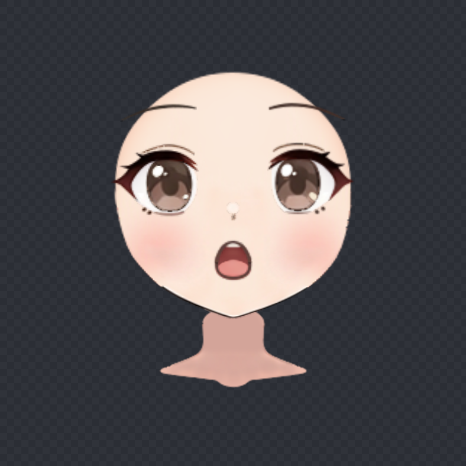

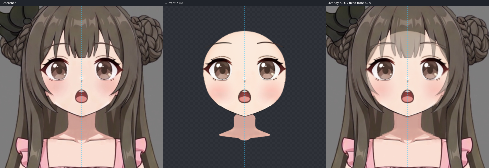

## 脸型辨认与隐藏结构

已阅读并打开先验文件所带的六模型脸型板、Hiyori 单模型图、圆脸视频关键帧，以及教程 04:16 脸底、07:27 上下并列和 07:42 眉眼网格图：
`.agents/skills/live2d-maker/knowledge/nine-axis/step05_angle-up/references/completion/脸型补全先验.md`

原脸底是饱满颊部、渐收下颌和小尖颏的圆润鹅蛋脸，接近 Hiyori。选择其额顶—太阳穴—上颊的连续体量作为遮挡补全依据；没有混合短圆脸、宽扁圆脸或长窄脸。圆脸视频含 X 转向与表情变化，只用于理解隐藏体量；教程和模型的位移、角度、嘴开与脖子运动没有复制。

目标可见的实体脸缘为左右发梢以下的下颊、下颌、下巴。刘海和侧发之间露出的皮肤是遮挡窗口，发梢凹口没有压入脸肉；鼻线、睫毛和下颌内部阴影未作为外轮廓。额顶、太阳穴、上颊及被侧发覆盖的下颊为 occluded。目标保留视频的小尖颏，没有按教程将下巴统一磨圆。

闭合 source 与 target 均由同一组 16 个语义对应的小段生成 SVG 和 trace，分开额顶、太阳穴、上颊、隐藏下颊、可见下颊、下颌、颏侧和颏尖。source 顶点约 `[197,107.5]`、下巴 `[197,283]`；target 隐藏额顶约 `[197,60]`、下巴 `[197,269.1]`，这些是固定特写坐标。完整脸的变化包含额部、颊宽和下颌投影的不同变化，并非整脸等比拉伸。

先整图 blend，再以重叠局部 crop、4–6 倍 blend/edge 检查填色外缘与笔锋；随后独显完整素脸并回查可见段。`inspect` 的 `completionMismatch=[]`。SVG 的完整路径与 trace completion 字符串一致，fit 报告的 trace 哈希也一致。

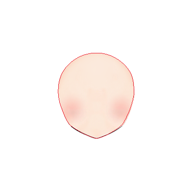

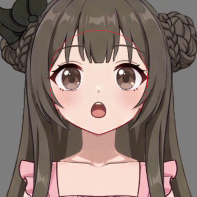

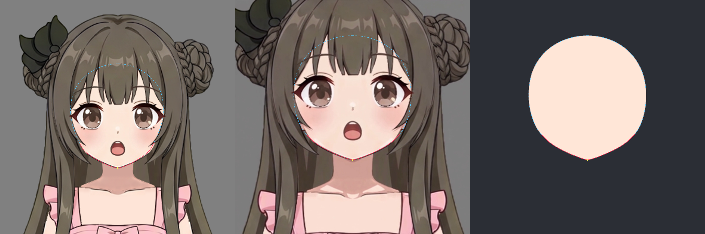

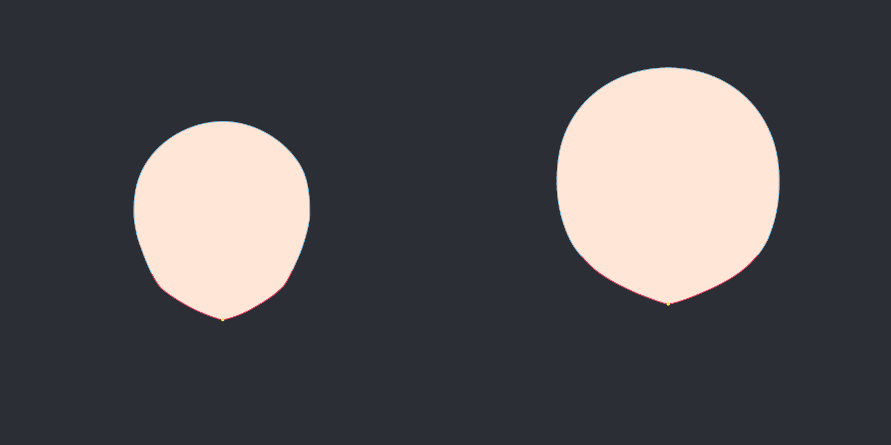

## 分组与实际脸底拟合

沿用上游层级和局部网格：

- `face-completion` 为独立根 Warp，12×12，负责本步完整脸型；`face-silhouette` 为其 6×8 子 Warp，保留既有 X 的轮廓修正；脸底部件保留原 4×4 局部网格。
- 两眼分别使用原独立 4×4 Warp，眼白、虹膜、高光、睫毛、眼睑与折线一起调整，保持眼层配合。
- 眉与鼻独立于脸底 Warp；口腔五层使用原 `mouth-perspective` 2×2 Warp，舌面再作局部修正。
- `neck` 始终在根层，无父级；所有 X/Y 关键形等于静止形。没有为五官套一个共同的脸底形变。

使用 `fit_nine_axis` 拟合 `face-completion`，smoothness=0.01，169 个控制点。可见约束优先，遮挡约束初始权重 0.03；工具进一步将遮挡权重缩到原先的 1%，避免隐藏补全拉走可见脸缘。以下是网格对应描线的误差，单位为原画布像素，不能解释为对视频的像素误差。

| 分段 | 可见性 | 平均残差 | 最大残差 |
| --- | --- | ---: | ---: |
| forehead-left | 遮挡 | 1.616 | 2.197 |
| temple-left | 遮挡 | 1.406 | 2.672 |
| upper-cheek-left | 遮挡 | 3.081 | 7.406 |
| lower-cheek-hidden-left | 遮挡 | 3.762 | 7.406 |
| lower-cheek-visible-left | 可见 | 0.056 | 0.179 |
| jaw-left | 可见 | 0.114 | 0.396 |
| chin-left | 可见 | 0.108 | 0.396 |
| chin-tip-left | 可见 | 0.044 | 0.109 |
| chin-tip-right | 可见 | 0.017 | 0.034 |
| chin-right | 可见 | 0.081 | 0.342 |
| jaw-right | 可见 | 0.110 | 0.342 |
| lower-cheek-visible-right | 可见 | 0.072 | 0.266 |
| lower-cheek-hidden-right | 遮挡 | 3.173 | 6.208 |
| upper-cheek-right | 遮挡 | 2.639 | 6.208 |
| temple-right | 遮挡 | 1.567 | 3.027 |
| forehead-right | 遮挡 | 1.531 | 2.152 |
| chin-center landmark | 可见 | 0.034 | 0.034 |

隐藏上颊与下颊没有强求贴满预测线，实际渲染仍保有连续体量。已单独查看真正变形后的完整脸底，再以固定坐标放大核对两颊、下颌、下巴和太阳穴遮挡范围。

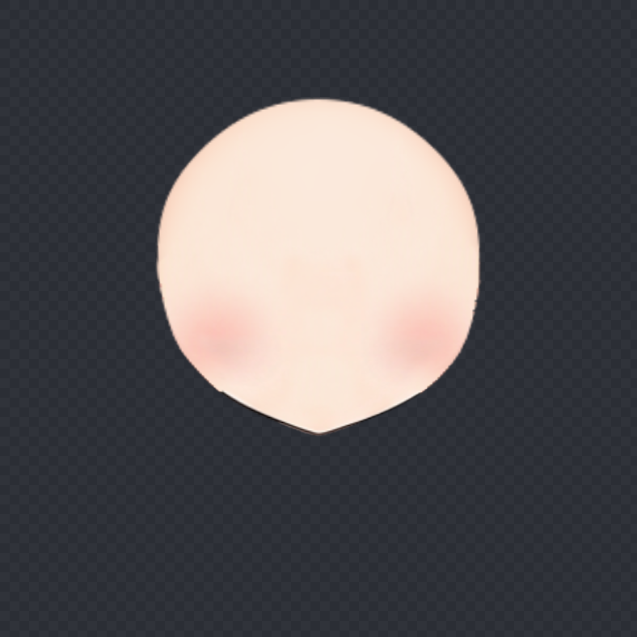

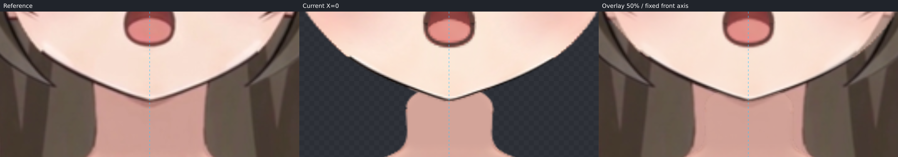

补充实际检查图：[太阳穴与上颊](checks/temple-cheek-check.png)、[静止正面对照](checks/front-fit-check.png)。

## 五官调整

先用一次 operations 批次调整两眼、两眉、鼻和整口腔，再以同坐标放大渲染微调。数值来自本角色目标帧的落点和开口，未用通用俯仰距离规则。

两眼整体约横向放大 1.26、纵向放大 1.22；画面左眼净平移约 `[-13.3,-41.7]`，画面右眼约 `[13.5,-42.4]` 画布像素。最后分别回落 1.6 和 0.9 像素，修正放大叠加中略偏高的眼层。眼睑、眼白、虹膜和高光共同变形，没有单移瞳孔制造角度。

两眉约放大 `[1.28,1.14]`，左右外移约 14.5、上移 56 像素；鼻约放大 `[1.23,1.15]`、上移 39.8 像素。口腔整体约放大 `[1.269,1.306]`，上移约 29.3 像素，保持原张嘴表情和各层绘制次序。舌面单独缩放 `[0.97,0.82]`，再把上缘中心软选择上提 0.7 像素，贴近目标的舌面弧度。

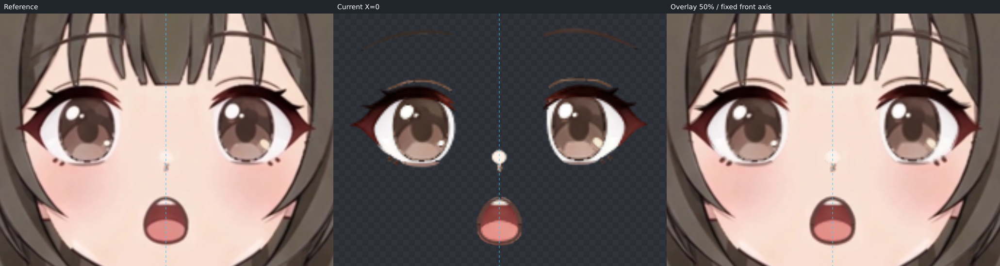

原鼻高光较视频醒目，虹膜/睫毛的小笔锋和嘴边线也有原贴图与视频的差异；保留原画纹理，没有换贴图或用透明度掩盖。可见脸缘整体贴近目标，但原下颌白色笔锋凹口、深色描边仍比视频稍明显。原工程没有独立耳朵部件，本步跳过耳朵制作。

## 固定脖子与 step08 交接

固定脖子 textureBounds 为 `[565,293,126,70]`；+25 下巴约在画布 `[628,304.1]`。下巴与原脖子圆顶附近的接触主要位于 x≈602–654、y≈296–307。原脖子顶缘在两侧仍有圆肩式收口，接触黑线/阴影尚未消除；目标视频脖子更宽、更高，不能把这些运动搬到本步固定脖子上。

交给 step08：沿原固定脖子两侧方向处理顶部覆盖与缺口，检查上述下巴接触范围；整理接触线、局部阴影以及头发装回后的隐藏额顶覆盖。保持本步目标脸型和固定脖子下部的位置、宽度、形状，不为接缝改变下巴落点。当前保留原线和脸色层，没有新增蒙版或透明度修补。

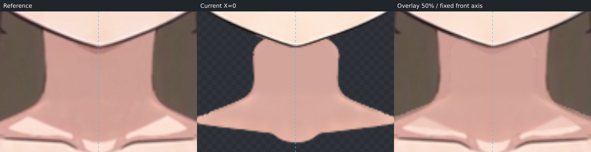

## 过渡与工程校验

实际查看 Y=0、6.25、12.5、18.75、25；回查 X=-30、-15、0、15、30（Y=0）。所有图使用相同画布裁框。未看到眼层或口腔层突然收缩、分离，脖子始终固定。

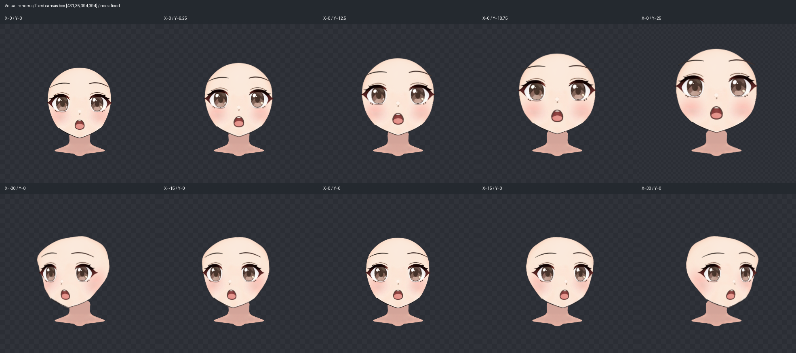

最终通过管线 `buildAngleY` / `writeBuilt` 生成完整工程和继承贴图。来源与画布校验通过，X 五个姿态的组合网格画布位置与上游差均为 **0**；24 个部件的贴图 SHA256 一致。详细结果在 `validation-report.json`，检查图来源记录在 `checks/render-manifest.json`。本步 ParamAngleY 仅有 0 与 +25，没有负 Y 或四角关键形。

最后作者 revision / SHA256：
`26ce300f05dd7aa744c34e54aa946d6bbbef1cb31db158e39a895fc645076bf9`。
完整逐段拟合记录在 `fit-report.json`。技术检查不代替视觉验收，本方向是否通过由用户确认。
