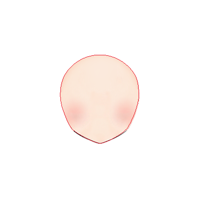
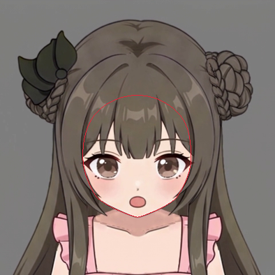
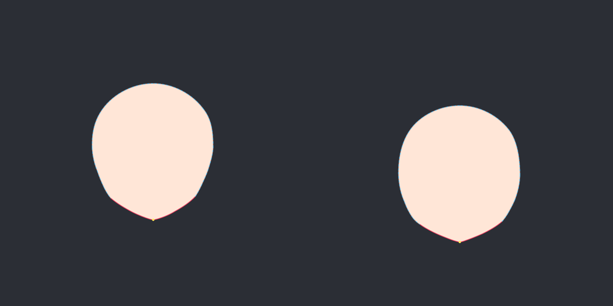
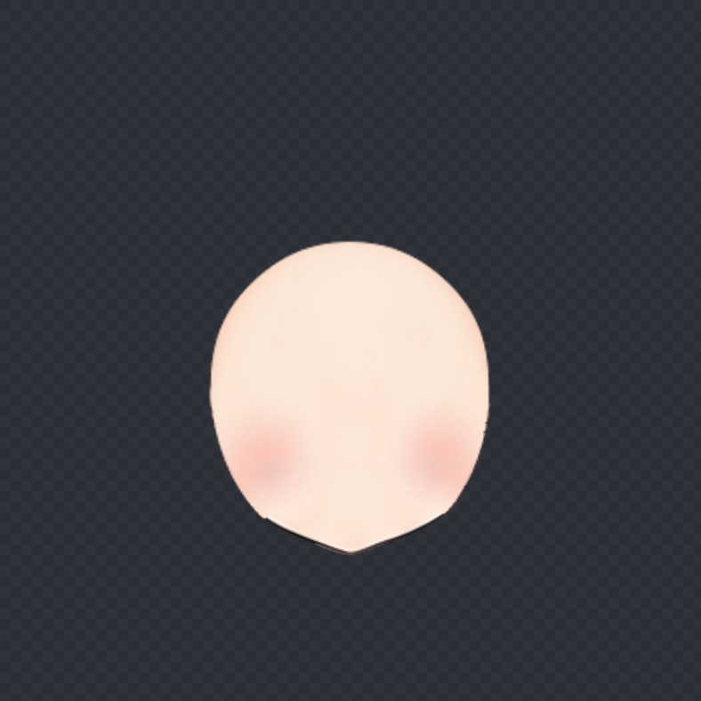
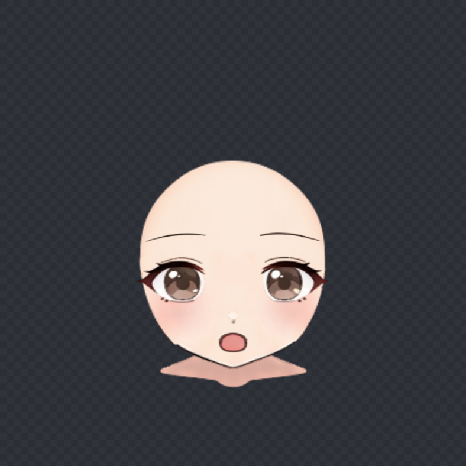
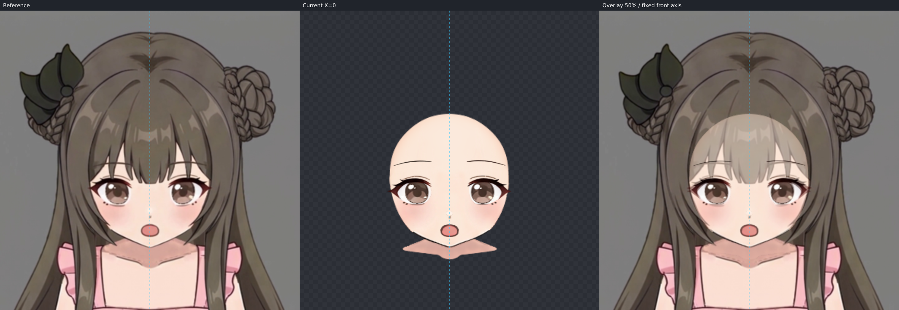
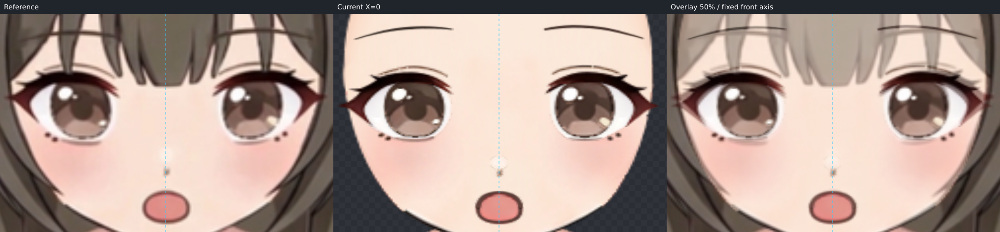
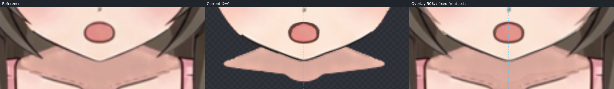
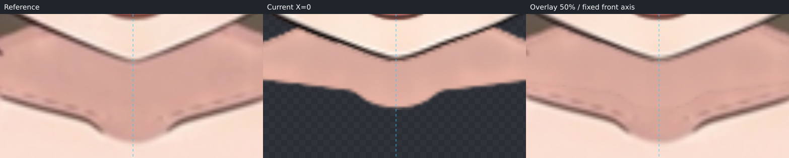
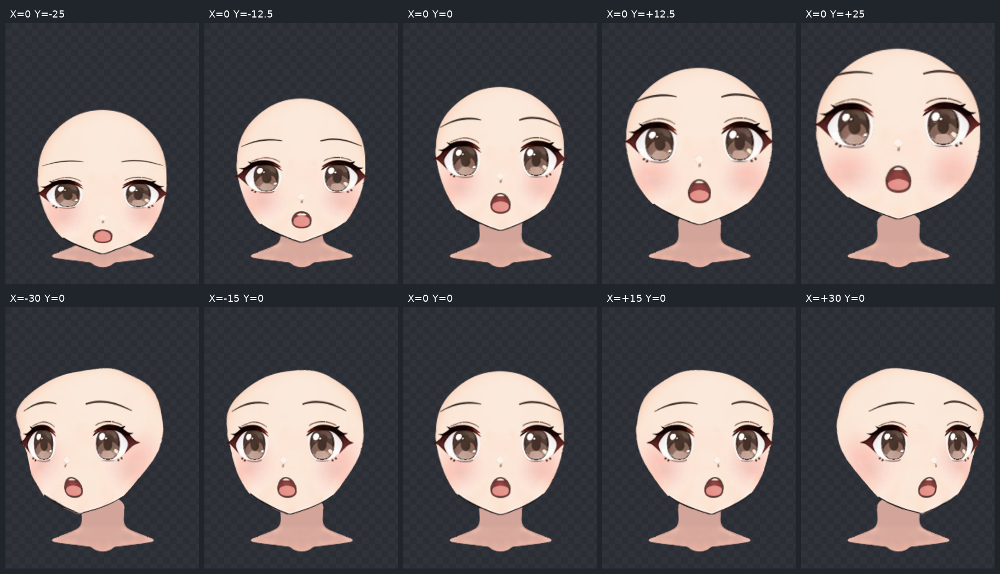

# 低头 −25 制作记录

仅制作 X=0、ParamAngleY=−25。正式目录：nine-axis/step06_angle-down。
已生成完整 version 2 作者文件及程序构建工程；技术检查通过，用户视觉验收待定。

## 原画辨认与补全依据

角色原脸底是饱满圆颊、渐收下颌、短而圆钝的小尖颏，接近圆润鹅蛋脸。已实际查看指定的六模型板、圆脸视频 Y 关键帧板、教程 04:08 脸底、04:12 网格、07:27 上下对照、07:35 眉眼，以及 Hiyori 单模型图。选用 Hiyori 的额部—太阳穴—上颊连续结构辅助隐藏体量；圆脸视频帮助理解圆颊连接。没有平均长脸与圆脸，也没有照搬模型参数、教程 −30、表情、视线、脖子运动或反转上游 up。

当前 down.png 决定可见颊颌、下巴、五官及位置。刘海下沿、侧发发梢凹口、内部发影、鼻线及颈部阴影均不作为脸肉外缘。隐藏额顶和太阳穴保留连续体量，额顶投影约在特写 (197,136)，目标下巴约在 (197.1,311.6)；只给遮挡结构弱约束。

原画 source 来自完整 face_base alpha 外缘：上游 PNG textureBounds=[548,142,159,177]，先放回 1254×1254 原画布，再按 box=[431,35,394,394] 裁出 source-face-reference.png。source 不是头发间露肤窗口或上游转角。全程共用该裁框、尺度与 axis=628，没有重新对齐五官、下巴或参考。

两份 SVG 与 face-trace.json 由相同的 16 个对应路径段生成，闭合完整轮廓与分段是同一套几何。先看整图 blend，再看重叠局部 edge/blend，覆盖两侧颊颌、下巴、额顶及太阳穴；独显预测素脸后回查可见边。inspect 的 completionMismatch=[]，并实际查看三联描线检查和完整 source/target 素脸检查。

## 分组与自动拟合

沿用上游实际层级：根 Warp face-completion（12×12）带 face-silhouette（6×8）及 face/face_base。选 face-completion 拟合本步负 Y 端点，保留子级已有局部修正。整眼各用独立 4×4 Warp，口腔与上下唇共用 mouth-perspective（2×2），鼻、眉独立调整；五官没有统一挂到脸底上。

固定 neck 从初始检查起参与完整渲染，parent=null，所有 X/Y 关键形严格等于静止形。原 KRA 图层清单没有独立耳朵，也没有独立脸线/脸色层，故跳过耳部制作；face_base 自带的颜色与下颌线一起考虑。

拟合使用 169 个控制点，smoothness=0.02。可见权重=1，遮挡标注权重=0.03。程序为保护可见线自动将遮挡约束缩至 occludedWeightScale=0.01（有效权重约 0.0003）。因此隐藏左中颊仍有约 3.89 像素最大残差；不为压低隐藏残差拉走可见颊颌。以下单位均为原画布像素，是网格对已核对描线的误差，不代表与视频自动测量的误差。

| 路径段/点 | 证据 | 平均残差 | 最大残差 |
| --- | --- | ---: | ---: |
| forehead-left | 遮挡补全 | 0.6177 | 1.6458 |
| temple-left | 遮挡补全 | 0.6711 | 1.6458 |
| upper-cheek-left | 遮挡补全 | 1.7592 | 3.0063 |
| mid-cheek-left | 遮挡补全 | 3.3972 | 3.8919 |
| cheek-jaw-left | 遮挡补全 | 2.0222 | 3.8919 |
| jaw-left | 可见 | 0.0661 | 0.3192 |
| chin-slope-left | 可见 | 0.1371 | 0.3192 |
| chin-tip-left | 可见 | 0.0728 | 0.2026 |
| chin-tip-right | 可见 | 0.0481 | 0.0685 |
| chin-slope-right | 可见 | 0.0440 | 0.1328 |
| jaw-right | 可见 | 0.0254 | 0.1328 |
| cheek-jaw-right | 遮挡补全 | 0.4216 | 0.8551 |
| mid-cheek-right | 遮挡补全 | 1.5626 | 2.4314 |
| upper-cheek-right | 遮挡补全 | 1.5446 | 2.4314 |
| temple-right | 遮挡补全 | 0.8021 | 1.8438 |
| forehead-right | 遮挡补全 | 0.6098 | 1.8438 |
| chin | 可见 | 0.0218 | 0.0218 |

实际 deformed face_base 已单独渲染，并与完整预测核对；随后在同坐标叠加目标、放大颊颌/下巴及额顶范围检查。可见脸缘残差最大 0.3192 像素，实际贴图保留原 alpha 和笔锋的小起伏。

## 五官调整与仍可见的偏差

首先用一批 operations 调整整眼、眉、鼻、嘴，再按放大渲染作局部微调。眼组纵向比例约 0.78，整体向下约 42.6 像素，眼白、眼睑、虹膜、高光及睫毛同步运动。眉纵向比例约 0.56，按目标压低眉峰并移至目标落点；没有只动瞳孔制造角度。

鼻纵向比例约 0.8，整体向下约 50.2 像素。嘴初始纵向比例 0.58、横向 0.96 后按目标修正上沿宽度、中排高度和下缘，最终保留视频的圆椭圆开口。舌顶以平滑弧接入口腔；上齿在同一口腔 Warp 中向下 3.1 像素，由原舌层自然覆盖，端点不露齿。未改贴图、绘制顺序或透明度。

最后检查了眉眼、眼鼻、鼻嘴、嘴颏的纵向关系和两眼整体配合。鼻部原画高光仍比模糊的视频帧更亮、更清晰，睫毛点与口缘的粗细也保留原笔触，局部约有一像素级差异；没有用透明度抹掉这些差异。下颌原线的粗细/像素起伏与目标略有差异，留后续收线。隐藏左颊的最大拟合偏差已如上记录。

## 固定脖子接触与 step08 交接

下巴覆盖固定脖子的范围与目标基本一致。当前下颌接触线约从画布 (577,324) 经 (628,346.6) 到 (682,320.2)。step08 处理此线的粗细、脸颈接触阴影、脖子顶部支撑补足与最终消线；隐藏额顶的发层覆盖也留该步处理。

固定脖子的下缘/锁骨支持范围比视频高，颜色与阴影也有差异，完整参考图中可以看到。没有倾斜、拉长或移动脖子，没有为接缝改变目标脸型。检查图只含继承的脖子、脸和五官；头发/服装仅出现在视频参考中。

## 过渡与工程验证

实际查看 X=0 的 Y=−25、−12.5、0、+12.5、+25，以及 Y=0 的 X=−30、−15、+15、+30；五官、口腔层与脸底没有突然收缩、融化或分离。中间负 Y 的齿层随口腔连续遮挡，固定脖子不动。检查板所有格使用相同画布裁框 [510,65,235,318] 和 scale=1.5，没有单独居中/缩放。

通过仓库 buildAngleY(...,'down',...) 与 writeBuilt 生成 deformers.json、继承 layers/，不是手工补丁。验证来源、中轴、画布、部件顺序、裁切、textureBounds 和实际贴图 SHA。24 个部件、5 个 Warp，ParamAngleY keys=[−25,0,25]，没有制作四角。

以每部件更密的 evaluatePoints 采样核对已保护的 X=−30、−22.5、−15、−7.5、0、+7.5、+15、+22.5、+30（Y=0）以及 Y=+6.25、+12.5、+18.75、+25（X=0）；与上游最大画布位置差均为 0。neck 为根节点，所有关键形等于静止形。详细程序记录见 nine-axis/step06_angle-down/validation-report.json，拟合记录见 nine-axis/step06_angle-down/fit-report.json。

本步没有推进四角或颈部收尾。技术检查通过只说明工程与受保护姿态合规，当前方向仍待用户视觉验收；未将其称为流程稳定。
