step06 斜向制作记录 — 待用户视觉验收

已完成左上关键形 `-30,25`、左下 `-30,-25` 的脸底、隐藏额顶/额角/太阳穴及五官调整。右侧由现有程序镜像组合形并反解父级生成。没有推进 step07；本次完成制作与检查，不据此称流程稳定。

最终作者 SHA256：`53659deb6f86ae6f6807303ad18639ed4a89b0221b468ad02f0cbf42fc6e1480`。运行工程 deformers.json SHA256：`dc1c414c4303b0bd566606127b74af98425c58698dd00381f9b0d05d19997547`。作者工程为完整 version 2 源，继承原画布 1254×1254、原来源与 24 张实际贴图。参考固定 box=[431,35,394,394]；所有比较按同一画布坐标，未按五官、下巴重新配准。图片中的青色中轴仍为正面 axis=628。

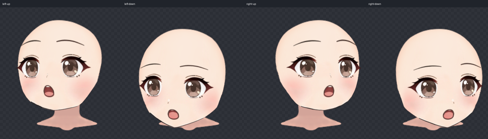

选帧证据与记录

实际查看两段原片每 12 帧的全段运动图，再比较 24–52 帧候选和邻域密集帧。左上加密查看 38/40/42，左下加密查看 34/36/38/40/42。两片均向画面左侧转面，候选保留各自抬头/低头的纵向投影，未见需要旋转或配准来掩盖的滚转、推近、叠影。后段远眼显露减少、侧转偏深，未选。两角独立取帧。

| 方向 | 原片帧号（0起） | 实际时间 | 选择依据 |
| --- | ---: | ---: | --- |
| 左上 | 40 | 1.6666666667 s | 远近眼显露比例和鼻嘴侧移接近既有 left；保留 up 的短下脸、较平圆钝底缘，五官清楚。 |
| 左下 | 36 | 1.5 s | 侧转幅度接近既有 left，保留 down 的高额部显露、五官下投影及较长渐收下脸；近远眼与嘴层次清楚。 |

工程参数值只是关键形标签，未宣称视频的真实三维角度经过测量。原帧保存为 960×960 PNG，仅等比规范化到 394×394，没有额外裁切、旋转、平移、变焦。此后目标帧固定，描边和拟合均绑定各自同名 PNG。

left-up：原片 `/data/home/lockliu/workspaces/AstraLayering-nineaxis-deformer-hierarchy-20261103/.web/nine-axis-forehead-pipeline-20261104/run1/pink-doll/nine-axis/step06_angle-xy/left-up.mp4`；原帧 `/data/home/lockliu/workspaces/AstraLayering-nineaxis-deformer-hierarchy-20261103/.web/nine-axis-forehead-pipeline-20261104/run1/pink-doll/nine-axis/step06_angle-xy/frames/left-up.png`；参考 `/data/home/lockliu/workspaces/AstraLayering-nineaxis-deformer-hierarchy-20261103/.web/nine-axis-forehead-pipeline-20261104/run1/pink-doll/nine-axis/step06_angle-xy/left-up.png`。

- video SHA256：`c1242bb418aaeb06477071a0698e21ddb6b875aecc1dc816b2b831126c49fb26`
- 原帧 PNG SHA256：`4f2227ac314368b8c8b0353068da67f2824e5438b8aad740e96f37a92a3ceb58`
- 394 PNG SHA256：`ef7a6af02f803b143455eb796b197800604479dcde2f69c637e804656c644665`
- trace SHA256：`c01326a27a4a95086eed5059357be90b336ee81d0e5b0ce69f6203c65915f795`

left-down：原片 `/data/home/lockliu/workspaces/AstraLayering-nineaxis-deformer-hierarchy-20261103/.web/nine-axis-forehead-pipeline-20261104/run1/pink-doll/nine-axis/step06_angle-xy/left-down.mp4`；原帧 `/data/home/lockliu/workspaces/AstraLayering-nineaxis-deformer-hierarchy-20261103/.web/nine-axis-forehead-pipeline-20261104/run1/pink-doll/nine-axis/step06_angle-xy/frames/left-down.png`；参考 `/data/home/lockliu/workspaces/AstraLayering-nineaxis-deformer-hierarchy-20261103/.web/nine-axis-forehead-pipeline-20261104/run1/pink-doll/nine-axis/step06_angle-xy/left-down.png`。

- video SHA256：`169f7825f2bf144cae8dd83092b408920504302b4fc7cfa780381b0b2842193f`
- 原帧 PNG SHA256：`1b2fcb141785c50c4dc33528f0793202d807a722cecb5131300c7e5450c423d7`
- 394 PNG SHA256：`0af404b5e8b4ba45755db8ed99836b0421a136c42e5a8cebf22519609e54621a`
- trace SHA256：`29864ba69e9515e1628784f62e4c95c8c6364911d76c509b84e2e4ddc670bce4`

脸型与补全依据

先查看原 KRA 导出的完整 face_base alpha、分类模型板、Hiyori 完整左上脸底及左下参考板、教程左上眉眼与左下鼻嘴下巴图。原画属于圆润鹅蛋脸：上脸圆、侧颊饱满、下巴小而钝尖。采用 Hiyori 同类体量帮助连接额顶中心→两侧额角→太阳穴→上颊，以及饱满颊部→小颏的连续体量。没有平均六种脸型，也没有搬用模型参数、表情、视线、脖子运动或教程固定五官距离。

左上隐藏额部接至抬头后较短的下脸和扁圆底缘；左下额部接至较长、渐收的下脸。额顶高度、脸宽、下巴位置由本角色原 alpha、已完成单轴与各自所选视频共同判断。实际可见远侧竖向脸缘、颊颌和下巴优先；刘海下缘、鬓发凹口、发影、睫毛与耳轮不作为脸底外缘。近側颊部被发束遮挡处保持连续脸肉，不把发束凹口压入脸肉。

source-face-reference.png 是原 PNG 按 textureBounds=[548,142,159,177] 放回原画布后按固定 box 裁出的检查图，没有更换贴图。source-face.svg、两角 target SVG 均为 394 见方透明背景、单个纯色闭合 path、stroke=none。全图 blend 后，在重叠局部用 4–8 倍 blend/edge 核对外缘与转折。左下颏线曾按外侧黑线下缘修正约 1.5 px，修正发生在最终拟合之前，SVG 与 trace 同步。两角 trace 均由同组实际 SVG 小段组成，最终 inspect 的 completionMismatch=[]；这个结果只证明描线一致。

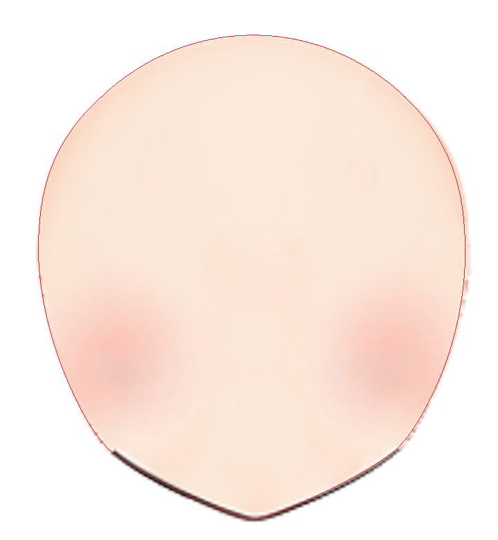

分组和自动拟合

沿用 face-completion 根 Warp（12×12）统筹脸底大形，其子 face-silhouette（6×8）用于轮廓和隐藏区域局部修正。脸底原部件网格保留。两只整眼各为独立根 Warp（4×4），各带眼白、虹膜、高光、眼睑、睫毛和褶线，显式配对 eye_left/eye_right。mouth-perspective（2×2）带口腔、上下唇、牙与舌；眉和鼻独立，避免所有五官随脸底同幅变形。neck 始终 parent=null。

两角分别 fit 到 face-completion，smoothness=0.05，每角独立报告。左上尝试较小范围和更低平滑度时出现网格翻折，被工具拒绝且未保存；保留成功拟合。可见边缘优先导致两角 occludedWeightScale≈0.001，隐藏有效权重仅约 0.00003。因此没有用小可见残差当作隐藏补全验收。

以下为成功自动 fit 的 after 残差，单位原画布像素；完整 before/after、采样数、visibility 与哈希保存在各自 fit-report.json。它们不是后续局部编辑后的拟合报告。

| 段 | 属性 | 左上均值 / 最大 | 左下均值 / 最大 |
| --- | --- | ---: | ---: |
| forehead_right | occluded | 10.780 / 18.289 | 14.352 / 17.392 |
| temple_right | occluded | 12.428 / 18.289 | 15.977 / 19.474 |
| upper_cheek_right_a | occluded | 3.053 / 5.385 | 17.267 / 19.474 |
| upper_cheek_right_b | occluded | 3.525 / 7.713 | 13.300 / 16.461 |
| cheek_right | occluded | 5.132 / 7.713 | 3.168 / 6.187 |
| jaw_right | visible | 0.187 / 0.379 | 0.159 / 0.338 |
| chin_right | visible | 0.479 / 0.582 | 0.241 / 0.347 |
| chin_left | visible | 1.142 / 1.733 | 0.413 / 0.612 |
| jaw_left | visible | 0.883 / 1.930 | 0.446 / 0.686 |
| cheek_left | occluded | 1.044 / 2.046 | 3.426 / 4.870 |
| far-lower-hair-hidden | occluded | 1.196 / 2.046 | 1.165 / 1.739 |
| far-vertical-cheek | visible | 0.216 / 0.325 | 0.284 / 0.619 |
| upper_cheek_left_b | visible | 0.110 / 0.275 | 0.154 / 0.289 |
| temple_left | occluded | 8.312 / 13.069 | 16.063 / 24.560 |
| forehead_left | occluded | 10.844 / 13.069 | 19.886 / 24.560 |
| chin-tip | visible landmark | 0.390 / 0.390 | 0.056 / 0.056 |

自动 fit 后真实隐藏上沿偏低或偏斜，不能交付该起始结果。先独显实际脸底及两个 Warp 网格，再用 face-silhouette 上部局部 points 修额顶、双侧额角和太阳穴。左上、左下各自处理，另角保持；后续限定上六行的局部修正基于已核对 completion，并冻结修正前已对齐的可见边缘采样，单轮最大位移约左上 0.004 px、左下 0.006 px。没有把 occluded 伪标为 visible。这个采样保护指标不代替真实 alpha 检查。最终回看了实际完整脸底、所有可见脸缘、五官、固定脖子、镜像与中间值。

隐藏额顶与实际覆盖

最终真实脸底的额顶约在 view (181,101) 与 (183,119)，接至双侧额角和太阳穴；额顶圆拱连续，没有脸底自身缺顶、断角或空洞。额角不沿刘海下缘闭合，不按整个头发外轮廓扩张。额部在刘海与鬓发背后保留搭接，露肤窗口的上尖角位于连续脸底内部；远侧眼外侧的真正外缘仍按视频，不为了覆盖把全脸加宽。

两角的 forehead-temple-check 为 completion／实际贴图／同坐标叠加，hair-coverage-check 为已选视频／实际脸底／同坐标叠加。完整实际脸底另见 face-base-check。额顶和额角在最终端点及轴到角、角间中间值均实际查看。上游 left 的远侧额角原有局部转折仍可在 protected 图看到，本步保留既有单轴；向角过渡没有新增坑、波纹或裂口。

隐藏近側下颊与预测仍有少量轮廓差异，尤其左上近侧颊颌渐收处保留了可见下颌的连接。原 alpha 的轻微锯齿和黑/白边也存在。此处静态鬓发遮挡下覆盖连续，未把隐藏预测修得更小来美化残差。没有头发层或定义的发摆范围，只核对两张视频的静态发缘和脸底完整性；不能由此承诺未来头发动画的动态覆盖。本步没有新增头发动画。

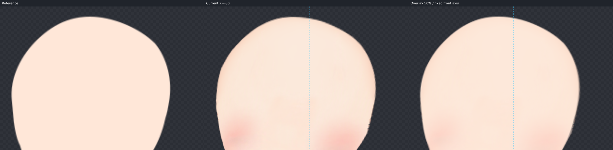

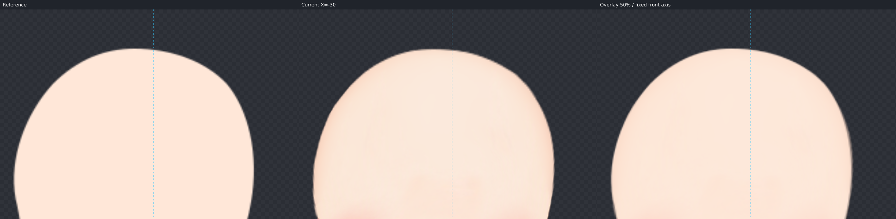

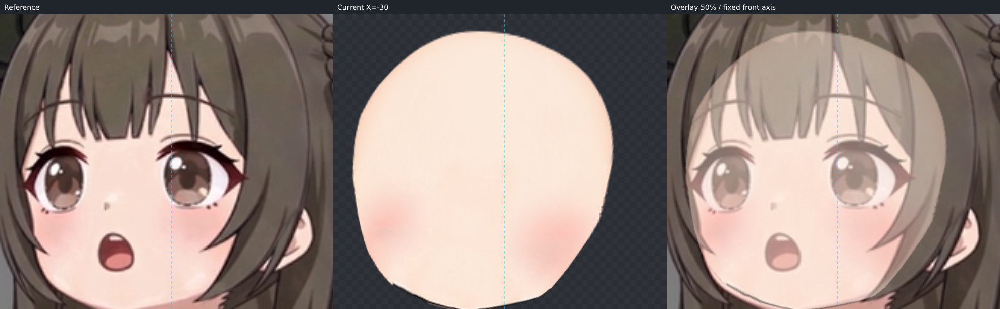

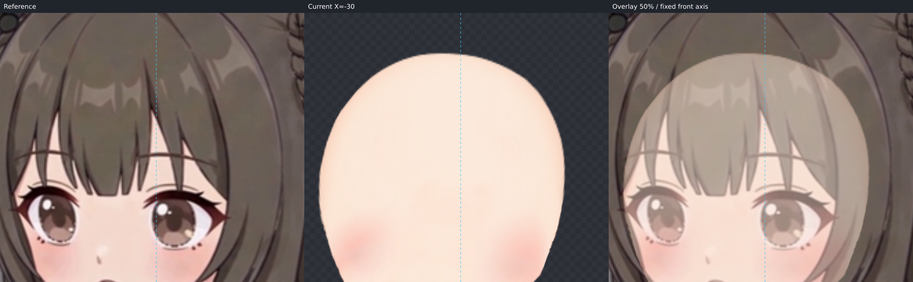

五官、笔触与固定脖子

每角先一次批次调整整眼、眉、鼻、口腔，再实际渲染复查。整眼的所有层共同调整，未只移动瞳孔。左上保持所选帧近远眼比例、抬头嘴开与唇缘层次；左下根据 frame36 整眼投影和鼻嘴侧移调整，最后按放大检查将口腔全层共同上移 2 px、向远侧 0.75 px、收 4%，改善原批次嘴部略低的落点。最终全部渲染图已在这次修改后更新。

虹膜、高光、眼白和睑线没有在检查角度中分离；嘴唇、舌、牙与口腔保持原层次。原鼻高光和小暗笔锋来自原贴图，左上仍比视频灰软鼻点更细、更尖，左下高光也较白；原睫毛/下睑细线比视频更锐，嘴唇与舌的柔化程度有差异。没有换贴图或用透明度掩盖。工程没有独立耳朵部件；左上视频可见耳部只用于区分遮挡，跳过耳部制作。

脖子从起始完整渲染到最终对照均参与，始终原形原位置、根节点。左上颏约 canvas (601,321)，左下颏约 (598,357)；对应接触检查区分别约 [548,304,158,67] 与 [548,330,158,45]。低头角会更多遮住固定脖子，未照视频拉长或倾斜脖子。step07 需要在这些接触区域处理固定脖子顶部补足、下颌接触消线和阴影。原下颌黑线/白边比左上视频的柔软粉色边缘明显，左下亦保留细白边与锯齿；这些接触差异明确留作 step07，不改本步脸型填缝。

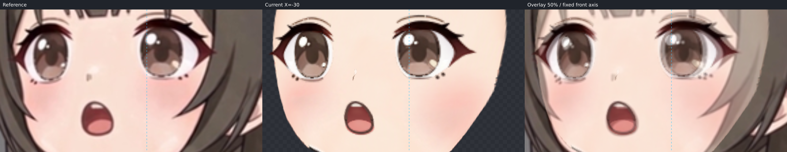

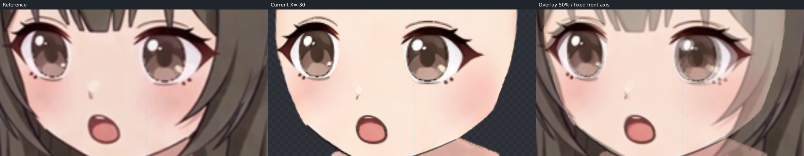

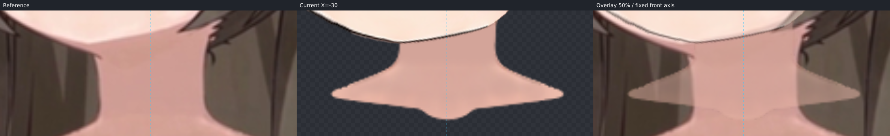

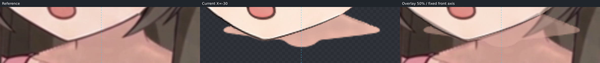

过渡与保护结果

实际查看左上、左下及程序镜像右上、右下；从 up/down 轴经 X=-15 到角、从 left 经 Y=±12.5 到角，以及两左角之间的中间值均有渲染图。眉眼、鼻口层保持连续，未见突然收缩、融化、分离。下颌遮盖脖子的变化由头部完成，脖子不随动。再次核对 protected X/Y 各端点与中间角。

以工作台同一 renderer 生成最终图。对上游部件在九个单轴/中间姿态以 5 倍网格细分比较，最大画布网格差异 `0` px；24 张贴图哈希一致。固定脖子在 143 个 X/Y 采样中的最大位移 `0` px，parent=null。另在 81 个角度姿态、每网格 3 倍细分检查所有父子组合网格，三角形面积均为正（最小 0.046744 px²，鼻部左上小网格）；这是采样与工程验证，仍需视觉验收。两角的分开编辑和局部修正均通过工具保护检查，最终无未结束的后台制作命令。

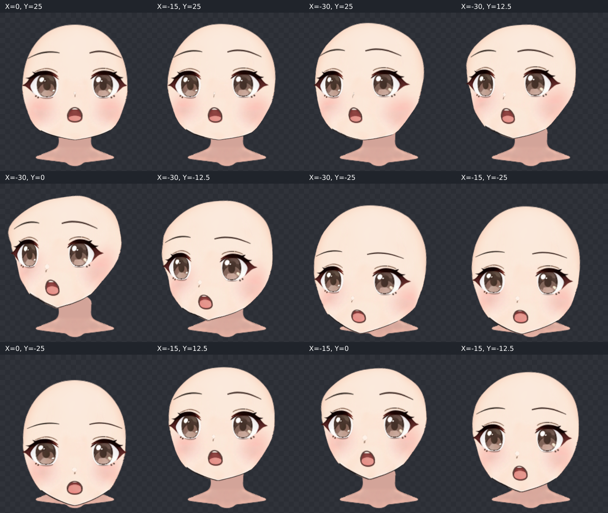

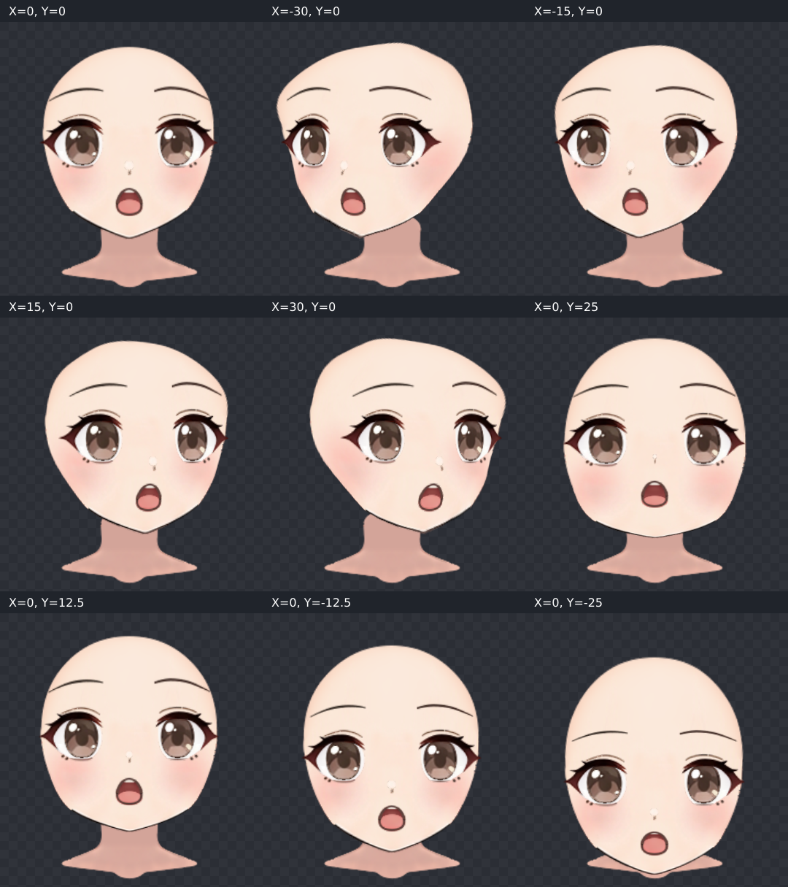

所有正式检查 PNG 对应上述最终作者 SHA。trace-check 与 face-completion-check 显示的是最终 SVG 预测，fit-report 是成功自动拟合时的数值记录；后续局部修改用最终实际渲染验收，不拿旧 fit 图验收新工程。check-manifest.json 记录产物路径、哈希、作者 SHA、渲染窗口与保护结果。当前结论是 step06 制作完成、视觉效果待用户验收，不称方向流程已稳定。
