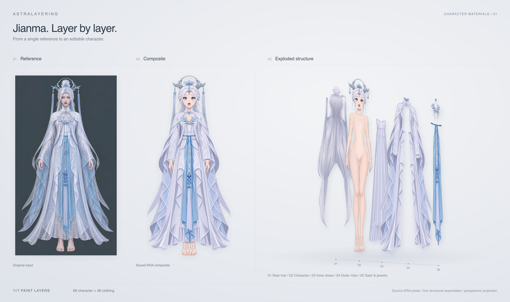
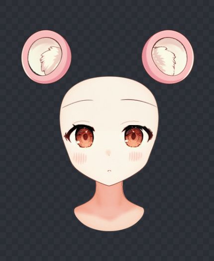
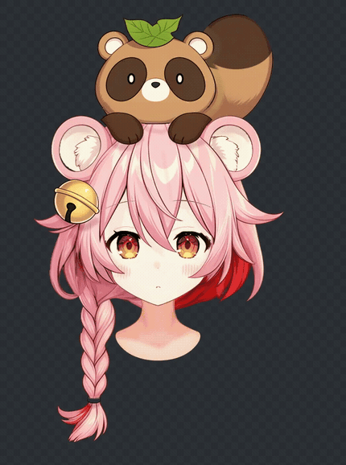

# 人物分层成果

从角色原图制作人物与衣服的独立图层，补全遮挡，组装角色并绘制阴影。狸猫女孩的头部九轴演示见下方。

| 案例 | 成果 | 文件 |
| --- | --- | --- |
| 狸猫女孩 | 人物与衣服分层、组装与阴影 | [案例](tanuki-girl/README.md) · [KRA](tanuki-girl/shadow/step01_mask/character-shadowed.kra) |
| Pink Doll | 58 层人物、8 层衣服，组装与阴影 | [案例](pink-doll/README.md) · [KRA](pink-doll/shadow/step01_mask/character-shadowed.kra) |
| Pink Elf | 70 层人物、32 层衣服，组装与阴影 | [案例](pink-elf/README.md) · [KRA](pink-elf/shadow/step01_mask/character-shadowed.kra) |
| Jianma | 人物与衣服分层、穿戴组装与阴影 | [案例](jianma/README.md) · [KRA](jianma/shadow/step01_mask/character-shadowed.kra) |
| Closed Face | 半身闭眼闭嘴角色，49 个绘画层与阴影 | [案例](closed-face-full-20261026/README.md) · [KRA](closed-face-full-20261026/shadow/step01_mask/character-shadowed.kra) |

KRA 保留可编辑图层，PNG 展示合成结果。下面依次是 Jianma、Pink Doll 和 Pink Elf 的原图、成品与分层展开。

## 头部九轴

| 脸＋五官 · 完整九轴 | 脸＋五官＋头发＋头饰 · 仅左右 |
| --- | --- |
|  |  |

脸部、五官、耳朵和下颌支持左右、俯仰与斜向；头发与头饰目前制作左右。演示来自已保存的九轴成果，以上案例目录保存分层、组装和阴影归档。
