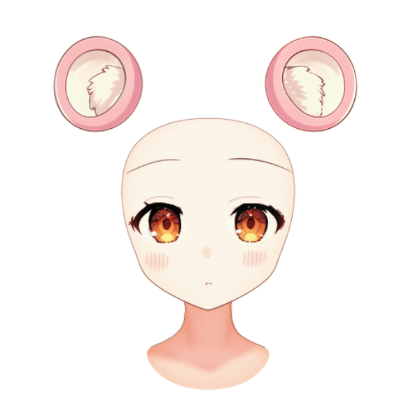

# 狸猫女孩：角色素材与头部九轴

角色的脸部、五官、耳朵和下颌支持左右转头、抬头、低头与斜向运动。

案例包含分层角色工程、阴影、头部素材、九轴模型与透明贴图。

| 内容 | 文件 |
| --- | --- |
| 角色参考图 | [PNG](input/original.png) |
| 组装角色 | [KRA](character-assembly/step01/character-assembled.kra) · [PNG](character-assembly/step01/character-assembled.png) |
| 阴影 | [KRA](shadow/step01_mask/character-shadowed.kra) · [PNG](shadow/step01_mask/character-shadowed.png) |
| 头部素材 | [KRA](nine-axis/step01_preparation/character-nine-axis.kra) · [PNG](nine-axis/step01_preparation/character-nine-axis.png) |
| 头部九轴 | [模型](nine-axis/step07_jaw-line/deformers.json) · [KRA](nine-axis/step07_jaw-line/character-nine-axis.kra) · [PNG](nine-axis/step07_jaw-line/character-nine-axis.png) |
