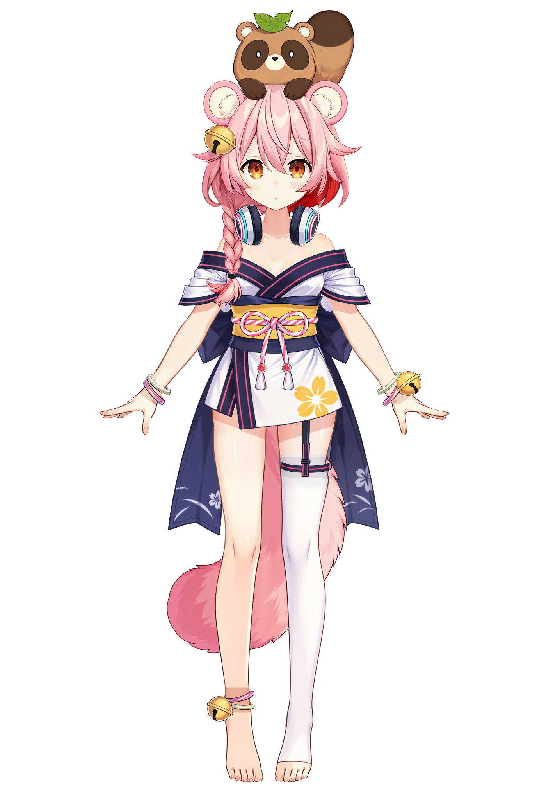
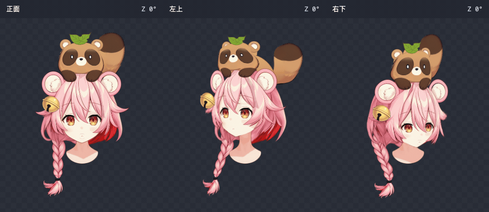

# 狸猫女孩：分层、阴影与头部九轴

本版来自 `tanuki-raster-rerun-20261111`，人物 raster 重新制作后完成组装与阴影，于 2026-11-14 按 `pnpm export` 导出。画布为 1376 × 2048，衣服沿用同一角色已完成的分层工程。

头部九轴在这份阴影稿上完成，覆盖脸、五官、头发和头饰的左右、上下、四角，以及 ±15° 的 Z 轴歪头。下方从左到右展示正面、左上和右下叠加 Z 轴。

| 内容 | 文件 |
| --- | --- |
| 角色参考图 | [PNG](input/original.png) |
| 人物分层 | [KRA](raster-layering/step01/character-depth.kra) · [PNG](raster-layering/step01/composite.png) |
| 人物柔边 | [KRA](raster-layering/step02/character-soft-edges.kra) · [PNG](raster-layering/step02/character-soft-edges.png) |
| 换装素体 | [KRA](raster-layering/step03/character-dressup-base.kra) · [PNG](raster-layering/step03/character-dressup-base.png) |
| 衣服分层 | [KRA](clothing-raster-layering/step01/clothing-depth.kra) · [PNG](clothing-raster-layering/step01/composite.png) |
| 组装角色 | [KRA](character-assembly/step01/character-assembled.kra) · [PNG](character-assembly/step01/character-assembled.png) |
| 阴影 | [KRA](shadow/step01_mask/character-shadowed.kra) · [PNG](shadow/step01_mask/character-shadowed.png) · [投影关系](shadow/step01_mask/shadows.json) |
| 头部九轴 | [最新 KRA](nine-axis/step09_head-accessories/character-nine-axis.kra) · [变形模型](nine-axis/step12_head-roll/deformers.json) |

在角色工作台的“打开项目”中把基准文件夹切到 `demos/`，选择本案例后切到“头部九轴”。可用“鼠标跟随”控制转头和俯仰，用 Z 滑杆、关键形按钮或 A／D 歪头。导出来源与文件清单见 [manifest.json](manifest.json)。
