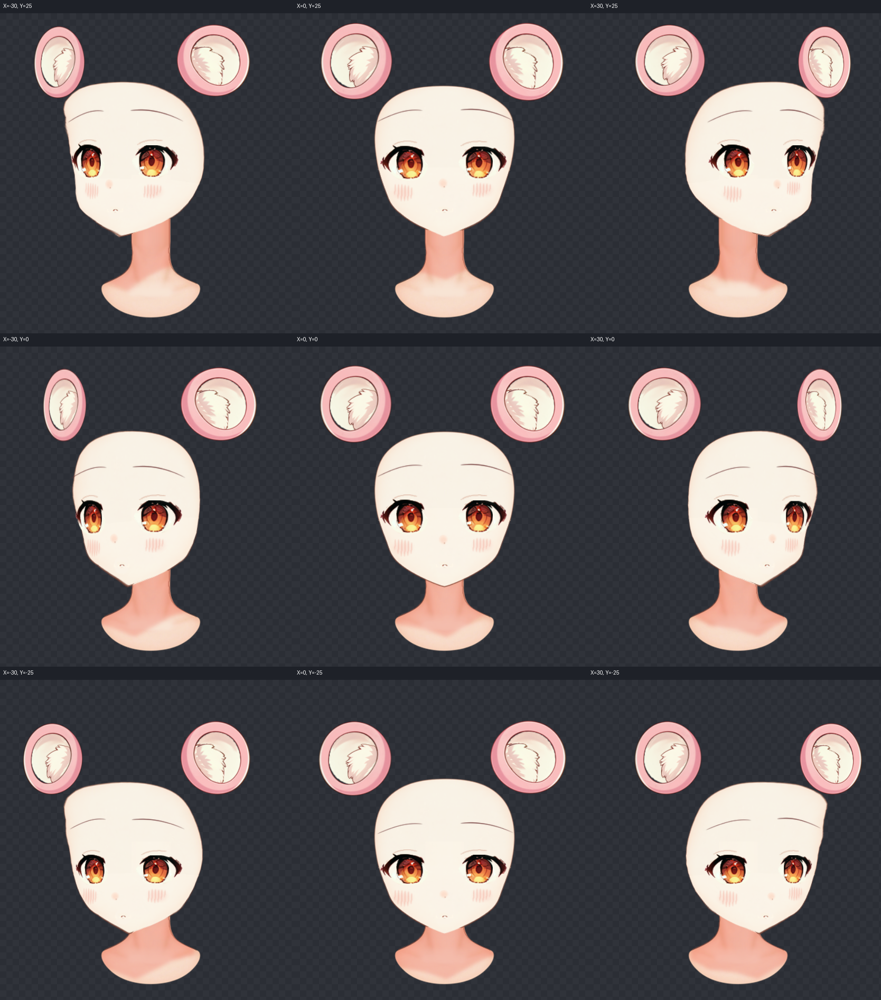
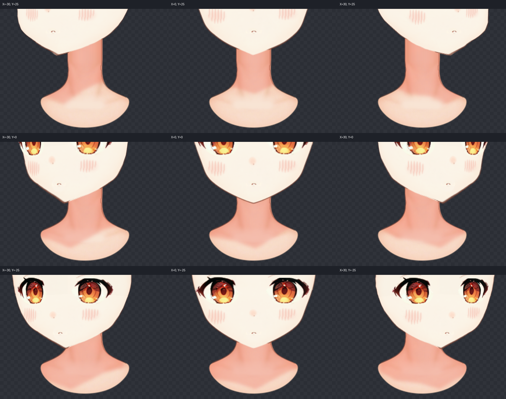
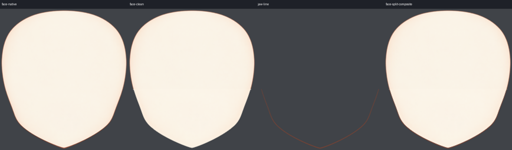
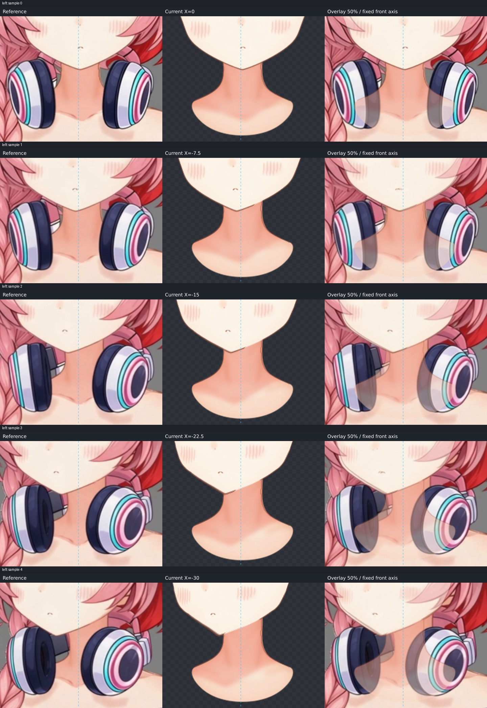
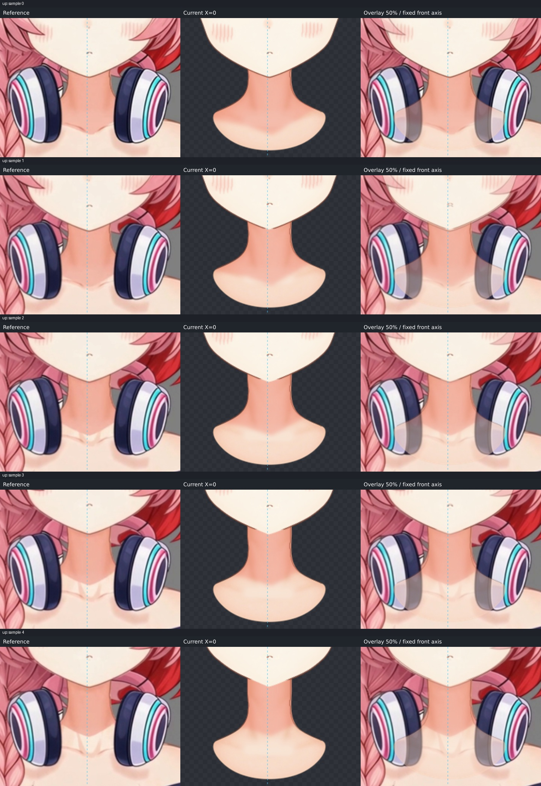
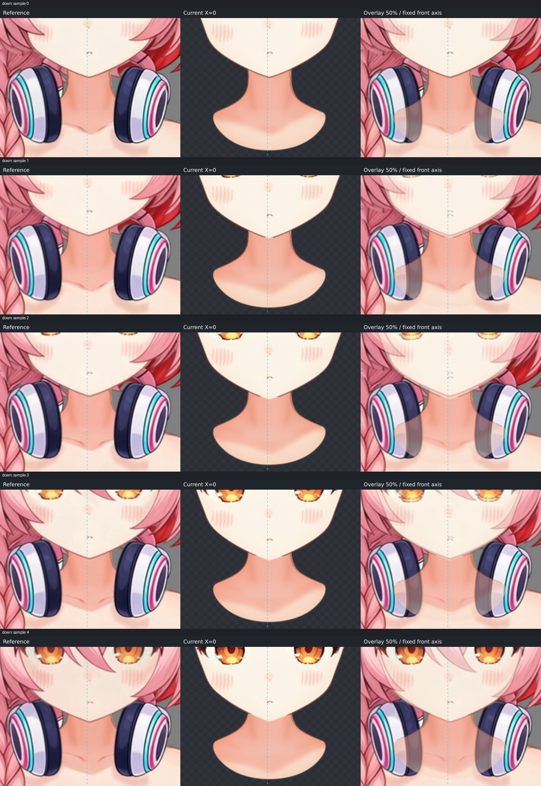
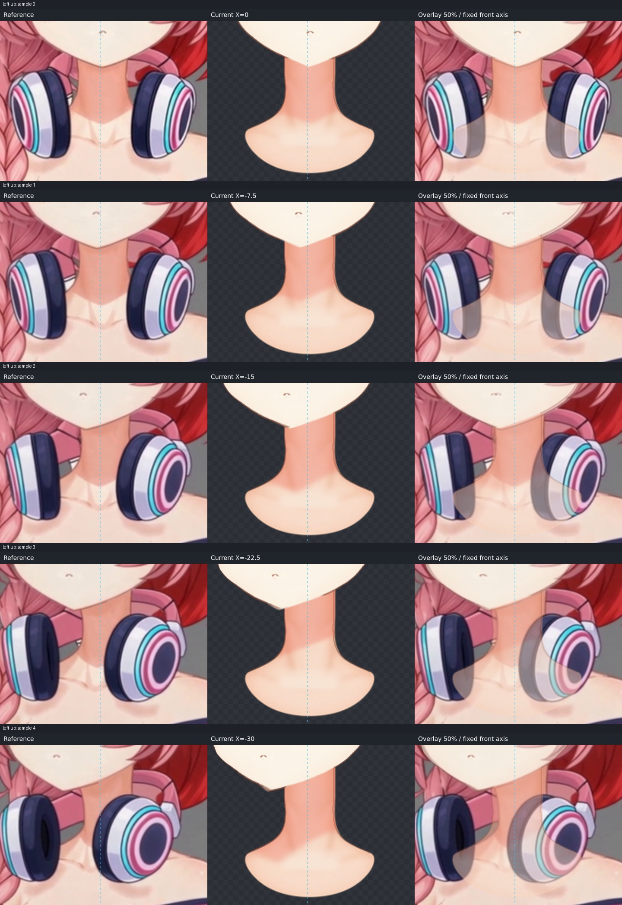
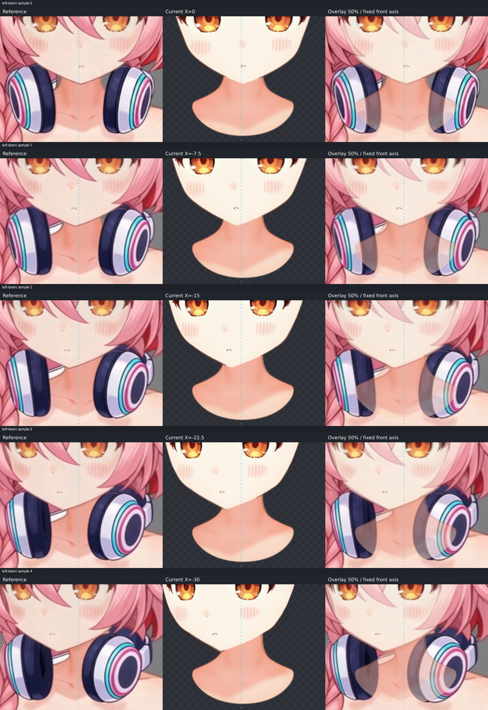
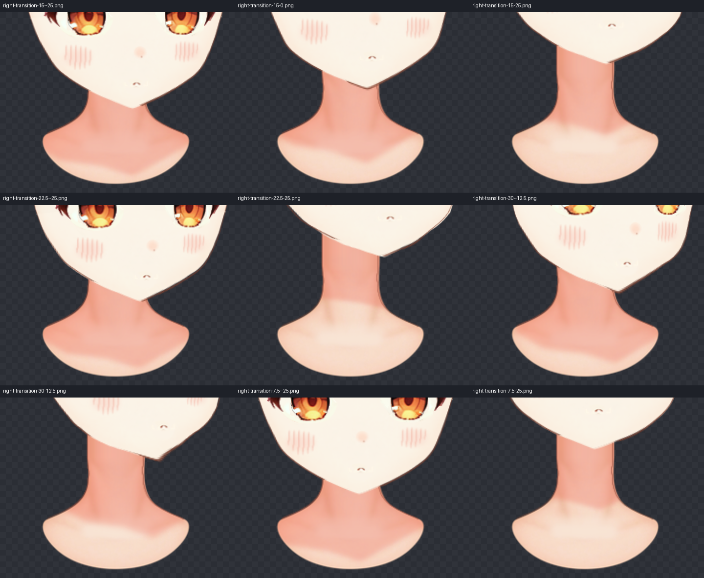

# 下颌、固定脖子与下巴投影

## 视频观察（制作前记录）

五段视频均为 960×960、24 fps、121 帧。逐帧展开全部 605 帧，再放大目标附近及运动中间帧。下表的帧号使用视频零基 frameIndex；完整片末段比本工程的角度更大，运动规律可参考，末帧不当作 ±30/±25 的目标。

| 方向 | 连续变化与接触 | 阴影处理依据 |
| --- | --- | --- |
| 左转，目标帧 50 | 首段下颌两边完整，中段下巴向画面左移。近侧（画面左）下颌是外轮廓，要保留；远侧下颌转成与脖子相交的内接缝，线段从脖子接触一端缩短。外露轮廓接到固定脖子的左侧走向，不能把整条下巴线一并隐去。 | 暖影横向随下巴偏移，在远側颈顶占得较多，近侧下方开始露出亮颈。视频的耳机与脖子也有生成漂移，以固定原脖子为准。 |
| 抬头，目标帧 51 | 下巴上移，两侧露颈增加；下颌外露段仍可辨，跨固定脖子顶部的内部段靠肤色与暖影分开。随接触变化逐段融合，不用整线淡出。 | 顶部投影随下巴上移；露出的脖子变多，但目标帧的暖影带比静止略短，中央约在原画布 y=575 转为亮部。左上不能沿用这一高度；继续大幅抬头时另有生成的光照变化。 |
| 低头，目标帧 50 | 下巴下压、下半脸缩短，颈顶遮挡增加。两边外露轮廓保留，中央接触段缩短并融合。后半段刘海、脸色出现生成变化，不据此重画脸内明暗。 | 暖色颈影受下巴遮挡，可见高度被压缩，底缘随下巴下降，不保留一条横跨脖子的硬界。 |
| 左上，目标帧 42 | 视频起点已有抬头特征，之后加入侧转。近侧下颌外缘连到脖子侧，远侧内接缝从颈顶接触端逐步缩短，接触区较单独左转偏高。 | 影区偏向远侧上颈，随侧转倾斜，保留原暖调和柔边，亮颈在近侧下方露出。 |
| 左下，目标帧 40 | 视频起点已有低头特征，之后加入侧转。近侧轮廓仍清楚，下巴更靠近颈顶；远侧接触端的融合范围与左上不同，不能共用一个俯仰阈值。 | 可见影区较左上低、短，随下巴偏移，远侧颈顶持续受影。 |

生成片中的发丝、纹理漂移、残线不直接当作墨线。线色与笔触以原 KRA 为准。原画静止下颌仍保持连续；各姿态的内接缝依据实际脸缘与固定脖子位置局部消线。

## 原工程归属与素材准备

Krita 独显核对：`D060.00 | face/face_base` 原生底色与上游 `layers/0039-face__face_base.png` 的像素完全一致。脸内部有原设计的静态肤色明暗；受影容器另外叠了刘海与左右鬓发三层 multiply 投影。这三层仍独立留在原 KRA，未把受影组整组合成烘入脸底。上游九轴的当前展示范围为脸、五官、兽耳与固定脖子；头发及其投影留在完整工程中供后续阶段。

本步只处理实际下缘墨线及局部补色。墨线原先合在底色里，按局部色素覆盖拆出 `jaw_line`，保留原下缘走向和不等粗细；独显是连续弧线，不是沿 alpha 切下一圈肤色带。脸底下缘肤色另行补足，肤色与墨线的抗锯齿覆盖分别处理。额头、上半脸侧和脸内绘画保留上游像素。

原脖子底色含自身柔和明暗，两侧有原生描边，顶部是闭合弧线。顶部沿原两侧直边向上补高至原画布 y=420；旧弧线已从内部清除。保持原 UV 部件元数据和已完成单轴来源，模型将补高脖子分为原 `neck` 范围及静止 `neck_top_extension`，两段无几何运动，接缝在同一连续素材的 y=486 切分。阴影由两段脖子 alpha 并集裁切。

原 KRA 已有独立 `Cast | chin-neck`，242/255 opacity、multiply、暖粉色，覆盖上颈并延到肩颈。脖子底色自身不是这层投影的烘焙结果，未拆走其自身明暗。沿用该投影的原 alpha/颜色；当前九轴渲染器使用正常 RGBA，制作独立接收色版本 `chin_shadow`，把原 multiply 在脖子上的着色强度换算成正常混合的低 alpha 暖色贴图（34% 最大 alpha，原层 242/255 的不透明度计入着色强度），保留颈部自身明暗与侧边墨线。原 alpha 外补 12 像素透明余量，填足其透明区的暖色 RGB，再以约 3 原画布像素柔化底缘，避免羽化时出现黑边。KRA 同时保留原生投影供编辑，显示版本与模型一致，不叠加两份投影。

`jaw_follow` 在实际脸底链下提供独立线形调整；新线与蒙版没有上游的单轴源映射，因此按最终脸底画布采样对齐，不能只复制一份看似相同的控制点。蒙版由这条实际墨线下缘制作，静止下移约 2.8 原画布像素；局部推进依据头颈接触，线使用反向裁切。投影挂在头部层级，绘制顺序在脸底下面。绘制顺序独立于 parent。

## 姿态制作与检查

已完成全部九个主姿态，并保留共享连续插值。左右转的内接触线从远侧颈顶逐段缩短，近侧外轮廓留到脖子侧边；纯抬头及低头分别处理中央接触区，两种左侧斜角按各自接触范围处理。外露线保持原有覆盖强度和粗细，消线由贴线蒙版局部推进完成。蒙版下方的位移逐渐回到原形，避免在不参与消线的区域拉出折叠。

阴影用独立头下 Warp 随下巴移动，固定脖子裁切。纯抬头影带较短，左上较纯抬头高、斜；低头及左下在下巴下降后仍保留暖影深度。横向位移在下方略收回到固定颈部，底缘按姿态改变，颈部自身的明暗与两边原线不随头拉动。

右侧程序镜像后曾出现右上约 5.9 像素的线缘偏差。原脸底有受保护的独立单轴源映射及较粗的镜像逆映射网格，新拆线没有该源映射；仅复制左侧形变不能保证右侧贴合。现在用两张完全透明的构造部件 `jaw_line_mirror_driver`、`jaw_mask_mirror_driver`，通过显式 `mirror_pair` 提供镜像采样，校正目标是已完成上游的实际右脸缘。它们不显示、不裁切任何绘画，也没有墨线像素；实际墨线与擦线仍各一份，右侧仍由程序镜像生成。面部与五官没有为此变形或重画。

正式模型包含 35 个部件、34 张实际引用 PNG；27 张未修改的继承贴图与上游逐字节相同，脸底和脖子两张按本步范围更新。全部贴图均在正式 `layers/`，工作台模型与报告不引用 workspace 草稿。可编辑 KRA 中新绘画素材及原投影均保留；六个本步贴图片段与 KRA 对应像素完全一致，见 [导出记录](export-record.json)。KRA 内 `mergedimage.png` 与交付完整画布 PNG 的 RGBA 像素完全一致，ZIP 完整性检查通过。

[几何检查](review/geometry-check.json) 对下颌弧线采样：静止几何差为 0，九个主姿态中线相对实际脸底的最大采样差约 0.75 原画布像素（右上），均值不超过 0.21 像素；所测中间姿态最大约 0.36 像素。上游部件实际几何的最大变化约 0.000183 像素，为程序重新镜像的浮点舍入；固定脖子变化为 0。额头及脸底上半部像素与原脸底相同。53 个角度样本、336656 个组合网格格子的检查没有折叠，见 [连续检查](review/continuity-check.json)。

已先检查独显脸底、未裁切原线贴图和静止合成，再检查固定脖子、阴影、各姿态蒙版及完整展示范围。右转、右上、右下及其过渡放大回看：外露墨线沿实际脸缘连续，没有脸内第二道轮廓；内接缝逐段融合，未见漏空、深色残边、白点或新横向颈缝。原顶部弧线已清除，补高处延续原侧描边。阴影只显示一份，底缘柔和。

剩余偏差：原画的低分辨率笔触在 4–5 倍放大时仍有亚像素至约 1 像素的重采样起伏；新线与原脸底的独立网格拟合仍有上述不足 0.75 像素的几何误差。视频会移动脖子、耳机及局部纹理，本步保持原固定脖子与上游脸型，未追随这些漂移。视频中的影边常比原绘画硬，交付沿用原暖色并保持柔边。辅助键仅覆盖实际检查需要的几条过渡，未制作的 X/Y 组合使用共享插值，不宣称逐像素复现所有视频帧。

## 正式检查图与帧登记

九个主姿态：

[原生脸底](review/face-native.png)、[原受影组](review/face-receiver.png)、[刘海投影](review/bangs-shadow.png)、[左鬓发投影](review/side-left-shadow.png)、[右鬓发投影](review/side-right-shadow.png) 均独立保留，展示底色与投影内容的区别。

[固定脖子独显](review/solo-fixed-neck.png)、[原脖子底色](review/neck-native.png)、[原下巴投影](review/chin-shadow-native.png)、[当前阴影独显](review/solo-shadow.png)。

[静止蒙版](review/mask-0-0.png)、[左上蒙版](review/mask--30-25.png)、[右上蒙版](review/mask-30-25.png)、[左下蒙版](review/mask--30--25.png)、[右下蒙版](review/mask-30--25.png)。

五个方向各保留起点、三个中间值及目标的参考／当前／50% 叠加三联图。全部按共同 box 登记，未重新居中或按五官对齐。帧号为零基：

| 方向 | 模型角度 | 对应视频 frameIndex |
| --- | --- | --- |
| left | X=0、-7.5、-15、-22.5、-30，Y=0 | 0、16、29、41、50 |
| up | X=0，Y=0、6.25、12.5、18.75、25 | 0、17、31、42、51 |
| down | X=0，Y=0、-6.25、-12.5、-18.75、-25 | 0、14、26、39、50 |
| left-up | X=0、-7.5、-15、-22.5、-30，Y=25 | 0、10、21、32、42 |
| left-down | X=0、-7.5、-15、-22.5、-30，Y=-25 | 0、10、20、30、40 |

这些中间配对依据姿态外观作近似登记，不是由视频时长线性换算角度；斜角片起点已带俯仰。原帧按 960→774 等比缩放留在正式 `review/frames/`，登记见 [检查索引](review/review-index.json)。

全片逐帧图：[left 全 121 帧](review/left-all-frames.jpg)、[up 全 121 帧](review/up-all-frames.jpg)、[down 全 121 帧](review/down-all-frames.jpg)、[left-up 全 121 帧](review/left-up-all-frames.jpg)、[left-down 全 121 帧](review/left-down-all-frames.jpg)。

正式交付：[jaw.json](jaw.json)、[deformers.json](deformers.json)、[可编辑 KRA](character-nine-axis.kra)、[完整画布 PNG](character-nine-axis.png)、同目录全部 `layers/` 及本报告引用的 `review/` 图像。工作台与成果导出沿用这些正式文件；本步完成标记由管线程序管理。

