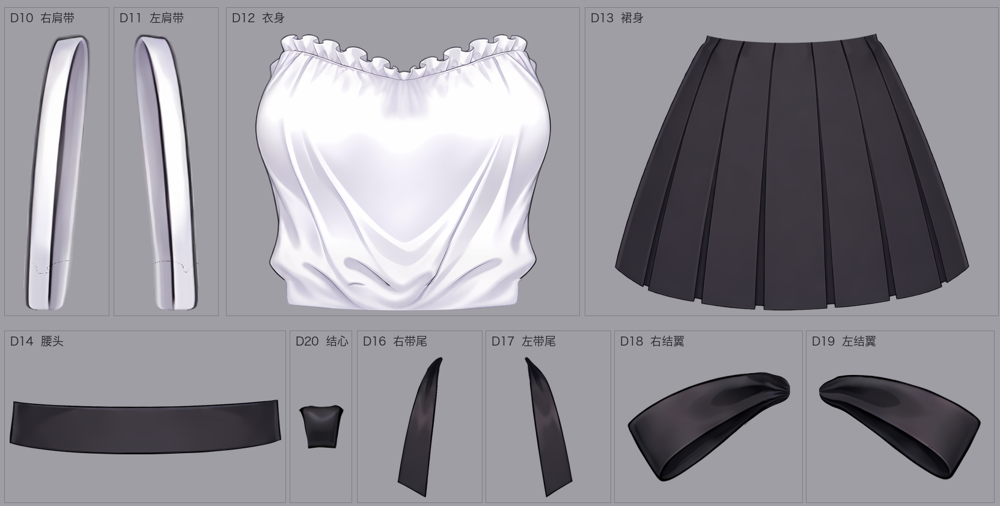
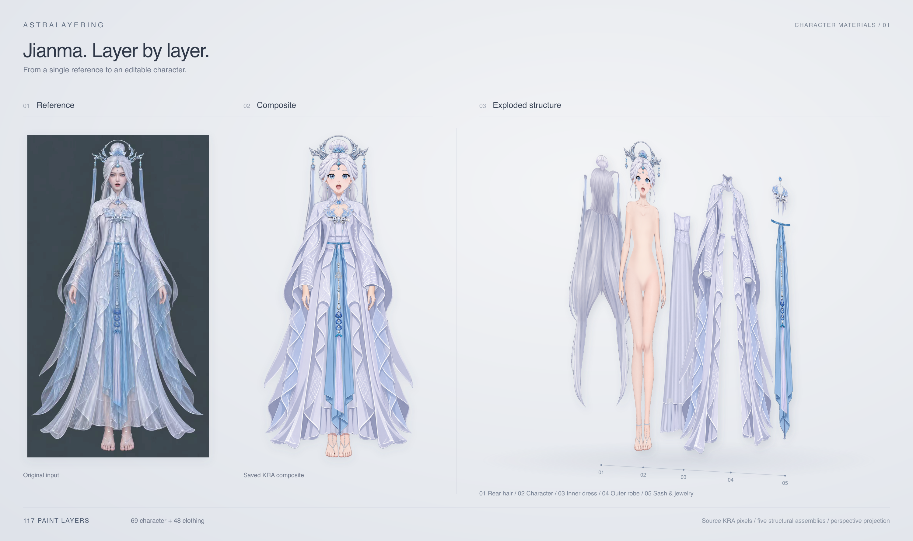
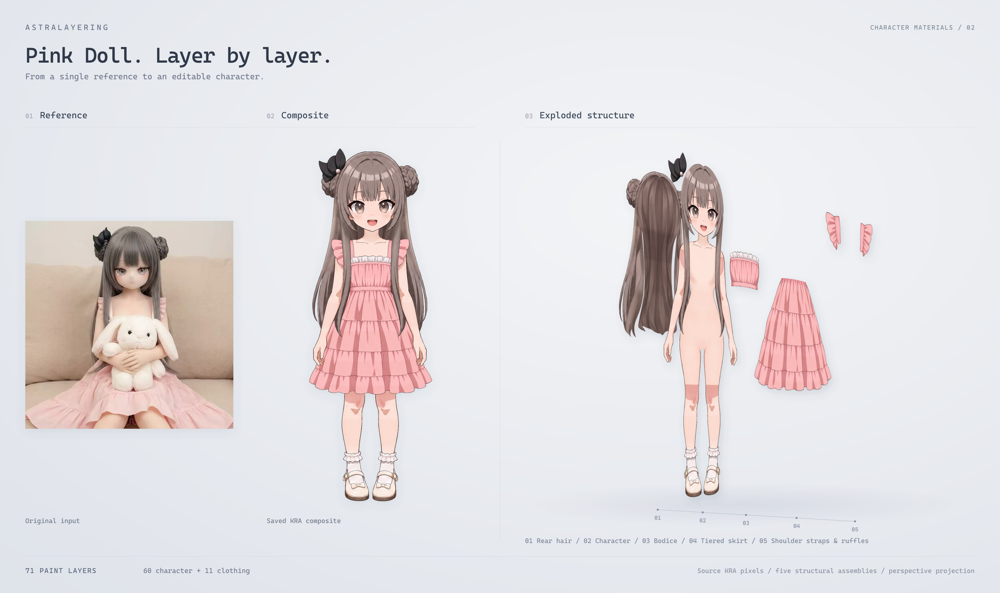
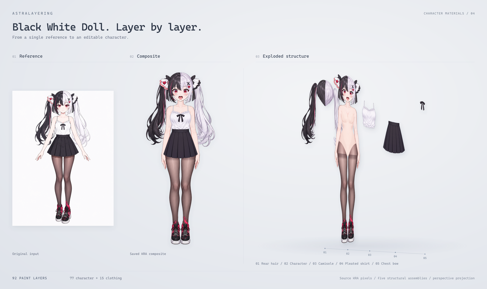
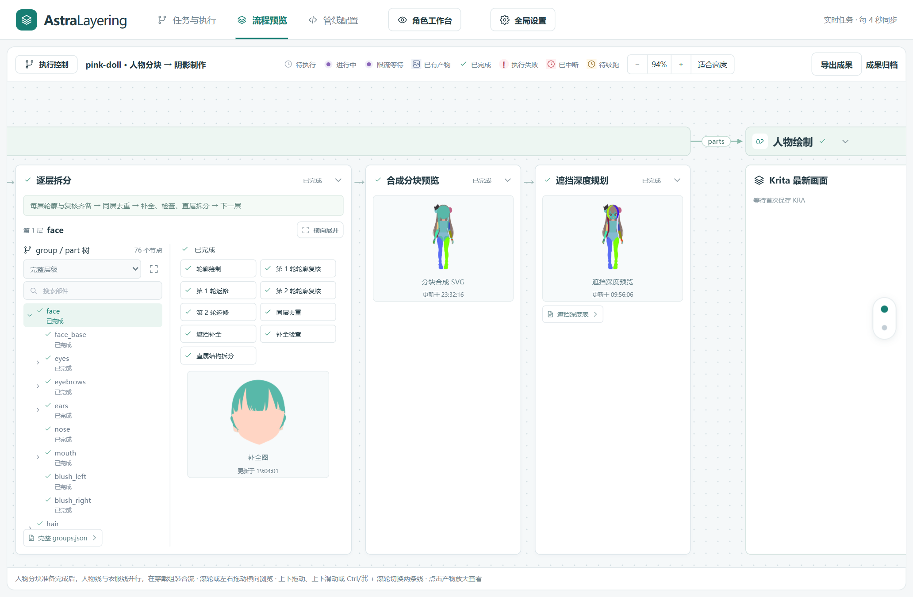
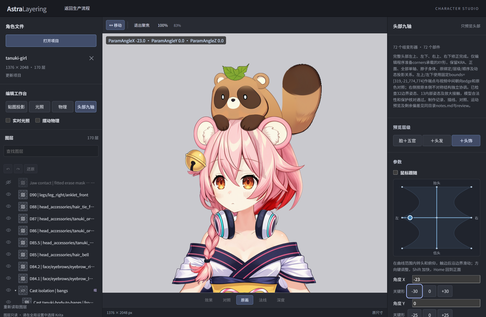

# AstraLayering

AstraLayering 是一个由 AI agent 驱动的角色分层工具。从一张角色图开始，完成人物与衣服分层、遮挡补全、穿戴组装、阴影与头部九轴，交付可编辑的 Krita KRA、透明 PNG 和制作报告。

## 工作流最高支持 4K 分辨率

可选择固定档位或跟随输入图。下图是 Black White Doll 的衣服分层，工程画布为 3258 × 4344，共 15 个绘画层。

[查看 4K 原尺寸合成](showcase/black-white-doll-clothing-4k-composite.png)

## 人物分层

人物与衣服分别绘制，保留独立图层和被遮挡部分，再按层次组装成完整角色。

| Jianma | Pink Doll · 60 层人物、11 层衣服 |
| --- | --- |
|  |  |

| Pink Elf · 70 层人物、32 层衣服 | Black White Doll · 77 层人物、15 层衣服 |
| --- | --- |
|  |  |

## 可视化工作台

制作工作台展示任务进度、部件结构、绘制过程和每一步的成果，支持停止、继续和导出。

角色工作台支持图层编辑和头部九轴预览。

## 头部九轴

工作台可预览转头、抬头、低头和斜向姿态。有 Z 轴的模型也支持歪头。下面是狸娘的完整演示，包含头部、头发和头饰的联动与表情。

感谢形象原创：**@楓山狸**。

制作工作台和角色工作台都能切换“脸＋五官”“＋头发”“＋头饰”，按各模型已完成的方向开放预览。[使用头部九轴](.agents/skills/live2d-maker/nine-axis/README.md)

## 开始使用

下载 [最新发布包](https://github.com/wu-tian807/AstraLayering/releases/latest)，解压后双击对应系统的 `start-workbench`；源码启动和操作见[工作台说明](web/README.md)。模型与服务支持预设和自定义，配置见[模型方案](.agents/skills/live2d-maker/references/model-presets.md)。

## 开源协议

[LGPL-3.0-only](LICENSE)，配套条款见 [COPYING](COPYING)。第三方素材和依赖遵循各自的许可。
