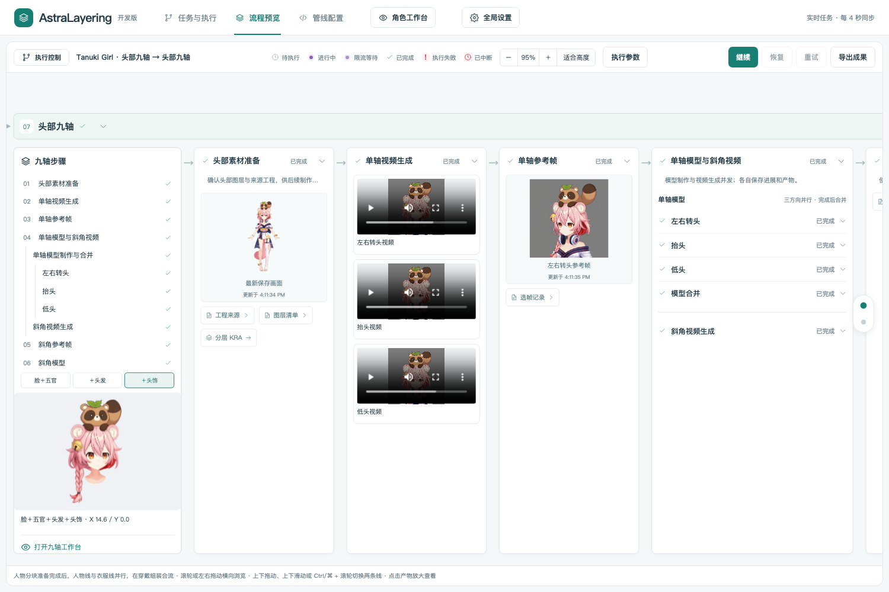
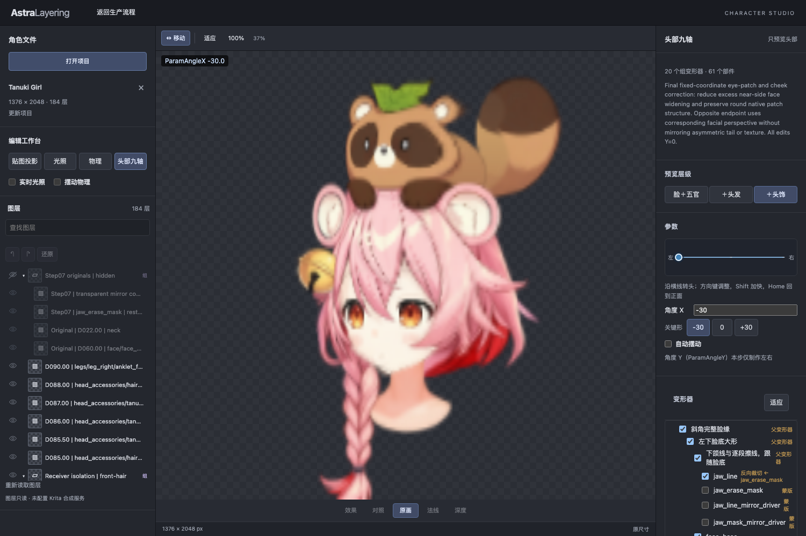
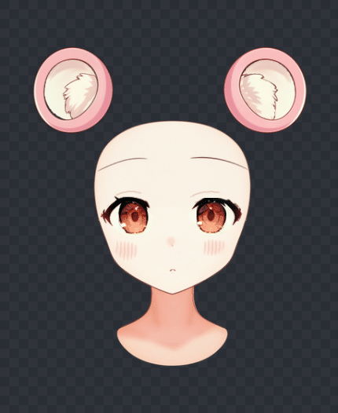
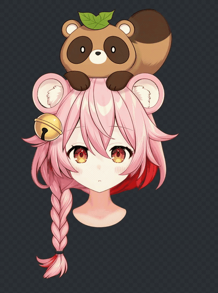

# AstraLayering

AstraLayering 是一个由 AI agent 驱动的角色分层工具。从一张角色图开始，完成人物与衣服分层、遮挡补全、穿戴组装、阴影与头部九轴，交付可编辑的 Krita KRA、透明 PNG 和制作报告。

## 人物分层

人物与衣服分别绘制，保留独立图层和被遮挡部分，再按层次组装成完整角色。

| Jianma | Pink Doll · 58 层人物、8 层衣服 |
| --- | --- |
|  |  |

| Pink Elf · 70 层人物、32 层衣服 | Black White Doll · 81 层人物、19 层衣服 |
| --- | --- |
|  |  |

## 可视化工作台

制作工作台展示任务进度、部件结构、绘制过程和每一步的成果，支持暂停、继续和导出。

角色工作台支持图层编辑、光照调整、九轴变形和布料摆动预览。

## 头部九轴

脸部、五官、耳朵与下颌已支持左右、抬头、低头和斜向九轴；头发、发辫及头饰已接入左右转头。头发按前发、侧发、后发、其余发片依次制作，并协调发根、遮挡与头顶衔接。

| 脸＋五官 · 完整九轴 | 脸＋五官＋头发＋头饰 · 仅左右 |
| --- | --- |
|  |  |

制作工作台和角色工作台都能切换“脸＋五官”“＋头发”“＋头饰”，各自按已完成的方向开放预览。头发和头饰当前制作左右，俯仰与斜向留待后续扩展。[使用头部九轴](.agents/skills/live2d-maker/nine-axis/README.md)。

## 布料与光照

裙摆、袖片和飘带可以随风摆动，和角色光照、投影一起预览。

## 开始使用

下载 [最新发布包](https://github.com/wu-tian807/AstraLayering/releases/latest)，解压后双击对应系统的 `start-workbench`；源码启动和操作见[工作台说明](web/README.md)。模型与服务支持预设和自定义，配置见[模型方案](.agents/skills/live2d-maker/references/model-presets.md)。

## 开源协议

[LGPL-3.0-only](LICENSE)，配套条款见 [COPYING](COPYING)。第三方素材和依赖遵循各自的许可。
