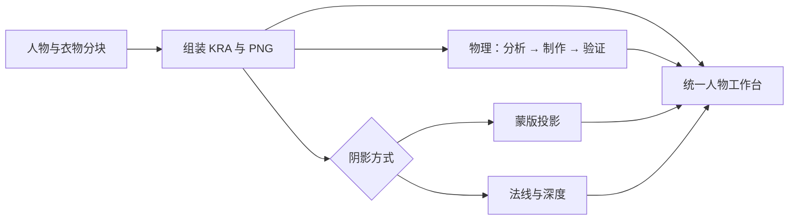

# 摆动物理制作工作流：范围、绑定、约束与交付

状态：2026-10-22 已注册独立 `physics` 初版，包含组件分析、连续固定区绑定、最大约束、动画证据与统一工作台加载。实现入口见 [physics/README](../../../.agents/skills/live2d-maker/physics/README.md)。单向支撑、多源层共享场、长束、布片和刚性挂件已接入；闭环装配和同层多独立活动区仍需明确暂缓。完成标记代表所记录的复核范围，不把设计清单算作所有角色都已通过。

本工作流制作**角色动作之后的次级摆动**：发束、飘带、自由衣料、悬挂饰物。眼睛／胸部果冻另有制作逻辑，使用同一个时间、输入和预览基础。动作、表情、身体碰撞和 Cubism 导出不是本工作流的制作步骤。

当前求解核心已按 [13 源码移植与适配](13-secondary-physics-solver.md)替换为 psd2live/Cubism、psd2live XPBD 与 Inochi2D。来源、许可证、已移植范围和运动拒收门槛以该章及实际运行源码为准。

## 1. 先判断自由度，再决定是否制作物理

不能按“头发”“衣服”的名字给整层挂弹簧。每个候选区域必须回答四个问题：

1. 有哪些真实连接处，连接到哪个支撑？隐藏根部也计入，不能从首次露出的像素开始固定。
2. 有没有离开支撑后可以弯曲或摆动的自由段？贴在身体上的纹样没有自己的自由度。
3. 材质应连续弯曲，还是保持形状绕挂点转动？金属切面不能像布料挤压。
4. 原图、分组说明及实际透明像素是否支持该关系？图层数量和明暗色块都不是连接证据。

分析清单使用四种结论，所有源部件都要有结论：

| 结论 | 行为 | 常见对象 |
| --- | --- | --- |
| `simulate` | 有自己的动态状态与约束，制作物理残差 | 长发、袖口垂料、裙摆、悬坠 |
| `follow` | 采样所属组件或动作支撑的同一形变，不另建弹簧 | 线稿、印花、前后插层的连接片、固定扣件 |
| `pose` | 只由动作／表情驱动，本工作流不增加物理残差 | 身体、四肢、贴头发盖、固定衣领、五官 |
| `defer` | 关系不明确，保留证据和原因，默认不启用 | 缺失连接处、未知材料、无法确认的分层 |

设计上一个绘图层可以有多个活动区，一个组件也可以包含多个绘图层。初版只实现后者：同一源层只允许一个场；需要多个独立活动区时暂缓，不能重复叠加位移。

## 2. 通用覆盖范围

| 部位 | 应制作的物理 | 应固定／随动的部分 | 不应做的事 |
| --- | --- | --- | --- |
| 贴头发盖、紧发髻、贴头短刘海 | 通常不做；有明确松散尾尖时仅开放尾尖 | 发根与贴头面跟随头部姿态 | 整个发盖像帽子滑动 |
| 脸侧短发、较厚刘海 | 按角色可选，小幅受控弯曲 | 中分根部、贴头区及必要的贴脸范围 | 套长绳幅度，扫过眼睛或露出额头接缝 |
| 长侧发、后发、马尾、辫子 | 连续发束摆链；宽发面增加横向保形 | 根部与绑扎处 | 每个尖叉各挂独立弹簧，或整片刚性平移 |
| 发束内部线稿、亮暗、固定发饰 | 共享所属发束场；悬挂的饰物另判断 | 各自源 UV、实际连接点 | 给线稿／高光再加相位 |
| 窄飘带、绳、细流苏 | 保长摆链，沿原曲率弯曲 | 结、扣或悬挂根；闭合绳还需两端连接 | 按图片高度等分固定区，填掉绳环孔 |
| 宽飘带、披片、自由袖纱 | 二维布片；按宽度、缝线与自由区判断 | 缝线、带头或袖体连接处 | 只因为名字叫“带”就使用单线刚摆 |
| 贴身上衣、领肩、束腰 | 默认动作随动，无独立摆动 | 固定衣料与身体连接 | 把整件上衣从胸口甩出去 |
| 袖筒 | 动作形变为主；明显悬空的下侧可选小幅布料残差 | 肩／上臂接口、腕口，常有多个支撑 | 当成只有肩部一个挂点的长旗帜 |
| 袖口垂料、侧翼纱、下垂袖尾 | 明确的布料组件，单独制作自由段 | 真正的袖口／袖侧连接区 | 把袖尾受力传成整条手臂的大摆动 |
| 裙面、裙摆 | 固定裙腰、下方连续布料弯曲；前后／左右依真实接缝连接 | 腰口及缝线，两腿前后层序 | 每条明暗褶皱独立摇动，或左右片无依据同相刚摆 |
| 长前襟、披风、衣摆 | 自由下段做布料；上段先随动作 | 胸饰后／腰口等连接及隐藏搭接 | 让顶端滑出扣件，忽略前后插层 |
| 蝴蝶结 | 结芯随支撑；环翼、短尾按材料和自由长度可选 | 结芯、束口 | 整个结芯另挂摆链 |
| 耳坠、悬挂宝石、硬质吊牌 | 保形悬摆；链和柔性连接另处理 | 耳钉、安装座或吊点 | 金属或宝石被拉伸压扁 |
| 珠串、环链、软链配硬坠 | 柔性段＋刚性段组成同一耦合组；两端链按真实端点约束 | 已装配接头与前后穿环片 | 每张层都加无关联弹簧，放开本来固定的第二端 |
| 鞋、贴身镯、固定饰板 | 默认动作随动；悬挂尾件可选 | 与身体的固定连接 | 没有自由连接也强行增加晃动 |
| 身体、手脚、五官、嘴部 | 本工作流不制作；由动作、表情或专用果冻流程处理 | 原有作者姿态 | 自动把全部角色层开启物理 |

固有暗部、褶皱和固定高光继续随所属表面，不重绘。投影阴影的运动按投影源、受影者和裁切关系处理，见 §8；它不是一张普通“衣料层”。

## 3. 三种求解原语与组件装配

### 3.1 `strand`：发束、细带和长绳

沿真实发流／带形建立连续中心线，根节点加约 3–5 个控制节点作为起点，按弯曲段与曲率增加节点。保留原画的卷曲平衡形，不先把曲线拉直。

- 根部活动权重为零，贴头／绑扎区与短过渡区保形；末端逐渐开放。
- 短物理摆链相邻节保长，输出沿原画弧长映射，保留作者卷曲；下节接收上节运动，迟滞来自耦合求解。
- 中心线经过弧长校正后驱动网格。宽度、横截面方向和尖叉的共享权重独立控制，避免贴图变成橡皮长条。
- 宽后发可先采用多横截面的发束场；若无法保持侧向形状，改用布片式控制或有证据的多个活动区，而非无限增加骨节。

### 3.2 `cloth`：宽布料

在实际透明轮廓与缝线内建立二维网格，分别配置拉伸、剪切、弯曲、面积和原形保持；质量按网格面积分配。固定侧比例仅为快捷初值，正式配置支持斜线、曲线、固定区域和多个支撑。

裙子前后片不必使用完全相同的变形，但共享裙腰与侧缝必须连续。袖体上臂与腕口的支撑先来自动作，只有作者开放的悬空区域获得物理残差。透明间隔不能自动加三角形跨过去；绕回的裙边和真实孔洞保留。

### 3.3 `pendant`：保形挂件

金属、宝石、环、饰板保持局部形状，围绕真实挂点转动。软连接可用短 `strand` 或两端约束连接硬件。孔内悬珠有自己的吊点，不能把环孔填成布片。

多段链与双端连接属于**装配关系**，不另造第四套物理引擎。互相依赖的刚性段、柔性段、闭环或双端约束在一个耦合求解组内处理；组之间的支撑依赖保持有向无环。前后穿环的多张图层共享同一接件变换，不各自求解。

### 3.4 动作姿态与物理分层

```text
动作／表情提供当前支撑和中性姿态
→ 挂点运动产生惯性，测试工具提供外力
→ 在组件局部空间求解物理残差
→ 共享场驱动每张图层的原始网格和源 UV
→ 最终约束检查
→ 合成颜色、法线、深度与投影
```

固定区是“相对当前支撑不滑动”，不是永远停在原图世界坐标。取景移动、缩放和移动光源不产生力。切项目、复位和不连续跳转明确 reset；正常连续动作不逐帧清空动态状态。

初版规范测试通过 `sourcePose` 同步平移、转动整角色父层与全部支撑；静态图层、组件、法线、深度及投影都使用同一步父姿态。固定残差相对当前父姿态计算。只移动数学挂点、让头冠或袖体保持静止会造成真实接缝脱开，即使固定残差为零也不能通过。单端口输入仍可调用，但局部头／手九轴的父层姿态映射尚未制作，不能把整角色测试等同于九轴验收。

## 4. 自然感和最大约束的制作顺序

1. **先连接：**定位隐藏根、支撑点、缝线以及多图层之间的搭接。
2. **再活动区：**固定、过渡、自由区分开；网格在边界处布点，避免大三角形跨过固定边。
3. **先限幅：**末端位移、每节／局部摆角、拉伸、剪切、面积和翻折限制全部落盘。
4. **再节奏：**用规范输入调整恢复频率、阻尼、分段迟滞和材质，而非靠放大摆幅制造“明显”。
5. **最后组合：**加入父动作、多组件和光照，检查接缝与遮挡，避免单件好看、全身一起失控。

末端位移以自由长度的比例保存，同时显示像素；固定／过渡区使用更小的局部上限。摆角限制沿实际轴定义，不把斜发束误当竖直旗帜。两端连接不能放任端点分离。

日常运动接近限幅时平滑减弱输出或增加边界阻尼；最终仍做硬约束投影。只移除朝越界方向的速度，保留切向运动。局部越界优先局部修正，整组件向中性形回退仅作最后保护。持续顶限幅是参数失败，不能因为“没有爆炸”就通过。

| 可调项 | 含义 | 审核依据 |
| --- | --- | --- |
| 固定区／过渡区 | 哪些位置不动，哪里开始自由 | 真实连接、原尺寸根部特写 |
| 轴、控制节与保宽 | 在哪条曲线上弯曲，横截面如何变化 | 保长、原曲率、线稿是否被拉坏 |
| 材质与保形 | 哪些方向允许弯、剪切或拉伸 | 布料、头发与硬件不能同一行为 |
| 目标响应频率、阻尼 | 回落节奏与余摆 | 规范输入的实测曲线和完整播放 |
| 最大位移／角度／拉伸 | 允许的最后边界 | 接缝余量、邻接轮廓及极端输入 |
| 输入增益 | 父动作或扰动传入多大惯性 | 日常输入不持续顶到边界 |

Hz／阻尼比是可理解的响应目标；宽布与耦合链有多个模态，需要用实际求解器标定，不能把一维弹簧公式或 Cubism Delay 直接当材质参数。初始值按类型给保守预设，绝不以 Jianma 等角色名命名。没有实测前不规定“所有头发都必须某频率”。

## 5. 管线位置、输入与既有流程兼容

`physics` 是组装之后的独立工作流，不依赖 shadow 完成。shadow 的蒙版／法线深度仍按既有参数二选一；物理与它们是两个独立维度。



主要输入：固定位置的 `character-assembly/step01/character-assembled.kra` 和 PNG；人物／衣服两套 `groups.json`、`occlusion.json`；现有原图及 simplified 参考。参考图的来源通过现有上游解析器取得，不让用户重新挑目录。PSD 外部导入先规范化成可持久保存 UUID 的 KRA。

法线、深度、`shadows.json` 和阴影 KRA 是可选预览输入；缺它们时仍能制作、加载并验证物理。后续加入阴影，只更新关系映射与光照复核，不使未变组件重做。已有组装任务缺少历史 assembly 报告时，不因此要求重绘；映射存在疑点的部件单独列为待确认。

总控已注册参数 `physicsEnabled` 和 `physicsProfile: primary | all`，默认关闭物理自动制作，启用时默认 primary。它们与 `shadowMode` 独立透传到任务记录和前端配置。**旧任务保存的 from／to、默认终点和已完成状态不自动改成必须制作物理。** 独立入口为 `pnpm physics --name <任务名> --profile primary|all`；全局入口 `pnpm start --name <任务名> --physics --physics-profile primary|all`。已组装项目可使用 `--from physics --to physics` 独立运行。

独立 physics 工作流使用同一 profile，保存到自身启动参数；总控只负责透传。profile 决定分析／制作候选范围，工作台的效果开关决定是否播放，两者不混用。逐组件启用／禁用与作者修改写入正式配置或带父 revision 的草稿，不再追加大量总控命令行参数。

首轮 primary 制作明显的自由头发、飘带、袖尾、裙摆和长流苏；all 再处理有依据的小幅短发、蝴蝶结和复杂饰物。改用 all 时保留指纹匹配、已审核的 primary 配置，追加候选；取消已做组件必须明确关闭或删除，不能因本轮 profile 没列到它就静默清空。

前发／刘海、侧发、后发分别检查，不能用“已有后长发”代表全部头发完成；同样不能把全部头发开启物理来弥补漏做。发盖、梳紧发髻及贴头区保持固定，无自由段的源层排除；有实际连接和余量的尾端、外侧、游离发束才开放连续的小幅残差。小耳坠或冠饰也可能是显著部件，优先级不只由像素面积决定。all 只扩大有依据的自由段范围，不改变上述固定规则。

短颈与硬坠可以共享保形悬摆；同一硬环的前后穿接素材共享刚性变换，不必构造动态闭环。串联挂件先检查 `supports.componentId` 的有向连接；真正需要双端耦合或同层独立活动区时，才按具体拓扑暂缓。

## 6. 三个正式步骤及产物

下表是初版实际产物，替代 10 中初稿的“两步”路径。作者参数保存在结构化配置中，网格和活动权重确定性派生，不要求额外维护一套手写顶点文件。

| 步骤 | 做什么 | 产物 |
| --- | --- | --- |
| step01 识别与组件规划 | 解析 UUID／来源、独显像素、真实连接；给所有 part 分类，确定同动、双端关系和候选优先级 | `source/catalog.json`、原尺寸各层 PNG；`step01/analysis.json`、`coverage.json`、`report.md` |
| step02 制作绑定、约束与有限标定 | 固定／过渡／自由区、支撑、中心线／网格、共享场、材质、响应与最终限制 | `step02/physics.draft.json`、`assemblies.json`、`tuning.json`、`coverage.json`、`report.md`；可补绑定叠图 |
| step03 模拟、独立视觉复核与交付 | 同求解器规范测试、接缝和图层复核、明确返修、整体光照比较，最后发布 | `step03/physics.json`、`findings.json`、`evidence/manifest.json`、`report.md`；通过后发布 `physics/physics.json` |

目录为 `<任务>/physics/step01|step02|step03/`，由程序维护本管线的 run、提示词、事件日志、步骤状态和完成标记。

**step01：**输出完整决策表，不只输出将启用的组件。每条结论记录实际 part ID、源 UUID、连接依据和证据图片。组件首次分配持久 ID，改名／排序不重铸 ID。多张层共享一个组件必须显式登记；同层多个独立活动区和闭环暂缓。初版分析使用 `bind/defer/excluded` 决策，组件 `layerRefs` 表达共享场；表中的 simulate/follow/pose 是判断语义。

当前分析 version:2 对每个 part 记录 `motion.family`（hair/fabric/accessory/other）、实际 `region` 与 `freedom`（free/fixed/follow/uncertain）。fixed 无独立自由段而排除，follow 表示源层只随所属组件。暂缓必须用 profile-secondary、uncertain-connection 或 unsupported-topology，最后一种附具体拓扑；all 不接受 profile-secondary。工具生成 coverage.json，将各部位的绑定、固定、暂缓原因列出来。制作阶段还核对选定 part 与 UUID、实际启用配置一致，不以同名组件计数冒充覆盖。

**step02：**把作者可编辑的固定线／区域、中心线、接点、权重和限制保存到候选 rig。渲染网格是确定性派生物，记录生成器和指纹；手动精修也要更新作者控制，不把只在浏览器内变过的顶点当成正式结果。线稿、色层、印花以及前后接片保留各自源 UV，采样同一组件场；局部区域重叠时明确定义混合权重，不能重复叠加全幅位移。

**step03：**先排除数值失稳，再按 [12 的动画证据协议](12-physics-animation-review.md)检查根部、形状、图层、贴图和完整时间响应。120 Hz 完整数值轨迹、均匀帧序列、事件邻域密集帧与原尺寸细节同步提供给审核模型；每条结论记录实际已读证据和未检查范围。修正作者结构时回到 step02；仅改响应／上限时复用来源和作者几何；初版仍重跑九组完整组合，尚未实现逐组件增量模拟。`physics.json` 是审核后的唯一正式配置，候选 rig 与本机草稿不能自动冒充已审核交付。

管线不默认调用生图。固定区、控制线、权重和网格由分析与确定性绘制／几何工具制作，避免模型“重画”皮套。发现隐藏连接素材缺失时记录该部件并交上游修复，不在本流程里偷偷重绘角色。

### 6.1 分析怎样变成实际绑定

step01 工具提供组装全身和候选部件的原尺寸独显；工作台可通过图层开关检查相邻关系。自动邻层拼图、连接处标记图尚未实现。关闭光照／投影后检查真实像素。agent 结合父／子 note、遮挡图和图像提出支撑点、固定轮廓及自由轴；不能只按外接框顶部或名称得出根部。按 catalog 的源像素坐标核对挂点确实落在同一连接处；工作台已有绑定点可拖动检查。

源目录默认返回简明分组索引，再按 `partIds` 读取完整连接说明，避免反复灌入全部长 note。候选源层支持按 `uuids` 批量原像素拼图，编号与原 bounds 分别记录；证据查看同样合并图片而不缩放。图像坐标不因拼图而改成新画布坐标。具有单次图片数量上限的服务还需图片数上下文整理或分段复核；它处理模型历史，不处理原画分辨率。分析、绑定和复核使用独立会话，磁盘分析、配置及逐帧查看记录是步骤之间的交接依据。

step02 通过结构化工具提交固定多边形／线、过渡距离、中心线与接缝点，生成连续活动权重和候选网格，当前没有独立权重图片或权重画笔。固定区权重为零，过渡按到固定边的距离平滑增加；真正孔洞、尖叉和不连通区域分别处理。刚度／保形权重与活动权重分开，不能用一个灰度值同时表示“能动多少”和“材质多硬”。预览叠加固定区、控制线、共享层、自由端边界，发现根部或拓扑问题就修改作者控制并重新派生。

step03 使用同一 rig 先运行规范输入，查看完整动画和根部／自由端局部特写，附响应曲线、约束热区与限幅占比。独立 reviewer 提出返修，制作 agent 调整参数再测，但必须分别回答“连接是否正确”“形变是否保形”“节奏是否自然”；不能靠调阻尼掩盖错误绑定。某组件失败可保留合格组件，最终报告列出未交付项，不能把部分成功登记为 profile 全部完成。

三步提示词保持简练，工具 schema 负责参数范围与格式：

> 分析：依据源部件、实际像素与连接说明，分类全部 part；标出真实支撑、自由区和共享运动，不确定项保留原因。
>
> 制作：沿确认的连接制作固定／过渡区、控制线或布片网格；保持原形、层序和源 UV，先设置最大约束再调整材质。
>
> 复核：用统一运行时检查中性、轻扰动、支撑往返和极端输入；修正接缝、形状与回落，保存证据，仅发布检查通过的组件。

### 6.2 三个职责与装配组标定（2026-10-24）

共享能力属于 skill，前端是消费者。`physics-core` 负责作者格式、几何、权重、求解与固定步；`physics-evidence` 负责规范输入、轨迹、指标和事件窗口；`character-render` 负责颜色／法线／深度／投影。独立安装不依赖工作台目录或服务。管线所需制作指南位于 skill 的 [physics/guide.md](../../../.agents/skills/live2d-maker/physics/guide.md)，本 formal 保留完整研究与证据边界。

| 职责 | 默认模型 | 权限与交付 |
| --- | --- | --- |
| A 结构分析 | `gpt-6.1-sol-high` | 查看源图／catalog，逐 part 保存连接、自由度和覆盖 |
| B 制作、标定与返修 | `gpt-6.1-sol-xhigh` | 保存完整作者绑定，逐装配试参、明确选候选，读取 C 的失败窗口 |
| C 独立复核 | `gpt-6.1-sol-xhigh` | 查看、模拟、渲染、提交通过或返修；不能修改 B 草稿 |

`supports.componentId` 保留父子方向，弱连通关系形成完整装配组。组 ID 由稳定 component ID 集合决定，不依赖图层排序。单个挂件选中不应改变装配是否运行；标定时带上父带、接环和下游坠等全部相关组件。

B 保留 baseline，最多比较三个 response/material 候选。三种快速输入为微风、轻扫和支撑释放，120 Hz、固定输入尺度；测量根残差、末端与中段轨迹、速度、曲率、跳变、停止残差、限幅和回退。输入一致、来源／几何／上限不变，候选建议分数仅作比较。每装配每代最多三轮；来源、作者几何或求解规则更新时归档旧代。明确选择后保存 config 指纹与逐组件指纹，独立组选择不会回滚其它组；后改绑定和参数使旧标定失效。

`tuning.json` 记录 `groups[].rounds[].candidates[]` 的参数差异、metrics／samples、eligible、score、issues 以及选择理由。只有全部启用装配的当前版本完成选择才标为 calibrated；这个状态证明标定完成，不等同于视觉 accepted。`assemblies.json`、`tuning.json` 与 C 的 `feedback.json` 可用于同画布前端的装配关系、候选曲线、覆盖和返修证据可视化。手动配置只能派生装配图，没有真实标定记录时不能补造工作流通过。

C 否决时写 `feedback.json`，绑定当前 configHash 和 reviewTurn，列明组件、准则、输入、整数步、原因及已查看图片。调度器归档当前失败、恢复 B 原会话，B 完成后以新 C 会话复查。每装配最多三轮制作／复核；普通异常或旧反馈不触发返修。交接使用可恢复状态，中断不删除完整证据，也不重复增加轮次。C 越权改草稿会被检测并恢复 B 版本，异常版本保留。

当前定向测试验证了上述身份、数值可复现、参数隔离、基线恢复、代次、权限和调度边界。已获用户认可的 Jianma 手动效果继续作为风格／材料参考；未进行新的无缓存管线运行与连续视觉验收之前，不能将其声明为本轮三 agent 工作流已稳定复现。

## 7. 身份、配置与恢复契约

正式配置使用独立类型标识 `astra-component-physics` 和 version；与现有工作台 schema 2 的逐层草稿区分。当前旧草稿可转换为候选，必须经过组件／支撑补齐和复核再发布。

初版实际结构如下；后续字段不能只写进 JSON 就当作已经实现：

- `source`：组装源、画布、组树、稳定图层目录、实际源像素和几何指纹。
- `components`：持久 ID、显示名、优先级、类型、启用状态、`sourcePartIds`、`layerRefs` 和活动区。
- `supports`：动作支撑、组件挂点和实际接缝的引用。头、腰、腕等是支撑端口，不把九轴关键形的制作混进来。
- `authoring`：绑定姿态、固定／过渡区域、中心线、网格生成配置、空间权重及同动映射。
- `material`、`response`、`limits`：材质约束、实测节奏目标与硬上限分别保存。
- 共享场由组件的多项 `layerRefs` 表达，单向挂接由 `supports[].componentId` 表达。独立 `relations`、闭环缝合和双端链装配尚未实现。
- 网格由 `authoring` 派生，原尺寸图像位于 source/preview；初版没有外部 `assets` 权重文件。布片控制网格与显示细分分开，推荐 `controlGrid:[4,8]`（列／行，各 2–16）规则格，完整轮廓只负责显示。未配置控制格时沿用轮廓控制，`simulationSubdivisions` 默认 0，可设置为 1；显示细分使用精确父面权重，不重新猜测最近三角形。固定边切分传播到相邻面，UV 插值改为小位移残差，以免产生透明缝隙；原图 UV 和分辨率保持不变。
- `review`：输入方案、测试配置、报告指纹、视觉复核状态和遗留项。

部件语义引用采用 `character:<groups完整ID>`／`clothing:<groups完整ID>`，工程定位采用源 UUID。映射一对多，不按层顺序，不把“路径唯一”误解成“必然只对应一张层”。重建图层或重新划分部件需要明确来源迁移及受影响组件复核。

几何坐标明确区分源画布、组件绑定空间、支撑局部空间和最终画布。控制点以绑定空间保存并记录源画布尺度；角度、位移比例、像素显示和求解时间的单位由 schema 明确。支撑可以是单点枢轴、固定区域、多点姿态场或双端接缝，不把宽裙腰压成一个点。来自上游组件的支撑输出在同一固定步更新，下游读取当前支撑及连续速度，不能用屏幕拖动画布的速度代替父动作速度。

已有工作台可以读到隔离剪贴组的原生合成片段，但这不足以支持组内多个组件独立运动。新组件路线必须保留原成员、蒙版和裁切图，按原层序在 GPU 合成，不能把整片阴影组当一件衣服。初版对 `shadows.json` 登记的直接剪贴关系，分离原接收合成与原投影素材，支持正常／正片叠底、保留透明度蒙版和隔离组透明度继承；每次渲染工具先做原生中性合成等价检查。隔离组的其他绘图成员必须同场，否则禁用受影响绑定。特殊滤镜／变形蒙版或外部混合依赖未支持时，对受影响组件保留原生预览并明确标记，不能虚报动态通过。

恢复依据输入＋作者配置＋工具版本＋测试／审核指纹，不只看文件存在：

| 变化 | 恢复行为 |
| --- | --- |
| 添加／重排图层、重新保存 KRA | 用 UUID 和来源映射复用未变组件，不按整份文件哈希清空 |
| 添加阴影、切换阴影方式 | 复用物理 rig，更新裁切／映射并重做相关视觉比较 |
| 更换法线／深度／光照预设 | 重做相应光照复核，不重建物理固定区和网格 |
| 改根部、控制线、权重或几何 | 重做该组件及受其支撑的后继绑定、测试 |
| 改材质、响应或上限 | 复用几何，重测该组件及耦合组 |
| 更换源像素、拆／并／替换部件 | 保留旧版和手工草稿，明确迁移或重分析受影响组件 |
| 中断／工具失败 | 保留完成的组件和证据；只恢复受影响步骤，不能伪造完成标记 |

程序复用既有任务锁、模型配置、日志和恢复机制，不新增另一套后台运行器。模型角色沿用既有 agent slot 规则，为 physics 分析、制作和复核注册明确的步骤映射；没有生图步骤就不注册虚假的图像模型选项。手工编辑保存在项目 drafts，带来源／父 revision；候选修改标记待复核，检查后原子发布新版，并保留可回退历史。

## 8. 法线、深度与投影怎样共同变形

**表面数据：**每张真实部件的颜色、法线和深度共享最终网格与原 UV；隐藏区域按 [08](08-part-surface-completion.md) 的部件归属方法补全，并保留样本／估计可信度。法线做二维形变 Jacobian 的逆转置与归一化；深度沿原值或显式姿态深度偏置。自由段发生大幅翻面、纵深变化或新视角露面时，单视角贴图不足，这些动作不进入此轮自动验收。

**蒙版投影：**按 [09](09-clipped-cast-shadows.md) 的 caster／receivers／clip 关系运行。投影素材在独立范围采样投影源的连续位移外推场，再由受影者变形后的 alpha 联合裁切。外推采用归一化平滑权重，位移受 caster 限制；这是二维素材跟随，不重新计算投影方向或新增遮挡几何。巨大阴影素材不能直接按衣片外接矩形套网格；需要明确的阴影跟随映射和外推范围。全部阴影随受影衣片或把暗色写进法线，都会破坏关系。

父姿态与局部残差分开：整角色的刚性移动直接应用到投影原坐标，只有 caster 相对当前父姿态的物理位移进入外推。否则会把头冠转动误当作局部摆动，造成阴影错位。

**实时投影：**法线／深度方式使用同一最终深度合成与遮挡查询，不生成另一份“物理专用光照”。光照 presets 仍由工作台提供，不恢复每轮 agent 产出 `light.json` 的步骤。

未完成组内动态裁切前，不能只验证独立布片就声称 Jianma 的蒙版＋物理全部通过。必须验证原生中性合成等价、源部件独立运动、动态受影裁切、根部和接缝，以及法线／深度平滑。

## 9. 工作台与 agent 共用验证

所有项目继续从统一“从项目加载”进入。左边选择物理编辑，右边配置当前项目的组件；光照、投影和物理共用一个画布，不增加独立物理案例入口或重载底图选择。

右侧分为组件、绑定、运动、限制、验证几个区：可搜索组件、定位相关图层、显示支撑／固定区／自由轴；初版支持拖动已有固定区、中心线和轮廓控制点，坐标面板可增删点及调整网格；响应和最大约束有数值控件。绘制权重画笔及逐区域材质权重尚未实现。图层与组件互选；一个组件涉及多层时一起标记，前后插层仍按原顺序显示。内部 UUID／矩阵不成为主操作选项。

验证保留悬停扰动、单次脉冲、支撑牵动后释放、往返、暂停、单步和复位。默认工具是移动；只有物理面板选中扰动时鼠标输入才产生力。切页／失焦／忙碌停止新输入，普通切工具不把已有余摆抹掉。鼠标仅在扰动模式且画布聚焦时施力，每次冲量有上限；规范回放按固定时钟推进。初版尚未记录悬停输入或按固定步聚合触控板事件，因此不同事件频率可能影响连续扰动，不能当作规范复核输入。

共享干扰路由保留“只对飘动物体／只对果冻物体／全部”三类，再选择当前或所有组件。此工作流只注册飘动物体；没有果冻绑定时该类别显示未配置，不能用布料模拟替代果冻。

agent 工具最少有来源检查、配置组件、同工作台预览、数值检查和发布五种操作。预览必须调用同一配置解析、求解器和渲染器，输出原尺寸 PNG 和逐步轨迹，短动画在工作台按同输入重放，当前不导出视频文件；不能另画正弦摆动当通过证据。工具限制写入本 physics 输出和 drafts，不修改上游 KRA 或运行状态。

动画复核通过 [12](12-physics-animation-review.md)定义的证据包和按 step 查询：规范输入、完整轨迹、均匀时间序列、峰值／反转／异常邻域及同一物理状态的多视图对照。视频用于连续播放，AI 默认读取可引用的图片与指标；选择性读图与完整数值检查分别记录，不能合称为 AI 已逐帧验收。

## 10. 什么条件才算成功

| 验证 | 必须看到／测到 |
| --- | --- |
| 无输入与复位 | 保持原画平衡形；中性颜色、光照和图层合成等价 |
| 单次轻扰动 | 自由段确实动，根部不滑，回落不是整件同时截停 |
| 支撑牵动、保持、释放 | 挂点跟上支撑；末端有迟滞并正常归位，断开／瞬移不产生爆冲 |
| 往返与持续小输入 | 没有累积漂移、无限余摆或经常顶限幅 |
| 极端输入 | 每步固定区、位移、局部角、拉伸、剪切、面积和方向都满足限制 |
| 多组件与多层 | 线稿印花不漂，缝线／连接片不裂，饰件不压扁，顺序与孔洞正确 |
| 动态阴影和数据贴图 | 运动后的法线／深度连续；蒙版随源并对动态受影面裁切 |
| 分辨率和性能 | 原纹理与导出尺寸保留，静止缓存复用，运动时只更新必要几何与 GPU 合成 |

报告记录第一峰值、衰减与稳定时间、逐段相位、限幅占比、固定残差和帧耗时；没有统一的“自然分数”。当前机目标为流畅 60 Hz 预览，CPU 固定 120 Hz；未测前不承诺达到。超预算优先调整物理控制密度、静态缓存和批次，不降低皮套贴图分辨率。已采用控制／显示网格分离、静止组件跳过、流式压缩轨迹；离线截图耗时不作为页面 FPS。

先用斜轴长条、多层线稿印花布片、曲线裙口、相邻发束和保形悬坠验证；增加两端连接和跨层裁切专例后再进入对应角色组件。例子必须作为项目加载，并使用同一运行时。每个组件至少保留中性、峰值、反转、回落的证据，全身组合再复核。没有连接证据或视觉复核未过的组件不默认启用。

## 11. Jianma 的实际制作范围

2026-10-23 的独立实跑已制作 17 个候选组件（7 个长束、10 个布片），关联 19 个 part、20 张源层。九组各 961 个场景状态已保存，全步非法网格与固定残差均为零；1,134 张均匀原尺寸颜色／光照图与 1,428 张组件裁切已生成。冠带等对象仍有反复回退，数值合格不能据此判定自然。图像复核服务的自动内容过滤中断了三张冠带局部帧的读取，实际视觉覆盖不足，发布校验拒绝提交；候选只能作为 `physics/physics.draft.json` 体验，不是已审核的正式 `physics.json`。

这轮离线证据使用平面后备法线／深度，未覆盖真实数据贴图的完整动态光照。真实工作台项目已验证同时载入候选组件与现有法线、深度，但它不替代缺失的连续视觉复核。工作台的项目加载、17 组件来源匹配、单次扰动、固定区、100% 源像素和切换文件清理均已实际检查。以下原始分批清单仍是规划，不能用候选制作数量倒推全部装配关系已经完成。

以 2026-10-22 当前组树和 assembled KRA 为依据。完整的 **158 个叶 part** 分类与源文件指纹见 [Jianma 制作清单](cases/jianma-secondary-physics-plan.json)。这是候选计划，不是已经制作的运行时 `physics.json`。

清单覆盖人物 90 个、衣装 68 个叶 part，包括旧组树未写 `kind`、但 `childrenAnalysis` 已明确终止的 neck、pelvis 与 chest_ornament。全范围计划分为 69 个姿态部件、76 个模拟候选源部件、13 个共享场跟随源部件；复杂组包含多张源层，这些数量不能当作物理体数量。第二批有 18 个候选项，包含需要手臂支撑后才考虑的两个袖筒活动区；第二批尚未制作或启用。

### 第一批：17 个主要柔性组件候选

| 范围 | 候选数 | 做法 |
| --- | --- | --- |
| 后发 `main_left/right`、`lock_left/right` | 4 | 后枕根固定，长自由面／中长游离束分别标定，宽主发保宽，保留叉隙 |
| 冠侧左 `ribbon_tail`、右 `ribbon_body` | 2 | 带头之后连续保长弯曲，支撑预留上方宝石悬挂组的运动输出 |
| 左右长前襟 | 2 | 胸饰后连接段随动作，上段保形，下段布料摆动 |
| 袖尾／侧纱 | 5 | 左袖 `free_curled_drape`、`outer_flared_gauze`、`side_pointed_gauze`；右袖 `outer_side_gauze`、`cuff_train`；各按真实袖体连接制作 |
| 内裙前片与侧后片 | 1 组 | 两张源 part 共同维持裙腰、侧接口与前后裙缘；不独立乱摆 |
| 腰带左右长幅 | 2 | 宽布幅从结后固定，连续变形，不能套细线刚摆 |
| 腰挂长白流苏 | 1 | 扣后隐藏束头固定，整束保长柔摆，不逐根细丝拆；复杂上挂链未启用时沿中性硬件支撑跟随腰部 |

17 是组件候选数，不是图层数。实际连通区／缝线检查可能需要合并或细分。上方硬件暂只随动作时，带尾／流苏也能先制作；以后硬件获得物理输出，继续使用同一支撑端口，不能改成没有根的独立浮动物。

**特别注意前侧发：**`hair/side_hair_left/right` 是从中分到耳外、约 y270 收尾的宽短幕帘，不是伸到腿边的两条长绳。第二批可做很小的受控尾端弯曲，根部与贴头区保持稳定，先验证眼角／额头覆盖；不能沿用后长发幅度。

### 第二批：按需要开启的局部和饰物

- 两片前侧短发、两侧带头的局部偏转。
- 两组冠侧宝石悬挂、两组耳链／耳坠、额心下水滴；安装座、耳钉与硬件高光随动。
- 腰前短环／小布穗；结芯不独立晃动。
- 领扣到胸饰的连接链：保留两端接点；领扣体与胸饰本体随动作，不把胸饰变成吊牌。
- 腰挂珠链、银件、莲结、双环、孔内小悬珠与扣件：刚柔耦合；穿环的前后接片统一运动。复杂组按子连接逐步验证，不要求首轮每件硬件都有独立动力学。
- 两侧踝链及下垂坠：踝／脚双端运动加保形挂件。贴身踝上宝石无自由悬挂时不另做物理。
- 袖筒悬空下侧若动作随动仍显僵硬，再增加有限残差；肩口、腕口必须保持支撑，不能整袖松绑。

默认不制作独立摆动的部分：发盖／紧发髻、固定冠框／莲饰／安装座，身体与四肢、所有五官与嘴部，贴身衣胸、领肩、横向腰带、固定胸饰。眼部／胸部果冻继续留给专用流程。

**当前 KRA 的一对多实例：**`clothing:outer_robe/left_front_panel` 对应 `::front_main` 与 `::back_under_front_band` 两张真实源层。两者保持不同叠放位置，但属于同一长前襟运动；正式来源映射必须记录两张 UUID，并复核该装配。不能因为精确同名只找到 157／158 个 part，就判定前襟缺失或要求上游重画。

## 12. 开发顺序与完成边界

1. 保留现有 UUID 基础，补正式组件／支撑契约、来源映射和原成员动态合成；实现同页作者区域、控制线与权重编辑。
2. 先完成 `strand`、多层共享场及明显自由布料的固定／限制；用独立项目检查根部、斜轴、保长、接缝和光照。
3. 注册三步 physics 管线、同运行时工具、恢复／审核和前端保存；给 Jianma primary 生成初版并逐组件检查。
4. 加 `pendant`、两端连接和复杂耦合装配专例，再制作 all 中的饰物与局部细节。

本流程完成的标准是：角色可从项目自动加载正式配置，主要自由部件连接自然且不越界，手动修改可保存和重新复核，颜色／法线／深度／投影在同一画布共同运动。不是增加一个参数面板或生成一个 JSON 就算完成。

## 13. 依据与证据边界

- [psd2live SWING](https://github.com/tsunehimatoi/psd2live/blob/ef527ddf9a7e738de642a0f19bdda17da1ef6191/docs/zh/guide/SWING.md)：固定边、保长、横截面和分段作者输出。
- [psd2live SIMULATION](https://github.com/tsunehimatoi/psd2live/blob/ef527ddf9a7e738de642a0f19bdda17da1ef6191/docs/zh/guide/SIMULATION.md)：多层物理体、固定／刚度／保形权重、胶水与面积质量；本方案不声称已复现其完整模拟器。
- [Cubism 及真实 physics3、Inochi2D、Rive 等研究记录](sources/component-physics-research.md)：参数驱动、挂点、时间响应、绑定空间与权重的固定版本证据。
- [Jianma 清单](cases/jianma-secondary-physics-plan.json)：来自当前角色组树、组内连接说明及源 KRA UUID；未生成权重，也未对这些新组件作动画美术验收。

当前求解器包含固定版本的 psd2live 与 Inochi2D 源码移植；来源、许可证和适配限制见 [13](13-secondary-physics-solver.md)。物理参数、网格、素材接缝以及图层遮挡共同决定自然感，任何单一引擎名字都不能替代上述制作与验证。

## 启用依赖与同源续跑

bind 表示当前装配可以安全启用的自由段；候选几何存在并不足以成为 bind。如果它会拉开当前仍暂缓的下游接口，且运行时没有可验证的随动边界，应将该部件及确受影响的祖先按具体连接原因 defer。保留候选配方作续跑参考，覆盖报告仍显示暂缓；不能先在分析选择 bind，再靠 disabled 绕过完整绑定检查。明确来源的 pose 挂点可以支撑可独立运动的下游分支，不能因此整类跳过头饰或腰饰。

制作规则修正后旧步骤归档。任务根的 physics-recovery/handoff.md 可记录同源分析、已生成候选和失败原因；每项复用须核对 UUID、像素指纹与实际支撑，并由正常工具重新保存。交接中的静态检查和候选不替代新规则的范围判断、当前九组模拟、渲染与实际图像复核。
