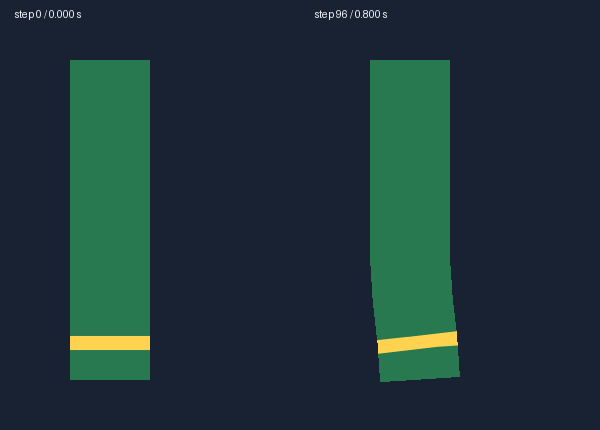

# 动画怎样变成 AI 可复核的证据

状态：2026-10-25，step03 协议补充 [11 摆动物理工作流](11-secondary-physics-workflow.md)。已实现规范输入、120 Hz 全网格轨迹、精确按步取帧、原尺寸局部、图像查看记录和逐组件六项结论。求解、证据及渲染核心由 skill 独立维护，工作台引用它们；离线复核不依赖前端服务。数值、渲染、AI 选帧和人工覆盖分别记录，人工复核不会自动填为通过。当前不提供自动视频文件或连续视频理解；工作台使用同一输入重放。

本章解决的问题是：人观看连续动画时同时感知形状、节奏、迟滞和回落，AI 需要明确的时间序列与可核对的依据。默认协议使用**规范输入、完整数值轨迹、时间帧序列、局部细节和结构化结论**。视频保留给工作台播放，也可供支持视频输入的模型辅助阅读；不假定所有模型都能读取视频，更不把提交视频等同于已经看过全部帧。

2026-10-23 运行时替换及实际运动拒收门槛见 [13 求解器移植](13-secondary-physics-solver.md)。数值失败会阻止发布；数值通过仍须连续视觉复核。

## 1. 把“自然”拆成可观察的问题

| 人看到的感觉 | AI 应检查的证据 | 不能直接推出的结论 |
| --- | --- | --- |
| 根部贴合，尾部能动 | 同时刻的支撑、固定区和自由段轨迹；连接处连续帧 | 整个画面位置没变，不证明根部没滑 |
| 发束有连续弯曲 | 中心线／横截面形状、相邻段相对角与连续帧 | 末端有位移，不证明整束不是刚板 |
| 跟着头动，但留有余摆 | 支撑输入与物理残差曲线、释放后的真实时间序列 | 峰值图好看，不证明过渡和回落好看 |
| 回弹柔和、逐渐稳定 | 多次反转、局部速度、回落包络和停止后的尾段 | 一次反弹或固定振荡次数不能定义所有材质 |
| 没有突然卡住 | 接近限幅时的连续帧、逐步修正量和速度变化 | 约束全部合法，不证明限幅没有视觉顿挫 |
| 布料与印花一致 | 同时刻颜色、网格、源 UV 对应和相关层叠加 | 内部顶点动了，不证明最终贴图真的动了 |
| 接缝、穿环和遮挡正确 | 接点距离、前后层 ID、局部 alpha 与正常合成帧 | 数值上接点重合，不证明没有黑线或透明裂口 |
| 光影贴着运动表面 | 同一物理状态下的原色／光照／法线／深度／裁切对照 | 亮暗在动，不证明衣料在动，也不证明投影正确 |

数值负责查越界和描述节奏，视觉负责查原画形状、接缝与表现。二者都通过才支持对应范围的交付；没有统一的“自然度 90 分”。

## 2. 先定义可重放的输入

同一配置、输入和初始状态应得到相同轨迹。复核使用工作台同一解析器、求解器和渲染器，以固定 120 Hz 推进；浏览器 RAF 与截图耗时不推进模拟。整数 `step` 是权威时间，`time = step / 120`，不靠等待真实 100 毫秒取得“差不多这一帧”。

这里的“同一”指 skill 的 `shared/physics-core`、`shared/physics-evidence` 与 `shared/character-render`，前端只消费这些能力和正式产物。

每个测试记录输入方向、施力位置／半径、幅度、支撑运动曲线、时间段、初始状态和 reset 事件。长度按组件自由长度归一化，角度和脉冲明确单位。幅度依据已保存的审核 profile，不能遇到限幅就临时缩小输入冒充通过。

| 测试 | 输入含义 | 主要观察 |
| --- | --- | --- |
| 无输入／复位 | 原画平衡形与固定支撑 | 根部、中性合成、漂移 |
| 自由端轻脉冲 | 在确认的自由区施加一次已记录脉冲 | 局部受力传播、弯曲和回落 |
| 支撑牵动—保持—释放 | 支撑沿平滑曲线运动，再停止；运动函数连续性明确 | 根部随动、自由段惯性与释放后余摆 |
| 支撑往返 | 同一支撑向两侧运动，保留实际时间 | 反转、滞后、接缝和两侧不对称 |
| 持续小输入后停止 | 有限时长的规范连续输入，再静止 | 累积漂移、常态顶限幅、停止后的恢复 |
| 极端输入 | 预先定义的较强输入，覆盖边界 | 局部修正、无翻折、无整体截停 |
| 轻扫后停止 | 小幅局部载荷，驱动结束后释放 | 自由段是否有可见响应，是否因僵硬完全不动 |
| 微风后停止 | 慢速风场持续 4 秒，再关闭 | 连续飘动、无漂移、停止后衰减 |
| 多组件与组合 | 使用相同支撑输入和项目层序 | 接头、共享场、整体协调与阴影 |

直接作用自由端与移动支撑必须分开测试：前者可能先动末端，后者检查支撑带动的响应。不同方向按实际自由轴选择，不能对所有部件只做屏幕水平力。

当前输入版本为 `astra-physics-tests-3`：支撑测试同步移动整角色父层与所有附件，平移幅度按项目最长自由段计算，不因某组件限幅而缩小测试。`sourcePose` 与每步全网格一起保留，并在浏览器渲染时与离线轨迹核对。旧版只移动挂点而没有移动可见父层的图片属于已知失败，不复用于新版结论。局部头／手九轴父层绑定不在本轮覆盖范围。

2026-10-24 补充：轨迹同时保存每步 `airflow`。证据取图直接读取指定整数步保存的完整显示网格、姿态、速度及约束状态，校验全部组件、数组长度、有限数与 step/time 后原子应用，再交给工作台同一渲染器。颜色、光照、法线、深度和投影读取同一帧，不插值、不重新积分。这只是渲染记录状态，不能用来恢复未保存的求解器内部状态。

实时求解与证据渲染分别验证。记录的精确输入仍供独立重放测试使用；跨 CPU／V8 的三角函数及约束运算可能出现极小舍入差异，不能为满足逐顶点字节一致而调整衣料参数，也不能把渲染记录网格称为独立求解通过。Jianma revision07 的组合测试 0–300 步，Node 重放差异为零；Mac Chrome 已测顶点最大差异约 2.84×10⁻⁷ px，所查 valid/fallback 状态一致。该测量只说明所查范围，完整数值与连续视觉审核仍独立执行。渲染实现指纹变化后须重新生成图片并实际查看，旧图片及查看记录保留但不计入新版本通过依据。

连续性审核采用 `astra-motion-review-2`：将每步最终网格逆变换到 `sourcePose` 之前的源画布，`maxStep` 只扣除测试明确施加的整角色平移与旋转，`maxWorldStep` 保留世界坐标位移供诊断。不能减去组件自己的 `pose`：其中含物理父组件的运动，会把真实祖先跳变一起消掉。根部残差、限幅、回退和回落仍按原规则检查，不因修正坐标系降低门槛。

Jianma 支撑释放实测中，左右耳坠的世界最大单步位移约 2.40 px，源参考坐标约 0.97 px；额坠从 2.49 px 降至 0.52 px，避免把正常随整角色移动误判为小组件突跳。同一轨迹中冠带的源参考位移仍约 60 px、长流苏约 37 px，属于仍须修复的失败。坐标修正不能用来宣布整套绑定通过。证据版本升为 `astra-physics-evidence-2`，测量代码本身纳入实现指纹，旧指标与视觉结论不可直接复用。

建议单片从 8 秒测试窗起步，包含事件前静止、驱动与回落；如果角色的响应目标需要更长，profile 事先规定延长规则及最大时长。窗末未稳定就记 `not-settled-in-window`，不能循环延长直到看起来成功。初始平衡检查发现偏离原画时记录失败，不能把漂移后的姿态重新定义为合格中性形。

当前有界延长协议对所有非静止输入生效，包含极端测试。保留原 0–960 步输入，随后追加无输入的完整装配回落，预算按频率、阻尼与串联深度事先计算，最多追加 20 秒。每组件连续 60 步同时满足可见位移和内部速度门槛、尾段没有安全回退，才记录当前 `astra-physics-settling-3` 证明；发布校验拒收缺失或旧版证明。最后两张回落颜色帧仍须实际查看。原输入期的顶限／回退计数单独保留，不因延长尾段而稀释；预算耗尽仍是失败。独立 C 曾因极端测试漏采尾段主动撤回通过，详见 [14](14-physics-initialization-and-targets.md)。

后续应将工作台悬停扰动记录为可重放输入；初版暂未实现这项记录。它补充规范测试，不替代后者。取景拖动、缩放和光源移动仍不作为物理力。

## 3. 分开记录动作、物理和最终画面

每个固定步保留最终约束后的控制点／活动网格、速度、支撑与接缝状态；保留初始状态、输入、版本及必要的求解状态，以便准确重放或按帧取图。数据可以压缩，不能丢掉异常步，只留下摘要。

测量每个采样点在**相同动作、相同时刻关闭物理时的姿态** `p_pose(t)`，以及开启物理后的 `p_final(t)`：

```text
物理残差 δ(t) = p_final(t) - p_pose(t)
归一化位移 = |δ(t)| / 组件自由长度
固定残差 = 固定区内 |δ(t)| 的最大值
```

局部方向必要时换到当前支撑／姿态场坐标。宽裙腰、双端链和袖筒使用实际多点姿态场，不能统一用一个刚性矩阵代替。这样能区分“身体移动了一截”和“衣料相对身体摆了一截”。

轨迹至少包含实际固定边、过渡区、中段、自由端、左右边和各接缝／挂点。可沿弧长增加 25%／50%／75% 采样点，但它们不能替代真实连接点。全网格的越界检查与少量易读轨迹分开，不能只测几根曲线就宣称所有三角形合法。

原色像素和合成轮廓也必须检查：顶点变化是求解证据，正确的最终颜色运动才是渲染证据。

## 4. 时间采样采用三层，保持真实先后关系

### 4.1 完整数值时间线

120 Hz 每步记录与检查固定区、局部位移／角度、拉伸、剪切、面积、方向、接缝距离和限幅修正。事件索引由这些完整数据产生，不由 AI 挑漂亮帧。

总量占比还需要结合连续时长判断。Jianma 复跑的一版配置在总回退／限幅占比门槛内，仍出现短布环连续回退 33 步（0.275 秒）、袖片连续回退 26 步、另一袖片连续限幅 241 步（约 2 秒）。这些是本轮发现的待修复候选，不能凭 `issues=[]` 批准。查询连续段的起止步及输入阶段，在段前、段内、段后补实际图像，检查残差是否停滞、释放是否跳变、自由边是否僵住；总量统计与连续段证据同时保留。

### 4.2 均匀帧序列

按需求使用 60 Hz 确定性渲染进行诊断；保留可查询状态，无需把全部全身 PNG 反复落盘。首次给 AI 的索引图可先使用每 100 毫秒一帧，长片分成短页，注明真实时间和未读范围。索引图用于定位，原尺寸裁切或完整帧用于定论。

均匀序列必须覆盖驱动前、驱动、保持、释放、反转与回落，不能只取发生明显运动的前半秒。两张峰值之间实际经过 0.1 秒还是 1 秒，会改变自然感；不能把帧按幅度重新排序，也不能在相位比较时抹掉时间间隔。

### 4.3 事件与异常附近的密集序列

完整协议应索引输入边界、首次显著响应、局部极值、反转、接缝误差、修正和回落。初版已索引最大位移、末端符号反转、首次限幅与 fallback，保留建议密集步号；密集图像由模型请求，未自动全部渲染。正常事件可查询前后约 0.1–0.2 秒的短段，以 60 Hz 阅读；疑似单步异常按 120 Hz 的真实状态补渲染，并连同前后几步检查。

完整协议需要事件的显著性门槛和时间去重。初版末端反转仅有 0.1 px 位移门槛，没有完善的反弹识别；微小局部噪声不应被解释为自然反弹。二维轨迹用局部轴投影、角度或位移模长分别描述，不混用其峰值和反转。

60 Hz 渲染与稀疏 AI 图片不能保证排除所有瞬时像素错误；高频／单步疑点必须补密集帧。120 Hz 数值也不能证明更高频或步间行为正确。报告明确模拟、渲染和 AI 实际阅读覆盖，不把选择性复核称为 AI 逐帧看完整动画。

### 4.4 原精度与固定取景

连接处、线稿和细饰物按源像素 1:1 裁切，查看器可无损放大，不先缩小再放大。连续裁切使用包含运动余量的固定框，不逐帧追着尾端居中；否则会隐藏位移和根部滑动。全身帧保持同一画布、相机、缩放、背景及光源；正常显示与诊断覆盖图分开。

初版以组件最大位移和规范父姿态范围计算固定 `framePadding`，输出尺寸为源尺寸加两侧余量。源图原点位于 `(framePadding, framePadding)`，源纹理不重采样；同一配置所有帧使用相同取景。组件裁切也计入父姿态余量，避免外飘布片或转动的头饰被源画布边界截断。工作台的 100% 显示仍按源像素 1:1，新增透明余量不代表降低画质。

索引页每次约 8–16 格，文字在图外标注 step／秒／事件。过长或细小的对象拆成根部、中段和末端三条同步序列，同时提供原尺寸全景。不可见区域明确标记遮挡，不能因为看不到裂口就判定接缝合格。

## 5. 供 AI 使用的证据包

实际目录为 `physics/step03/evidence/<test>/`，整项目精确帧在 frames/，逐组件固定框在 crops/；共用 manifest.json 和 frames.json，图像查看记录在 viewed.json，结论在 step03/findings.json。以下是完整证据协议；初版未实现的项目另外注明：

| 产物 | 用途 |
| --- | --- |
| `manifest.json` | 源／rig／求解器／渲染器及 shader／贴图指纹、输入版本、画布、取景、时钟、覆盖范围与截取规则 |
| 输入版本 | 初版由共享 physics-test-input.js 和 manifest.inputVersion/实现指纹记录，无独立 input.json |
| `trace.jsonl.gz` | 每步精确 sourcePose／airflow、完整显示网格、姿态、控制速度和残差；流式无损写入与按步读取 |
| `metrics.json` | 越界、固定残差、位移峰值、面积、限幅／回退步数及窗末残差摘要；完整统计协议未全部实现 |
| `events.json` | 事件类型、step／时间、关联组件／点位／指标与建议查询窗口 |
| `frames/`、`crops/` | 已查询的无损原尺寸图；颜色／光照／法线／深度帧及图像指纹；网格和支撑叠图目前仅工作台交互显示 |
| `curves.svg`、分页索引 | 初版提供末端残差曲线、事件与图片索引；条带由工具按原像素即时拼接 |
| 工作台回放 | 初版在同一画布重放九组输入，支持暂停和单帧；暂不产出视频文件 |
| `findings.json` | AI 的逐问题观察、证据引用、结论与待补信息 |

整项目组合另有同样结构的证据，不能用单件通过代替全身组合通过。颜色／法线／深度／阴影对照固定同一物理 step；改变视图或光照效果后不重跑一遍不同物理动作。

同输入、配置、贴图和工具版本未变时复用已有证据。仅改光照时重做相应渲染／视觉复核，保留数值轨迹；修改根部、权重或材质时重测受影响组件与耦合组。

## 6. 数值怎样帮助评估，怎样避免误判

| 指标 | 能回答什么 | 使用边界 |
| --- | --- | --- |
| 固定残差、接点距离 | 根是否滑动，双端／接缝是否脱离 | 按真实支撑算，数值容差由 schema／精度定义 |
| 归一化峰值与发生时间 | 摆幅、响应快慢、是否过度 | 同一测试、同一自由长度与相同输入才可比较 |
| 各位置轨迹和相对角 | 弯曲是否分布，是否接近整片刚动 | 刚挂件允许保形转动；弱输入下小差异不直接判僵硬 |
| 输入与响应的时序 | 驱动后的跟随、反转、余摆 | 自由端施力和支撑驱动分开；不同模态会改变峰值先后 |
| 回落包络、尾段 RMS 与速度 | 余摆衰减、是否仍运动 | 耦合系统可有拍振，不能要求每次局部峰值单调下降 |
| 稳定时间 | 停止输入后多久回到可接受残差 | 同时满足位移与速度门槛，并持续指定时间；不能只看某次过零 |
| 局部速度／加速度变化、修正量 | 突跳、卡顿、频繁限幅 | 考虑输入本身的脉冲或不连续事件，不把它们统称渲染跳帧 |
| 限幅步比例与持续区间 | 日常运动是否总在撞边界 | 极端测试碰边不自动失败，越界与视觉截停仍不允许 |
| 面积、剪切、宽度与方向 | 拉坏、压扁、翻折 | 类型和区域上限分别定义，不能所有材质共用一个值 |

延迟可结合响应曲线和显著事件；周期输入的相关性存在整周期歧义，跨模态还有反相，不能仅用一个相关系数得出“自然”。普通相邻段的节奏也不需要严格按根→中→尾排列。

“稳定”的示例定义是停止输入后，位移与速度连续满足 profile 门槛至少一段保持时间。具体门槛在测试前保存，兼顾自由长度与像素精度；不能在看到结果后改成刚好通过。这里不规定所有角色都必须 1 秒停止或恰好弹三次。

数值硬失败先定位原因；若继续取图，是为了诊断，不能被视觉模型的“看起来不错”覆盖。限幅参数是作者运动边界，审核门槛是证据规则，两者分别版本化。

## 7. AI 怎样逐轮阅读与下结论

### 第一轮：结构与完整时间范围

输入组件目的、材质、固定／自由范围、支撑与测试定义；再给数值摘要、全身／部件均匀序列和输入—残差图。审核模型需支持实际图片输入；仅收到文件路径或文字指标不等于视觉复核完成。

先回答根部是否贴合、自由段是否真实运动、运动形态是否符合类型、驱动停止后发生了什么。每个回答带实际证据引用。没有观察到的时间段和被遮挡细节保持未检查。

### 第二轮：密集局部和异常

工具提供峰值、反转、限幅和 fallback 的建议邻域；接缝异常尚不自动提取。AI 可请求指定组件、step 区间、视图、裁切和采样间隔。优先读连续短段，不只补一张最坏帧。原色用于确认形变，正常合成用于判断效果，网格／支撑覆盖用于解释原因。

比如“袖根在 0.4 秒疑似裂开”，工具返回这一段的袖根原尺寸帧、前后壁层序、接缝轨迹和 alpha 覆盖。若数值接点无误但正常帧有黑线，再取同一步关闭光照／投影的对照，区分 UV／透明边、裁切与法线问题。

细节仍不足则结论是 `needs-evidence`，继续请求证据或明确暂缓该组件。图片预算不足、文件损坏、时间段缺失或工具不支持，不自动转为通过。

### 第三轮：修改前后与组合

修正参数或作者结构后，以同输入、同取景、同光照、同时间窗口对比 A／B。均匀时间比较保留实际节奏，事件对齐图只辅助比较形状，不能用后者隐藏响应变慢。记录哪一个问题改善、是否产生新问题，以及仍需复核的组合。

工具计算指标，AI 解释观察并提出修改方向；修改通过配置工具形成新 revision，再生成受影响证据。保留前版结果和失败输入，不通过修改摘要、删掉异常帧或反复换更弱输入来“修复”。

### 结构化观察

每条 finding 至少有：

- `criterion`：根部、连续弯曲、回落、限幅、接缝、贴图或投影等明确问题。
- `componentRefs`、`testRef`、`runId`、`configHash`：对应哪个实际组件与测试。
- `observation`：看到了什么，使用真实时间／step，避免仅写“更自然”。
- `evidenceRefs`：已实际查看的帧序列、原图、曲线与工具指标 ID。
- `verdict`：`supported`、`rejected`、`needs-evidence` 或 `unreviewed`。
- `uncertainty`、`suggestedChange`：遮挡／采样等局限，以及具体调整方向。

`supported` 只支持该 criterion 与已记录范围，不表示人物全部运动合格。结论的证据引用必须存在且匹配本 run；旧图、另一个光源下的帧或仅列了路径但未输入模型的图片不能作为已读证据。

## 8. 图像诊断需要保留运动与语义

逐渲染帧可计算受保护接缝带的 alpha 缺口、相关层边界、材质／部件 ID、形变修正量和异常变化区，用来建议 AI 查询。接缝带跟随当前姿态，位于作者确认的隐藏搭接；自由外轮廓自然露出的背景不算裂口。

整图差分大、光流大或相邻帧 SSIM 低都可能只是正确运动，不能直接判错。法线和深度在不同部件交界处本来可能不连续；连续性要求针对同一表面、真实接缝及其可信补全区。高光、投影边界的合法变化也不能一概算闪烁。

分层／颜色诊断能辅助定位，但最终必须看正常显示。全身帧确认是否互相遮挡；局部单显确认形变；颜色／法线／深度／投影对照用于找原因。没有一个像素指标能代替全部视觉判断。

性能另用实际工作台运行记录测量帧间隔、CPU／GPU 耗时和卡顿区间。离线“模拟 120 Hz”只表示时间步长，不证明真实页面每秒渲染 120 帧；PNG 回读的耗时也不能当成普通预览帧耗时。

## 9. 现有真实测量怎样说明采样问题

[既有数据](sources/physics-component-measurements.json)中的 `ribbon/default` 使用 150×650 测试矩形，固定 120 Hz、运行 8 秒，在自由端施加脉冲；[测量脚本](../tools/probe_component_physics.mjs)逐步求峰值，但保存曲线时每四步取一点：

| 已有实测 | 结果 | 对协议的意义 |
| --- | --- | --- |
| 末端首次全局最大位移 | 41.2943 px，0.125 秒，第 15 步 | 不能仅按 60 Hz 偶数步取图；事件需要精确状态 |
| 中段全局最大位移 | 17.7160 px，0.133333 秒，第 16 步 | 末端先峰值符合末端施力，不能据此判定迟滞错误 |
| 保存曲线 | 240 点，step 为 1、5、9、13、17…… | 保存的稀疏曲线没有第 15／16 步，不能从中伪造精确峰值帧 |
| 固定残差与约束 | 固定残差 0，越界步 0 | 证明这些数值条件，尚无该测试的皮套形状或美术验收 |

精确截图需要重新用同版本求解器重放到指定步，或读取当时保留的完整状态；不能用稀疏点插值画一张“看起来差不多”的峰值图。现有数据并未保留本章要求的完整图像证据，不能给它补写视觉通过。

这些峰值是 8 秒窗内绝对位移最大值及其最早出现时间，不是对所有局部反弹逐一标注，也不是第一局部峰的通用提取器。未来 `events.json` 必须明确区分首次局部峰、全局最大值与稳定时间。

## 10. 交付状态与共用工具契约

拟定工具操作包括 `buildEvidence`、`queryWindow`、`compareRevisions` 和 `submitFindings`；它们是接口设计名，当前没有同名可调用工具。`queryWindow` 参数明确 run、组件、起止 step、视图、固定裁切与 stride；结果返回实际图片内容和可引用指标。缺帧明确报错，不能悄悄替换成最近帧。

管线执行数值筛查→证据生成→分轮视觉复核→必要修改→受影响复核。发布检查核对必测输入、数值硬条件、实际图像阅读与当前版本。初版每组件各测试必须看 0/60/96/180/360/960 的颜色帧和运动光照；首个 fallback 补前后 1 步，峰值补前后 2 步；还要查看运动法线/深度。attachment/shape 引用原尺寸组件 crop，动态 criterion 引用不同时间，不能用同一图片重复凑数。渲染器、贴图、配置或裁切关系变更时旧证据失效。

审核状态分开保存：数值、渲染诊断、AI 选择性视觉、人类查看记录。人类查看可作为补充反馈，不在本设计中新增每次必须人工批准的门禁；没有人类查看时不得写“用户已经验收”。能由现有工具补足的疑点继续补证据，需要暂缓的组件明确记录，避免把没有看清当作合格。

允许交付已合格组件并列出遗留项，但若 profile 要求的主要组件未完成，总流程状态仍是部分交付。当前 AI 实际查看了多少帧、哪些区间、哪些局部，必须可追溯；工具记录了完整轨迹不等于 AI 看过完整动画。

## 11. 与既有正式资料的关系

- [10 组件物理](10-component-physics-authoring.md)：根部、材质、响应、真实源码和数值研究。
- [11 制作工作流](11-secondary-physics-workflow.md)：本协议作为 step03 的详细契约，不增加新的制作阶段。
- [07 同页验证与画质](07-review-and-quality.md)：原精度、工具门槛和黑线定位。
- [psd2live 研究记录](sources/component-physics-research.md)：规范支撑牵动、保持、释放与同引擎响应记录；本章的 AI 时间证据包属于本项目的工程设计，不能倒写为第三方软件已经验证的能力。

AI 不需要凭一张图“猜出动画”。它需要从真实时间线中查找事件，查看同步连续帧，结合完整轨迹作可复核判断，并把证据范围和未知部分保留下来。

## 已运行的原尺寸工程例子



该图由工作台同一渲染器输出：300×400 源画布，长束自由段 280 px，频率 0.9 Hz、阻尼比 0.24，末端脉冲在第 60 步施加。左图是第 0 步，右图是第 96 步；黄色标记属于原色贴图。固定根部保持原位，尾部及标记随连续弯曲运动，法线与深度使用同一场。图中只是两个精确时刻的说明，不代替回弹过程的连续复核。

## 有限标定与独立返修产物（2026-10-24）

快速标定不是最终复核。`step02/tuning.json` 的三种输入各保留 161 个显示样本（每 6 步一次），末端／中段位移、根残差、速度、曲率与约束摘要来自真实 120 Hz 推进；曲线用于比较候选，不用于伪造中间精确渲染帧。完整九组证据和事件窗仍由 step03 生成。

独立 C 使用 `physics_request_repair` 提交 `step03/feedback.json`：`version,status,configHash,reviewTurn,items,disposition,repairRounds`。每项含 `component,criterion,verdict,reason,test,steps,images`；视觉否决引用已查看当前图像，数值 response／limits 可引用真实步窗口；缺图用 needs-evidence。反馈只针对当前 reviewer 与配置，旧反馈不能重复触发返修。

调度状态 pending→dispatching→dispatched 保证交接中断可恢复。失败版本、报告与反馈保存在 `step03/reviews/<reviewTurn>/`；完整轨迹仍按实现／配置指纹归档。B 读取 `step02/repair-request.json` 后修改、重测；C 不代改草稿，后续使用新独立会话。每装配最多三轮制作／复核，达到上限保留失败而不放宽输入或形变上限。当前测试证明这条调度边界，未据此声称自动角色美术验收已经完成。
