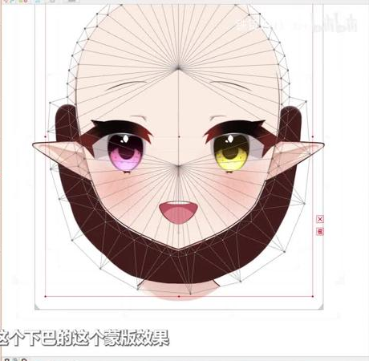
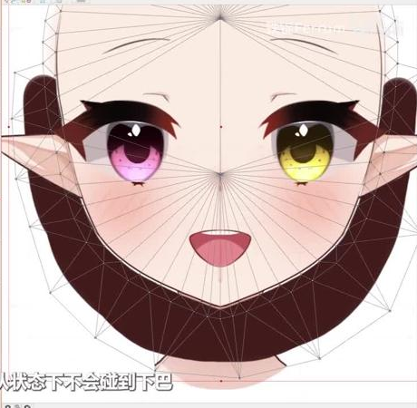
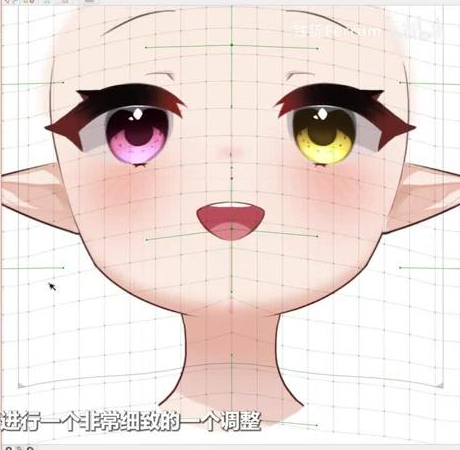
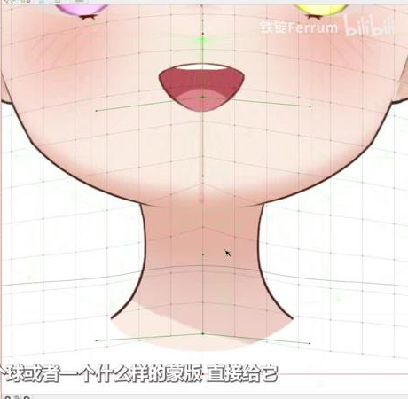
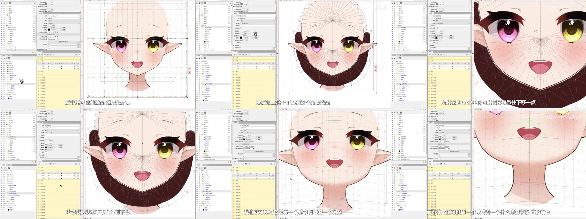

# 下巴消线与脖子阴影

来源：用户 2026-11-03 提供的 Live2D 视频教程《下巴处理方法》（5:28，讲解者自述为“我个人最新的下巴处理方法”），见 [sources/jaw-neck-shadow.mp4](sources/jaw-neck-shadow.mp4)。目标是在转头、俯仰时消掉压进脖子的那段下巴线，让脸和脖子之间没有交界线，并让脖子上的阴影跟着头动。哪段线消掉、阴影怎么动都可以单独控制。live2d-maker `nine-axis` step07（[提示词](../../../../.agents/skills/live2d-maker/knowledge/head-nine-axis/step07_jaw-line/prompts/下颌线与脖子.md)）按本页做下颌线与脖子；阴影部分留给后续步骤。

## 拆分（绘图软件里）

脸：

1. **脸线与脸底色分开**。
2. **脖子阴影**：新建一层，从脖子上取阴影，把它画满，样式接近脖子 [01:05]。
3. **脸色扩展**：一层比原脸大一圈、边缘羽化的脸底色 [01:24]。
4. **脸部蒙版**：贴着整个脸形做的蒙版。脖子细、要消的少时可以做小一点 [01:41、02:14]。

脖子：**线与底色分开，顶部画高一些**（“这个应该是常识了”）[01:55]。线和底色谁在上都可以 [02:46]。

## 组装（Live2D 里）

- **脖子阴影**用 **脸部蒙版 + 脖子底色** 一起作剪贴蒙版 [02:56]。
- **脸色扩展**只用 **脸部蒙版** 剪贴，不用脖子。这样默认值下羽化不会溢到脖子上，抬头时它补在脸部蒙版范围里 [03:17–03:43]。
- 以上部件都放进**脸 XY 变形器**。做完脸 XY 后，也可以在外面单独调整它们的变形 [03:43–04:10]。
- **下巴线蒙版**：原本贴着脸线做，进 Live2D 后稍微往下移，默认状态下不碰下巴线但离得很近。之后按角度细调，只把需要的那段线反向剪掉 [04:10–04:36]。
- 比起用一个球形蒙版硬怼上去削线，这种做法自然得多 [04:36]。消哪段可以控制：原画一侧头发多、几乎看不到线、耳朵又会转过来时，可以把那一侧的线全部削掉；也可以只削脖子附近的那段 [04:44–05:03]。

检查器（[inspector-tree.jpg](sources/jaw-neck-shadow-frames/inspector-tree.jpg)）可以看到层级如下：

- HeadZ 下是 FaceXY。
- FaceXY 下有子变形器 FaceBaseColorXY 和 FaceLineM。
- 阴影层（图层13）和脸颜色在 FaceBaseColorXY 里。阴影层的剪贴 ID 是两个部件，即脸部蒙版加脖子底色。
- 蒙版（ArtMesh39，不透明度 0）直接在 FaceXY 下。
- 脸线条蒙版在自己的变形器 FaceLineM 里，可以单独移动。

## 关键帧

| 帧 | 要点 |
| --- | --- |
|  | 默认值：下巴线蒙版（深色）贴在线下方一点，不挡线 |
|  | 蒙版范围示意 |
|  | 脸和加高的脖子 |
|  | 转向后只消掉脖子附近那段下巴线，脸和脖子之间没有交界线 |
|  | 下巴蒙版从默认到按角度细调的过程（六帧拼图） |

## 与本项目的关系

- 阴影的剪贴方式可以和 [09 蒙版投影](../09-clipped-cast-shadows.md) 对照。
- version 2 支持 agent 自己创建 FaceXY 等组级 Warp。脸线与脸色可放入同一父级，线蒙版仍可通过子 Warp 或自己的局部网格独立调整。固定脖子不放进 FaceXY。左右制作从一开始就检查这处连接，不等四角做完才看接缝。

## 资料

| 文件 | 内容 |
| --- | --- |
| [sources/jaw-neck-shadow.mp4](sources/jaw-neck-shadow.mp4) | 教程视频（5:28，1280×720，22 MB），SHA-256 `fbfa87eef99dc8d84830e387e623ad996847e9c21646b80423a74de31e2ec37c` |
| [sources/jaw-neck-shadow-transcript.txt](sources/jaw-neck-shadow-transcript.txt) | faster-whisper medium 机器听写，带时间戳；「Side」应为 PS/SAI，「涂层」应为「图层」，「levelD」应为「Live2D」 |
| [sources/jaw-neck-shadow-frames/](sources/jaw-neck-shadow-frames/) | 上表关键帧与检查器拼图 |
