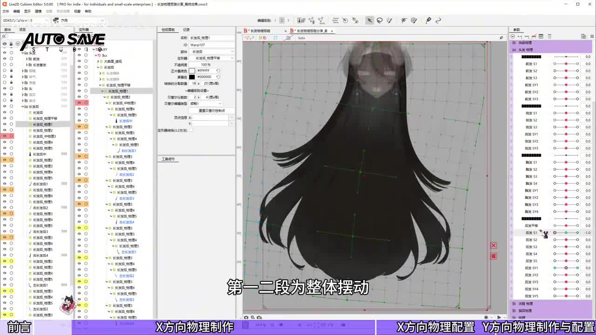
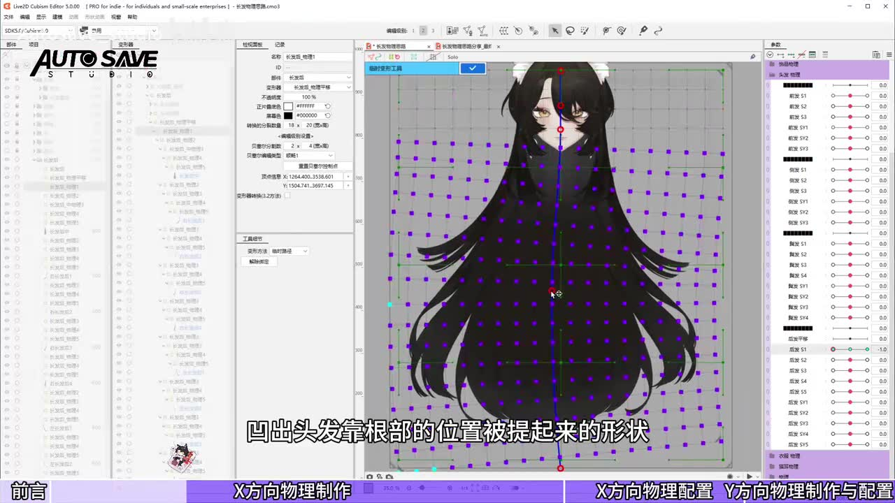
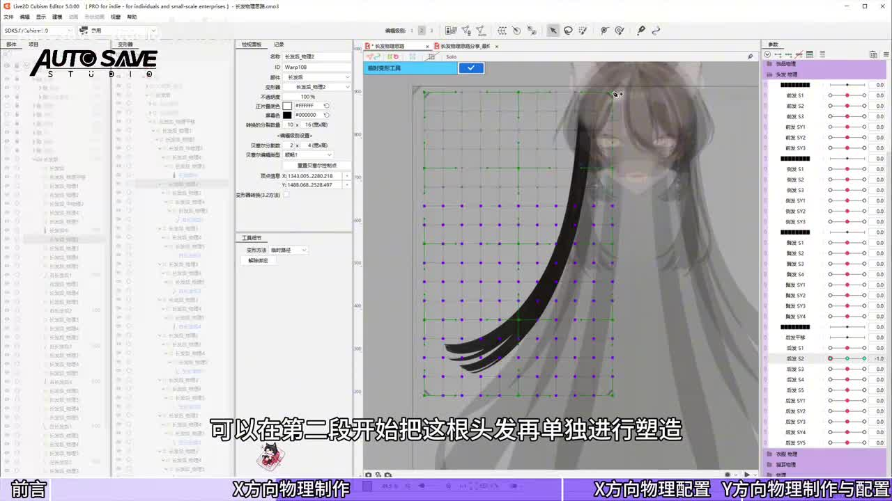
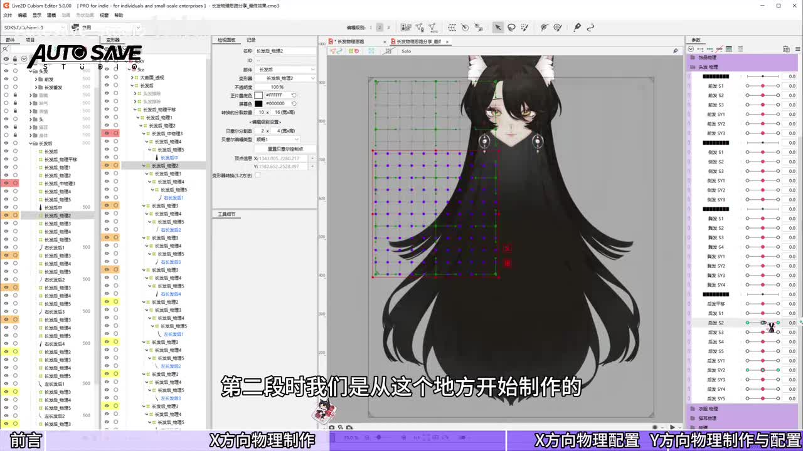
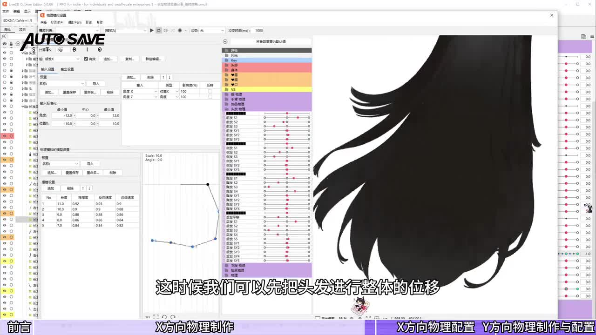
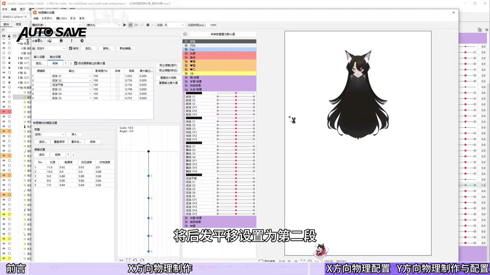
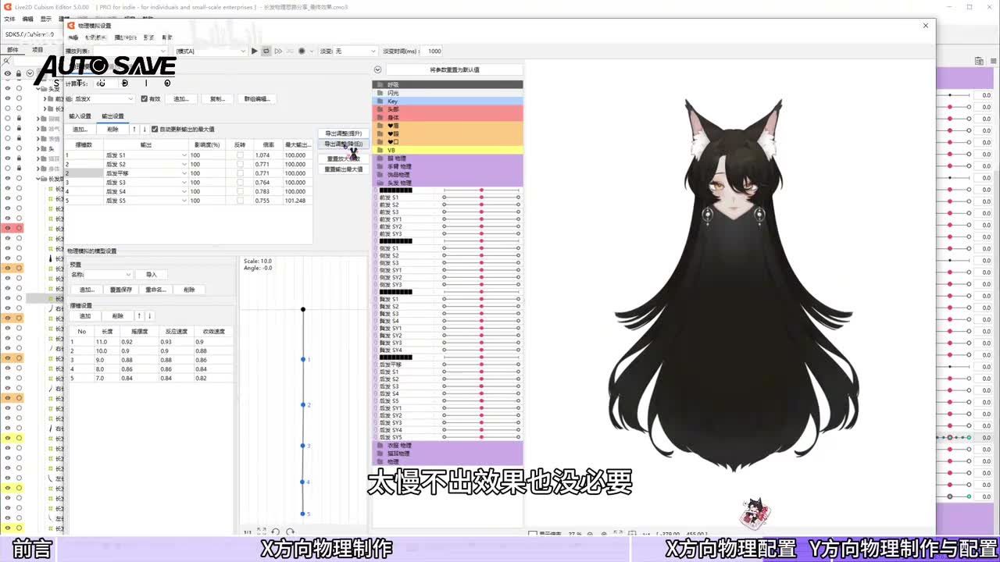
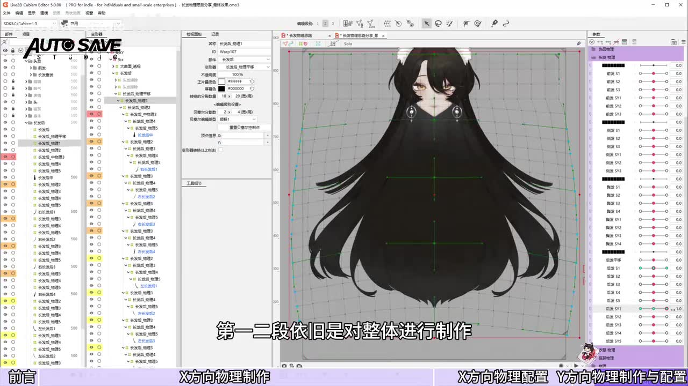

# 头发九轴物理

来源：AUTO SAVE Studio 往期毕业生刘烈猫猫茶制作的长发物理教程（5:22），用户 2026-10-29 提供，见 [sources/hair-nine-axis-swing.mp4](sources/hair-nine-axis-swing.mp4)。内容是转头时长发的 X、Y 方向摆动形状与物理设置。头发本身的透视形变（转头时发型怎么转）不在本片范围内。

## X 方向：分段形状

1. **先构思分几段**：长发、发尾外散，想甩起来又柔软，4–5 段就够了。示例头发长，分 5 段 [00:00–00:30]。
2. **定好每段的范围**：
   - 第 1、2 段做整体摆动，第 3、4、5 段单独塑造每根头发。
   - **发根不能动**，各段范围不重叠 [00:30]。
3. **按风的思路做形状**：头转动时头发受风，翘起的一侧往下压、另一侧翘起，接着发尾甩出去 [00:50]。
4. **第 1 段**：
   - 选发根以下的部分，用临时路径工具平移，做出靠根部被提起来的形状。
   - 再用笔刷修被拉伸的地方，**头发整体的形状和面积不能明显拉伸**。
   - 最后水平翻转得到另一侧 [01:02]。
5. **第 2 段**：
   - 往下顺延到第 2 块区域，同样整体位移、提起，并把发尾甩出去。
   - 最外侧向外翘的那根可以从这一段开始单独塑造，甩得更远，做出错落感。
   - 甩起时头发稍弯、反方向略拉直；**长度和面积不变**，用完路径工具再用笔刷修 [01:32]。
6. **第 3–5 段**：
   - 逐根往下顺延，继续把发尾甩出去，适当加弧形。
   - 打开洋葱皮看路径应是一条弧，摆动才圆滑 [02:05]。
   - 短的头发可以省掉第 5 段 [02:37]。
7. **错开幅度与高度**：各根甩起的幅度和高度错开，否则头发糊在一起甩不开；拆分再细、造型再好也出不来效果 [02:37]。
   - 发丝拆得少时，从第 3 段开始单独做拆出来的发丝。
   - 大片发型甩不起来时，先整体位移，作为第 2 段 [03:07]。

## X 方向：物理设置

- 输入为角度 X 和角度 Z，输出为刚做好的各段 X 参数。后发平移设为第 2 段 [03:07]。
- 摆锤：
  - 长度按喜好，每段往下递减 1。
  - 摇摆度、反应速度、收敛速度个人常用 0.8–0.93。
  - 反应速度偏快，每段相差 0.02–0.03，这样摆锤会像波浪一样从上往下甩。其他物理也可以这样设 [03:37]。
- 收敛速度不建议低于 0.8，太慢没效果 [03:37–04:07]。
- **最大输出最好不超过 100%**，否则会卡顿、畸形。可以手动调倍率，或在右侧测试后用导出调整自动拉到 100%。导出到 VTS 后物理会减弱，稍高一点没关系，120% 以内即可 [04:07]。

## Y 方向

- 形状思路相同：头发受风向上吹起、向下收缩拉伸。
  - 向上：整体做，靠近发根处鼓起、向两侧拉伸、向上位移。
  - 向下：用混合形状（Ctrl+Shift+B）混 80% 左右得到 [04:07–04:37]。
- 其余发丝和 X 方向一样，可以单独做，也可以复制 X 方向的形状再改 [04:37]。
- 物理输入改为角度 Y，摆锤设置同 X；最后一段可以反转，看效果调整 [04:37–05:07]。

## 关键帧

| 帧 | 要点 |
| --- | --- |
|  | 第 1、2 段为整体摆动 [00:40] |
|  | 第 1 段：凹出靠根部被提起来的形状（发根以下的网格平移） [01:08] |
|  | 第 2 段起单独塑造最外侧的发丝 [01:40] |
|  | 第 3 段从第 2 段的起点再往下顺延 [02:12] |
|  | 大片发型先整体位移 [03:16] |
|  | 物理设置：后发平移设为第 2 段 [03:32] |
|  | 收敛速度不要太慢 [04:04] |
|  | Y 方向第 1、2 段也是整体做 [04:36] |

## 与本项目的关系

本片讲的是**物理摆动参数**的形状（受风、甩尾、分段摆锤），对应 README 范围第 5 项。头发跟随转头的透视形变（第 4 项）仍没有教程。分段形状的原则（发根固定、面积与长度不变、段间不重叠、错落）可以和 [10 部件物理](../10-component-physics-authoring.md)、[11 二次物理](../11-secondary-physics-workflow.md) 对照。

## 资料

| 文件 | 内容 |
| --- | --- |
| [sources/hair-nine-axis-swing.mp4](sources/hair-nine-axis-swing.mp4) | 教程视频（5:22），SHA-256 `89090e66288f19c4460a5f584444b9fd66548b1150700f7675c5f3c4b2909374` |
| [sources/hair-nine-axis-swing-transcript.txt](sources/hair-nine-axis-swing-transcript.txt) | faster-whisper medium 机器听写，带时间戳；开头有重复幻听；「范丽」应为「刘海」，「歪轴」应为「Y 轴」，「椭圆叉子」大意为弧度，以画面字幕为准 |
| [sources/hair-nine-axis-swing-frames/](sources/hair-nine-axis-swing-frames/) | 上表 8 张关键帧（每 4 秒一帧中挑选，文件名序号 n 对应 (n−1)×4 秒） |
