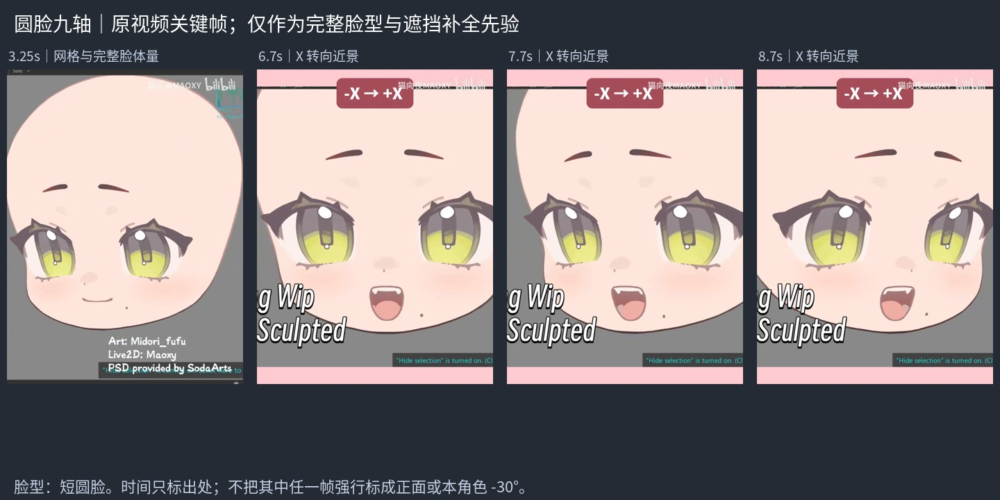
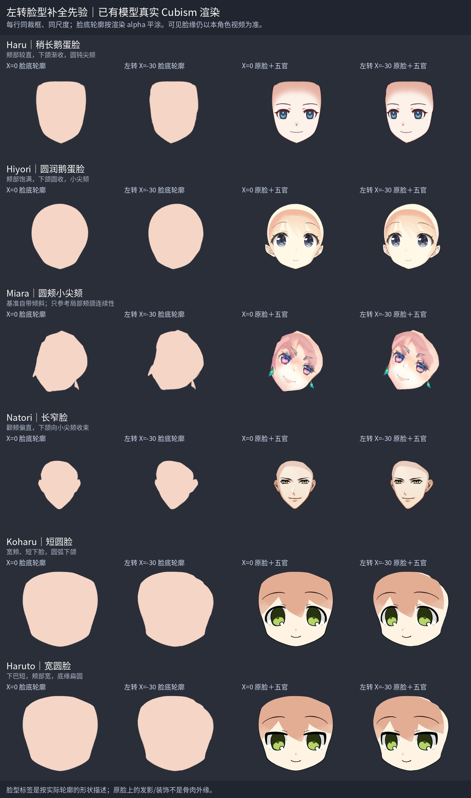

# left 完整脸型补全先验

当前角色 left 视频帧决定所有看得见的脸缘、五官和笔锋。本页只帮助预测被头发挡住的脸底；先辨认真实脸外缘与皮肤/头发遮挡边界，再把遮挡区域补成完整连续的脸。近侧眼旁的发束凹口不能捏进脸肉。源轮廓取原 KRA 脸底，目标完整轮廓用可见证据和原画体量约束，不能照搬其它角色。

先看原画整体脸型，再从下表选择接近的形状，解释选择理由。可组合局部结构知识，不能平均圆脸与长脸的轮廓；先验与当前视频可见部分冲突时，保留当前视频。头部中心、下巴和固定脖子的接触仍按当前角色参考核对，不能从示例复制脖子的运动。

## 圆脸视频：短圆脸

用户提供的《圆脸九轴》原视频见 [圆脸九轴.mp4](sources/round-face-x/圆脸九轴.mp4)。0–6 秒可看完整脸体量，6.5–9.5 秒可看 X 转向近景。这里时间只标出处，不把截图硬当成正面或本角色 -30°；表情也不作为本角色目标。作者字幕保留：Art Midori_fufu、Live2D Maoxy、PSD provided by SodaArts。

看宽颊、短下脸与下颌圆弧怎样保持连续，同时鼻嘴有透视位移。视频中的表情/嘴开不抄给本角色；先看完整脸底，而不是只看头发之间露出的皮肤。

## 教程：脸部 left 关键帧

与 [01-脸部与五官九轴](01-脸部与五官九轴.md) 和 [原教程视频](sources/face-nine-axis.mp4) 对应。此例按图归为圆润鹅蛋脸：颊部较饱满、下颌渐收、小尖颏；它说明补全结构，不规定本角色比例。

近侧脸体积要连到太阳穴/眼窝/颊部，被发束挡住的部分不能按发丝形状凹进去。远侧眼窝到颧颊的转折可以帮助理解深度；具体切线、笔锋和位移以当前角色视频中看得见的脸缘为准，不强塞通用“三峰三谷”。

## 已有模型：6 张不同脸型参考

真实渲染仓库已有官方样例的 moc3，用原模型关键形 X=0 与 X=-30；旧模型对应 PARAM_ANGLE_X，其余是 ParamAngleX。Y/Z、body、视线和嘴开归零，关闭默认 motion/physics/pose/expression、自动眨眼/呼吸。每个模型两姿态采用同一 alpha 联合裁框和比例，没有为左转重新居中或图像液化。X=0 指原模型基准，不保证原绘画本身没有倾斜。

前两栏按实际脸底渲染 alpha 平涂以看完整外轮廓，后两栏是原始脸＋五官渲染。原脸上的发影、同组耳轮/耳饰仍可能存在，它们不能被当成脸外缘。Miara 基准绘画带倾斜、脸组含耳饰，只看局部颊颌连续性；Natori 脸组含耳轮，判断颊线时跳过突出的耳轮。都不用于本角色脖子运动参考。

| 模型 | 脸类型（按实际轮廓描述） | 适用观察 |
| --- | --- | --- |
| [Haru](sources/model-face-priors/haru/reference.jpg) | 稍长鹅蛋脸 | 颊部较直，下颌渐收，圆钝尖颏 |
| [Hiyori](sources/model-face-priors/hiyori/reference.jpg) | 圆润鹅蛋脸 | 颊部饱满，下颌圆收，小尖颏 |
| [Miara](sources/model-face-priors/miara/reference.jpg) | 圆颊小尖颏 | 基准倾斜、含耳饰，只看局部颊颌连续性 |
| [Natori](sources/model-face-priors/natori/reference.jpg) | 长窄脸 | 颧颊偏直，下颌收束；耳轮不是颊线 |
| [Koharu](sources/model-face-priors/koharu/reference.jpg) | 短圆脸 | 宽颊、短下脸、圆弧下颌 |
| [Haruto](sources/model-face-priors/haruto/reference.jpg) | 宽圆脸 | 下巴短、颊部宽、底缘扁圆 |

单模型目录另有 face_front/face_left 与 features_front/features_left 四张原 RGBA 渲染。模型来源是本仓库已有 model-originals/archives/qq-mail-20261009 官方包；[sources.json](sources/model-face-priors/sources.json) 记录模型/贴图哈希、参数、部件选择与截图指纹。[render_faces.py](sources/model-face-priors/render_faces.py) 负责原生渲染，[build_reference_board.py](sources/model-face-priors/build_reference_board.py) 只给真实 alpha 着色、排版和标记，不修改轮廓。原模型仅作参考，本轮角色不导入其网格或贴图。

## 管线必须显示完整预测与实际结果

`face-trace.json.completion.source/target` 是整张闭合脸型；visible/occluded 分段取自这两条完整路径。先 inspect 并实际查看无遮挡素脸双图，保存 face-completion-check.png，确认近侧体量、轮廓连续性与可见目标再自动拟合。不能沿发缘闭合一块皮肤窗口就当完整脸。

拟合后另用 view_nine_axis 单独渲染真实脸底，保存 face-base-left-check.png，检查实际网格是否保持预测的脸型；再显示五官和固定脖子做同坐标叠加。本轮输出为候选，用户明确说通过前不得称流程稳定。
