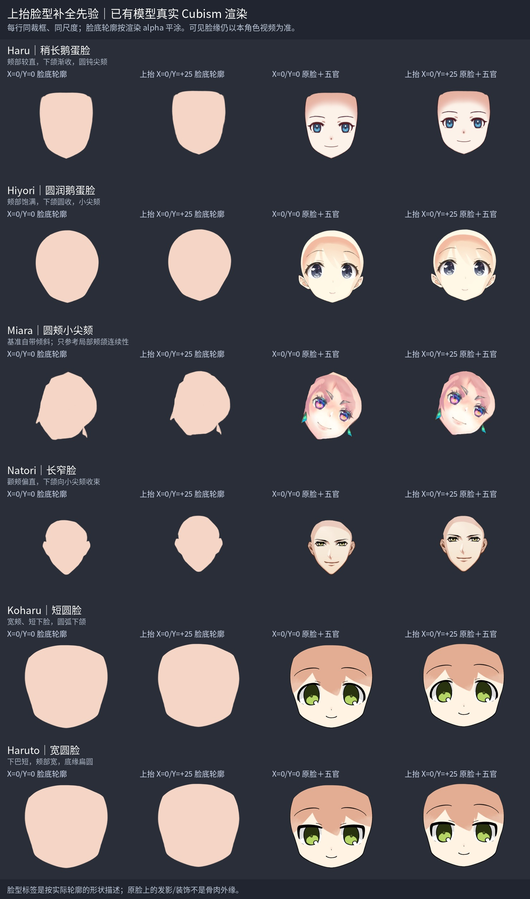
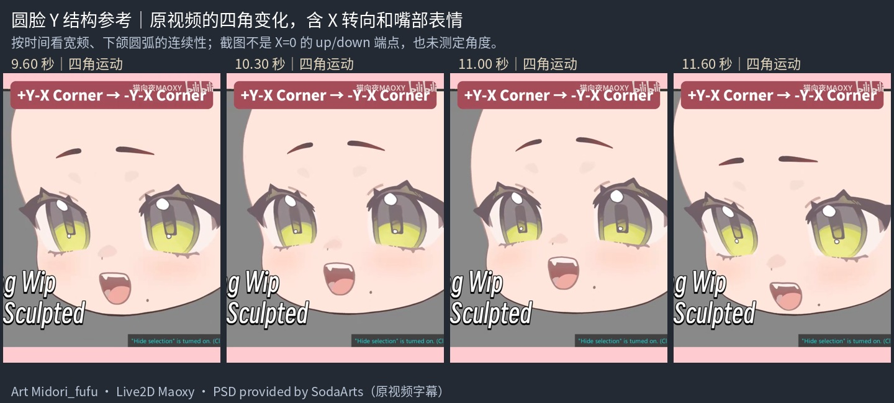
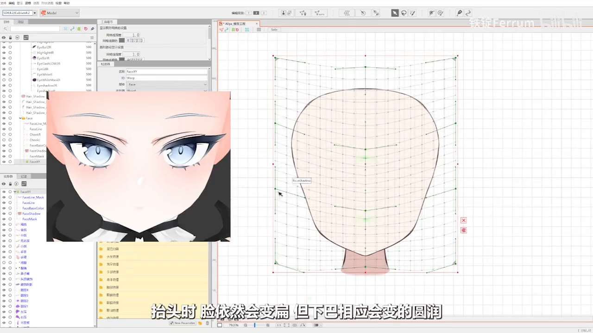
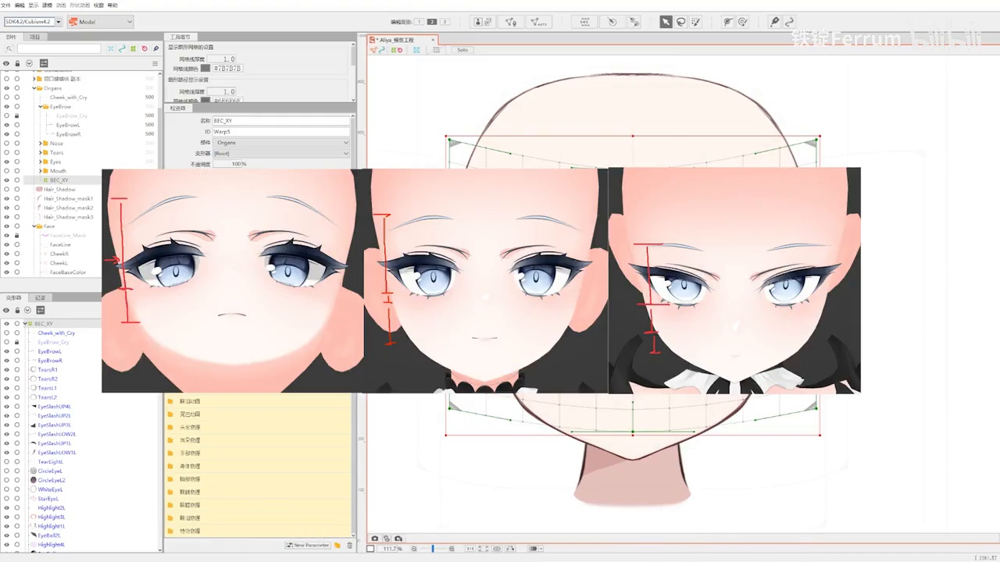
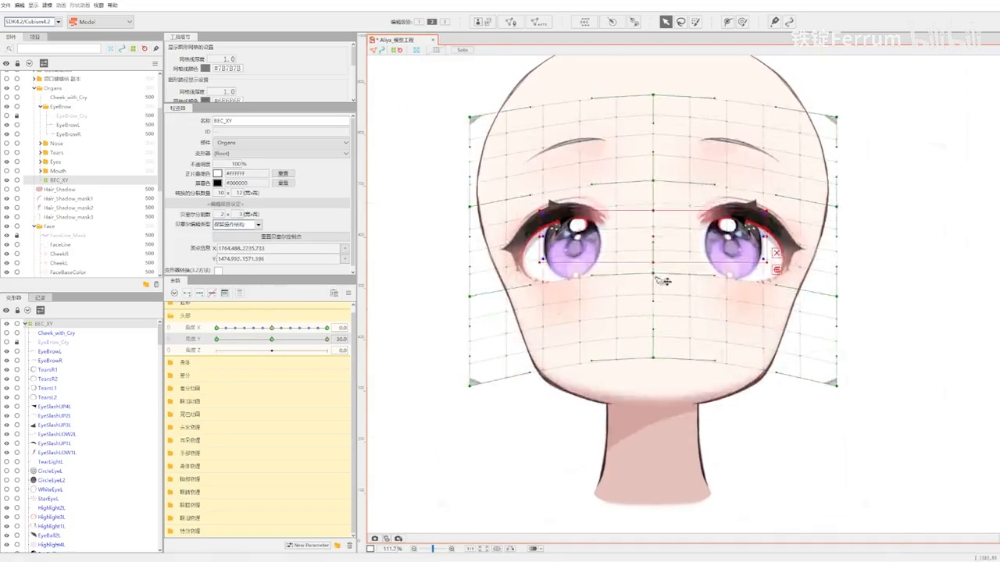

# up 完整脸型补全先验

用于 `step04_angle-up`：从已完成 X 的工程单独制作上抬 +25，保留 X 结果。**本角色 up 视频帧决定可见脸缘、五官、笔锋与位置；本页只帮助补全视频遮挡的额头、太阳穴、脸颊和下颌。** 原模型参数和教程示例都不决定本角色的实际角度，不把别人的脸变成目标脸。

先辨认皮肤的真实外缘、头发遮挡边界和阴影边界，再描可见部分。发束围出的皮肤窗口不是完整脸型；被发梢挡住的凹口不能直接捏进脸肉。原 KRA 的完整脸底和原画脸型提供源体量，up 视频提供可见目标，先验帮助连接两者之间不可见的结构。与视频可见证据冲突时，以本角色视频为准。

## 上抬时怎样使用隐藏结构先验

| 区域 | 补全时观察什么 | 怎样限制补全 |
| --- | --- | --- |
| 额头与额顶 | 遮挡后仍有连续的额部体量，额顶接到两侧太阳穴 | 不沿刘海下缘闭合；不把整个额头填成任意大圆；投影高度由原脸体量与本角色视频限制 |
| 太阳穴与上颊 | 侧缘从额头、眼外侧连到饱满脸颊 | 保留本角色轮廓切线；发束凹口、发影和耳饰不是颊线 |
| 脸颊与下颌 | 下颌弧线如何接到两侧脸颊，底缘怎样保持角色原有的小尖颏或圆颏 | 教程示例的“抬头下巴变圆”只是一种画法；看得见的下巴与颊线必须描视频，不能一律压扁或磨圆 |
| 下巴与固定脖子 | 上抬投影下的覆盖关系、下颌与脖子顶部接触 | 脖子从开始就参与同坐标预览，保持固定、不挂头部 Warp；不拉长、不倾斜，顶部补足与消线留 `step07_jaw-line` |

完整预测应同时包含可见段和隐藏段：可见段贴着自己的视频描，隐藏段保持原画脸型与连续体量。先看无遮挡的完整预测脸，再看自动形变后真正渲染的脸底；两者都要显示整张脸。加回五官和固定脖子，检查接触与体量，避免只有露出皮肤的一小块对齐。

## 六模型：上抬与正面，明确脸型

每行从左到右：X=0/Y=0 的完整脸底、X=0/Y=+25 的完整脸底、基准脸＋五官、上抬脸＋五官。前两栏只给真实渲染 alpha 平涂，后两栏保留原纹理。六模型均由原 moc3 的关键形与蒙版原生渲染，未液化图片；关闭 motion/physics/pose/expression、自动眨眼与呼吸，视线、嘴开、身体与其他整体变换固定。每次渲染新建模型，检查实际参数值，原模型文件只读。

每个模型的 Y=0/+25/−25、脸底与五官六张渲染共用一个 alpha 联合裁框；up 和 down 板因此也用同一裁框与尺度，不重新居中某个姿态。这里 ±25 是原模型参数值，**不是物理角度测量，也不是本角色拟合标准**。基准关键形不保证原画本身没有倾斜。

| 模型与放大图 | 脸型 | 上抬补全适用观察 |
| --- | --- | --- |
| [Haru](sources/model-face-priors-up/haru/reference.jpg) | 稍长鹅蛋脸 | 颊部较直，下颌渐收；看额顶到太阳穴、下颌到圆钝尖颏的连续性 |
| [Hiyori](sources/model-face-priors-up/hiyori/reference.jpg) | 圆润鹅蛋脸 | 饱满颊、小尖颏；看上抬后侧颊体量与底缘圆收如何共存 |
| [Miara](sources/model-face-priors-up/miara/reference.jpg) | 圆颊小尖颏 | 基准自带倾斜、脸组有装饰，只参考局部颊颌连续性，不抄倾斜与装饰外缘 |
| [Natori](sources/model-face-priors-up/natori/reference.jpg) | 长窄脸 | 颧颊偏直，渐收至小尖颏；脸组含耳轮，耳轮突出不等于脸颊变宽 |
| [Koharu](sources/model-face-priors-up/koharu/reference.jpg) | 短圆脸 | 宽颊、短下脸、圆弧下颌；看短下脸怎样保持连续底缘 |
| [Haruto](sources/model-face-priors-up/haruto/reference.jpg) | 宽圆脸 | 颊宽、下巴短、底缘扁圆；不把扁圆底缘强行改成小尖颏 |

按本角色原画轮廓选择接近的脸型，并说明用于哪个隐藏区域。不同脸型不能平均成一种脸；同属圆脸也不代表五官与头骨比例相同。原脸上的发影、纹理装饰、Miara 耳饰和 Natori 耳轮不能当骨肉外缘。模型图未提供本角色脖子运动依据。

每个单模型目录保留 `face_front.png`、`face_up.png`、`features_front.png`、`features_up.png` 原 RGBA 渲染；[来源与参数记录](sources/model-face-priors-up/sources.json) 包含原模型/纹理 SHA、六姿态参数检查、联合裁框与图像指纹。来源为仓库已有官方样例包；脚本复用 [render_faces.py](sources/model-face-priors/render_faces.py) 的 `--axis y` 和 [build_reference_board.py](sources/model-face-priors/build_reference_board.py) 的 `--direction up`，默认 X 行为保留。

## 圆脸视频：Y 变化中的体量，含 X 与表情

原片复用 [圆脸九轴.mp4](sources/round-face-x/圆脸九轴.mp4)。09.5–11.7 秒的字幕为 `+Y-X Corner → -Y-X Corner`，画面包含 X 转向和嘴部表情变化；本板 09.60/10.30/11.00/11.60 秒只标时间，不伪装成纯 Y 端点，也不测定角度。观察短圆脸完整额部、宽颊到下颌圆弧怎样连续变化；不抄嘴开、眉眼表情、视线或倾斜，也不把四角位移搬到纯 up。

原视频 Art Midori_fufu、Live2D Maoxy、PSD provided by SodaArts 字幕和画面署名保留。[片段来源记录](sources/round-face-y/sources.json) 记录原视频 SHA、原始帧时间和图像 SHA。完整脸体量还可回看原片 0–6 秒，那里也不把任一截图指定为本角色的上抬角度。

## 正式教程：上抬脸底与上下并列示例

来自 [脸部与五官九轴教程](01-脸部与五官九轴.md) 和 [原视频](sources/face-nine-axis.mp4)。按轮廓归为圆润鹅蛋脸，画面是制作过程和插入的示例图，不是本角色目标。

04:16 字幕讨论抬头时脸底投影与下巴圆润变化。只观察完整额顶、侧颊到下颌的连贯体量；网格拓扑、位移量和“变扁/变圆”不硬套。本角色可见下颌是什么形状，就描什么形状。

07:27 插图从左到右为上抬、正面、低头，展示上下投影下脸和五官的位置关系。眉眼距离、鼻嘴位置、嘴的高度都以本角色视频为准，教程“抬头眉眼远、嘴高”等不作为强制变形规则，也不据此改闭嘴表情。

用 07:42 的制作画面帮助看眉眼在完整脸体量上的位置，再回本角色视频核对。本页图片保留完整原画面和时间出处；[教程帧来源记录](sources/face-nine-axis-y-frames/sources.json) 包含 SHA。教程中的脖子即使发生形变，也不复制给本角色：本阶段固定脖子参与参考，最终补足在 step07。
