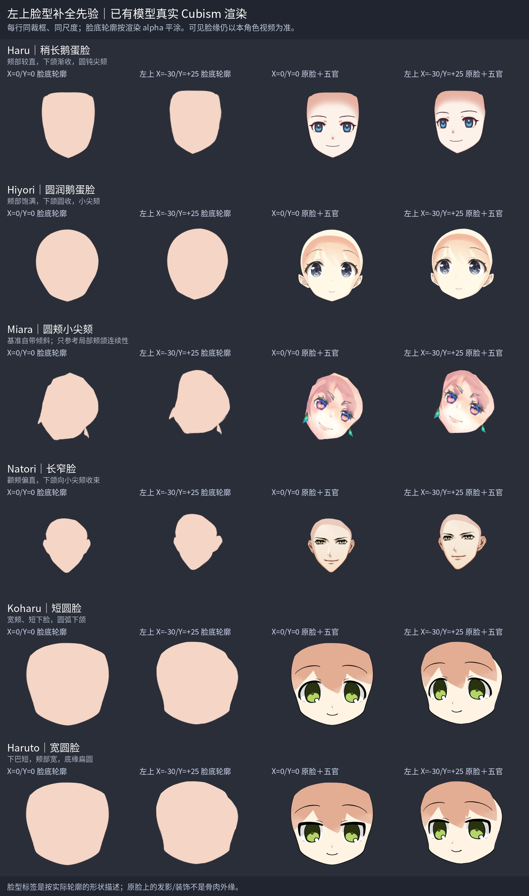
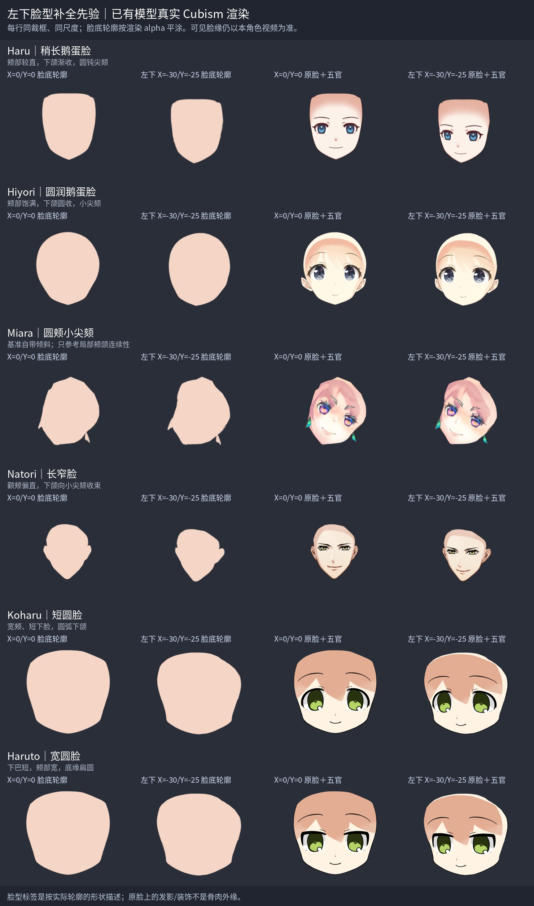
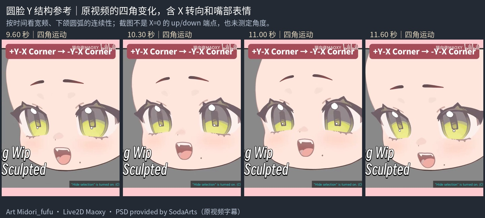

# 左上／左下脸型补全先验

用于 `step06_angle-xy`：先由选帧步骤确定左上、左下目标，准确描可见脸缘，再延续被头发挡住的形体，根据目标制作网格并核对五官与完整预览。当前制作提示见 [斜向先验](../../../../.agents/skills/live2d-maker/knowledge/head-nine-axis/step06_angle-xy/prompts/斜向先验.md)。

**本角色选中视频帧决定可见脸缘、五官、笔锋与位置，教程和模型仅帮助补隐藏结构。** 已认可的 left/up/down 是本角色的脸型、体量及过渡约束；不能用轴形相加替代斜向目标，也不能把左上倒过来当左下。两角单独描边、补全、拟合。脖子固定参与参考，延长和下颌消线留 step07。

## 六模型：两种斜向与正面

每行从左到右是基准完整脸底、斜向完整脸底、基准脸＋五官、斜向脸＋五官。基准 X=0/Y=0；左上 X=-30/Y=+25，左下 X=-30/Y=-25。每个模型的正面、两角、脸底及五官六张 alpha 联合裁框，同模型两板共用尺度；不重新居中某一姿态。前两栏只给真实 alpha 平涂，后两栏保留原纹理，没有图像液化。

| 模型（两套放大图） | 脸型 | 隐藏结构参考与局限 |
| --- | --- | --- |
| Haru：[左上](sources/model-face-priors-left-up/haru/reference.jpg)／[左下](sources/model-face-priors-left-down/haru/reference.jpg) | 稍长鹅蛋脸 | 较直颊部、渐收下颌、圆钝尖颏 |
| Hiyori：[左上](sources/model-face-priors-left-up/hiyori/reference.jpg)／[左下](sources/model-face-priors-left-down/hiyori/reference.jpg) | 圆润鹅蛋脸 | 饱满侧颊、小尖颏；发影不是额部外缘 |
| Miara：[左上](sources/model-face-priors-left-up/miara/reference.jpg)／[左下](sources/model-face-priors-left-down/miara/reference.jpg) | 圆颊小尖颏 | 原画自带倾斜和耳饰，仅看局部颊颌连续性 |
| Natori：[左上](sources/model-face-priors-left-up/natori/reference.jpg)／[左下](sources/model-face-priors-left-down/natori/reference.jpg) | 长窄脸 | 颧颊偏直、下颌渐收；耳轮不当颊线 |
| Koharu：[左上](sources/model-face-priors-left-up/koharu/reference.jpg)／[左下](sources/model-face-priors-left-down/koharu/reference.jpg) | 短圆脸 | 宽颊、短下脸、圆弧下颌 |
| Haruto：[左上](sources/model-face-priors-left-up/haruto/reference.jpg)／[左下](sources/model-face-priors-left-down/haruto/reference.jpg) | 宽圆脸 | 宽颊、短下巴、扁圆底缘 |

脸型标签按实际轮廓描述。按原画选择接近的参考并说明只用于哪个隐藏区域，不平均不同脸型，不抄其它模型的比例、五官或笔锋。基准关键形可能带绘画倾斜；原纹理、部件与蒙版保留的发影、饰品、耳轮或色带不当成需要复制的脸外缘。

来源是仓库已有官方原模型包，model3.json、moc3 与贴图只读。复用已装 live2d-py 和 OpenGL display，原关键形与蒙版原生渲染；内存设置移除 motion/physics/pose/expression，关闭自动眨眼、呼吸，固定身体、视线、嘴开、Z 与整体变换。每张图新建模型，`Update(0)` 后同时核对 X/Y 实际值及固定控制；原文件渲染前后 SHA 相同。[左上来源记录](sources/model-face-priors-left-up/sources.json) 与 [左下来源记录](sources/model-face-priors-left-down/sources.json) 含源包及文件 SHA、六张图参数检查、裁框和图片 SHA；每模型目录保留原 RGBA。

这些 X/Y 是原模型参数值，**不是实测物理角度，也不是本角色视频的制作标准**。各模型参数变化与可见转角没有统一换算关系，不据此决定通用取帧时间。

## 复用圆脸片段与斜向教程

复用 [已有圆脸片段来源](sources/round-face-y/sources.json) 的 09.60、10.30、11.00、11.60 秒原图，脸型归为短圆脸。字幕 `+Y-X Corner → -Y-X Corner` 标明带 X 的 Y 变化，适合看额部、宽颊、下颌圆弧的连续性。时间只标出处，不测角度，不搬嘴部表情、视线或位移。原署名保留；不新增视频到 knowledge，也不移动任务产物。

[01 脸部与五官九轴](01-脸部与五官九轴.md) 的 08:02–09:37 讨论手动修四角及中轴参考。教程示例按轮廓归为圆润鹅蛋脸，可用来观察无头发遮挡的完整体量；本角色的上下位置、下巴和五官距离仍按自己的目标帧确定。

## 生成与核对

复用 [render_faces.py](sources/model-face-priors/render_faces.py) 的 `--axis xy`，一次渲染正面和两角共六张 RGBA；[build_reference_board.py](sources/model-face-priors/build_reference_board.py) 用 `--direction left-up`／`left-down` 排版、分类。两脚本原 X/Y 行为保留。

实际验证完成六模型 36 张斜向组渲染，两个参数与固定控制均符合请求，原模型源 SHA 与已有参考一致。原 X 路径重渲染 24 张 PNG、Y 路径 36 张 PNG，与既有参考逐字节相同。已查看两套图的轮廓、五官及标签。参考图用于隐藏形态判断，实际角色按目标关键帧自检。
