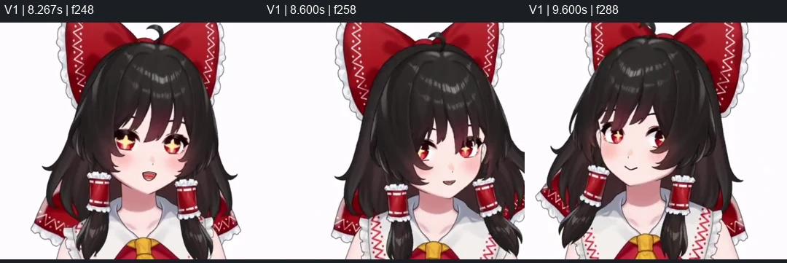
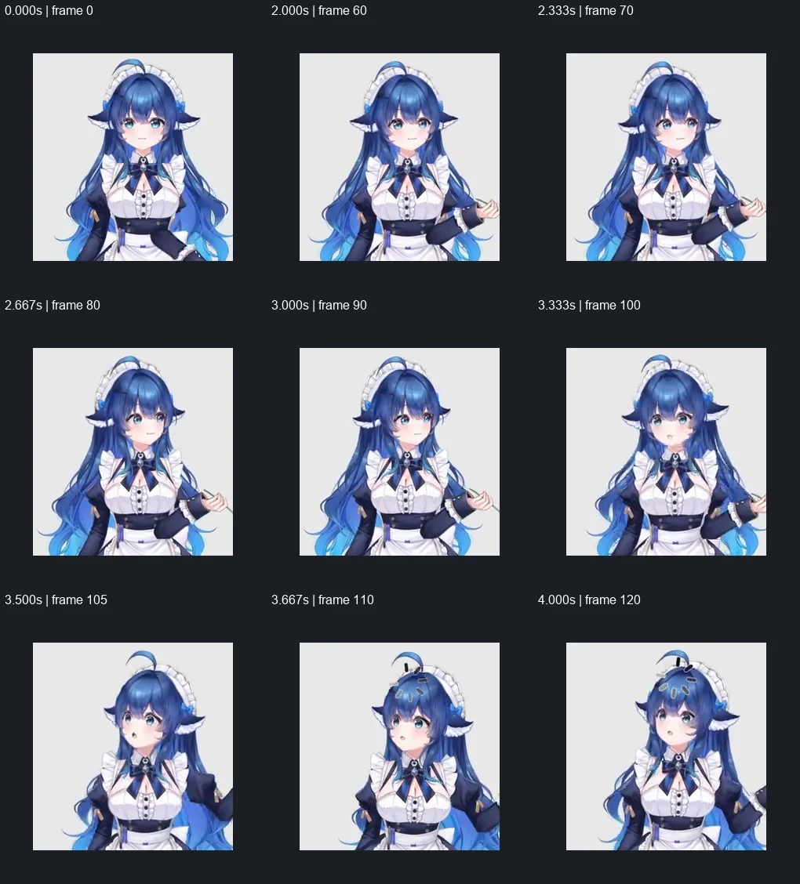
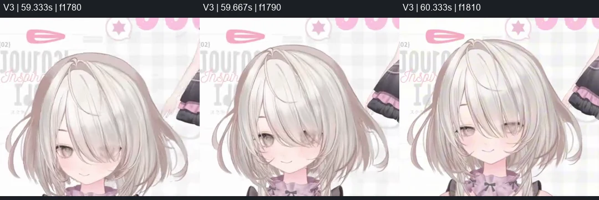
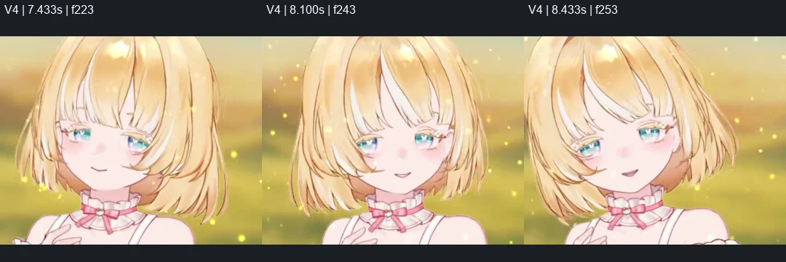

# 成品转头中的脸发协同

本记录整理四段 Live2D 成品演示的逐帧观察，重点讨论大转头时脸、前发、侧发、后发与头饰的关系。原视频、原帧裁切对照及指纹保存在 [sources/product-hair-turns/](sources/product-hair-turns/manifest.json)。这些是成品视觉证据，不是其内部拆件或变形器工程的公开说明。

## 四段视频与观察窗口

| 视频 | 重点时段 | 能直接观察什么 |
| --- | --- | --- |
| [演示一](sources/product-hair-turns/01-product-turn.mp4)，72.77 秒 | 8.267–9.600 秒；连续观察 8.933–9.433 秒 | 面部朝向、贴脸发束覆盖、两侧发面的宽窄一起改变，顶部轮廓与高光仍连贯；下面长束还有摆动 |
| [大肥鱼](sources/product-hair-turns/02-da-fei-yu.mp4)，66.03 秒 | **开头 0–4.5 秒，尤其约 2–4 秒的大转头**；连续观察 3.133–3.800 秒 | 头箍两侧显露范围互换，顶部发面和分缝转向，脸缘与贴脸侧发的遮挡协同变化；肩后长发量感相对稳定 |
| [演示三：去头饰](sources/product-hair-turns/03-uncovered-crown.mp4)，81.13 秒 | 9.833–11.333 秒；58–63 秒去掉头饰后，重点看 59.333–59.833 秒 | 前后发可以有可见界线、不同明暗与层间位移，仍沿共同的顶区发流搭接；不靠所有发片合成一张平面 |
| [演示四：短发](sources/product-hair-turns/04-short-hair.mp4)，79.53 秒 | 同一镜头 7.433–8.433 秒；连续观察 7.933–8.433 秒 | 脸旁亮面、颈侧暗内面和发梢轮廓共同表现厚度；顶区相对稳，发梢有额外摆动 |

大肥鱼片头是本组最重要的大转头参考，不能用其余较小转幅样例代替。3.667 秒附近同时带抬头；后续编辑器片段、缩放、镜头切换不拼成一次连续转头。面板中的 AngleX／AngleY 是控制参数，不能据此测出真实空间角度。

## 可以保留的观察

### 1. 可见外壳的圆润来自整头组合

转头时，脸缘、贴脸发束、额角、太阳穴和顶区发面一起决定头型。判断对象是合成后的轮廓、发流与体积，单片各自贴合参考并不保证组合成立。反过来，发片上端有圆头、前后发有分界、两层有视差，也不能单独作为出错证据。

由此得到的拆件检查方向是：核对哪几片实际承担可见包头发面，哪些承担后脑承接和下面垂落。前发／侧发或已有包头结构可以共同覆盖顶区；后发保留完整承接范围。如果合成读起来像后脑壳上另贴几片互不相干的发束，应回查可见发面的分配、发流与搭接。这里不规定固定件数，也不要求每片都长成独立圆顶。

### 2. 本组样例的后发露出较克制

包括大肥鱼的大转头，头部周围直接读成“后发”的可见范围仍相对少，整体头型却保持圆润。这是本组样例中的观察，不能写成所有发型都必须遵守的面积比例。

应优先通过前侧发与后发的完整范围、前后顺序和搭接建立覆盖关系。把后发缩到很小、把瑕疵挤没，不能替代正确遮挡。局部小块若只是同一大束头发从遮挡缝里露出的窗口，隐藏段仍应完整连回去。

### 3. 后发少变形，仍需要转面

后发较小的形变有助于稳定后脑体积，但不等于固定不动。大转头时，上部包头发面、耳后转折、下面垂落的长发职责不同：上部需要协调朝向与露面，下面较大范围可以维持稳定量感。不能把“少动”推广成整张后发都不转面。

可见细尖、回卷和亮边必须在隐藏区延续成有宽度的完整发束。亮外面与暗内面应在可能露出的发面中自然交错；只有大暗底板与一圈细亮边，运动后容易显得像前片滑过平面底板。轮廓连通不等于发束、纹理和明暗已经连贯。

### 4. 头饰是可见构型的一部分

头巾、头箍或头顶饰物既遮住部分接合，也提供朝向线索。评估时应带上原设计的头饰与其他已完成发片：持续可见处跟随关键帧，转动新露处补足形体与搭接，始终遮挡处保证覆盖余量。

摘掉饰物后局部构型显得奇怪，不必然说明实际佩戴效果失败；戴回后变自然，也不证明所有隐藏结构都正确。仍要检查饰物旁、耳上和侧顶的新露轮廓，避免运动中漏缝、穿插和错误接触。不能把饰物的遮挡边界当成头发本身的终止边界。

### 5. 连接处靠完整搭接，摆动物理另行处理

本轮研究中，长发束与短发交接藏到合理的侧发之后，比露出独立的膨大接头更自然。可推广的目标是完整保留连接段，让它伸入合理遮挡面后，并在整个转头范围内保持余量；保留设计本来可见的分缝与安装结构。

当前转头制作保留部件固有形态，只加入有依据的位置、朝向与透视变化。直段仍应保持直，既有曲线与纹理随同一投影变化，不为了追随脸部额外扭曲、弯折或拉伸。视频中的发尾惯性、风吹和二次摆动需与转头投影分开看，物理制作另见 [03](03-头发九轴物理.md)。

## 对制作顺序的启发

1. 先确认可见小片段属于哪一完整发束。父级 hair 的补全范围要容纳它，子级后发补全再接续上下段的两侧边界。
2. raster 阶段把完整宽发束、隐藏区发流及内外明暗画出来，不能默认留给九轴时逐次修补。
3. 九轴阶段同时检查参考拟合与最终组合，必要时在 Krita 修复实际露出的画稿或搭接问题；不要靠缩小转角或挤小部件遮掩问题。
4. 在正面、左右端点及连续中间帧检查整头体积、后发露出、连接遮挡和本体形状。独显用来定位，实际佩戴组合用来评估可见效果。

## 尚不能下定论的内容

- 没有这四个成品的工程，不能确认其实际 Part 命名、隐藏区画稿范围、ArtMesh、父变形器层级或物理配置。
- 视频没有证明根部必须共点、必须新增某种 cap，也没有给出通用的后发露出比例或最优形变幅度。
- “前侧发包头覆盖不足”可以作为待核对方向，尤其要在带头饰的实际可见区成立后再定位；不能仅凭裸头图确定它是唯一原因。
- 大转幅的目标可以保留，但本组观察不能证明同一拆件与形变参数能稳定适用于所有角色。
