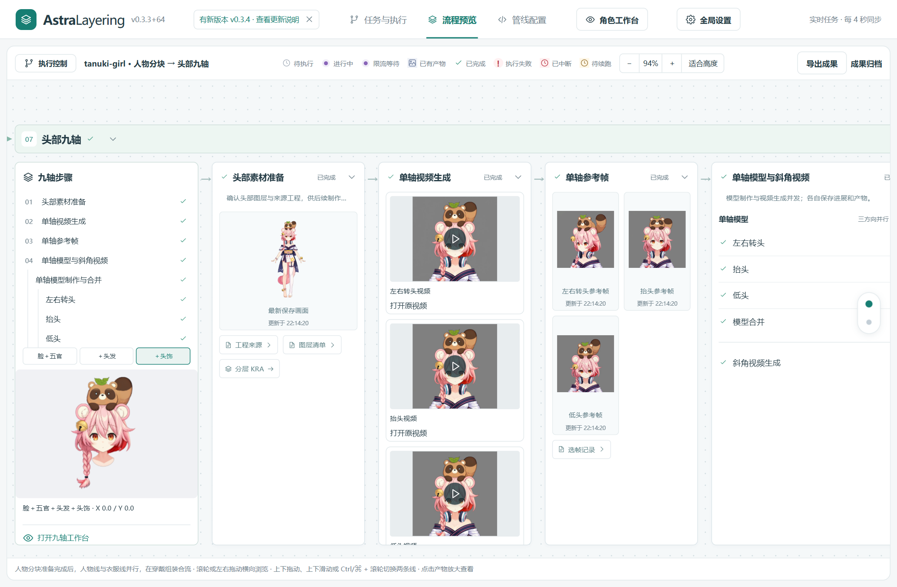
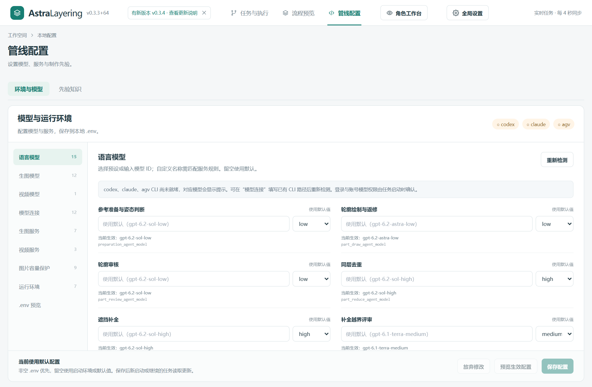
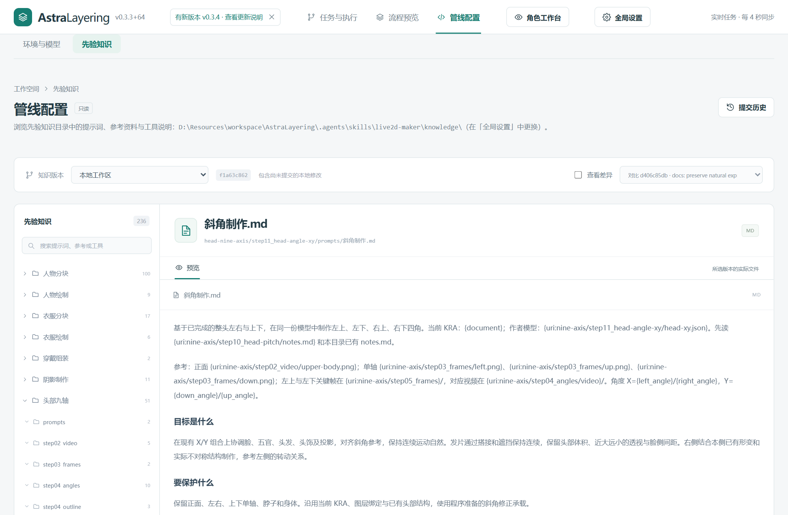

# 制作与角色工作台

制作工作台管理角色任务、展示每一步的成果；角色工作台编辑图层、调整光照、预览九轴和布料摆动。

流程卡片显示视频首帧，点击播放按钮或对应步骤，在右侧产物面板播放、拖动进度或全屏查看。

## 启动

发布包解压后，双击对应系统的 `start-workbench` 文件。源码安装需要 Node.js 24.12+ 和 pnpm 10.33.0：

```sh
pnpm install
pnpm web
# 指定端口
pnpm web --port 4387
```

打开终端显示的地址。默认地址是 `http://127.0.0.1:4387`；使用远程工作台时，打开部署方提供的入口。安装细节见 [安装与前置](../.agents/skills/live2d-maker/references/setup.md)。

## 制作与续跑

1. 打开“全局设置”，选择 Krita、默认运行目录和先验知识目录。运行目录默认是仓库下的 `.run/`；先验知识留空时使用 skill 自带的 `knowledge/`。软件路径支持浏览和自动扫描，远程工作台选择的是服务器上的文件。
2. 新建任务，填写目录名、可选的显示名称并上传角色图，也可填写服务器上的图片路径。相对路径以 `<运行目录>/<任务名>` 为基准，绝对路径直接使用。
3. 选择制作范围、姿态标准化、阴影方式、分辨率档位和并发数，点击“新建并开始”。分辨率初始选中 `1K`，希望贴近原图尺寸时选择“跟随输入图（最大 4K）”。人物与衣服分别制作，再合流组装和绘制阴影，默认流程在阴影结束。

已有任务在空闲时打开“执行参数”，可修改执行范围、并发数等设置。标准化人物姿态、分辨率和阴影方式在此处只读，由新建任务时的选择决定。

选择“跟随输入图（最大 4K）”时，工作台按原图长边[换算并保存档位](../.agents/skills/live2d-maker/workflow/README.md#分辨率与画布)。例如长边 1500 像素为 `1K`，2600 像素为 `2K`。

工作台检查运行管线的机器，通过后开放 `2K` 至 `4K` 和跟随选项。环境不支持或无法确认时，只能用 `1K` 创建任务。[平台支持与自动安装](../.agents/skills/live2d-maker/references/setup.md#超分环境与自动安装)。

需要安装 Upscayl、安装临时 Rust 或构建 Codex 补丁时，任务页和流程页的“运行环境准备”会显示下载和构建进度。

| 操作 | 用途 |
| --- | --- |
| 停止 | 停止当前制作，保留文件 |
| 继续 | 保留产物和会话，从中断处接着做 |
| 恢复 | 保留产物，换新会话继续 |
| 重试 | 删除待重试步骤的产物和会话，重新制作；操作前会确认 |

网页操作处理任务中需要继续或重试的步骤。指定单个步骤使用命令行；重试范围和命令见 [总流程](../.agents/skills/live2d-maker/workflow/README.md#恢复方式)。

**独立 section 启动无状态。** 每次传入 `--dir`、`--knowledge` 和所需软件路径，见 [独立入口](../.agents/skills/live2d-maker/SKILL.md#单独运行一个-section)。

## 头部九轴

在执行参数中开启“阴影完成后制作头部九轴”，或在总入口加 `--live`。续跑沿用任务保存的选择，`--no-live` 关闭。

九轴需要 FFmpeg 和独立的 Seedance 视频服务。在“全局设置”中浏览或扫描 FFmpeg，可选择系统安装或手动解压的可执行文件；agent 用 `extract_video_frame` 工具抽帧，路径由工具内部处理。

在“管线配置 → 环境与模型 → 视频服务”填写地址和密钥，在“视频模型”选择模型：

```ini
video_provider=volcengine
video_base_url=https://ark.cn-beijing.volces.com/api/v3
video_api_key=你的视频服务密钥
nine_axis_view_video_model=doubao-seedance-2-5-260628
```

支持火山官方（默认）、OpenRouter 和 OpenAI 兼容视频服务（含 LiteLLM），模型可选预设或输入。旧兼容配置填写 `video_provider=openai`。仅制作到阴影时无需视频服务。[九轴步骤与依赖](../.agents/skills/live2d-maker/nine-axis/README.md)。

## 任务执行与流程预览

“任务与执行”展示任务、日志和当前状态。点击管线卡片进入“流程预览”，展开步骤或部件，查看图片、KRA 与报告。鼠标滚轮和拖动可浏览流程图，点击“适合高度”恢复取景。

预览会自动同步已保存的文件，保留展开状态和滚动位置。`.completed` 表示“已完成”；实际 agent 调用显示“进行中”或“限流等待”；带有部分产物但当前没有调用的步骤显示“已有产物”。`.running` 在执行器退出后显示“已中断”或“执行失败”，没有标记的步骤显示“待执行”。产物和报告可继续查看，不会替代步骤完成标记。失败原因可展开和复制。

九轴沿用其他阶段的卡片尺寸、标题、状态和折叠样式。总览在开始前就列出当前流程及已有子步骤，点击清单或卡片标题可查看对应步骤；折叠阶段卡片不会隐藏总览清单。单轴方向、模型合并和斜角视频保留紧凑任务行，有产物时展开查看。模型保存后显示随鼠标运动的缩略头，统一通过“打开九轴工作台”进入交互预览。

头发卡片依次显示前发、侧发、后发、其余头发，四轮共用累计成果。两轮之间按卡片提示点击“继续”。后续可查看头饰、完整头部上下、完整头部斜角和头部 Z 轴。点击“打开九轴工作台”可预览最新可用的累计模型。

流程缩略头和角色工作台均可切换“脸＋五官”“＋头发”“＋头饰”。三个组合按各自已完成的模型开放角度。新组合可用时自动选中，普通保存与刷新保留手动选择。点击缩略头下方的“打开九轴工作台”会带入当前组合。

完整九轴的侧转范围在半抬头、半低头时沿曲线收窄。角色工作台与最新画面共用这条边界；鼠标拖入禁区时，控制点沿边界随鼠标方向滑动，九个主要姿态仍可到达。



发布包的 Pink Doll 示例位于 `.run/pink-doll`，打开工作台后可选择。浏览源码自带的案例时，在角色工作台进入“打开项目”，把基准文件夹切到 `demos/`，再从列表选案例。继续制作使用原来的 `.run` 任务。

## 导出成果

所选制作路线完成并停止后，点击“导出成果”下载任务 ZIP。包内包含正式工程、图片、流程预览与报告，解压后可在工作台浏览。

命令行导出见 [导出成果](../.agents/skills/live2d-maker/workflow/README.md#导出成果)。成果统一从制作工作台导出。

## 配置与版本

“管线配置”包含两个页签：

- **环境与模型**：模型均可从预设选择或手动输入，自定义语言与生图名称按服务匹配规则归属，配置服务连接和运行环境。修改后先点“预览生效配置”，再点“保存配置”。密钥框留空保留已有值，清除使用“清除已存值”。
- **先验知识**：浏览提示词、参考资料和工具说明，支持搜索、媒体预览以及 Git 版本对照。

配置按非空 `.env` → 启动环境 → 默认值读取，留空允许回退。字段显示实际来源；三种 CLI 的 API 连接、账号登录／订阅和未确认类型分别标识，凭据只显示是否存在，不显示内容。

模型与服务配置保存在当前安装的 skill `.env`，在下一次启动或续跑时生效。运行中的请求沿用启动时配置。多个窗口同时修改时，按提示重新读取后再保存。





标题栏显示当前软件版本，并提示可用的新发布。升级变化见 [更新记录](../CHANGELOG.md)。

## 角色工作台

制作页顶部“角色工作台”打开当前任务。在角色工作台里，点“打开项目”，从列表选已有项目，或用基准文件夹旁的“选择…”切换到其他项目所在的父目录。工作台根据项目加载组装工程、阴影、贴图和九轴模型。

默认拖动平移画布。在“光照”页签启用“实时光照”并加载法线后，选择“移动光源”即可拖动灯位。方向键微调，Page Up／Page Down 或 Alt＋滚轮调整前后。画布下方可切换“效果”“对照”“原画”“法线”“深度”，可用选项取决于项目贴图。

## 图层与蒙版

图层栏支持搜索、折叠分组、显隐、不透明度、混合模式、组穿透与透明度继承，也可启用或停用已有蒙版。图层编辑使用“全局设置”选中的 Krita 原生合成服务。服务就绪前，图层栏为只读，画布会先显示保存的合成图。

图层修改、撤销和重做保存在本次浏览会话中，关闭后丢弃。调整普通图层后，旧法线与深度预览会暂停；还原图层可恢复对应贴图。

### 九轴预览与编辑

切到“头部九轴”后，可拖动参数区的控制点，或开启“鼠标跟随”并在画布内移动鼠标。支持 Z 轴的模型可使用 Z 滑杆、关键形按钮，或按住 A／D 连续歪头，按住 Shift 加快。编辑网格时先关闭“鼠标跟随”，将 Z 归零，选择变形器并停在对应的 X／Y 关键形上，完成后点“保存九轴变形”。

头部九轴和贴图投影共用画布、镜头和 KRA 图层。进入已加载模型的“头部九轴”后，工具栏的“适应”切换为“聚焦头部”或“聚焦选中部件”。图层会话就绪后，聚焦时可勾选“隐藏关注范围外图层”。退出聚焦或切换工作区会恢复镜头和临时显隐，期间手动设定的图层开关保留。

在头部九轴的参数区开启“鼠标跟随”，在画布内移动鼠标预览转头和俯仰。支持 Z 轴的模型可点按 A／D 微调，按住连续向左／右倾斜，Shift 加快。关闭鼠标跟随可继续编辑网格。

头部九轴和贴图投影共用画布、镜头和 KRA 图层。在头部九轴里，工具栏原有的「适应」切换为「聚焦头部」或「聚焦选中部件」。聚焦时可以临时隐藏关注范围外的图层。退出聚焦或切到其他工作台时，镜头和临时显隐恢复，期间手动操作的图层开关按用户设定保留。

### 部件移动与替换试验

展开“部件试验”，点击“准备部件贴图”，再选择部件调整位置、旋转和前后层次，也可用已有部件替换。试验作用于当前预览，点击复位或退出恢复原始画面。

### 摆动物理预览（实验）

在物理页签逐层启用绑定，设置固定区、摆角、位移和拉伸。选择“扰动”后用鼠标划过布料，也可使用单次扰动、暂停、单帧和复位。布料摆动与光照、投影共用画布。

“打开项目”中提供长飘带、裙摆布片和横向挂布示例。绑定草稿保存在本机，可继续调整。

### 原生合成服务配置

安装带 Python 插件的 Krita，然后在工作台的全局设置中选择该可执行文件。图层合成和九轴预览统一使用这个设置，并复用制作流程的 Krita 启动方式。

```sh
# Linux 上解包的 AppImage 如需指定 Python 路径，按实际目录设置
export ASTRA_STUDIO_KRITA_PYTHONHOME=/path/to/krita/usr
export ASTRA_STUDIO_KRITA_PYTHONPATH=/path/to/krita/usr/share/krita/pykrita:/path/to/krita/usr/lib/krita-python-libs
pnpm web
```

无桌面的 Linux 使用 Xvfb。它不在 PATH 时设置 `ASTRA_STUDIO_XVFB`。合成器按需启动，首次加载图层期间先展示保存的合成图。

## 从项目自动加载

新成果保存后，点击“更新项目”或重新打开项目，加载对应工程和贴图；更新会重置本次图层修改。项目缺少组装结果时显示等待状态，缺少法线或深度时继续展示原画。

## 阴影制作

新建任务时，“阴影方式”默认 Live2D 蒙版，也可选择法线＋深度。角色工作台的“贴图投影”可逐条开关和定位阴影，光照页签调整实时明暗。两套结果齐备时可混合预览，并分别调整效果。

## 维护说明

接口、产物路径、部署和相关检查见 [开发说明](DEVELOPMENT.md)，角色工作台检查记录见 [VALIDATION.md](studio/VALIDATION.md)。
